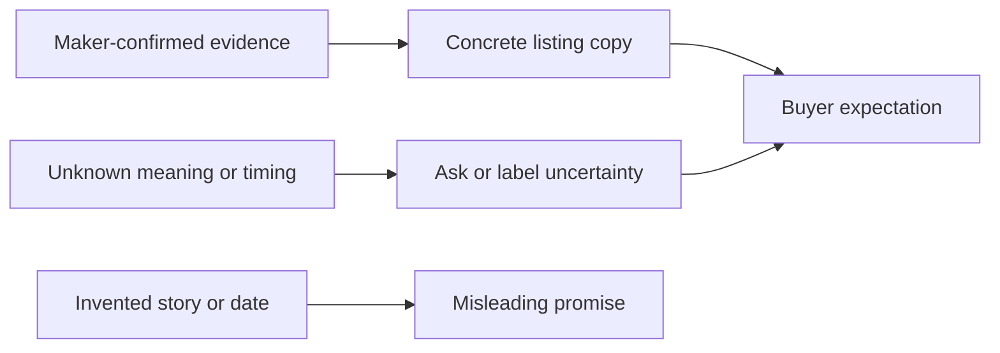

# Writing about craft with respect and accuracy

A marketplace can harm trust without a code bug. A listing that invents a motif's history, hides the maker's chosen name or promises delivery on a date the Workshop cannot guarantee may mislead a buyer. Ghurza uses four writing rules: credit the maker according to their choice, state materials and technique concretely, do not invent cultural meaning or origin, and use lead-time and transit ranges rather than a certain arrival date. These rules apply to UI labels, seed descriptions, image alt text and support messages.

The diagram separates evidence from uncertainty. Unknown does not mean the item is uninteresting; it means the app should not fill a gap with a confident claim. A Workshop may know that a piece uses cotton thread and hand stitching but not want to publish a personal family story. The listing can still explain size, materials, care and photographs. If the Workshop gives an approved explanation of a motif, attribute it rather than presenting the platform as the authority on that maker's meaning.

<TraceRequest title="Revise one product description">
  <TraceStep actor="Draft copy" label="Ancient pattern, arrives next Friday" detail="Neither origin nor date has evidence" />
  <TraceStep actor="Workshop" label="Confirm maker, material and technique" detail="Choose public credit and precise object facts" />
  <TraceStep actor="Editor" label="Publish honest copy" detail="Name verified facts and a range, not a guarantee" />
</TraceRequest>

## Credit as a choice

The Workshop may have a record for Huda as an Artisan, but Huda can choose a public name, pseudonym or no name. The product page should follow that choice. A hidden legal name in API JSON still violates the choice even if React renders "Workshop maker." Inspect the raw response. If the display preference changes, current public pages should follow it under the product policy. An OrderLine can preserve sale facts, but any name-removal request needs an explicit privacy process instead of an accidental conflict between old and new fields.

Credit should identify who made a Piece, not imply that the person manages orders or receives direct payment from the buyer. A caption such as "Made by Huda for Bayt al Zayt" may make the two roles clearer than one generic "seller" label. Ask the Workshop to approve this wording. Do not create a biography from a social profile or a photo caption that the maker did not authorize. The data model will support a short approved bio, but the default should be minimal rather than invented.

## Materials and technique as useful facts

A buyer may need to know whether a cushion uses cotton or wool and whether a ceramic cup is hand wash only. State what the Workshop confirms, and keep uncertain claims out of the product page. A craftDetails field can store vetted details, but a free-form object should not become a place to assert unreviewed food-safety or origin claims. A listing should say what the object is, how it was made in terms the maker accepts, its approximate dimensions, and how to care for it.

Try rewriting "premium handmade bowl" into a specific description using only visible and confirmed facts. Name olive wood, approximate diameter, finish and care if the Workshop has confirmed them. Do not claim that every bowl from that Workshop is identical. If the exact Piece has a visible knot or asymmetry, a photo and honest note may help the buyer more than a generic quality adjective. This is not about making copy dull; precise information is often more compelling than a vague claim.

## Lead time without a promise you cannot keep

Ready-made Pieces have handling and transit ranges. A custom Commission adds a production range after a Quote is accepted. A buyer's wished date is not a delivery commitment. Show dates as ranges with a clear point of origin, such as "usually ready to ship in 5 to 8 days after balance payment" only when the Workshop has supplied and can support that estimate. Do not transform that range into an exact arrival date by adding a constant in code. Customs, carrier delays and production changes are outside the platform's control.

A Quote can include expiry and lead-time range; later progress updates can revise expectations with an explanation. The app should preserve the accepted terms and show any change clearly. A vague "soon" is not useful, but a false Friday promise is worse. Test the UI with a buyer in a destination the Workshop does not serve. It should say shipping is unavailable before payment rather than display a date range for a route that does not exist.

## Practice a review before publishing

Take a draft description with an unverified historical claim, an anonymous maker, missing care, and an exact delivery date. Rewrite it in the learning log with approved credit or neutral Workshop maker text, confirmed material and technique, care, and a range or explicit unknown. Note what question you would ask the Workshop before filling each missing fact. A peer should be able to tell which words came from evidence and which are a pending question.

The next chapter limits the build to features the course can actually validate. Keep these writing rules active throughout the project; they apply to request forms, quote screens, shipping status and the final demo, not only to the first product card.

## Edit one description in stages

Start with this draft: "An ancient tatreez design made by local women, guaranteed to arrive next Friday." Ask the Workshop which maker should be credited, what the material and stitch technique are, whether the maker wants the motif's context published, and what handling range the Workshop can support. Until those answers arrive, do not replace uncertainty with a guessed story. A revised interim description can say "Hand-stitched cushion, cotton fabric and thread; maker credit pending approval; dispatch estimate available after Workshop confirmation." It may be less dramatic, but every claim has a source or is clearly pending.

Once the maker approves a display name and a description, the copy can become more specific. Include dimensions as approximate when the Piece varies by hand, care instructions confirmed by the Workshop, and photographs of the exact object. If the motif has a meaning the maker chooses to share, attribute the explanation. Do not use a platform-authored sentence that implies all makers or every example of that motif share one story. A peer review can ask which word came from the maker and which came from the product team.

## Test a false date in a real flow

A ready-made Piece may need handling time before dispatch; a custom request may need production, approval and balance before shipping even begins. If the UI uses one generic "delivery date" field, the buyer may read a wished date as a promise. Create a timeline in the learning log: request submitted, quote offered, deposit verified, production update, approval, balance verified, dispatched. Mark where a Workshop can reasonably state a range and where the buyer merely states a preference. This timeline will guide Quote and ShippingProfile models later.

For an international destination, a Workshop may pause shipping or exclude the route entirely. A buyer in that country should see an unavailable message before payment. Do not show a confident transit range for a destination the Workshop does not serve. A delivery range has to be tied to a served zone and an accepted order, and even then it is an estimate. This is both copy accuracy and server validation: the UI message and checkout decision must agree.

## Review image descriptions too

Alt text should describe the visible Piece and relevant detail, such as "blue stitching along the cushion edge" or "small knot in the bowl grain." It should not invent a maker's identity or a motif's meaning from the image. A close-up of a defect needs a caption that helps a buyer understand what they are buying. Ordered photos and captions are part of the product record, not decorative files added after the sale logic. A buyer may rely on them when accepting a one-off Piece.

End by marking one sentence you chose not to publish and why. A rule is easier to remember when it changes a real example. The following scope chapter identifies which product features can enforce these promises during the course and which would need later business processes.
