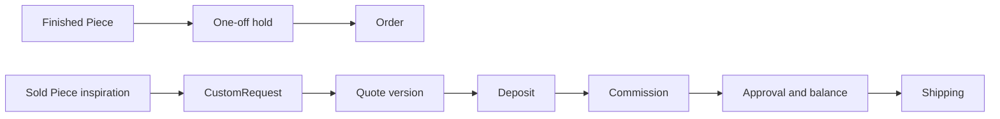

# Scope

Ghurza has two core journeys. A buyer chooses an exact finished Piece from a Workshop, pays in test mode and follows a simple packed, shipped and received status. Another buyer asks a Workshop to make something new, reviews a versioned Quote, pays a deposit, sees production progress, approves the work and pays a separate balance before shipping. The second journey is the hero feature because it carries uncertainty across weeks and two parties. The first teaches sold-once inventory, multi-Workshop checkout and honest shipping ranges.

The two paths meet in shipping, but they should not share a fake quantity field or a single payment state. A finished Piece exists before payment. A custom Piece may not exist until production is far along, and it uses deposit and balance events under an accepted Quote. The course's models and gates must let a reviewer see which path a buyer is on at every step.

## What the core includes

Build Workshop ownership, Artisan credit, one-off Piece status and hold, craft-specific fields, safe photo handling, served shipping regions and ranges, a Cart without quantity, server-priced Checkout, verified test-mode payment, per-Workshop Orders and status tracking. For commissions, build private CustomRequests and reference photos, a two-party thread, versioned Quotes, deposit verification, production updates, buyer approval, separate balance payment, shipping and stage-based cancellation. Add Redis-backed jobs for expiry and reminders, search and caching that never decide final availability, and a deployed HTTPS demo.

Every core feature needs its denial or stale case. Another Workshop cannot edit a Piece. Another Buyer cannot read a request. Two checkouts cannot both hold one bowl. A stale quote version cannot be accepted. A duplicated webhook cannot take a second deposit. A late successful payment after a hold expires needs a documented refund or reconciliation path. A course that shows only the happy flow does not prove the product's hardest constraint.

## What stays outside the core

The project uses test-mode payments only. It does not send real payouts to Artisans or Workshops. It does not integrate with a carrier API to buy labels or receive live tracking scans; the Workshop can enter a carrier name and tracking reference. It does not promise customs clearance, exact international delivery dates or automated tax advice. It does not verify every cultural statement a Workshop might publish. A real launch would require business, legal and operational decisions beyond the course. Naming these limits early prevents a demo from making a claim the system cannot support.

Do not carry grocery quantity or perishability through the variant because a shared lesson happens to mention it. A one-off Piece has status, and a commission has stages and versions. Do not replace the custom path with a generic "pre-order" button; that would lose scope negotiation, deposit, approval and balance. Do not add a public maker chat that exposes a buyer's budget or photos. The buyer expects the request to be private to the addressed Workshop.

## Week-by-week demonstration

Week one establishes both apps, the database, fictional Workshops, six Artisan credits, twelve Pieces and the ERD. Week two makes seller and buyer screens useful: one-off listings, photographs, shipping profiles, browse and Cart warnings. Week three proves a finished Piece sells exactly once under concurrent checkout and a verified test payment, then tracks a simple Order. Week four builds and defends the private commission flow, jobs, cache, deployment and capstone. The exact roadmap gives module-level timing; this chapter gives the product story that each demo should show.

The capstone should include an exact Piece bought from one of two Workshops, a sold Piece that inspires a new request, a stale Quote conflict, a verified deposit, production evidence, approval, balance and shipping. It should also include a denied wrong-buyer request and a one-off hold race. These are different demonstrations. A polished commission screen does not prove no double sale, and a green payment receipt does not prove request privacy.

## Write an honest product promise

In the learning log, write one sentence about what a buyer can purchase immediately and one about what they can only request. Add one sentence about lead times and one about the maker's chosen public credit. Cross out any word that implies guaranteed arrival or an unlimited copy of a one-off Piece. Then name two attractive features outside the course, such as real carrier integration or automatic Artisan payout, and explain why the demo does not claim them.

The next chapter checks prerequisites and the four-week route. Keep this scope note nearby when adapting shared lessons. If an inherited page asks for a grocery unit or prints a courier promise, the product contract here gives a reason to replace it instead of changing only a label.

## Compare the two payment stories

A buyer pays once for a finished Piece that the Workshop has already made. A commission starts with a request, then a Quote that can be revised. After accepting the current Quote, the buyer pays a deposit. The Workshop produces the piece and posts evidence. The buyer approves and pays a balance. These are not two UI variations of one Cart line. The money is attached to different stages and different facts. A finished Piece's price exists at listing time; a commission's accepted price exists only after negotiation.

If a customer cancels before work starts, the refund policy may differ from a cancellation after materials have been purchased or production is nearly complete. A stage-based rule needs durable timestamps, accepted terms and verified payments. This course can model and test a defined policy in Stripe test mode, but it cannot decide every real-world dispute automatically. Show the policy in plain language before the buyer pays. A hidden conditional in server code is not enough for a fair marketplace.

## Name the boundaries the system can enforce

The API can deny an unauthorized request, hold one Piece atomically, reject an expired quote, verify a payment event and create a refund under a defined test policy. It cannot guarantee a carrier's arrival date, authenticate every historical claim about a craft, or ensure a maker receives a real-world payout outside the platform's test mode. Separate these in a product scope table in the learning log. The boundary helps you make honest UI copy and prevents a capstone defense from claiming more than the code and evidence show.

There is also a privacy boundary. Buyer reference photos and budget are visible to the buyer and addressed Workshop, not every Artisan in a public catalogue. Progress photos may be visible to the two parties to a Commission but not to visitors. A public sold Piece page can show approved portfolio images and invite a request without exposing the private conversation that follows. These decisions need API field projection and storage policy, not only a hidden tab.

## Pick a narrow core demo

For the first complete demo, use fictional Workshops and one exact Piece. Have two Buyers race for it and show one conflict. Then show a separate request for similar work, one stale Quote rejection, a test deposit, one progress update, approval, balance and shipping state. This single coherent story teaches more than five unrelated features that each work only in isolation. Keep a second Workshop in the seed for ownership denial and a multi-Workshop Cart test.

A stretch feature such as automated carrier scans can be valuable later, but it should not replace the missing hold race or quote-version check. The scope is ordered around trust: who owns the piece, which buyer paid, what terms were accepted and what stage the work reached. The next chapter maps these promises to the four-week learning path and entry skills.
