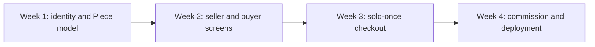

# Prerequisites and course outline

You should arrive with JavaScript functions and asynchronous calls, basic HTTP request and response knowledge, one small CRUD application, Git commits and basic MongoDB queries. You do not need to know tatreez or ceramics history; the course asks you to verify craft descriptions with makers and instructors rather than invent them. You do not need Stripe or BullMQ experience before their modules. The first week's database work will make their later relationships easier to understand.

At the end of Week 1, the API and client communicate, authentication works, and a seed shows three fictional Workshops, six Artisans, twelve Pieces and one private request. The ERD must distinguish Workshop ownership from Artisan credit and existing Piece from future commission. At the end of Week 2, a buyer can browse exact Pieces, see maker credit and shipping constraints, and hold intent in a Cart without quantity. At the end of Week 3, two buyers race for one Piece and only one can proceed, with a verified test payment and per-Workshop Orders. Week 4 completes the custom request, Quote, deposit, production, balance, shipping and live demo.

## A short entry check

Read this route idea: a client sends a Piece ID, the server loads it, and a Workshop owner edits its price. Which ID must come from authentication, and which stored relationship must the query check? The URL Piece ID alone is not enough. Write the predicate in words or pseudocode. Then write a MongoDB query that finds available Pieces for one Workshop. A learner who can express both filters is ready for the first data and authorization exercises. If not, practice a small CRUD route with two owner accounts before proceeding.

Next, explain what a Git commit does when the network is unavailable. Create a tiny local commit if needed. A power cut after a passing Piece model test should not erase your reasoning or leave an unexplained half-edit. Finally, calculate a 3,500-minor-unit Piece plus a 600-minor-unit shipping amount. State the integer total and why the server, not the browser, must decide it before payment. These are entry skills, not craft knowledge.

If two or more parts of the check are weak, use the repair exercises from the general course skeleton or ask an instructor for a short review before Module 2. If one is weak, work through that repair alongside the skeleton and record it in the learning log. Do not guess through the route ownership question; it becomes a private-request access risk later. Keep the original answer and your repaired version so you can see the change.

## Decide which week owns which problem

A Piece `status` and hold shape appear in the Week 1 model, but the concurrent claim route belongs in Week 3 checkout. A CustomRequest skeleton appears in Week 1, but private messaging, quote acceptance and payment belong in Week 4. This staging lets the model support the later work without pretending it is already finished. A seed containing a sold Piece is not evidence of a verified payment, and a Quote document is not proof that a stale version cannot be accepted. Label fixtures and demos accordingly.

The course also carries shared engineering skills: JWT authentication, role and ownership checks, server-owned totals, image storage, search, caching, jobs, tests and deployment. They are taught through Ghurza's objects. A shared chapter whose example still talks about shelf stock needs review before it can be used for this path. Treat the roadmap as the source of product decisions and the gate evidence as the source of readiness, not the presence of a file in the repository.

## Prepare the first demo

Write a five-minute Week 1 demo plan. Show the API health, the two account roles, one Workshop with two Artisans, a public available Piece, a sold Piece page and a private request that another buyer cannot read. Open the ERD and explain which arrow grants edit permission and which arrow grants maker credit. This is enough to prove the foundation without showing a full checkout or commission timeline early.

Save the entry check and demo plan locally. The final introduction chapter turns them into a working rhythm, including a recovery note for the next time power or connectivity interrupts a build. Module 2 then creates the project skeleton needed to run the plan.

## Route a learner after the entry check

If you can explain the owner filter but not write the Mongoose syntax, practice one query in a disposable collection and compare it with a working example. If you can write a route but rely on a client-sent owner ID, practice an authenticated request where the server derives User ID. If Git is unfamiliar, make a local commit before starting the skeleton. If minor-unit arithmetic is weak, write a small pure function for Piece price plus shipping and test it with two Workshops. These are targeted repairs, not a judgement on your ability to finish the course.

An instructor can review your short route sketch, query filter and total calculation in minutes. Ask them which value the browser can change. If you named Piece ID from the URL and owner ID from the session, you have the critical distinction. If you named an Artisan display name as the owner, revise the model. The first week's ERD will use this exact skill when separating Workshop authority from maker credit.

## Prepare a week-three race fixture early

The Week 1 seed should include at least one available one-off Piece and two Buyer accounts. You will not implement the hold until later, but these records allow a future concurrent test without inventing data under deadline. Give that Piece a realistic price, status and Workshop ID. Add a sold Piece as a contrast; its page may stay visible while its purchase action fails. The seed is a teaching tool when every row has a later test purpose.

For the commission path, the seed can include one open CustomRequest addressed to a Workshop. It should not include a fake paid Commission unless clearly marked as a fixture, because the deposit verification is a Week 4 behavior. This prevents a demo from implying a stage has passed when only a database row exists. Keep the request brief fictional and any reference image private or omitted until storage is configured.

## Carry the roadmap into a daily plan

Break a ten-hour workday into small coding and review blocks if that suits your circumstances. A useful cycle is to read the next chapter, implement one relationship, run a narrow test, commit locally, and write the next action. Power and internet may interrupt a long uninterrupted task, so make each block leave evidence. A week-end demo does not need every edge polished, but its stated gate must pass before the next week relies on it.

Use the outline to tell a peer what is not built yet. At the end of Week 1, you can show a Piece schema and private request fixture but should not claim a complete commission. At the end of Week 3, you can prove sold-once checkout but not yet the deposit and balance lifecycle. This honesty is part of readiness: every demo target has a specific scope and failure proof.

Keep the first demo plan on one page. If a step needs an external service that is unavailable on demo day, show the local test and explain the missing integration honestly. Do not replace a failed provider connection with a manually edited paid status and call it a verified sale. A careful learner can still present the model, ownership denial and seed evidence while recording the integration as unfinished. The roadmap's gates tell you which claim remains open and which work can continue independently.
