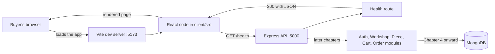

# 2.1: Set the scene

> **[Read]** · Chapter 02, Project skeleton · *What "standing the project on disk" means*

You cleared the introduction checklist. You know what you are building, how the course gates progress and what is in scope. **Nothing in your Ghurza repository exists yet**, or it should not, if you are starting clean.

<BigWordAlert term="Monorepo layout" plainEnglish="One Git repository that holds both the client app and the server app, usually in separate top-level folders." whyItMatters="Ghurza keeps `client/` and `server/` side by side so you can run and deploy them together while keeping concerns separate." />

This chapter is where that changes.

<ArticleBreak title="Before you write feature code: how Ghurza is wired" subtitle="A five-minute map of client, server, and the first request" readMinutes={6}>

Ghurza runs as two applications: a Vite + React client and an Express + Node server. The client never talks to MongoDB directly. It calls HTTP routes on the server, and the server owns all data access, including which Workshop owns a Piece and which buyer holds a Cart.

The job of this skeleton chapter is narrow: prove the wiring holds before any feature asks it to carry weight. The moment your home page renders a health response, four separate facts are confirmed together. The API is bound to a port, the React app knows which URL to call, CORS permits that call from the browser origin, and JSON survives the round trip in both directions.

Every later chapter plugs into this same pattern. Auth adds protected routes. The collection adds public read routes for Pieces. Checkout adds a hold on a single Piece, then payment of a deposit and a balance for a Commission. The skeleton is boring on purpose. Boring infrastructure is what lets exciting features ship safely.

</ArticleBreak>

<LearningObjectives objectives={["Explain how the React client talks to the Express API.", "Create a clear folder layout for client, server, and shared code.", "Run both apps and prove the health check works."]} />

## Bridge from last chapter

Chapter 1 was about **clarity before code**. You named your product, read what Ghurza is for, checked prerequisites and learned how this course gates progress: finish one chapter's checklist before opening the next. You should have completed the Chapter 1 gate and learning log on the platform. None of that required a running app. It required you to understand *what* you are building and *how* the course expects you to work.

What carries forward is your product name, your learning log habit and the discipline of not skipping gates. What does **not** carry forward yet is any folder structure in a repository you own. The introduction told you the story. This chapter makes the story **physical on disk**.

The hat you wear now is **builder of the skeleton**. You are not designing the Piece schema, wiring login or styling a collection page. You are answering the boring questions every professional team answers on day one: where does the API live, where does the React app live, and how do we know both halves are alive? When Chapter 4 adds MongoDB, it slots into folders you already understand. When Chapter 7 adds login pages, they land in `client/src/pages/` that you create here. This chapter is the floor everything else stands on.

<RealWorldEvent title="Shopify's modular commerce platform" when="2006-present" summary="Shopify grew from a single-product store builder into a platform with separate admin, storefront, and API surfaces, all coordinated through clear project boundaries." lesson="Starting with a deliberate folder skeleton prevents painful renames later, when Workshop, Cart and payment code all need room to grow." />

## In plain English

| Term | Meaning |
|---|---|
| **Skeleton** | The empty but runnable shape of the app: folders, entry files and a health check, before real features |
| **Monorepo** | One Git repository containing both `server/` and `client/` as separate apps |
| **Module folder** | A directory grouped by product area (auth, cart, orders), not by technical type (all controllers together) |
| **Health check** | A simple API route that answers "is the server up?", your first proof the backend works |
| **Full-stack** | Browser UI (client) talking to a Node API (server) over HTTP |
| **Scaffold** | Create folders and stub files so later chapters have named places to add code |
| **Gate / checklist** | Tickable outcomes at chapter end: you do not proceed until each box is checked |

## Think of it like

**Building a market hall before the stalls open.** You pour the foundation, erect the frame, run electricity and plumbing, and hang a sign that says "we are open", even though no maker has hung a single Piece yet. The health check is that sign: it proves power and structure work. Later chapters are individual stallholders moving in, with one Workshop taking the corner stall, a second Workshop taking the row beside it, and buyers walking the aisles once the collection page exists. If you skip the hall and start with one embroidered cushion on a folding table in a field, every next delivery has nowhere to plug in.

<MustRead
  title="Introduction to client-side JavaScript frameworks"
  url="https://developer.mozilla.org/en-US/docs/Learn_web_development/Core/Frameworks_libraries/Introduction"
  source="MDN"
  description="Short MDN primer on why frameworks like React exist and what problems they solve. Helps you understand why the client is a separate app from Express."
  readMinutes={12}
/>

## The wiring you are about to build

Before you type a command, it helps to hold the whole chapter in one picture. Ghurza has two applications and one request path between them. The diagram below is Chapter 2 in miniature: a browser, a Vite development server, an Express API, and a single health route that proves the two halves can talk to each other.

**Takeaway:** read the diagram from left to right and notice that only the middle boxes exist by the end of this chapter. The browser, the Vite server, the Express API and one health route are the whole deliverable. Everything to the right of the API, which is auth, Workshop and Piece routes, cart, orders and finally MongoDB, is future work that plugs into the same arrow. If you can point at each box and name the folder it will live in, you have understood the chapter. If the arrow from the browser to the API still feels like magic, do not worry: sub-chapter 2.15 makes that arrow explicit by fetching the health route from React and printing the answer on the page.

## Common questions

**Q: Why not start with MongoDB or login, the interesting parts?**  
A: Because those features need *somewhere to live*. Without `server/src/modules/` and a running Express app, every later chapter would say "add this somewhere" and you would paste into random files you do not understand. Think of it as building the market hall before the stalls open: you pour the foundation, run the wiring and hang a "we are open" sign before any Workshop stocks a shelf. Get the skeleton right once, and every later feature slots into a folder you already know.

**Q: Do I build inside the course folder (`multi-vendor-marketplace/`)?**  
A: No. That folder is the textbook, and the course content lives there. Your app is a **separate Git repository** you create in sub-chapter 2.8, somewhere like `~/projects/ghurza/`. If you build inside the course folder, your app and the course materials get tangled, commits mix together, and instructions that say "create a file in your project root" become ambiguous. Keep the book on the shelf and your workspace separate. That is what real teams do too.

**Q: I have never used Express or Vite. Is this chapter too early?**  
A: Not too early. This chapter introduces them **one small step at a time**. You will install packages, create entry files and verify with curl and the browser, so each concept appears the moment you need it. Unfamiliar errors will happen and that is fine. Use the working rhythm from Chapter 1: read the message, search the docs, fix the smallest failing piece. By the end you will not be an Express expert. You will simply know enough to run a server and a client, which is precisely what the next chapter needs.

**Q: Why two terminals, can one command run everything?**  
A: Because the client and server are **two separate programs** during development, and two terminals make it obvious which half broke. You run `npm run dev` in `server/` to start the API on port 5000, and `npm run dev` in `client/` to start the React app on port 5173. When something fails, the terminal that shows the error tells you exactly where to look, and "client works, API is down" is a sentence you will say often. Running both from one command is possible later, but it hides the architecture you are here to learn.

**Q: What if I already have a MERN starter template?**  
A: Unless it matches this course's **module-based** layout under `server/src/modules/`, it will fight you. Every chapter names an exact path, for example `modules/pieces/piece.routes.js` in the Piece module, and if your repository has no `modules/` folder you will translate every instruction for twenty chapters or diverge from the guide. Scaffolding fresh here takes an afternoon. Un-teaching a random boilerplate takes weeks. If you love your template, adapt it to the target tree in 2.3. Otherwise start clean and stay aligned.

**Q: What does the health check actually prove?**  
A: The health check, `GET /health` returning `{ "status": "ok" }`, proves the wiring between Express and the browser works before you add anything complicated. When your React home page fetches that endpoint and displays the result, you have confirmed that the server boots and listens, the client renders, HTTP works across the two, and your folder conventions hold real files. It is the smallest possible proof that the full-stack loop is alive. Skip it and you would debug connection problems later with database and auth code mixed in, which is much harder.

## Where you are

| You have | You do not have yet |
|---|---|
| A name for your product | A Git repository with code |
| The course outline in your head | `server/` or `client/` folders |
| Chapter 1 gate cleared on the platform | A running API or React app |
| Prerequisites checked (Node, Git, editor) | MongoDB connected, which is Chapter 4 |

Chapter 1 was **mindset and product**. Chapter 2 is **the skeleton**: the physical shape of the application on disk, before databases, auth or Piece routes.

## What "standing the project on disk" means

Professional teams do not start by writing a login handler. They start by answering boring questions. Where does the API code live? Where does the React code live? How do we start each app with one command? How do we know both halves are alive?

**Standing the project on disk** means that at the end of this chapter you can open your repository in an editor, see a **folder tree you understand**, run **two commands in two terminals**, and **demonstrate something real**: the React home page calling the API health check and showing the response.

No users. No Pieces. No MongoDB. Still a **working full-stack skeleton**, and every future chapter attaches to it like scaffolding on a building. The proof is deliberately small because small proofs are the ones you can repeat on demand in front of a mentor without hoping that several systems cooperate.

## Why this chapter comes before MongoDB

Chapter 4 connects MongoDB. Chapter 5 builds schemas. You might wonder why we do not start with the database.

Because the **app must exist before the app needs a database**. The health check in this chapter proves that Express boots and listens, React boots and renders, HTTP works between browser and server, and your folder conventions hold real files.

When Chapter 4 adds `MONGODB_URI`, it slots into `server/src/shared/`, a place you already created and understand. If you started with Mongoose before you had `app.js`, every chapter would say "add this somewhere" and you would paste into random files. **Order matters:** skeleton, then config and database, then data model, then features.

## What this chapter is not

This is **not** the auth chapter: no JWT, no passwords. It is **not** the data model: no User, Workshop or Piece schemas yet. It is **not** a UI design chapter, since one plain home page is enough. It is **not** deployment, so localhost is the whole world for now.

It **is** the chapter where you make the **one structural decision** the rest of the course assumes: **module-based folders** in `server/src/modules/`. Change that later and every subsequent chapter's file paths stop matching.

## The milestone you will feel

When this chapter gates clear, you will say:

> *"I built the project skeleton."*

That means one Git repository with `server/` and `client/`, a module-based server layout committed, `GET /health` returning `{ "status": "ok" }` or equivalent JSON, a React home page displaying that response, and the ability to draw the folder tree from memory.

That is the first demo brick of the course. The second brick is MongoDB plus seed data in Chapters 4 and 5. A mentor who asks "show me what works" should get a browser tab and a terminal, not an explanation.

## How this chapter is organized

You will move through the usual arc. The opening lessons (2.1 to 2.3) explain why structure matters and preview the tree. The learning lessons (2.4 to 2.6) compare layer and module layouts, separate client from server, and set the mandatory read. The build lessons (2.8 to 2.16) create the repository, the server folders, the health route, the client and the connection between them. The wrap lessons (2.17 to 2.19) offer optional practice, a recap and the gate.

Sub-chapter **2.7** is a short project-structure knowledge check. Use it to confirm the client and server boundary before the build begins.

Each **build** sub-chapter is one concrete action: create this folder, create this file, verify with this command. You write the logic. The course specifies behaviour and contracts.

## Continuity promise

Every build sub-chapter opens with **where the repository stands** after the previous step. You should never wonder what file to touch next. You should only wonder how to write the function, which is yours to figure out from the specification.

After 2.8 you will have a Git repository. After 2.11 the API will answer on a port. After 2.13 the client will render in the browser. After 2.15 the client will talk to the API. After 2.16 you will have your first screenshot for the portfolio.

## Before you continue

- [ ] Chapter 1 checklist cleared
- [ ] Node 18+ and Git verified (`node --version`, `git --version`)
- [ ] Empty directory chosen for your marketplace repository, outside the course content folder
- [ ] Editor ready, because you will create many files this chapter

**Estimated time:** one full work day at medium pace, faster if you have scaffolded MERN before, slower if Vite or Express are new. That is fine.

## Time and tooling expectations

| Sub-chapter range | Focus | Rough time |
|---|---|---|
| 2.1-2.7 | Understand structure and reads | 2-4 hours |
| 2.8-2.11 | Server repo and health API | 3-5 hours |
| 2.12-2.16 | Client and full-stack connect | 3-5 hours |
| 2.17-2.19 | Stretch, recap, gate | 1-2 hours |

If Express or Vite are new, expect the upper end. Not because the steps are complex but because unfamiliar tooling generates searchable errors. That is normal, and the working rhythm from Chapter 1 applies: read the error, check the docs, reduce to the smallest failing case.

## Two repositories, do not confuse them

You are reading course files in the **guides** repository or folder that contains the `multi-vendor-marketplace/` course content. You are **building** in a **separate Git repository** that you create in 2.8. Never commit your app into the course textbook folder unless your mentor explicitly uses a monorepo for both. The default is a **separate app repository**.

The distinction matters later, when you add a `learning-log/` entry about a deposit percentage or a shipping profile decision. That note belongs in your app repository, beside the code it explains, so a reviewer can read the decision and the implementation in one place.

## Key ideas

- Chapter 2 is **skeleton on disk**, not features
- The **server and client** both exist before MongoDB
- **Module folders** are decided here
- The end demo is a browser showing the API health response
- You build in a **separate app repository**, away from course materials

## Mentor checkpoint

Before sub-chapter 2.8, confirm that an empty directory is chosen, Node 18+ and Git are installed, and the Chapter 1 learning log is written. Missing any of these is cheaper to fix now than after you have scaffolded the wrong folder.

Next: why folder structure is a real decision, not aesthetics.
