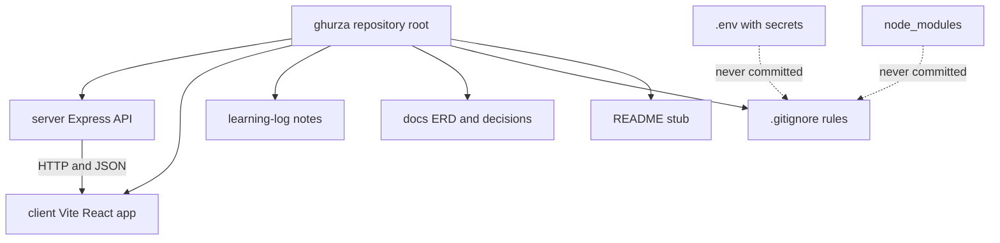

# 2.8: Create the repo

> **[Build]** · Chapter 02, Project skeleton · *Init git; root `.gitignore`; `README.md` stub*

**Why this step matters:** Everything you build for Ghurza lives in a repository you own, not in the course guides folder. This step creates that root with Git, ignore rules and a learning log, so every later sub-chapter has a committed home and secrets stay out of history from day one.

<BigWordAlert term="Git repository" plainEnglish="Version-controlled project folder where every change is tracked and reversible." whyItMatters="Ghurza lives in one repo from day one, and commits mark chapter milestones you can demo or roll back." />

**Where the project is now:** You have no application repository, only the course materials you have read. After this sub-chapter you will have a Git root with ignore rules and a place for the learning log.

**After this step:** You own a Git repository with a root `.gitignore` that keeps secrets out, a README stub and a `learning-log/` folder. Every later sub-chapter builds inside it.

## Why the repository is the first artefact

A repository is not a storage folder with extra steps. It is the record of how the project reached its current state, and that record is what a mentor, a collaborator or a future you will read when a Piece fails to publish or a deposit total looks wrong. If the first three weeks of work happen in a folder with no history, then the only evidence of progress is a screenshot, and a screenshot cannot tell anyone which change broke what.

Starting with Git also fixes a habit that is hard to learn later. Every commit becomes a checkpoint you can return to. When sub-chapter 2.11 adds a health route and the server stops booting, you can compare your working tree against the last commit instead of guessing what changed. When an experiment with CORS goes badly at 2.16, you can throw the experiment away without losing the server you already proved. Reversibility is the whole point of version control, and it costs nothing to have it from the first file.

There is a third reason, which is about honesty. A repository with small commits that follow the chapter order is a readable account of your work. A single commit named "final project" at the end of the course is not. Reviewers who assess Ghurza projects look at the log to see whether the learner built the skeleton before the features or pasted a finished application in one afternoon.

## One repository, two applications

Ghurza is a monorepo, which means one Git repository holds both `server/` and `client/` as separate top-level folders. Each folder is a separate Node package with its own `package.json`, its own dependencies and its own start command. They are separate programs that happen to live in one history.

Two repositories would also work, but they make the common case harder. A change that adds a field to a Piece model and reads it in a React page would need two commits in two places, and one of them could be forgotten. With a monorepo, that change is one commit, one diff and one revert. The cost is that both applications share a root, so ignore rules and tooling must be arranged once, carefully, which is exactly what this sub-chapter does.

The layout you create now is deliberately flat. There is no `packages/` folder and no workspace tooling, because the course does not need them and they hide the two-process architecture you are learning. Later chapters will add `server/` and `client/` and nothing else at the root except documentation and notes.



**Takeaway:** the diagram shows one root with two runnable halves and three supporting folders. The two dotted arrows matter more than the solid ones. Secrets and dependencies are the two things that must never enter history, and the ignore file is the only mechanism that keeps them out. Read the rest of this lesson as the work of drawing those two dotted arrows first, before any code exists to protect.

## The ignore file is a security boundary

A `.gitignore` file lists paths Git should never stage. Most of those paths are noise, such as `node_modules/`, which can be reinstalled from `package.json` and would otherwise add tens of thousands of files to the repository. Two of them are not noise at all: `.env` and its variants. Those files hold credentials, and the moment one is committed, it is in history, in every clone and in every backup, even if you delete the file in the next commit.

For Ghurza the credential list will grow quickly. Chapter 4 adds `MONGODB_URI` with a database user and password. Chapter 6 adds `JWT_SECRET`. The payment module adds provider keys. A leaked database string is not a minor embarrassment: anyone who reads it can drop the seed data, and if the cluster is reachable, they can read buyer records. A leaked token secret is worse, because it lets an attacker mint an access token for any account, including a Workshop owner.

The rule that follows is simple to state and easy to break: the ignore file exists before the first secret exists. Create `.gitignore` in step 3, before `server/.env` in Chapter 4, so the protection is already in place when the first real credential appears. A learner who writes the ignore file after the first `.env` is one careless `git add .` away from rewriting history.

Ignoring a file is not the same as proving it is ignored. Git has a specific command for that proof, `git check-ignore -v <path>`, which prints the rule that matched. The verification section below uses it, and you should run it yourself once. It turns a hopeful assumption into a fact you can show.

## Commands, one at a time

The commands in this lesson are short, and that is why they are easy to run without understanding. Each one below is explained before you type it, so the sequence makes sense as a whole rather than as seven separate rituals.

The first decision is where the repository lives. It must be a directory you created for the application, outside the course guides folder. The folder name is your product name, and for this course the running example is Ghurza, so `ghurza` is a sensible choice. If you named your marketplace something else in Chapter 1, use that name instead and keep it for the rest of the course. Consistency here pays off later, when the README and the deployed domain should agree.

### Step 1: Create the project directory

```bash
mkdir ghurza
cd ghurza
```

This directory is the **monorepo root**. `server/` and `client/` are created inside it in the next sub-chapters. Running `pwd` after `cd` is worth the extra second: it confirms you are in the new folder and not in the course content folder you were reading a minute ago.

### Step 2: Initialize Git

```bash
git init
```

`git init` creates a hidden `.git` directory that holds the object database and the configuration for this repository. Nothing is tracked yet, and no commit exists. Use the default branch name your Git version provides, `main` where available. The branch name has no effect on this course, but write it in your learning log so you notice if it differs from the tutorials you read.

### Step 3: Root `.gitignore`

Create `.gitignore` at the **repository root** with at least:

```gitignore
# Dependencies, reinstall from package.json
node_modules/

# Environment files, secrets never in Git
.env
.env.local
.env.*.local

# Logs
npm-debug.log*
*.log

# OS / editor
.DS_Store
Thumbs.db
.idea/
.vscode/*
!.vscode/extensions.json

# Build output
dist/
build/

# Optional: coverage
coverage/
```

**✅ Do:** Verify the ignore works *before* the first commit:

```bash
touch .env
git status    # .env must NOT appear as untracked
git check-ignore -v .env    # prints the rule that ignores it
rm .env       # you will recreate server/.env in Chapter 4
```

**❌ Don't:** run `git add -f .env` "just once", ever. The force flag is how secrets enter history.

The order inside this step is the point. You create a disposable empty `.env`, ask Git what it thinks of it, and delete it again. An empty file leaks nothing, and the exercise proves the rule before a real password is anywhere near the repository.

### Step 4: Stub `README.md`

Create a minimal root README you will expand through the course:

```markdown
# Ghurza

Multi-vendor handmade marketplace, MERN stack.

## Structure

The repo is split into two top-level folders, one per process, each with its own dependencies, config and lifecycle:

- `server/` holds the Express API
- `client/` holds the React (Vite) frontend

## Run locally

Both apps run in separate terminals:

API: `cd server && npm install && npm run dev`

Client: `cd client && npm install && npm run dev`

## Author

Your name, course project
```

Replace **Ghurza** with your product name if you chose a different one. The README is a deliverable in its own right, because it is the first file a reviewer opens. Two copyable run commands at the root save that reviewer from reading six sub-chapters to learn how to start the app.

### Step 5: Learning log folder

```bash
mkdir -p learning-log
touch learning-log/.gitkeep
```

Git does not store empty folders, so the placeholder file is what makes `learning-log/` appear in a clone. The learning log is where you keep decisions that are too long for a commit message and too important to lose. Ghurza will generate several: why a Piece can only be sold once, what deposit percentage you chose for a Commission, when the balance is charged, and how a shipping profile states which countries a Workshop serves. A dated note beside the code is easier to defend in a mentor review than a memory of a decision made three weeks ago.

### Step 6: Optional `docs/` placeholder

```bash
mkdir -p docs
```

Empty is fine. Chapter 3 adds the ERD draft, Chapter 5 finalises it with Workshop, Artisan credit, Piece, CustomRequest, Quote and Commission, and Chapter 8 adds the authorization matrix.

### Step 7: First commit

```bash
git add .
git status    # review: no .env, no node_modules
git commit -m "chore: initialize repository with gitignore and learning log"
```

Read the `git status` output before you commit, every time. It is the last checkpoint between a mistake and permanent history, and it costs one glance.

## Failure modes to expect

The most common failure is running `git init` in the wrong directory. If `git status` lists thousands of untracked files, you have initialized Git in your home directory or in a parent folder that holds every project you own. The fix is to delete the accidental `.git` directory from that wrong location and run `git init` again inside `ghurza/`. Do this immediately. A repository rooted three levels too high is painful to unpick later.

The second failure is committing a secret. It usually happens because the `.env` file was created before the `.gitignore`, or because a tool generated one during a test. If the file is staged but not committed, `git rm --cached .env` removes it from the index and leaves the file on disk. If it is already committed, the credential must be treated as compromised: rotate the password or the secret first, then decide whether the history needs rewriting. Rotation is the part learners skip, and it is the only part that actually protects the database.

The third failure is a nested repository. If `git init` is run inside `client/` as well as at the root, the root repository sees a folder that contains another repository and cannot track its files. The symptom is a `client/` entry in `git status` with no contents beside it. The fix is to delete `client/.git` so the root owns everything, which is the monorepo shape this course assumes.

A quieter failure is ignoring too much. A pattern like `*.local` or a broad `dist/` rule can hide a file the course expects you to commit, such as a `.env.example` template. When a later lesson says "commit the example file" and `git status` shows nothing, run `git check-ignore -v` on the path to see which rule is responsible, then add a negation line such as `!.env.example`.

## Verification a reviewer can read

Verification for this step is not "it looked fine". Each check below leaves output a reviewer can see, and each one tests a promise rather than a command that ran without an error.

| Check | Expected |
|---|---|
| `git log --oneline` | exactly one commit |
| `git status --short` | empty output |
| `git check-ignore -v .env` | a matching ignore rule |
| `git log --all -- "**/.env"` | empty output |
| `git ls-files` | README, `.gitignore` and learning log only |

The fourth row is the one that matters most in review. It asks Git for every commit that ever touched an environment file, on every branch. Empty output is the evidence that no secret has ever been committed, and it is a stronger statement than "I do not think I committed one". The fifth row shows how small the repository is at this point, which is exactly right: a first commit should contain a README, an ignore file and a notes folder held open by one placeholder file.

```openquestion
prompt: Paste the GitHub repository URL for your Ghurza project and briefly confirm that the first commit is pushed and no secrets are tracked.
submissionMode: url_required
allowUrl: true
urlRequired: true
urlLabel: Ghurza repository
urlHint: Paste a public or mentor-accessible GitHub repository URL. If it is private, give your mentor access before submitting.
minWords: 0
required: true
```

## ✅ Do / ❌ Don't

**✅ Do:** Commit after each major sub-chapter through Chapter 2, at 2.11, 2.15 and 2.16. Small commits with clear messages make the log readable and every mistake reversible.

**❌ Don't:** Clone someone else's marketplace repository and erase their code. Start empty, because the course builds the structure with you and a borrowed history hides which parts you understand.

**❌ Don't:** Put `server/` or `client/` outside this repository root. One product, one history, one place to look when something breaks.

## Hint

If `git status` shows thousands of files, you accidentally initialized Git in your home directory or a parent folder. Use `cd` to reach the intended project folder only, remove the mistaken `.git` if needed, and re-initialize **inside** `ghurza/`. If you are unsure which repository you are in, `git rev-parse --show-toplevel` prints the root that Git currently considers yours.

## What's next

**Sub-chapter 2.9:** Create the `server/` folder skeleton with `src/app.js`, `src/server.js`, `modules/` and `shared/`.

Continue when the first commit is done and the verification table above shows what it should.
