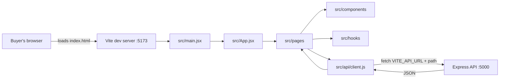

# 2.12: Scaffold client folders

> **[Build]** · Chapter 02, Project skeleton · *Vite React app in `client/` with `src/pages/`, `src/components/`, `src/api/`, `src/hooks/`*

**Why this step matters:** Ghurza is a product buyers see in a browser, not a headless API. Scaffolding Vite and React now establishes where login pages, collection screens, custom request forms and API helpers live for the rest of the course.

<BigWordAlert term="React SPA shell" plainEnglish="A single-page app with routing and layout components but minimal pages, which is the UI skeleton." whyItMatters="Ghurza's client starts as a shell, and the collection, cart, commission and Workshop pages plug into the same router later." />

**Where the project is now:** The server runs and `GET /health` returns 200 JSON via curl.

**After this step:** A Vite and React app exists in `client/` with `pages/`, `components/`, `api/` and `hooks/` folders, and it renders in the browser.

## What this application is for

The client is where a buyer meets Ghurza. A buyer arrives, reads a collection of Pieces made by different Workshops, opens one Piece to see the materials, dimensions and shipping profile, and later adds it to a cart. A maker arrives in the same application after signing in and sees a Workshop dashboard with drafts, questions and orders. Almost every screen in the course is a page in this one client application.

That range is why the folder layout matters more than it looks. A single-page application can grow into a pile of components with no obvious home, and the symptom appears late: two people add the same Piece card twice, an API call is duplicated in five components, and the login state is read from three different places. The four folders you create here are the smallest structure that prevents that outcome.

This step does not build a full interface. It builds the shape that later modules fill. The home page stays plain, the router arrives in 2.13 and the health fetch arrives in 2.15. What matters now is that every future file has a named place to land.

## Why the client is a separate application

The client is a separate Node package with its own `package.json` and its own development server. Vite compiles the React code, serves it over HTTP on port 5173 and reloads the browser when a file changes. None of that runs on the Express server, and none of the Express code runs in the browser.

There are two practical consequences. The first is that browser code cannot read a database, hold a secret or trust its own user input, so every Piece, hold and payment decision belongs to the API that runs on port 5000. The second is that the browser must be told where that API lives, which is why this step ends with a `VITE_API_URL` variable rather than a hardcoded address scattered through components.

Vite also builds the production bundle. `npm run build` compiles the app into static files in `dist/`, which any static host can serve. That is the artefact Chapter 23 deploys. The development server and the production build are two different modes of the same source, which is why the folder conventions must survive both.



**Takeaway:** follow the arrows and notice where the network boundary sits. Everything left of `src/api/client.js` is browser code that ships to the user. Everything right of the arrow is server code that the buyer never receives. The only file allowed to know the API address is the API helper, and the only files allowed to call it are pages and hooks. Keep that rule and you can change the server address, add a token header or handle a 401 in one place instead of twelve.

## The template choice

`npm create vite@latest client -- --template react` asks Vite to generate a React project in a new `client` folder. Choose the **JavaScript** variant, not TypeScript, to match the JavaScript stack used by the rest of the course. This is not a claim that TypeScript is worse. It is a decision to keep one language across client and server so a learner debugging a Piece response reads the same syntax in both places.

The scaffold writes `index.html`, `package.json`, `vite.config.js`, `src/main.jsx`, `src/App.jsx` and a starter stylesheet. Those files are a working application, not a placeholder. `main.jsx` mounts React into the `#root` element in `index.html`, and `App.jsx` is the top-level component. You will replace the contents of `App.jsx` in 2.13 when routing arrives, and you will not need to touch `index.html` again.

The generated project also includes `eslint.config.js` and example assets. Leave the lint configuration alone. Deleting starter assets is optional and has no effect on the gate, though most learners remove the logo and the counter demo because they make the first screenshot look like a tutorial rather than a product.

## The folder convention

Four folders sit under `src/`, and each answers a different question. `pages/` holds one component per route, so a URL maps to a file. `components/` holds reusable pieces of interface that do not own a route, such as a Piece card, a price row or a loading skeleton. `api/` holds the code that talks to Express, starting with a single `client.js` that knows the base URL. `hooks/` holds reusable state logic, and Chapter 7 adds the authentication hook there.

This is a layering by responsibility, not by feature, and that is deliberate on the client. A React page usually needs a small number of components and one or two hooks, and those pieces are shared across routes far more often than server modules are shared across domains. A Piece card appears on the collection page, the Workshop page and the cart, so it belongs in `components/`, not inside a feature folder where the second user would have to import across a boundary.

The mapping to later work is direct. `pages/` grows a collection page for browsing Pieces, a Piece detail page, a custom request form for a buyer to describe what they want made, a quote view, a commission tracker and a Workshop dashboard. `hooks/` grows the auth hook and a small data loading hook. `api/` grows from one health call into functions for Pieces, carts, orders, requests and quotes. None of those files need to be invented from scratch, because each one has a folder and a responsibility before it exists.

## Commands, one at a time

The commands below run from the repository root unless a step says otherwise. Being in the wrong folder is the single most common cause of a confusing error in this lesson, so each step starts by saying where you are.

### Step 1: Create the Vite React app

From the **repository root**, not inside `server/`:

```bash
npm create vite@latest client -- --template react
```

When prompted for the variant, choose **JavaScript**. Then install the dependencies the template declares:

```bash
cd client
npm install
```

The scaffold creates baseline files, and you will reorganize slightly to match the course convention. Running the command from inside `server/` would create `server/client/`, which breaks the two-sibling layout for the rest of the course.

### Step 2: Target client tree after this sub-chapter

```
client/
├── index.html
├── package.json
├── vite.config.js
├── public/
└── src/
    ├── main.jsx
    ├── App.jsx
    ├── index.css          ← from Vite template; trim later
    ├── pages/
    │   └── .gitkeep
    ├── components/
    │   └── .gitkeep
    ├── api/
    │   └── .gitkeep
    └── hooks/
        └── .gitkeep
```

### Step 3: Create course convention folders

```bash
cd client/src
mkdir -p pages components api hooks
touch pages/.gitkeep components/.gitkeep api/.gitkeep hooks/.gitkeep
```

Git does not store empty directories, so the `.gitkeep` files are what make the folders appear in a clone. They are a convention rather than a Git feature, and their only job is to keep the structure visible before real files arrive. Remove or ignore the Vite template's default `App.css` assets if you prefer. That cleanup is not required for the gate.

### Step 4: Verify the Vite dev server

```bash
cd client   # if not already there
npm run dev
```

The terminal prints a local URL, typically `http://localhost:5173`. Open it and confirm the React welcome content renders. Stop the server with Ctrl+C after confirming, because the next steps do not need it running.

### Step 5: Client `.gitignore`

The Vite template usually includes `client/.gitignore`. Confirm it ignores `node_modules`, `dist`, `.env` and `.env.local`. The root repository ignore file already covers many of these patterns, and duplicating them inside `client/` is fine. Duplication is cheaper than a committed `node_modules` folder.

### Step 6: Commit

From the repository root:

```bash
git add client/
git commit -m "chore(client): scaffold vite react app with folder convention"
```

Commit the lockfile with the manifest. `package-lock.json` records the exact versions that worked on your machine, and it is the difference between a reviewer reproducing your app and a reviewer getting a different minor version of React.

## Failure modes to expect

The first failure is running the scaffold from the wrong directory. If `client/` ends up inside `server/`, the app still runs, which is what makes the mistake expensive: the course paths stop matching, and every later instruction that says `client/src/pages` needs translating. Check with `pwd` before you run `npm create vite`, and check the tree afterwards with `ls`.

The second failure is an old Node version. Vite requires a modern Node release, and Node 18 is the floor for this course. An old version reports errors about unsupported syntax or missing APIs rather than a clear message about the version. `node --version` settles it in one second.

The third failure is a port already in use. A previous dev server, or another project, may still hold port 5173. Vite will offer the next free port, and the URL in the terminal is the authoritative one, not the URL you remember. If a stale server keeps running in the background, stop it rather than opening a second copy, because two copies writing to the same files cause confusing reload behaviour.

The fourth failure is assuming the client can reach the API without CORS. The browser sends the request from `http://localhost:5173` to `http://localhost:5000`, which is a different origin, and the API must allow it. This chapter does not configure CORS, because that belongs with the health route and the server setup. Expect the first cross-origin fetch to fail in the browser console and treat it as the expected next lesson, not a broken scaffold.

The fifth failure is an environment variable that the client cannot see. Vite only exposes variables prefixed with `VITE_`, and it reads them at build time. A variable named `API_URL` in `client/.env` will be undefined in the browser, no matter what the file says. Chapter 2 uses `VITE_API_URL` for that reason, and `client/.env.example` documents it so a fresh clone knows the name.

## Verification a reviewer can read

A reviewer should not have to run your app to believe this step is done. The table below gives evidence that can be checked from the repository, plus two checks that need a browser.

| Check | Expected |
|---|---|
| `client/package.json` exists | yes |
| `client/src/pages`, `api`, `hooks`, `components` exist | yes |
| `npm run dev` in `client/` | Vite URL prints and the page renders |
| `npm run build` in `client/` | build completes and writes `dist/` |
| `git ls-files client` | source and lockfile, no `node_modules` |

The build check is worth running once even though the course deploys much later. A dev server can succeed while a production build fails on an import that only resolves in development, and the build is the version that ships. Keep the command output if a mentor asks for proof.

The last row is a history check. `git ls-files client | grep node_modules` should print nothing. If it prints paths, the ignore rules were added after the install and the dependency tree is now in your repository, which bloats every clone.

## ✅ Do / ❌ Don't

**✅ Do:** Keep `client/` as a sibling of `server/`, never nested inside it. Two applications, two folders, one repository root.

**✅ Do:** Run the client and server dev scripts in **separate terminals** from Chapter 2.15 onward, so each terminal owns one program and its errors.

**❌ Don't:** Proxy the API through Vite in this chapter unless you document it and skip the CORS teaching. The course uses an explicit `VITE_API_URL` with CORS so the boundary stays visible.

**❌ Don't:** Put Express code inside `client/`, ever. Nothing in this folder runs on the server, and nothing in `server/` should be imported here.

## What each client folder holds later

| Folder | Chapter 2 | Later |
|---|---|---|
| `pages/` | home page | collection, Piece detail, cart, login, Workshop dashboard |
| `components/` | empty | Piece card, layout, price and status badges |
| `api/` | empty | central fetch helper with base URL and headers |
| `hooks/` | empty | authentication and current user state |

## Hint

If `npm create vite` fails, check the Node version first. If it succeeds but the browser shows an error, read the terminal that runs Vite, not the browser console, because build and import errors are reported there. A manual Vite setup from the official guide reaches the same result, though the generated file names may differ slightly from the tree above.

## Next

**Sub-chapter 2.13:** add the React Router shell and a `pages/Home.jsx` placeholder. Keep it minimal, because the health fetch arrives in 2.15.
