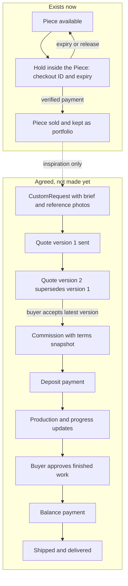

# A piece, a copy and a commission

Three buyers open the same bowl page on the same afternoon. Lina wants the bowl in the photographs and nothing else. Sami wants another like it, a little larger, in time for a family meal. Nadia wants six shallow dishes with a motif her grandmother used, sent to a country this workshop has never shipped to. Ghurza has to hold all three wishes without pretending they are one request. A schema with a single shape for all of them will get two of the three wrong.

The first shape is a Piece: an object that exists now. It has a workshop, an artisan credit, a craft, materials, dimensions, care notes, photographs, a price in integer minor units and a status. The workshop publishes it. A buyer claims it. A verified payment marks it sold. Its page stays online afterwards as portfolio evidence and the purchase action stops working. The piece is one of one, so its status is its availability. There is no count to decrement and nothing to replenish when it sells.

Then the hold. Between "the buyer pressed checkout" and "the provider confirmed the payment", the piece has to belong to one checkout and to nobody else. Ghurza stores that claim inside the Piece document as a small hold object: a checkout identity and an expiry instant. One conditional update both tests the piece and writes the new claim, so two buyers cannot both pass the test and then both write. When the payment is verified, the same document moves to sold and the hold is cleared. When the hold expires unpaid, the piece returns to available without a repair job. The course default is fifteen minutes, and the server clock decides, never the browser countdown.

The hold belongs inside the piece because three people need one answer to "who has this right now": the buyer, the workshop owner and the person on support. If that answer is assembled from two collections, the two can disagree and nobody can say which is true. A cart line is a different thing entirely. A cart is a list of intentions, and it locks nothing, because a buyer may keep a cart for a week while the workshop keeps selling. Adding to a cart changes no Piece field at all.

## The copy is where projects break

Sami's sentence, "make me another like this", is the sentence that breaks student projects. The quick implementation clones the bowl document, gives it a new id, sets status available, clears the hold, and lets Sami check out. That clone is a false promise with consequences. Nobody agreed the price, and a larger bowl costs more material and more days in the workshop. Nobody agreed the material, which may not be on hand. Nobody agreed a date, and the workshop may already have four commissions ahead of a new one. Nobody agreed that the motif can be repeated, which matters for some crafts and some patterns.

A copy of a database record is not a copy of the object. Cloning also carries the old photographs and the artisan credit onto work that does not exist, so the page shows a picture of a piece nobody is making, credited to a maker who has not touched it. That is not a modelling inconvenience. It is a false statement to a buyer and to a maker, and it is the kind of error that ends with a refund and a lost workshop.

The honest version of Sami's sentence creates a CustomRequest. A request belongs to one buyer and one workshop. It carries the brief, the craft, a budget range, an optional wished date that is labelled as a wish, reference photographs that only the two parties can read, and a link to the sold piece that inspired it. The link is inspiration, not ownership: it does not reopen the old bowl and it does not copy its price. The workshop may decline, ask questions, or answer with a quote.

## The commission is a sequence of agreements

A Commission is work that does not exist yet and is now agreed. The path runs for weeks and each step changes who owes what. The buyer sends the request. The workshop sends a quote with scope, material, size, one included revision, a production range, shipping terms, a total and a deposit percentage. If something changes, the workshop sends a second version. Version one stays visible as history and stops being acceptable, so nobody can accept a price the workshop has withdrawn. The buyer accepts the latest version, and that acceptance copies the terms onto the Commission.

The copy of the terms is deliberate. A quote is a document with a version number; a Commission is a separate document that must survive the workshop changing its defaults three weeks later. It holds the accepted total, deposit, balance, cancellation terms and production range exactly as the buyer saw them. The workshop's current settings stay editable without rewriting an agreement that is already in force.

Then the money, in two steps. A card authorisation lasts days and a commission lasts weeks, so a single charge held open would expire before the maker finished. The deposit is a payment at acceptance. The balance is a payment at buyer approval. Both amounts come from the accepted quote, stored in integer minor units, computed with one rounding rule, and always adding to the total. The course default deposit is fifty percent, which is a teaching choice and not an industry figure. Inside the Commission, the two payments are a bounded list: a kind, an amount, a provider reference and a confirmed time.

Read the two lanes as two different machines. The left lane is a state machine over one document, and every transition is a conditional write. The right lane is a sequence of agreements between two people, and every step needs an actor, a prior state and stored evidence. The dotted line carries no permission and no data except a mention of what the buyer liked. That line is where a careless model silently turns a request into a sale.

## What the separation buys you

The three shapes have different actors, so they need different rules. A buyer creates a request, reads their own thread and accepts a quote. A workshop owner prices, revises, makes and ships. A credited artisan may have no account at all, and module 8 treats credit as attribution, not permission. A cart changes nothing about a Piece, and a request changes nothing about a Piece except that it may mention one. If a single route could move a piece and a commission together, those permissions would blur, and you would spend the rest of the course untangling them.

The separation also keeps history honest. A sold piece is a public record of a finished sale, while a commission carries a private brief, a buyer's budget range and photographs the buyer sent in confidence. One serializer cannot serve both audiences. When you write the ERD, mark the audience of every field: public buyer, the two parties, or workshop internal. Module 8 tests those marks with real tokens.

You will see all three shapes at once in the seed later in this course: three fictional workshops, twelve pieces with two sold, and one open request. That small fixture is enough to tell a piece from a request from a commission, and it is enough to break a model that confuses them.

## This module decides, the next one implements

The work in module 3 is a document, not a server. You will write `docs/erd-draft.md`, name the collections, mark which fields are references and which are embedded copies, and commit a decision table with a reason and a cost for each choice. Code arrives in module 5, when the shapes are settled. Doing it in this order is cheaper, because renaming a collection costs minutes while changing a schema that three routes already trust costs days.

Be honest about the limits of the choice. A document store will not enforce that `piece.workshopId` points at a workshop that exists, that a commission points at the quote version the buyer accepted, or that a payment sum equals a total. Those become application checks with tests. Lesson 3.3 names the cases where a relational database with foreign keys and constraint checks would genuinely be the stronger tool, and a payout record for artisans is one of them. Knowing where your database stops helping is part of defending the decision.

The next lesson puts both worlds beside one real operation: reading a commission with its terms, its progress and its two payments, and writing the hold that decides who owns a piece. Once you see the same work done in tables and in documents, the choice stops being a preference and becomes an argument you can make.
