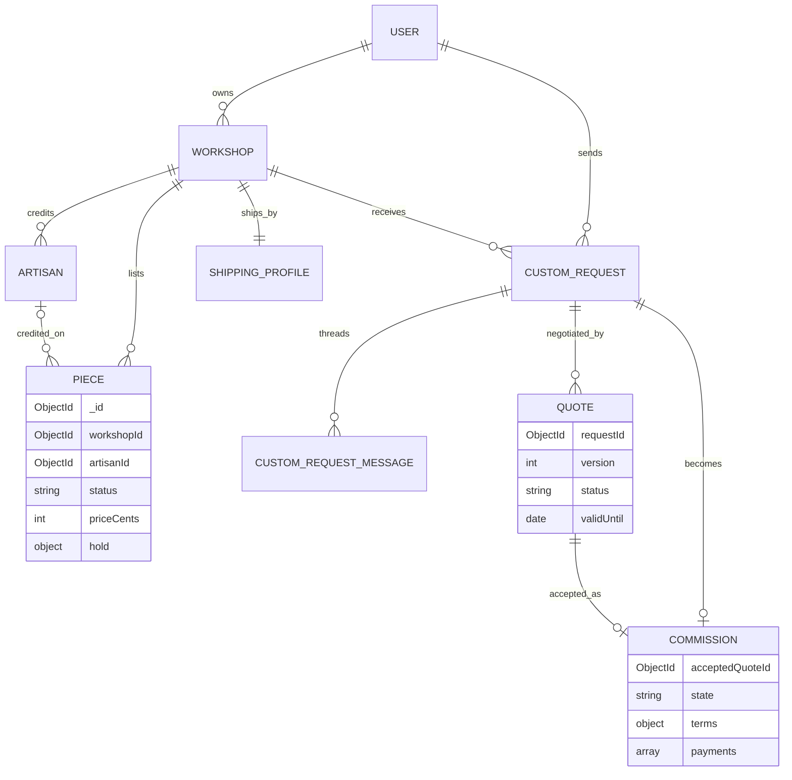

# The decision for Ghurza and the first ERD

A decision you cannot point at is a decision you will reopen in week three, under deadline, with three routes already depending on it. This lesson turns the argument from 3.2 into two committed artifacts: a decision table with a cost for every row, and `docs/erd-draft.md` with the first ERD. It also leaves a test that fails while the file is missing, so the decision is guarded rather than remembered.

Write the table first. A paragraph can hide a weak choice behind confident words. A table forces you to name the alternative, the price of your pick and the condition that would change your mind. Each row has five parts: the choice, why it fits this product now, what it costs, the credible alternative, and the signal that would make you switch. Keep the rows short enough to read on a phone, and keep every row specific to a one-off piece, a hold, a quote version or a commission.

| Decision | Choice for Ghurza | Why now | What it costs | When to switch |
|---|---|---|---|---|
| Database family | Documents for the Piece and Commission aggregates | Craft fields differ per craft, and quote terms differ per version | No cross-document constraints, so invariants need tests | When a payout ledger becomes the core product |
| ODM | Mongoose schemas with enums and subdocuments | One place for status values, holds and terms validation | Drift if code writes through the native driver | When the team prefers explicit validation with Zod |
| Ownership | References: `Workshop.ownerId`, then `Piece.workshopId` | One workshop edited once, and every write resolves the same chain | A second read to show names, and the N+1 risk in module 15 | Never for this product |
| Hold | One embedded object on the Piece | The claim must be one atomic write with the status | The Piece document is rewritten on each claim | If a piece could ever be reserved more than once at a time |
| Accepted terms | Snapshot copied onto the Commission | The agreement must outlive a change to workshop defaults | Duplication, and one more field to audit when terms change | If terms are versioned in a legal system outside the app |
| Payments | Two entries inside the Commission | The domain fixes exactly two payments on one agreement | Payments cannot be queried without reading commissions | When a reconciliation table joins payments across providers |
| Quote versions | Their own collection, unique on request and version | Versions are immutable, and the worker scans for expired ones | An extra read to assemble a request thread | If your product never revises a quote |
| Request messages | Their own collection, indexed by request and time | A thread grows without a bound and needs stable order | One more read on the thread page | Never for this product |
| Artisan credit | Reference from Piece to Artisan, credit text snapshotted on a sale | Credit changes display; attribution on a sale must not | A display-policy decision when a maker withdraws a name | Never for this product |
| Payout record | Not built in this course; Postgres if it ever is | Money owed to makers wants keys, numeric amounts and reporting | A second store to operate | When real payouts enter scope |

The ODM row is easy to wave through, so make it earn its place. Mongoose gives you one declared place for the status values, the hold subdocument, the terms snapshot and the two payment entries. Without it, every route writes its own object literal, and the first route that spells a status as `in-progress` instead of `in_production` breaks the transition service in module 24 in a way no compiler will catch. The cost is real: Mongoose validates what passes through a model, and nothing stops a route from using the native driver and skipping it. Write that risk into the table and review for native driver calls in code review.

## Draw the ERD from the operations

Now draw the entities that the operations in 3.2 need. The diagram below is the one to commit. It is deliberately small: nine boxes, no order records yet, because a first draft that shows everything hides the one edge that matters.



Three edges carry the whole argument. `USER` to `WORKSHOP` labelled `owns` is the only ownership edge that grants seller actions, and every write path walks it. `ARTISAN` to `PIECE` labelled `credited_on` is attribution, and its cardinality says a piece has at most one credit while an artisan may be credited on many pieces. `QUOTE` to `COMMISSION` labelled `accepted_as` looks like a pointer but behaves as history: the commission keeps its own copy of the terms, so the edge exists for audit rather than for reading a current price.

The `hold` attribute inside `PIECE` is not a box. If you draw it as an entity with its own arrows, a reader will assume it can be edited separately from the piece, and the whole guarantee rests on the opposite. Draw it as a field, write "one current claim" beside it, and keep claim history in the order and payment records that modules 19 and 20 build.

Two mistakes are common on a first draft. Do not draw an ownership edge from `WORKSHOP` to `ARTISAN` that a credited maker can follow backwards to edit prices; the line means the workshop maintains the roster, not that the roster gains permissions. Do not point `COMMISSION` at the current quote document as its source of truth for money. The commission's own `terms` is the truth after acceptance, and the reference is for the trail.

## Walk a near miss before you commit

The tempting alternative is a `HOLD` collection of its own, one row per claim, with the current claim found by a status field. Sketch it honestly and watch it fail. The claim becomes two writes to two documents, so there is a moment when the piece says available and a live hold exists, or the piece says held and no hold is stored. The reader who opens the piece alone cannot tell whether it is claimable. The release path now needs the hold row, so a worker that clears a stale claim must read the piece first, and a takeover after expiry has to move both documents without letting a third request interleave.

You can close the window with a multi-document transaction on a replica set, and that is a legitimate design at a larger scale. For this product it buys nothing and costs a replica set requirement, a transaction on every claim and two documents to reconcile in every test. The single-document claim gives the same guarantee with one conditional write, and its test in module 19 is twelve lines long. Write this near miss into the open questions of the draft, because a reviewer will ask why the hold is not its own collection and the answer is stronger when you have already tried it.

## Keep the draft alive

The draft is not a one-off assignment. When module 5 creates the Cart and Order models, add them to the same file with the snapshot edge labelled. When module 8 adds the authorization matrix, add a line to each entity saying who may read it. When module 23 decides that an accepted quote version is copied rather than referenced, the ERD must already have said so. One habit makes this cheap: change the model and the draft in the same commit, and let the contract test fail when you forget.

A draft that drifts from the code is worse than no draft, because the next reader will trust it and design against a shape that no longer exists. The test from the previous section is a small guard, not a proof. The proof is that a partner can read the file, name the collection behind one screen, and be right when they open the schema.

## Write the field list with the awkward parts visible

The ERD says where things live. The field list says what shape they take, and it is the part a reviewer will check against modules 5, 19 and 23. Write it as draft types, even though the models are JavaScript, because a type union makes an invalid state visible before a single route exists.

```ts
// Draft types for docs/erd-draft.md. Module 5 writes these as Mongoose schemas.
type PieceStatus = "draft" | "available" | "held" | "sold" | "archived";

type CommissionState =
  | "awaiting_deposit"
  | "in_queue"
  | "in_production"
  | "awaiting_approval"
  | "awaiting_balance"
  | "ready_to_ship"
  | "shipped"
  | "delivered"
  | "cancelled";

interface Hold {
  checkoutId: string;
  expiresAt: Date;              // absolute instant decided by the server clock
}

interface CommissionTerms {     // copied from the accepted quote, never edited
  version: number;
  totalCents: number;
  depositCents: number;
  balanceCents: number;
  currency: string;
  revisionIncluded: boolean;
  productionDaysMin: number;
  productionDaysMax: number;
  cancellation: string;
}

interface PaymentEntry {
  kind: "deposit" | "balance";
  amountCents: number;
  providerRef: string | null;
  confirmedAt: Date | null;
}

interface CommissionDraft {
  buyerId: string;
  workshopId: string;
  requestId: string;
  acceptedQuoteId: string;
  state: CommissionState;
  terms: CommissionTerms;
  payments: [PaymentEntry, PaymentEntry];   // exactly two, and the type says so
}
```

The tuple on `payments` is worth a pause. A plain array allows zero, one or nine payments, and every reader then writes defensive code. The tuple states the domain rule where the reader meets it: one deposit, one balance, both belonging to this agreement. The same idea appears on the Piece as a single optional hold rather than a list, because a one-off object can only be claimed by one checkout at a time.

Notice also what is absent. There is no `buyerId` on the Piece after a sale, because purchase evidence belongs to the order, and there is no price field on the Commission outside `terms`, because a second price is a second truth. Absences are decisions too, and a reviewer should be able to ask about each one.

## Guard the file with a failing test

A design document drifts the moment someone edits a model. Put a small contract test in `server/src/tests/erd-contract.test.js` that reads the committed file and checks the two claims the whole model rests on. It fails today, and that failure is the point.

```js
import test from "node:test";
import assert from "node:assert/strict";
import { readFile } from "node:fs/promises";

const erd = await readFile(new URL("../../docs/erd-draft.md", import.meta.url), "utf8");

test("the draft marks the hold as embedded and the workshop as a reference", () => {
  assert.match(erd, /hold[^\n]*embedded/i, "the Piece section must say the hold is embedded");
  assert.match(erd, /workshopId[^\n]*reference/i, "the Piece section must mark the workshop as a reference");
});

test("the draft names the two payments on one commission", () => {
  assert.match(erd, /deposit/i);
  assert.match(erd, /balance/i);
  assert.match(erd, /terms[^\n]*snapshot/i);
});
```

Run it before you write the file and read the failure:

```bash
$ node --test server/src/tests/erd-contract.test.js
✖ the draft marks the hold as embedded and the workshop as a reference
  AssertionError [ERR_ASSERTION]: The input did not match the regular expression /hold[^\n]*embedded/i
```

That red is correct: the document does not exist yet, so the claim it must make cannot be checked. A red with a different message, such as a module resolution error or a permission error, means your test is broken rather than your document. Fix the test first, then write the file, then run it again until it passes. From then on, any edit that quietly moves the hold into its own collection or turns the workshop into a copied name breaks a test that names the decision.

The runtime proof arrives later. Module 19 writes a test where two checkouts claim one piece and only one wins, and module 23 writes the test where a stale quote version is refused. This lesson cannot write those tests, because the models do not exist. It can write the test that stops the design from being quietly reversed while you build them.

## Verify the draft by hand before the gate

Read the file aloud to a partner and ask two questions. Which record can I buy today, and which record only asks for future work? If both answers point at the same box, the labels are wrong and the model will confuse a purchase with a negotiation. Then ask which edge gives a workshop owner the right to answer a request, and which edge only shows credit. A partner who traces both answers on the diagram without your help has understood the draft.

Save the decision table, the ERD and the field list in `docs/erd-draft.md`, plus a short "open questions" list. The honest open questions at this stage are the deposit percentage default, the hold duration and whether a request should expire on its own. Writing them down keeps the gate about the model rather than about the details later modules decide.

The gate in 3.4 asks you to defend the draft without reading it. If you need the file in front of you to say where the hold lives or why the artisan edge grants nothing, the draft is not finished yet. One question about the diagram is below, and it uses the same reasoning the gate will ask for aloud.

```quiz
type: mcq
id: handmade-m03-q5
question: On this ERD, which edge gives a workshop owner the right to answer a buyer's custom request?
options:
  - "WORKSHOP to CUSTOM_REQUEST, labelled receives"
  - "ARTISAN to PIECE, labelled credited_on"
  - "QUOTE to COMMISSION, labelled accepted_as"
  - "CUSTOM_REQUEST to CUSTOM_REQUEST_MESSAGE, labelled threads"
correct: 0
explanations:
  - "Ownership of the workshop is what makes the inbox readable and answerable."
  - "Credit is attribution and never grants access to a buyer's brief."
  - "This edge records which terms were accepted, not who may reply."
  - "This edge carries the conversation for the two parties already allowed in."
```
