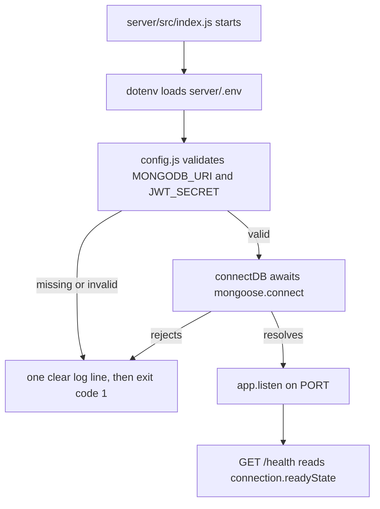

# 4.6 ,  Prime your thinking

> **[Learn]** · Chapter 04 ,  Config & database · *Mandatory read: Mongoose connection docs*

Before you write `shared/db.js`, read how **Mongoose** expects connections to work in modern Node (async/await, connection events, disconnect). This sub-chapter is a **mandatory reading assignment** ,  not optional skimming.

<BigWordAlert term="Twelve-factor config" plainEnglish="Store config in the environment, not in code ,  so dev, staging, and production differ by env vars only." whyItMatters="Ghurza follows this pattern: one codebase, many deployments, secrets injected at runtime." />

You already decided *why* MongoDB (Chapter 3). This read covers *how* the driver connects ,  so your boot sequence in 4.11-4.12 matches official patterns.

```predict
prompt: "MongoDB is unavailable when Ghurza starts. Which boot sequence tells the truth?"
options:
  - id: listen-first
    label: "Start listening first, then connect in the background"
  - id: connect-first
    label: "Connect to the database first, then start listening"
correctOptionId: connect-first
explanation: "Connecting first prevents the API from accepting requests it cannot complete. A failed connection should stop startup with a clear error instead of exposing a misleading healthy process."
allowRetry: true
```

## Why this matters

A connection failure is the least readable bug a beginner meets. The message arrives without context, usually as a buffering timeout, and the stack points at a model rather than at the wiring. Twenty minutes with the Mongoose Connections page gives you the three facts this chapter depends on: **await connect before listen**, the meaning of `readyState`, and the reason `shared/db.js` also has to be imported by the Chapter 5 seed script. None of this is API trivia. You are closing off the Week 1 stall that costs beginners an evening before a single Workshop document is written.

## What a connect call actually does

A `connect` call is not one step, which is why the ordering rule keeps returning. Mongoose parses the connection string into hosts, credentials, database name and options, asks the driver to open a TCP connection, completes a MongoDB handshake, and only then resolves the promise and marks the connection ready. Between the call and that resolution the connection sits in the connecting state. Queries issued in that window are queued by Mongoose instead of being sent, and that queue is the source of the most confusing error message in this chapter.

The pool is the second thing to picture. One Node process opens one connection pool and shares it across every model, so `User`, `Workshop` and `Piece` all borrow from the same set of sockets. That is why you call `connectDB()` once during boot and never inside a route handler: a second call does not give you a second useful pool, it gives you contention and a connection state that is harder to reason about. It is also why the seed script from Chapter 5, which runs as its own Node process, has to call `connectDB()` itself before it writes a single document.



Read the diagram as an ordered list rather than a picture of boxes. Load the environment, validate it, connect, and only then bind a port. The two arrows into the exit block are the only honest outcomes of a bad boot: say what is wrong once and stop, instead of listening on a port that will answer every request with a timeout.

## A boot that fails honestly

The smallest useful version of the helper is short enough to memorise, and every line earns its place in a debugging session later.

```js
// server/src/shared/db.js
import mongoose from "mongoose";

export async function connectDB(uri) {
  mongoose.connection.on("connected", () => console.log("mongo connected"));
  mongoose.connection.on("disconnected", () => console.warn("mongo disconnected"));
  await mongoose.connect(uri, { serverSelectionTimeoutMS: 5000 });
}
```

The `serverSelectionTimeoutMS` option is the one worth understanding before you type it. Without it, a host name that does not resolve, a paused cluster, or a firewall rule that silently drops packets leaves the terminal waiting about thirty seconds before the driver gives up. Five seconds is long enough for a slow laptop and short enough that a wrong URI is obvious while you still remember what you just changed. The failure arrives as `MongooseServerSelectionError` with a message that names the timeout rather than a stack trace from inside a model.

Handle that rejection at the entry point, not inside the helper. Wrap `await connectDB(config.mongoUri)` in a `try` block in `server/src/index.js`, log `error.message` and the error `name`, then call `process.exit(1)`. Logging the message matters because it names the host or the authentication failure. Logging the URI does not matter and actively hurts, because the URI contains the database password and your terminal, your shell history and the deploy log all keep copies of what you print.

## Trace one failed boot

<TraceRequest title="A boot that never reaches listen">
  <TraceStep actor="Server" label="node server/src/index.js starts" detail="Modules load, but dotenv has not run so the URI is still undefined" />
  <TraceStep actor="API" label="connectDB is handed an undefined URI" detail="The driver rejects at once instead of opening a socket" />
  <TraceStep actor="DB" label="No connection is opened" detail="The pool stays empty and readyState never reaches connected" />
  <TraceStep actor="Server" label="The process exits with code 1" detail="No port is bound, so nothing can answer a request from a half started API" />
</TraceRequest>

The trace is worth reading twice, because the interesting failure is the third step. A server that listens without a database does not look broken: `/health` answers, the login route returns a 500 after a long pause, and the error surfaces in whichever request happened to arrive first. Refusing to start turns a distributed mystery into one line at boot.

## A debugging path for connection errors

When a connection fails, check in cost order and stop at the first answer. Is `.env` loaded before `config.js` reads it, which fails when `dotenv.config()` is imported after the module that needs the value? Does the URI start with `mongodb://` for a local server or `mongodb+srv://` for a hosted cluster, because the wrong scheme fails in a different way? Are the username and password correct and URL encoded, since an `@` or `:` inside a password breaks the parse? Is this machine allowed to reach the cluster, because a hosted cluster with an address allowlist refuses your laptop while curl from the host works fine? Each question costs seconds, and only the last one requires opening a dashboard.

`Mongoose buffering timed out` deserves its own entry because it lies about its cause. It does not mean the database is down. It means your code reached a model operation before the connection resolved, so the queued operation waited until its buffer timeout expired and gave up. The usual source is a `listen` call placed before `await connectDB()`, or a module that runs a query at import time. Search for model calls outside request handlers first, then check the boot order in the diagram above.

A connection that dies after a healthy boot behaves differently, and the health endpoint should say so. Mongoose reconnects on its own, moving `readyState` from connected to disconnected and back through connecting while it retries. That is the reason a health check reads `readyState` on every request instead of a boolean you set once: during a reconnect the API is up, the pool is not, and a health answer that says healthy would send traffic to a process that can only fail.

## Common questions

**Q: Can I copy the Mongoose docs sample server verbatim?**  
A: Copy it and you inherit a layout this course already replaced. The docs build a complete server with the connection written inline, while your repository keeps config in `shared/config.js` and the connection behind `connectDB()` in `shared/db.js`. Borrow the idea rather than the file: `await mongoose.connect(uri)` before any `listen`, plus a feel for how the connection events fire. Put the docs in the recipe column and your modules in the kitchen column. Same technique, but the equipment is already laid out the way the rest of Ghurza expects to find it.

**Q: Should health use `readyState` or a boolean I set?**  
A: Both answer the same question, and either is defensible provided the response reports the connection as it stands right now. `connection.readyState` comes straight from Mongoose: `0` disconnected, `1` connected, `2` connecting, `3` disconnecting. Reading that number costs nothing and cannot drift out of date. Your own boolean, flipped after `connectDB()` resolves, reads more simply but records only that one moment; if the cluster goes away an hour later the flag keeps reporting success. A health route exists to tell the truth about the process, so the driver's own state is the safer source.

**Q: Why read disconnect if MVP never shuts down gracefully?**  
A: Because local habits do not survive contact with a deploy platform, and the disconnect half of the chapter is what makes the connection model feel complete. A restart signal from the host arrives as `SIGTERM`; answering it with `mongoose.disconnect()` gives queued writes a chance to land and releases the socket pool instead of cutting the database off mid request. The gate does not test it, so skim the section without guilt. The point is recognition later, when you meet a `SIGTERM` handler in someone else's Express app and know exactly what it protects.

**Q: What is "Mongoose buffering timed out" and why does it happen?**  
A: Read it as the driver complaining that a model operation arrived before a connection existed. While Mongoose is still opening the connection it holds operations in a queue, and when no connection is ever established that queue expires and throws. The usual cause is a query, or an early `listen`, that ran before `await connectDB()` finished. Follow the order the chapter keeps repeating: read env, validate config, connect, then listen. A bad `MONGODB_URI` or a stopped cluster should end the process at boot with one readable line, not surface hours later as a timeout inside a request handler.

## Mandatory read

**Primary:** Mongoose ,  Connections  
https://mongoosejs.com/docs/connections.html

**Focus on these sections:**

1. **Connecting to MongoDB**: the shape of a `mongoose.connect(uri)` call  
2. **Connection states**: what each `readyState` value means  
3. **Error handling**: startup connection failures compared with errors raised by queries  
4. **Disconnection**: using `mongoose.disconnect()` when the process is asked to stop  
5. **ESM note**: with `"type": "module"` set, the import style should match what Chapter 2 established  

**Secondary (skim):** Connection string format  
https://www.mongodb.com/docs/manual/reference/connection-string/

Enough to understand `mongodb://` vs `mongodb+srv://` ,  you already picked URI in 4.5.

## What to extract for your implementation

While reading, note answers to these ,  you'll implement in 4.11:

| Question to answer while reading | Why your build needs it |
|---|---|
| Is `connect()` a Promise? | `server.js` will await `connectDB()` before it listens |
| What does an invalid URI do? | Decides whether boot fails fast or limps on |
| How can I tell the connection is live? | One log line at boot, then the health route reads state |
| Which options belong in `connect()`? | `serverSelectionTimeoutMS` makes a dev failure arrive sooner |
| Is the pool shared or opened per model? | One pool per process, opened once at boot |

**Do not copy-paste** the docs' entire sample server into your repo ,  adapt to your `config.js` + module structure.

## Connection states cheat sheet (from docs)

Mongoose tracks `connection.readyState`:

| Value | State |
|---|---|
| 0 | disconnected |
| 1 | connected |
| 2 | connecting |
| 3 | disconnecting |

Health endpoint in 4.13 may use this ,  or a boolean you set after successful `connectDB()`. Either is valid if accurate.

## Common beginner mistakes (read before coding)

1. **Calling `listen` before `connect` completes**: the first request can reach a database that is not ready yet.  
2. **Calling `connect()` twice** without a guard: two attempts where one was enough.  
3. **Swallowing connection errors** in an empty catch: the server keeps running with no database behind it.  
4. **Logging the full URI** when a connection fails: the password lands in shell history and deploy logs.  
5. **Reading config before `.env` loads**: `MONGODB_URI` arrives undefined.  

Chapter 4 build steps explicitly order: load env → validate config → connect → listen.

## Optional deep read (not gate)

- **Buffering:** Mongoose queues operations while connecting ,  know it exists; don't rely on it for health semantics.  
- **Server selection timeout:** Tuning Atlas vs local failure messages.  

One paragraph in learning log if you tune timeouts ,  optional.

## Reflect ,  write in notebook or learning log draft

After reading, answer without opening the docs:

1. What is the difference between a **connection error at startup** and a **query error** after connected?  
2. Why should `connectDB()` live in `shared/db.js` instead of inline in `server.js`?  
3. What does `mongoose.disconnect()` do and when would you call it?  

If you can't answer #2, re-read the "Connections" page section on best practices.

## How this connects to Chapter 5

Chapter 5 creates **models** ,  `User`, `Workshop`, `Piece`, `Commission`. Models require an **active connection** before `Model.create()` works. Same `connectDB()` helper will be imported by `scripts/seed.js`.

If `db.js` is wrong, every schema chapter fails for the same reason ,  fix connection once, everywhere benefits.

## Time box

**Minimum:** 25 minutes focused reading + reflect questions.  
**If rushed:** Read "Connecting" + "Error handling" + disconnect section ,  skip advanced pooling.

## ✅ Do / ❌ Don't

**✅ Do:** Read official Mongoose docs ,  version matches your `npm install mongoose` major version.

**✅ Do:** Keep docs tab open while writing `db.js` in 4.11.

**❌ Don't:** Use deprecated callback-only patterns from old Stack Overflow answers.

**❌ Don't:** Skip reading because "I'll figure it out when it breaks" ,  boot bugs waste evenings.

## Next

**Sub-chapter 4.7:** Configuration and database knowledge check ,  complete it before **4.8** starts the build.

Reading done → hands on keyboard in the build cluster.
