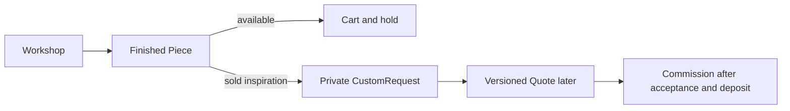

# Set the scene

Ghurza starts with a maker whose work is specific. A hand-stitched cushion and an olive wood bowl are not interchangeable units in a bin. One bowl can be photographed, priced and sold now. A buyer who wants a different size has begun a conversation about future work, not added an invisible bowl to stock. Draw both journeys on a sheet before choosing fields. The first needs Piece state; the second needs CustomRequest and a later Quote and Commission.

The workshop, not the artisan credit, is the seller. A workshop may feature several artisans and may choose whether a maker's name appears publicly. That display choice is not an authentication role. A course seed with six artisans matters because it forces you to distinguish a credited name from an account that may edit prices and accept requests. Make one workshop own several pieces by different artisans and show the credit on a product page without exposing private maker notes.

Ask what a buyer sees after a piece sells. The page can remain as a portfolio record, marked sold, and offer a route to request something similar. It must not reopen a cart line for the sold piece. A buyer who sends a request should see its status as submitted and its wished date as a wish. The workshop has not made a shipping promise or a price commitment. Write these statements beside the first ERD draft so that a later schema cannot flatten both journeys into one generic Product row.

The module's practical result is a seed that exposes each distinction. Three fictional workshops, six credited artisans, twelve finished pieces, two sold pieces and an open request will let a reviewer test browse, sold state and private commission boundaries. Use fictional people and workshop names. The seed should be small enough to inspect by hand and repeat without duplicating records. It will be useful in later access tests only if records from different workshops are present.

Do not optimize the schema for a dashboard screenshot yet. List the operations you need first: find a workshop's editable pieces, browse available public pieces, show a sold piece safely, read a buyer's own request, and show the workshop's request inbox. Each operation starts with a different actor and filter. If all data lands in one large document, the private request may accidentally travel in a public piece response. Separation is part of the privacy design.

## Follow two buyers who begin on the same page

Lina opens a finished olive wood bowl. It has a current price, visible dimensions and an available status. The API can resolve a single Piece ID and show one object that exists now. Sami opens the same bowl after Lina buys it. The page still has craft value, but the purchase action is closed. Sami asks whether the workshop can make a larger tray with similar carving. His new record cannot be another unit of the old bowl: the dimensions, materials, cost and delivery range have not been agreed. The request starts with a workshop and buyer, not with a fictional available Piece.

The branch matters. Both paths can start from a public Piece page, but only the first reaches a cart for that exact Piece. The second moves into a private discussion. Mark the actor and record at each branch in the first draft of `docs/erd.md`. A sold Piece should not be cloned into an available Piece when a buyer clicks "Request something similar." The buyer needs a chance to describe what should change, and the workshop needs a chance to decline.

## Draw the people without inventing permissions

Bayt al Zayt is the seller. Huda is credited for the bowl. The owner account may change a price, publish a draft and answer a request; Huda's credit may appear publicly with her chosen display name, but that alone cannot authenticate her or grant seller actions. A second Workshop may credit a different artisan with the same name. Names are presentation data, not authorization keys. Draw User to Workshop as ownership, Workshop to Piece as listing control, and Piece to Artisan as attribution. Label the lines so a reviewer does not read credit as ownership.

Look at a possible response for a public Piece. It can include craft, materials, care, dimensions, approved photos, current status and approved maker credit. It must not include a private CustomRequest brief, buyer budget, reference photos or workshop-only note. A request can refer to this Piece as inspiration, but the public Piece serializer has no reason to traverse back to request records. Write the fields on two separate cards, one public and one private, then check which ID joins them. This simple exercise catches a privacy leak before routes exist.

## Plan seed data as tests

Three fictional Workshops give enough variety for ownership denial. Six Artisans force a display choice and cross-workshop validation. Twelve Pieces permit ready, draft, held and sold examples. Two sold Pieces are not filler: one can still show its public portfolio page, and the other can anchor a "request similar" action. A single open request tests buyer and workshop visibility. Put a short purpose next to every seed row. If a row has no test or learner-facing story, omit it rather than enlarging the fixture.

A seed record should also be culturally and commercially plausible. A craft label is not enough to explain why a buyer values an item. Record material, technique and care without inventing claims about a real maker. Use fictional workshop names and owned placeholder imagery. One Workshop can have a shipping profile that excludes a country used in later checkout tests. The model should make the constraint visible early, even though this module does not yet calculate final shipping.

Before writing schemas, ask each actor to make one request that should fail. A buyer tries to edit the workshop's Piece. Another workshop tries to read Sami's private brief. A credited Artisan tries to change a Piece price without being the owner. These are model questions today and API tests later. The right data links make the future query possible. Save the answers as acceptance criteria, then proceed to the quantity trap.

## Check the promise on each screen

Write the sentence that appears above the ready-made purchase button: this exact Piece is available now, subject to a successful hold and payment. Write a different sentence above the request form: the Workshop will review the brief and may offer a quote; no price or date is confirmed yet. These are data-model constraints translated into plain language. If both screens say "Buy now," the backend will eventually be forced to invent a Piece and price for the unmade work. Keep the wording in your design notes and test it with the seed's sold Piece.

The buyer's wished date deserves its own field and label. It can help a maker decide feasibility, but it cannot be shown later as the promised delivery date. A Quote should state a lead-time range after review, and a paid Commission should preserve the accepted terms. This separation matters when a request remains open for days and the workshop's queue changes. A single `deliveryDate` field on every object would hide whether it came from a buyer's hope, a seller's offer or a paid agreement.

Use the first ERD draft as a conversation with an instructor. Ask them to point at the record a buyer can buy today and the record that only asks for future work. If they pick the same box, the diagram needs clearer entities or labels. This is a useful checkpoint before implementing Mongoose models, because an incorrect box at Module 5 will spread into catalogue, cart, payment and analytics chapters.
