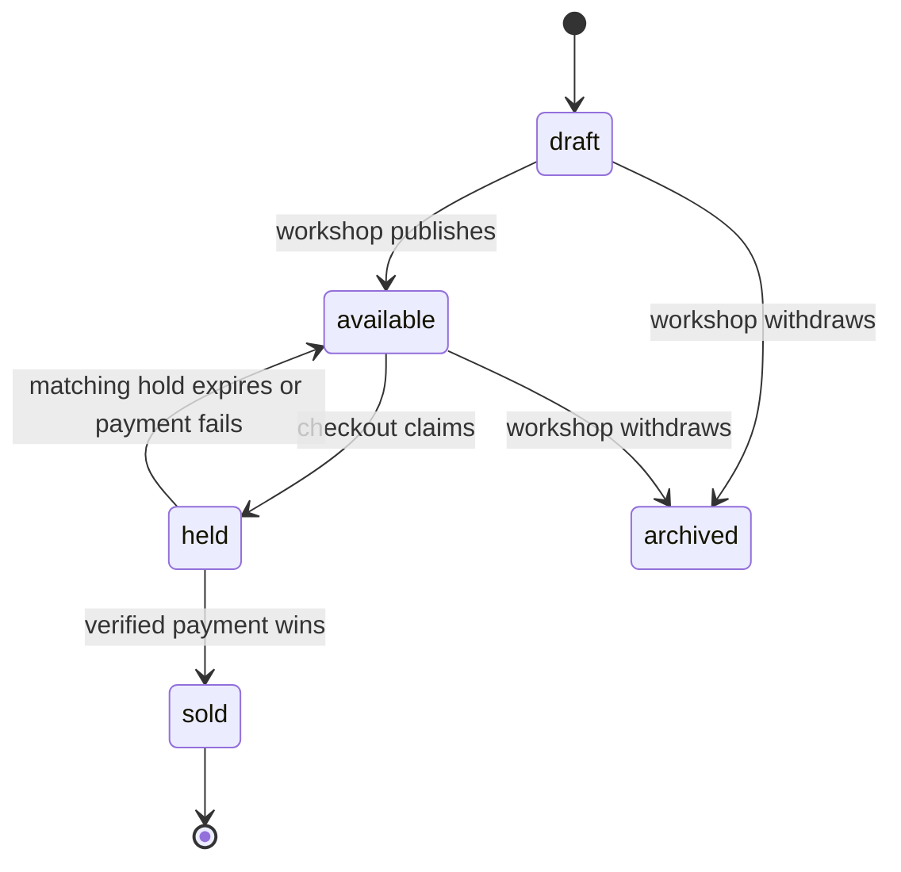

# The quantity trap

Suppose a shelf-stock Product has `stockQty: 1`. When a customer checks out, decrementing it to zero might describe the sale. For Ghurza, zero does not explain whether the piece is sold, temporarily held, archived by its workshop or withdrawn because of damage. It also cannot describe an item that has not been made yet. A quantity field gives the wrong vocabulary, and the rest of the course will inherit that confusion in cart, payment and fulfilment.

Use a `Piece.status` with draft, available, held, sold and archived. Draft is editable by its workshop and invisible to buyers. Available may be browsed and requested for a hold. Held is temporarily reserved for a checkout and needs an expiry. Sold preserves the page and credited maker but blocks another sale. Archived leaves a record for the workshop without a public purchase path. Write a table of transitions, actor, precondition and side effect. Do not expose a general endpoint that accepts any status string.

A hold is a subdocument on Piece, with checkout identity and expiry time. The later checkout module must claim availability with one conditional database update, changing available to held only if the current state still matches. MongoDB's single-document atomic write makes this a suitable boundary for one physical piece. Two buyers can read the same available page, but only one conditional update may win. The losing buyer receives a clear conflict and can browse something else or ask for a similar commission.

Do not assume that hold expiry itself means a sold piece can be reopened. A successful payment may arrive late; the payment module needs a reconciliation rule for that race. Store enough checkout identity to know which attempt held the piece. A stale sweeper should only release a held piece whose hold still matches the expired checkout, never a piece that was already sold or re-held by another attempt. The state diagram now becomes a test plan later.

The phrase "one of a kind" should also be represented in seed data and copy. Create two different bowls by the same artisan, not two quantity units of a single bowl. A cart contains Piece IDs with no quantity selector. If a buyer adds the same ID twice, the second add is a no-op or a validation error, not quantity two. A reviewer should be able to tell from the model how the app prevents duplicate purchase without reading the React component.

## Model the hold as a state transition

Lina and Omar load the bowl page at the same time. Both see available because both reads happen before checkout. That is normal. The promise begins when one buyer tries to hold the Piece. The later service must update one Piece document with a filter containing `_id` and `status: available`, setting status held and a hold with checkout ID and expiry. Only one concurrent update matches. The other returns a conflict and should show another item or a commission invitation. A prior `findOne` result cannot reserve the bowl by itself.

The diagram has no arrow from sold to available. A refund may require a return and inspection before a physical item is saleable again; it is not a generic status reversal triggered by a payment flag. Similarly, archived is not a hidden kind of zero stock. Each status communicates a different user expectation and requires a different transition actor. Put the actor and precondition in a separate table beside the diagram when building Module 19.

## Work through expiry without a false reopen

Assume Lina's hold expires at 14:15. At 14:14:59 a payment event begins processing; at 14:15:01 a sweeper checks for expired holds. If the sweeper simply sets every expired held Piece to available, it might release an item whose payment is being reconciled. The model must retain checkout identity and enough payment state for the later policy. An expiry task should filter on held state and the original checkout ID, and it should confirm the checkout cannot still legitimately complete under the chosen rule. The course may refund a late success rather than honor it, but it must make one consistent decision.

A hold subdocument can carry `checkoutId`, `expiresAt` and creation time. Do not store only a browser session ID: the payment handler and worker need a stable server record even if the buyer closes the tab. Do not store only `expiresAt`: a late task might release a newer hold that happens to occupy the same Piece. Compare the current hold identity before changing state. This is a concrete reason for modeling hold inside Piece, where the conditional write can inspect status and identity atomically.

## Compare the other states

A draft Piece has never been promised publicly. Its workshop can edit photos and price freely. An available Piece may be in a buyer's cart, but cart presence does not reserve it. A held Piece should show that purchase is temporarily unavailable. A sold Piece can retain a public page for the artisan's work but cannot be placed back in cart through an old URL. An archived Piece is withdrawn and may be hidden from public search. Build a raw response test for each state; a UI label alone is too easy to bypass.

Now imagine a workshop tries to edit the price while the Piece is held. Allowing that edit might change the buyer's payment expectation unless Checkout has already frozen a snapshot. Write a policy: either block price edits during hold or preserve the accepted amount in Checkout and OrderLine. Do not let the outcome depend on whether React loaded the page before or after the edit. This policy is another reason `stockQty: 1` is an incomplete model; it says nothing about a pending buyer promise.

The chapter is understood when you can explain which single document prevents a double sale, which checkout identity a sweeper must compare, and why a sold piece remains a portfolio record rather than a unit that can be incremented back into stock. Keep those answers next to the state diagram for the Piece build chapter.

## Design a test from the state diagram

Create one available Piece and send two hold attempts with different Checkout IDs at nearly the same time. The later Module 19 test passes only if one conditional update matches and the other returns a conflict. Do not count the initial GET responses: both buyers may correctly see available before either claim. Count the final Piece row, its hold identity and both API results. If the system returns two successes, inspect whether the update filter included `status: available` on the same document that was modified.

Create a second test for a late cleanup worker. Hold the Piece under Checkout A, let A expire, release it, then hold it under Checkout B. Replay the old cleanup job for A. B's hold must remain. A filter that checks only expiry time may release B incorrectly; compare checkout identity. This test is small enough to write before payment integration and shows why a hold needs more than a boolean. Keep the fixture clock injectable so the test does not depend on waiting fifteen real minutes.

A sold Piece may still appear in search when a workshop wants a portfolio. Search visibility and purchase eligibility are separate decisions. Filter purchase by status, not by whether the page exists. If a buyer posts a stale Piece ID from an old cart, the server should reject it even if the route can still return the public story page. This distinction lets Ghurza celebrate the work without selling it twice.
