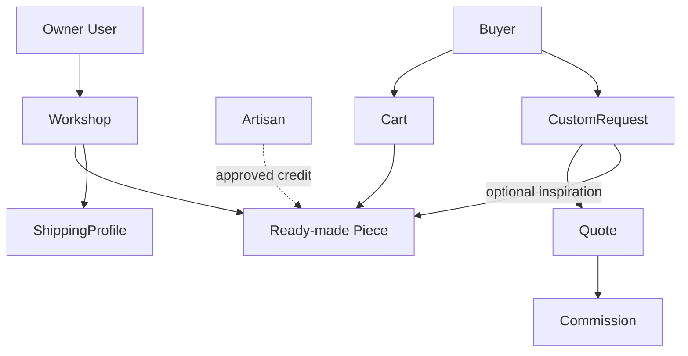

# What you will build

By the end of Module 5, identity, shop ownership, artisan credit, finished pieces, carts, order snapshots and commission skeletons have explicit homes. The goal is not to implement every payment and production route now. It is to choose a shape that allows those routes to be built without migrating away from shelf-stock assumptions. Write the collection list and one sentence explaining each collection's authority before opening an editor.

User authenticates. Workshop is the seller and owner. Artisan is a credited person linked to a workshop, with a public display choice. Piece represents one physical object with materials, technique, dimensions, care, price and status. Cart holds intended Piece IDs. Order records the sale and embeds what the buyer agreed to at the time. ShippingProfile describes where a workshop serves and its handling range. CustomRequest starts a private conversation. Quote and Commission are deliberately thin now and become active workflows in later modules.

Draw the two main paths: User to Workshop to Piece, and Buyer to CustomRequest to Quote to Commission. Add Artisan as a credit link from Piece, not as a parent of the ownership chain. Add OrderLine as a historical snapshot of a Piece sale. This drawing should let you answer two questions: who may edit the current listing, and what will remain true on a receipt after the listing changes. If those arrows point to the same mutable field, the model still needs work.

The seed has three fictional workshops and twelve pieces, so choose variety that exercises the model: tatreez, olive wood and ceramics; different sizes; one workshop with a pseudonymous artisan; two sold pieces with non-purchasable pages; one open request that belongs to only one buyer. Add one shipping profile that excludes a country used by a test buyer, because later checkout must show that boundary before payment. Use respectful fictional descriptions rather than treating a craft tradition as a generic decoration.

Document what remains postponed. The Quote schema will have versions, expiry and deposit terms, but Module 23 teaches their behavior. The Commission schema will have status and references, but Module 24 teaches production updates and balance. The hold field exists now, but the atomic claim and late-payment resolution are built in commerce modules. A roadmap is clearer when it distinguishes a field's existence from a working feature.

## Make the collection map answer a user story

A buyer opens a workshop page, selects an available stitched cushion, adds it to a cart and pays. Trace the data: Workshop identifies the seller, Piece identifies the exact object, Cart stores intent, Checkout later claims the Piece, and OrderLine preserves the sold facts. Now trace a different story: a buyer sees a sold cushion, sends a request with a changed size, receives a quote and pays a deposit. That path needs CustomRequest, Quote and Commission. Trying to force both through Cart creates an object that claims to be purchasable before the workshop has even accepted the request.

The dotted credit arrow does not carry edit permission. The inspiration link does not carry a price. If your ERD includes a direct Piece-to-Commission edge, label what it means: inspiration, not inventory. This prevents a later developer from decrementing stock for a commission that has not yet produced an item. Explain the two diagrams, ownership and workflow, to a peer separately before merging them into one final ERD.

## Choose fields by the query they support

The workshop dashboard needs its own Pieces sorted by recent edit, so Piece stores `workshopId` and an update time. Public browse needs available Pieces with craft and price, so index the fields used in that query after measuring it. The private request inbox needs CustomRequests addressed to the workshop and sorted by received time. A buyer's request list needs `buyerId`. These queries justify relationships and indexes. They also reveal where one giant embedded Workshop document would be awkward: private request threads and a growing set of Pieces would make the public document large and hard to isolate.

For a finished Piece, write the minimum shared facts: title, material, technique, dimensions, care, price in minor units, currency, photos, maker credit and status. CraftDetails may add a controlled small object later. For a CustomRequest, write buyer, workshop, brief, wished date, budget range and private reference photo IDs. The overlap is intentional but limited. A request's hoped-for dimensions are not an existing Piece's measured dimensions, and a budget is not an accepted sale price. Use different field names where the meanings differ.

## Record which rules are postponed

Do not allow an empty Quote skeleton to trick the learner into believing deposit logic exists. This module can create a schema with request ID, version, price, deposit rule and expiry, plus a Commission reference to an accepted quote. Module 23 must enforce quote version and verified deposit. Module 24 must implement production evidence, buyer approval, balance and shipping. Put those module numbers in `docs/erd.md`. A schema is a promise about future behavior only when the accompanying service and tests enforce it.

The same applies to one-off holds. A `hold` subdocument in Module 5 permits later atomic reservation, but does not itself prevent two buyers paying. Module 19 must claim a Piece conditionally, and Module 20 must resolve a late payment. A learner who sees `status: held` in a seed fixture should not infer that the payment provider or worker is already connected. Mark fixture records as examples. This honesty makes later gates meaningful.

Finish by writing three rows of expected evidence: one public Piece page that excludes private request data, one raw API denial for a different Workshop, and one OrderLine fixture unaffected by a current price change. The seed chapter will create the rows; the final gate will inspect them. If the collection map cannot produce those outcomes, adjust it before writing the schemas.

## Choose the first build order

Implement User and Workshop before Piece because every Piece needs a trustworthy seller. Implement Artisan credit next so the Piece schema can validate its same-workshop link. Then create Piece and its status. Cart and Order snapshots come after the current object exists. ShippingProfile can be built alongside Workshop, while CustomRequest, Quote and Commission skeletons come after the ready-made path is intelligible. This order lets each lesson produce a database query and a small denial test before adding the next relationship.

When writing `server/scripts/seed.js`, use fixed fixture keys in development rather than generated names that change on every run. The seed can upsert a Workshop first, then its Artisans, then Pieces that reference those Artisan IDs. If a run stops after the first Workshop, rerunning should continue without creating another owner. Record counts before and after. The fixture will be reused by several modules, so stable identities make later failures easier to debug than a fresh random catalogue on every test run.

At the end of Module 5, distinguish three evidence levels in your learning log. A schema declaration proves an intended shape. A database document proves it can be stored. A raw API denial proves a route applies the ownership rule. None of those proves a verified payment or production timeline. The course will add those behaviors later. Keeping evidence labels honest helps you identify the next missing piece instead of assuming a complete marketplace from a green seed script.

Before opening the next lesson, write one question for each model. For Workshop: who is allowed to change its public description? For Artisan: which name may appear publicly? For Piece: can this exact object be bought now? For CustomRequest: who may read the buyer's brief? For Quote: which version did the buyer see? For OrderLine: what price was agreed? If one collection cannot answer its assigned question without reading an unrelated mutable field, revisit the boundary. These questions form the final ERD review more effectively than a list of class names.
