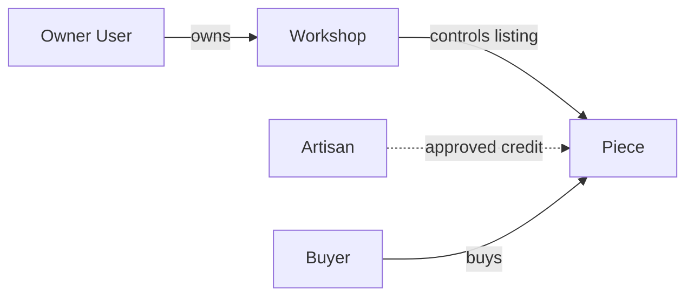

# Ownership versus credit

A Workshop is responsible for pricing, fulfilment, refunds and replies to a buyer. An Artisan may have made a piece but may have no account on the platform. If you put `artisanId` in an authorization query as if it were the seller, you give a credited person power the business never intended. If you omit the credit entirely, you erase the maker whose work the buyer values. Model both relations and label them differently in the ERD.

User owns Workshop through `ownerId`; Workshop owns Piece through `workshopId`. An Artisan belongs to one workshop for this course and may be credited on zero or many Pieces. The Artisan record holds a display name or pseudonym, short public bio if approved, and `showName` choice. A workshop owner may manage this record after verifying ownership. Do not let a public visitor infer a hidden artisan's real name from a database ID or unfiltered API response. Public Piece serialization should show approved credit text only.

Walk through a request to edit a Piece. The authenticated user ID locates their Workshop. The Piece query then includes that workshop ID and the requested Piece ID. A known Piece ID from another workshop cannot bypass the second predicate. `artisanId` is used to display credit, not to grant edit rights. Test a user who is named as the artisan on Workshop A's Piece but owns Workshop B; they may edit only Workshop B's listing. The test is more convincing than a role name in prose.

A workshop may change the approved display choice later. A current Piece page can reflect that preference. A completed OrderLine should preserve the credit text shown at sale, as part of the historical snapshot, while the application follows a documented privacy request policy if a maker asks for a name to be removed. That tension is a reason to separate immutable sale facts from current public display, not to assume one collection field serves both perfectly.

Try two workshops with artists who share a display name. A name is not an ownership key. Never query an Artisan by name to decide whether a Piece belongs to a workshop. Store IDs and check `artisan.workshopId === piece.workshopId` at write time. A Mongoose reference alone does not prove this cross-document invariant; a service or transaction check must enforce it before saving the Piece. Seed this mismatch deliberately and expect a denial.

## Compare credit and ownership in one sale

Huda made a bowl for Bayt al Zayt. The public page may say "Made by Huda" if she agreed to that display. The sale is still between the buyer and Bayt al Zayt. The workshop sets the price, accepts the order, handles shipping and receives the seller view. If the workshop employs or collaborates with another maker for the next bowl, its owner account still controls both listings. Credit tells a story about the work; ownership determines who can make the business promise.

The dotted arrow is deliberately not an authorization edge. In a database, use `Piece.workshopId` for owner checks. `Piece.artisanId` can populate approved credit after verifying that Artisan belongs to the same Workshop. If the two IDs disagree, reject the write. Do not repair it by moving the Artisan to a different Workshop; that would change other Pieces too. Let the seller choose a valid maker or create a new credit record under their own Workshop.

<TraceRequest title="A credited maker tries a seller action">
  <TraceStep actor="Huda" label="Know the Piece ID" detail="Public credit makes the ID visible" />
  <TraceStep actor="API" label="Resolve authenticated owner" detail="No matching Workshop owner relationship" />
  <TraceStep actor="API" label="Deny price edit" detail="Credit is not seller permission" status={403} />
</TraceRequest>

## Handle a display-name change honestly

An Artisan may prefer a pseudonym today and withdraw public naming later. The current Piece page can use the latest approved display choice. A historical OrderLine might have captured the maker credit shown when the buyer paid. That creates a real privacy decision: the receipt is evidence of the sale, but public profile display should respect a changed choice. Document whether a name-removal request updates historical buyer-visible snapshots or only public catalogue display. The data model should separate current public Artisan information from the exact text recorded on an OrderLine so the policy can be applied deliberately.

Test the raw JSON for a hidden-name Artisan. It must not include a legal name in an unused field merely because the React card hides it. If a workshop owner sees a private contact field in their dashboard, use a different serializer from the public Piece page. Do not populate the full Artisan document into a public response and rely on UI omission. Ask a peer to inspect network traffic as a buyer; any hidden field there is already disclosed.

## Write the edit predicate before the route

For a Piece price change, start with session user ID, resolve Workshop by `ownerId`, then update Piece with `_id` and that Workshop ID. For an Artisan edit, resolve the same owned Workshop and update Artisan with `_id` and `workshopId`. For a CustomRequest inbox, resolve the Workshop before querying addressed requests. These three operations use the same ownership chain but different target collections. Write each filter in a test comment before implementing the endpoint. This reduces the temptation to check only a broad maker role.

A two-workshop seed should contain an Artisan with the same display name in each Workshop. Name equality cannot authorize anything. Try to attach Workshop B's Artisan ID to Workshop A's Piece. Try to edit Workshop B's Piece as Workshop A's owner. Try to list Workshop B's requests. Each attempt should be denied for a different target but by the same stored ownership link. Save the status and unchanged database row after each. This chapter is complete when the ERD makes that distinction obvious and the future API predicates can be written from it.

## Examine a subtle staff case

Suppose Huda later receives a buyer account so she can purchase another workshop's item. That account still does not own Bayt al Zayt unless the workshop owner explicitly grants a role the course has designed and tested. A matching name or email on Artisan and User is not a permission bridge. Keep Artisan as credit identity and User as login identity, with no implicit join by display text. If the product adds staff roles later, use a separate membership record with scoped permissions and audit history.

A buyer might message a Workshop about a custom request that names Huda. The Workshop owner can answer through its business account. Huda's public credit does not give her access to the buyer's budget or reference photos. This is more than a strict role rule; it follows the buyer's expectation about who received the private request. Write a two-account request test that proves the credited maker cannot read the brief unless they also hold an explicitly authorized workshop role. Do not add that role silently while building the schema.

The final ownership drawing should show at least one denial path, not just positive arrows. Annotate the API predicate that rejects another Workshop's Piece ID and the same-workshop check for Artisan credit. A future developer can then turn the drawing into tests. If the drawing only says Workshop has many Pieces, it does not reveal the case that will break when a client sends a valid but foreign ID.

Check a credited Artisan with no User account. The public page should still show approved attribution, while a direct PATCH request without an authenticated owner must fail. Then give the same person a buyer User account and repeat the seller request. It must still fail. This test proves that credit is neither a login nor a role. The seller is the Workshop, and only a deliberate future staff membership feature could grant scoped action on its behalf.
