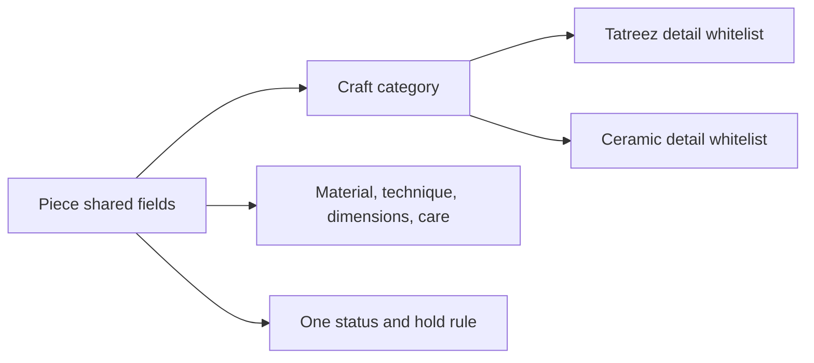

# Craft fields without a schema per craft

A buyer comparing a wooden tray with a ceramic cup needs some common facts: maker, material, technique, dimensions, care, price, photos and whether the piece is available. A seller also needs to record details that do not fit every craft, such as thread count for tatreez or glaze notes for ceramics. Making a separate Product collection for each craft would duplicate browse, cart and order logic. Making one unbounded bag of arbitrary fields would make validation and search unreliable. The schema should sit between those extremes.

Keep required shared fields on Piece with predictable types. `materials` can be a short controlled list of names, `technique` a bounded description, `dimensions` explicit value and unit per axis, `care` readable instructions, and `craft` a controlled category. An optional `craftDetails` object may hold a small whitelist per craft. Validate keys and lengths at the API boundary. A workshop should not be able to post a huge nested object or inject a private internal note into a field that the public serializer later spreads into JSON.

Model dimensions carefully. A string such as "medium" is easy for one workshop but impossible to compare or explain consistently. Store numeric measurements with units and allow an optional human-facing fit note. If a piece is irregular, the note can say so; the numeric envelope can still help shipping and display. Do not claim that every handmade object has exact factory measurements. The data model should support an honest approximate dimension and a clear unit.

Take two sample Pieces: a stitched cushion and a glazed cup. Write the common fields first, then only the craft-specific fields that help a buyer decide or help fulfilment. The cushion might have stitch technique and fabric care; the cup might have food-safe and dishwasher-safe claims that require truthful workshop confirmation. If a field is neither displayed nor used by a rule, ask whether it belongs in this course's first model. Avoid collecting sensitive artisan details simply because the schema can hold them.

In the API test, send a valid ceramic detail on a tatreez Piece and decide whether to reject or ignore it. Prefer a clear validation error so the seller can correct the form. Test a very long care note, a negative dimension and an unknown unit. Then browse a mixed catalogue and confirm the shared fields render without craft-specific branching on every card. The craftDetails object should enrich a page, not control ownership, hold or checkout behavior.

## Compare a stitched cushion and a ceramic cup

Both objects have a maker, a current price, photos and care instructions. The cushion needs fabric and stitching details that would be strange on a cup. The cup may need a truthful food-safe statement that does not apply to a cushion. Put material, technique, dimensions and care in shared fields that every Piece page can render. Put only a small vetted set of craft-specific keys in `craftDetails`. A separate Piece collection per craft would duplicate the sale state and owner checks; one unlimited object would let the form save inconsistent and dangerous data.

The status and hold rule remains one path for all crafts. A ceramic-only field must not affect whether a buyer can hold a one-off Piece. Conversely, a public craft description should not be able to override `workshopId`, `priceMinor` or `status` through a nested spread of submitted JSON. Validate and pick allowed keys explicitly. An unknown craftDetails key should produce a field error rather than silently survive in the database where a later serializer may expose it.

<TraceRequest title="A detail from the wrong craft">
  <TraceStep actor="Workshop" label="Submit ceramic glaze note for tatreez Piece" detail="Valid JSON, invalid craft combination" />
  <TraceStep actor="Validator" label="Read craft discriminator" detail="Tatreez whitelist does not include glaze note" />
  <TraceStep actor="API" label="Return field error" detail="No Piece mutation occurs" status={400} />
</TraceRequest>

## Decide which measurement is useful

A cushion can have width and height, a bowl can have diameter and height, and a tray can have length, width and depth. Store a list or structured object of named measurements with numeric value and unit, rather than a single `size: medium` string. Allow an approximate flag or note for irregular handmade work. The buyer needs an honest physical expectation, while shipping may need an envelope measurement. Do not promise factory precision where the craft has natural variation. Show the unit next to every number in the UI and reject a missing or unknown unit at the API.

Materials may be plural. A tatreez cushion has fabric and thread; a glazed cup has clay and glaze. Keep a short controlled list of approved material names for browse filters, plus a bounded description where a maker can explain nuance. Do not add a separate material collection for this small course unless a concrete operation needs it. In the seed, choose records that require at least two materials and one care note that matters to a buyer. That will expose an array or serialization bug more effectively than three copies with one material each.

## Test an uncomfortable edge

A workshop submits an extremely long care instruction, a negative diameter and an HTML script in a free-text technique field. Validation should bound length and number range; rendering should treat text as text. Do not solve display safety by deleting all useful detail. A buyer may need to know that a ceramic cup is hand wash only, and the claim should remain visible after validation. Test a mixed catalogue card and a detailed page at mobile width. Shared fields should render consistently, while irrelevant craftDetails should stay absent rather than show blank labels.

After changing the schema, reread a seeded Piece through the API. If `craftDetails` is included in a broad JSON spread, inspect whether internal validation flags or unapproved notes also appear. Prefer a curated serializer. The final ERD can show craftDetails as bounded embedded data; its individual craft keys belong in a schema note. The next chapter separates a finished Piece from a request for one that does not yet exist, which is a stronger boundary than any optional craft field.

## Avoid a field that means two things

For a ceramic cup, `finish` might mean glaze appearance. For tatreez, a maker might use the same word to describe edge stitching. A generic `finish` field would collect incomparable values and make a filter misleading. Give craft-specific keys names that describe their domain, and keep the shared query fields truly shared. If a filter says "material," decide whether it searches the base material, decorative material or both. Record that choice in the schema and UI copy so buyers are not surprised by results.

Keep a repair path for old data. If you later add a vetted `foodSafe` field for ceramics, existing ceramic Pieces should not silently display "not food safe" just because the field is absent. Unknown is different from false. Use an explicit unknown state or hide the claim until a Workshop confirms it. A buyer may rely on this claim in a way they would not rely on a color tag, so a migration must preserve uncertainty honestly.

The schema should also state how photos relate to a Piece. An image caption can describe the exact object and a defect, while a generic category image cannot. Keep ordered photo references and alt text or captions with each Piece. A request's private reference photos stay in another access path. Test that a mixed craft catalogue never includes those private references even when both use the same storage provider.

A craftDetails whitelist needs a versioning plan. When a new ceramics key is introduced, an older Piece without that key is not necessarily defective. The renderer should show only facts the Workshop has supplied and confirmed. Conversely, if a key is retired because its meaning was ambiguous, keep old documents readable while stopping new submissions. Record a small migration note beside the schema so a later change does not silently turn unknown into false or erase buyer-relevant care guidance.
