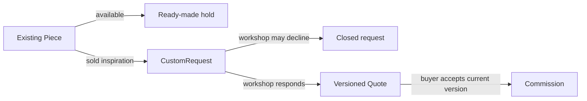

# Two things for sale

A ready-made Piece can be in a public catalogue. Its price and physical state are known, and a buyer can attempt to reserve that exact ID. A CustomRequest begins with uncertainty: the workshop may decline, ask questions or offer a quote. It has a buyer, workshop, brief and desired outcome, but no finished Piece and no accepted price. If you place a `madeToOrder: true` flag on Piece and send it through the same cart, the UI may promise delivery before either party has agreed to the scope.

Give CustomRequest its own private identity. Link it to the buyer and intended workshop, and optionally to a sold Piece that inspired it. That inspiration is only context. The request should have status such as submitted, in review, declined or quoted, plus brief and approved reference photo IDs. A buyer may view their own request; the workshop owner may view requests addressed to their workshop. A public catalogue query must never return it. A credited Artisan cannot read it merely because their work inspired the request.

The later Quote will propose price, deposit, balance, scope and time range. The Commission begins only after the buyer accepts a current quote version and pays the required deposit under the module's rule. At Module 5, store references and status enums but avoid a direct state mutation API. A schema that allows any `status` string does not guarantee a valid transition. Write a short state table now so that Module 22 can refine it, then test that a request cannot be seeded as "delivered" without a quote or commission.

A buyer may ask for a piece similar to an item already sold. Keep the sold listing public with an invitation to request something similar. The new request can carry `inspiredByPieceId` and the workshop ID. Validate that the inspiration Piece belongs to the same workshop; otherwise a buyer could attach a competitor's item to another workshop's private inbox. The buyer edits their own brief. The system should not copy the old Piece price, dimensions or promised shipping into a future commission automatically.

Draw the point at which money enters each journey. Ready-made checkout pays for an identified existing Piece. Custom commission pays a deposit after accepting a quote, then a separate balance after approval. Those payment timings have different records and failure paths. This module's model must let later chapters distinguish them without pretending that a generic `Order.quantity` field describes both.

## Put a request beside a purchasable item

A finished Piece has measured dimensions and a workshop price. A CustomRequest may ask for similar materials but a larger size and a deadline the workshop has not agreed to. Make two cards on paper. The Piece card says available or sold and shows its exact ID. The request card says submitted, includes buyer and workshop IDs, a brief, wish date and private reference photos. It has no accepted sale price and no hold. If both cards can be fed into the same cart function without a branch, the model is probably promising something it cannot yet deliver.

The arrow from sold Piece to request is inspiration only. It does not move the sold item out of another buyer's order or copy its price. The request can be sent to the same Workshop, but the workshop decides material, feasibility and lead-time range before quoting. The diagram also shows a decline path. If the model has only submitted and accepted, it leaves no honest way to say no or ask for clarification.

<TraceRequest title="A sold bowl inspires a new tray">
  <TraceStep actor="Sami" label="Open sold bowl page" detail="Piece stays sold and public as portfolio" />
  <TraceStep actor="Sami" label="Write a new brief" detail="Request stores buyer and intended Workshop" />
  <TraceStep actor="Workshop" label="Review feasibility" detail="May decline or prepare a quote; no price is promised yet" />
</TraceRequest>

## Set the privacy boundary at creation

A buyer's reference photo can show a room, a child or another personal object. It is not a public product image. Store its private asset reference with the CustomRequest, and require the buyer or intended Workshop owner before listing or viewing it. A Piece's public photos may be served without login, but the two asset classes must not be mixed. Test with another buyer who knows the request ID. If the photo URL works directly without authorization, the private collection schema has not solved the actual leak.

The request should also reject an inspired-by Piece from a different Workshop. If Sami is on Workshop A's sold bowl page, the server derives or verifies that A owns the inspiration before creating the request addressed to A. A malicious client can alter both IDs. The service must compare stored relationships, not just trust the URL slug. This check makes the seller's inbox coherent and avoids sending another workshop's photo or context into a private conversation without a deliberate choice.

## State the point of commitment

A workshop might say "I can make a tray" in a message, but the financial promise is in a versioned Quote. The Quote proposes scope, price, deposit, balance, expiry and lead-time range. The buyer accepts a current version; later, a verified deposit starts the Commission according to the product rule. Model those references now and mark the active transitions for Modules 23 and 24. Do not set CustomRequest.status to `paid` because a future production stage needs its own history and payment references.

Write one failure test in advance: the workshop sends quote version 2 while Sami's browser still displays version 1. An acceptance of version 1 must fail with a conflict. If Quote is just mutable fields on CustomRequest, the older terms may be lost and the test cannot explain what Sami saw. This is why two things for sale require distinct records even before their controllers are complete.

## Rehearse the stale quote case

Write three timestamps: Sami submits the tray request on Monday, the Workshop sends quote version 1 on Tuesday, and revises it to version 2 on Thursday after discovering a material cost. Sami's browser still displays version 1 on Friday. The server should reject an attempt to accept version 1 and show the new scope and price for a fresh decision. A single mutable quote object without version history cannot prove which terms Sami saw on Tuesday. Keep version, creation time and status on Quote records, then make Commission reference the accepted version.

Do not create a Commission as soon as a request is submitted. The Workshop may decline, and the buyer may never accept a quote. A submitted request is a conversation; a quote is an offer; a deposit-backed Commission is a work obligation. Map each stage to its owner and visibility. The buyer and Workshop can read their request; the Workshop may draft a quote; the buyer may accept only an active current offer; the verified payment handler starts the paid stage. This sequence is the basis for the later state machine.

The model should permit a buyer to withdraw an unquoted request without deleting its history, and permit a Workshop to decline with a reason. It should not give a buyer a general status patch that can mark work delivered. These restrictions are hard to retrofit if all states live in one generic Product enum. Write them beside the ERD now, even though Modules 22 to 24 implement the routes and payment checks later.

An inspiration link should also survive the original Piece becoming archived. The buyer's request keeps its own brief and workshop relationship, so it is intelligible even if the public Piece page is withdrawn later. A support view may show a safe snapshot of the inspiring title and photo, subject to privacy rules, but it should not depend on a mutable current price. This is another temporal reason to separate CustomRequest from Piece rather than set a `madeToOrder` flag on the sold item.
