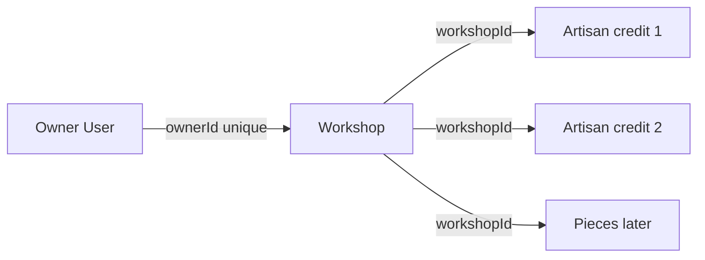

# User, Workshop and Artisan models

Start with User from the shared authentication path, but do not copy grocery vendor profile fields. A user may be a buyer, workshop owner or platform admin. Workshop holds owner ID, public name, description, craft categories, commission acceptance flag and contact policy. Put a unique index on `ownerId` if this course allows one workshop per owner. A `findOne` precheck is useful for a message but cannot stop two simultaneous creates; verify the actual database index and handle duplicate-key as a conflict.

Create Artisan as a workshop-linked credit record, not a login account. Store `workshopId`, approved display name or pseudonym, `showName`, short approved bio and optional public image. Do not store a private legal name in the public record unless the product truly needs it and has a privacy workflow. If an artisan later gets a login in a different product version, that is a new authorization decision; do not infer ownership from credit now.

Build a service function that creates or updates an Artisan only after finding the caller's Workshop. The client may choose the Artisan ID for a Piece, but the server must confirm that Artisan belongs to the Piece's workshop. Mongoose `ref` declares a relationship for population; it does not automatically enforce same-workshop membership. Use a test with two workshops, where Workshop A submits Workshop B's Artisan ID. Expect a clear error and no Piece row.

The public workshop endpoint may list approved artisans, but the owner dashboard may show additional draft credit records. Keep distinct serializers. A hidden maker's name must not leak through a populated `artisanId` document or a debug response. Test the raw JSON, not only the card. A Piece can have no named artisan when the maker chooses privacy; display "Made by this workshop" rather than a blank label or a guessed name.

Seed three workshops with two artisans each. Give one artisan a pseudonym and one a no-name preference. Re-run the seed, check counts, and verify the same IDs remain. Then login as the wrong workshop owner and attempt to edit both records. If the API only checks a broad vendor role, the wrong owner will succeed; the route must use the workshop link.

## Create the seller before its credits

Use three fictional owner accounts: one for Bayt al Zayt's olive wood work, one for a tatreez workshop and one for a ceramics studio. Create a Workshop for each owner and confirm a second create for the same owner conflicts through a database unique index. Then create two Artisan credits under each Workshop. One chooses a public pseudonym, one chooses not to show a name. This order produces stable workshop IDs before Piece creation and makes the attribution privacy rule visible in the seed.

A Workshop record needs a public display name, craft categories, short description, active or paused state, commission acceptance setting and location or shipping context appropriate to the product. Keep owner ID out of fields the client may overwrite. The create route derives it from authentication. An owner may pause commissions without hiding all ready-made Pieces. That distinction belongs in separate flags or state fields rather than a single `isOpen` boolean whose meaning changes by route.

## Make credit a bounded public record

An Artisan record is attribution, so choose fields for that purpose: approved display name or pseudonym, short public bio if provided, display preference, optional approved portrait and Workshop ID. Do not copy a private contract, legal name or payment details into this collection because a future `populate` might expose them. If the business later needs payroll or staff logins, those require separate protected records and access rules. For this course, a maker credit does not authenticate.

Add a service check for creating a Piece with an Artisan ID. First load the authenticated owner's Workshop. Then load the Artisan with both its ID and that Workshop ID. Only after both match may the Piece reference it. A Mongoose `ref` allows population but does not automatically test this cross-collection relationship. Test a foreign Artisan ID that is valid in the database. An invalid ObjectId only tests parsing; the foreign valid ID tests the actual business invariant.

## Inspect a public and private view

The public Workshop page may show approved Artisan names and Pieces. The owner dashboard may show draft Artisans and display preferences. Keep serializers separate. An Artisan with `showName: false` may still need a stable internal ID for the Workshop, but a public response should show a neutral credit such as "Workshop maker" and not reveal the hidden name in an unused property. Query raw JSON as an anonymous visitor and as the Workshop owner. Compare keys, not only rendered text.

A workshop owner may edit an Artisan record that belongs to that Workshop. Another owner with the same broad role must not. Use an update filter with Artisan ID and owned Workshop ID. After a denied edit, inspect the database row so a route that returns 403 after an earlier write cannot pass unnoticed. Try a cross-workshop Artist assignment and a cross-workshop direct edit. Both should leave the record unchanged.

Finally, update the ERD with cardinalities: one owner has one Workshop in this course; a Workshop has many Artisans and many Pieces; one Piece may credit one Artisan from its own Workshop. If you choose to permit multiple credited makers later, that is a deliberate schema change and UI decision. The single-credit model here is enough to teach the boundary and support the seed. Commit the indexes and the two-shop denial tests before writing Piece itself.

## Recover an interrupted seed

Stop the seed after Workshop A and its first Artisan are written. Restart it and verify it does not make a second Workshop for the same owner or a duplicate Artisan credit. Use stable fixture keys and resolve the existing Workshop ID before creating dependent records. A unique owner index is the last guard, but the seed should handle the existing-row case intentionally rather than treating duplicate-key as a fatal setup error. This exercise makes later test fixtures reproducible on a laptop with unreliable power.

The second Workshop should own a Piece whose title resembles Workshop A's. Query the owner dashboard as each account. If a route filters by title or craft instead of Workshop ID, it may mix the records. Inspect the raw JSON and compare the exact database IDs. The exercise shows why names and categories are display data, while owner and workshop IDs are relationship data.

## Keep naming choices private

A no-name Artisan can be credited as "Workshop maker" on the public page while still having an internal record with a stable ID. If the owner toggles showName off, inspect both public Piece and Artisan responses for accidental name disclosure. A `populate('artisanId')` call with no field selection is a common source of leakage. Write an allowlist serializer test with expected keys. It should fail if a future developer adds a private Artisan field and returns the entire populated document.

The one-Workshop-per-owner rule is a course choice, not a universal truth about craft businesses. A real cooperative could have multiple managers or one person could own two shops. Do not fake those cases by allowing an Artisan credit to act as an owner. If the product later supports staff, introduce a WorkshopMembership record with explicit role and effective dates, then extend the authorization matrix and tests. Keeping the Module 5 model narrow makes its current promise testable while leaving a clean place for future complexity.
