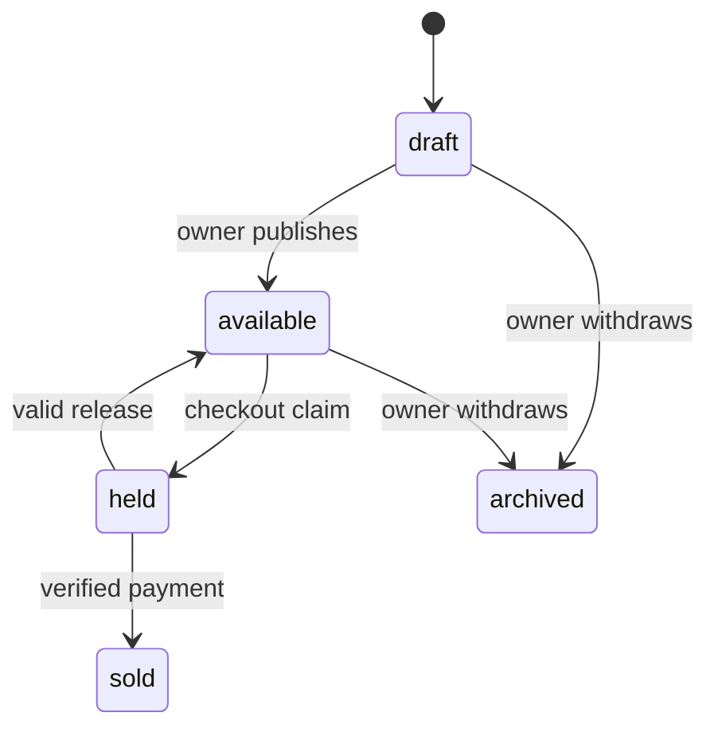

# Piece model

Define Piece with `workshopId`, optional `artisanId`, title, description, craft, common material and care fields, bounded craftDetails, price in minor units, currency, photo references, `status` and optional `hold`. Default to draft. The public catalogue lists available and perhaps sold portfolio pieces according to the page design; it must never surface draft internal notes. Price belongs to the workshop and is recalculated on the server when a checkout begins. A client-submitted total is not authoritative.

Use status values draft, available, held, sold and archived. A hold subdocument needs checkout ID and expiry time. Do not keep `stockQty`; it is possible to have exactly one Piece and still need to distinguish held from sold. Do not set `quantity: 1` in cart as a second source of truth. Each cart line references one Piece ID, and the later hold claim uses an atomic conditional update on that Piece document.

Add indexes for workshop dashboard (`workshopId`, updated time) and public availability queries. Test a Piece with negative price, invalid status, unknown craft and mismatched Artisan/workshop. Schema validation can reject the local invalid values; the cross-document credit check belongs in a service that reads Artisan and Workshop. For a sold Piece, keep approved photos and maker credit so its page can offer "request something similar" without offering purchase.

Write a state transition sketch beside `docs/erd.md`. It should say who may publish a draft, hold an available Piece, mark a held Piece sold after verified payment, release an expired hold, or archive an unsold listing. Avoid implementing a generic status patch that lets a workshop mark a buyer's paid order as never sold. Later modules will implement transitions with payment and race checks; this chapter supplies the entity and constraints.

Seed twelve Pieces across three workshops. Make two sold, one draft and one held by a test checkout; leave the rest available. Browse as a buyer and inspect raw JSON. A held Piece should not promise immediate purchase, and a sold Piece should not be addable to cart. Re-run the seed without changing how many Pieces exist. If counts grow, fix the stable seed key before checkout tests become impossible to reason about.

## Walk one Piece from draft to sold

Create a carved bowl as a draft. Its Workshop owner may edit the title, technique and photos without putting it in public browse. After verifying price, care and images, the owner publishes it as available. A buyer starts checkout, which later claims the Piece as held under one Checkout ID. Only verified payment marks it sold. The sold page stays as a portfolio example, but an old add-to-cart request fails. This journey explains every status in the schema more clearly than a generic inventory quantity.

The Piece schema holds Workshop ID, optional same-workshop Artisan ID, craft category, shared material and dimension fields, a bounded `craftDetails` object, price in minor units, currency, ordered photos, status, and optional hold information. Set default status to draft and validate allowed values. Do not place buyer ID on the Piece as a permanent owner after sale; purchase evidence lives in Order and OrderLine. A hold may include checkout identity and expiry, but not client-supplied price authority.

## Prove the credit invariant

Create a Piece for Bayt al Zayt and attach an Artisan ID from the ceramics studio. Both IDs are valid, so a type validator may accept them. The service must reject the combination because the Artisan belongs to a different Workshop. Read both documents and compare Workshop IDs before saving. Repeat the test with no Artisan ID if anonymous workshop credit is allowed; the Piece can still be valid. This protects a maker's attribution and prevents an owner from misusing another Workshop's public credit.

A public response should be assembled from allowed fields. The Workshop may store internal production notes or a draft photo that a buyer should not see. Do not spread the full Piece Mongoose document into JSON. Include published approved images, display-safe maker credit, current status and the facts a buyer needs. For a held Piece, the page can say temporarily unavailable without revealing the other buyer's checkout ID or expiry detail. For a sold Piece, offer a request-similar route that creates a separate CustomRequest.

## Prepare the future race test

MongoDB writes to a single document are atomic. Later, the claim route can filter `_id` plus `status: available` and set `status: held` with a hold identity in one update. A prior GET can help the UI, but it is not the claim. Write a test skeleton with two concurrent claim attempts and one expected winner. Inspect `matchedCount` or the returned document, not just a response label. A database state of held with two successful checkout responses would be a defect even though the Piece row itself is singular.

Seed two sold, one held, one draft and several available Pieces. Search public browse and verify only states chosen by the product policy appear. A direct API request to buy a sold ID must be denied regardless of whether its page remains visible. Change an available Piece's price and see that a fixture OrderLine from an earlier sale does not move. The Piece model is current state; the order model in the next chapter is history.

## Inspect a stale status write

Open the owner editor for a draft Piece. In another tab, publish it. Then submit the old draft form with a `status: draft` field. The update route should not accept arbitrary status from general edit JSON; it should update allowed descriptive fields and leave the published state alone. A separate publish action can require current status draft and complete required fields. This prevents a stale browser from undoing a sale-related state transition as a side effect of editing care text.

A similar rule applies after a Piece is held. The owner may discover a typo, but changing price or craft while a checkout has frozen an offer can create conflicting promises. Decide which edits are blocked during held state and which harmless display corrections are allowed. Write that policy before the route. The data model's status is useful only if update services actually read it and act differently in each state.

Finally, verify the hold shape with a document query. A held Piece has a checkout ID and expiry; an available Piece has no active hold. If a release changes only status but leaves an old hold ID, a later worker or support tool may mistake it for an active claim. Clear or archive hold fields deliberately in the transition. This belongs in the future claim implementation, but the schema and test fixture can expose the invariant now.

For a Piece whose status is draft, photo upload may be incomplete. Permit a draft to save without every public field, then require complete title, price, material, care and approved photo before publishing. This separates authoring from a buyer-facing promise. A Mongoose `required` rule on every field would prevent useful drafts, while no publication validation would let an empty listing appear. Test a draft with missing care saves, but its publish action fails with a specific field message and leaves status unchanged.

Consider an archived Piece whose Workshop reopens the listing after repairing damage. That is not the same as reviving a sold Piece. An archive-to-draft transition can require the owner to review photos, care and price again before publishing. The model can support that future rule because archived and sold are distinct states. Write a test expectation now: an owner may not publish a sold Piece through the archive route, and a buyer's old cart cannot make the archived Piece available by requesting checkout.
