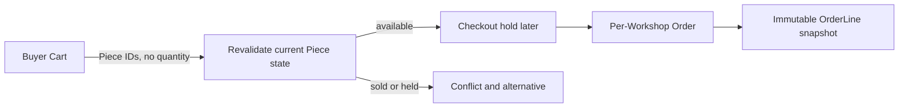

# Cart and Order models

Cart is an expression of interest, not a reservation. It belongs to a buyer and contains distinct Piece IDs. Reject duplicate IDs rather than interpreting them as quantity two. A Piece can become unavailable while it sits in a cart. Therefore, the cart page must show a clear stale-item state, and checkout must re-read each Piece before claiming holds. Do not let an old cart's displayed price become the payment amount.

One checkout may include Pieces from more than one workshop. The shared spine creates one Order per workshop after one payment coordination path, so every workshop sees only its own sale and shipping responsibility. Store buyer ID, workshop ID, payment reference, status and OrderLines. Each line embeds title, price, currency, craft, selected maker credit, dimensions summary and a chosen photo URL or asset reference as seen at purchase. Also store Piece ID for navigation and audit. A later reprice or credit-display change must not silently rewrite the receipt.

The OrderLine snapshot is historical evidence, while Piece.status is current inventory state. A sold Piece may have its public description corrected after the sale, but the order should retain the agreed price and promised shipping range. In a multi-workshop cart, sum integer minor-unit line amounts and shipping amounts on the server. Avoid floating point calculations such as decimal dollars multiplied in JavaScript. The actual shipping profile and destination validation come later, but the order schema needs fields to preserve the offer.

Create two orders in seed fixtures only if you label them as examples, not evidence of payment. A seed cannot prove a webhook was verified. Test a Product edit after fixture order creation: the OrderLine price and maker credit remain unchanged. Test a buyer requesting another buyer's order and a workshop owner requesting another workshop's order. Both raw API responses must deny access. Do not rely on frontend filtering to protect receipts or addresses.

Think about a held Piece whose payment fails. The cart may still exist, but the held Piece must eventually return to available under the correct checkout identity. This is a later workflow, yet the model must have a stable link from hold to checkout. Draw the relationship now, and mark exactly which module implements the transition. A schema diagram that stops at Order without showing Piece state makes the hardest race invisible.

## Start with a stale cart

Lina adds a bowl to her cart, then loses connectivity. Omar completes checkout for that bowl while Lina is offline. When Lina returns, her Cart still contains the Piece ID, but the Piece is sold. The cart is allowed to remember her intent; it is not allowed to create availability. Show a clear stale-item message and block checkout for that line. The API must re-read Piece state and attempt the proper hold. Do not assume that because the cart saved successfully, the Piece is still purchasable.

A Cart line identifies one physical Piece. If Lina taps Add twice, keep one line or return a duplicate message. There is no quantity selector for a one-off bowl. Add an index or application rule that prevents duplicate Piece IDs within one buyer's Cart. For two separate Workshops in one Cart, the later checkout should split seller-facing Orders while coordinating one payment. The order schema therefore stores Workshop ID per Order, not only a giant cross-workshop array in which every seller can see all lines.

## Preserve the agreement

At payment preparation, record the Piece title, craft, approved maker credit, selected photo, unit price and currency, shipping range and any other sale terms shown to Lina. OrderLine embeds those fields with the Piece ID. The ID preserves a link to the current public page, but the embedded values explain the receipt even if the Workshop later edits or archives the Piece. A corrected maker pseudonym may require a separate privacy policy; it should not silently rewrite the original amount paid.

Test snapshot immutability with a fixture, not a fake payment claim. Create an OrderLine for a 3,500-minor-unit Piece, then change the current Piece price to 4,000. The fixture line remains 3,500. Change the current care text and verify the line's captured care or description remains as originally recorded if it was part of the sale terms. The point is temporal separation, not merely data duplication. Mark the fixture as unpaid or test-only until a verified webhook exists.

## Split access along seller lines

Workshop A may view its Order and fulfill its Piece. Workshop B may view a separate Order from the same buyer's checkout. Neither Workshop may view the other's private buyer note, shipping segment or price breakdown beyond shared payment totals that the product deliberately exposes. Scope each order query by the authenticated owner's Workshop ID. The buyer may view all their own Orders. Test with two Workshops and a buyer who bought from both; a seller route that filters only by Checkout ID would disclose the other seller's line.

A held Piece whose payment fails needs a release path. The Cart may remain, but it must not automatically promise the Piece again until the server confirms the hold is released. Draw the checkout ID from Piece.hold to Checkout and then Order. This reference lets a worker compare identity before changing Piece state. Commit the Cart uniqueness, OrderLine snapshot and cross-shop access tests now; the later payment module will fill in verified state changes.

## Calculate one combined payment

Suppose Lina buys one Piece from Bayt al Zayt for 3,500 minor units and one ceramic Piece from another Workshop for 2,400. Their shipping amounts are calculated separately after destination validation. The Checkout total is the sum of both Piece snapshots and both shipping snapshots, all in one currency. Store that calculation on the server. If the cart body submits a different price, ignore it or reject the request; never use it for the provider amount. The two Orders should add back to exactly the one Checkout total.

After payment, Workshop A must see only its own 3,500-unit line and shipping obligation. Workshop B sees only its 2,400-unit line. Lina can see both through her buyer account. A seller asking for the Checkout ID must not receive the other seller's private details merely because the payment is shared. Scope seller endpoints by Order.workshopId and buyer endpoints by Order.buyerId. Test both directions with raw requests and compare the response fields.

When a Piece sells, its public story may stay visible. An OrderLine's photo snapshot should remain available to explain what Lina bought even if the workshop later reorders the public gallery. Store an approved stable asset reference or URL under a retention policy; do not assume the first current photo is the same image that was shown at sale. This choice should be visible in the schema rather than hidden in a receipt component.

A stale Cart should also preserve the buyer's context. If the sold bowl was part of a two-Workshop checkout, the other Piece may still be available. The API can return line-level conflicts and a revised total rather than destroying the whole Cart silently. The buyer chooses whether to continue with the remaining item. Never charge the old total while quietly omitting one Piece. This behavior requires Cart lines to retain distinct Piece IDs and Checkout to calculate accepted lines from current server state.

For the buyer's receipt, include the Workshop identity as it was displayed at sale. A Workshop may later change its public name or close, but the buyer still needs to know who accepted the order. Store a safe seller snapshot on Order, while retaining Workshop ID for support and authorization. Avoid copying private owner contact details into the snapshot. This is another case where current catalogue identity and historical agreement should be related but separate.
