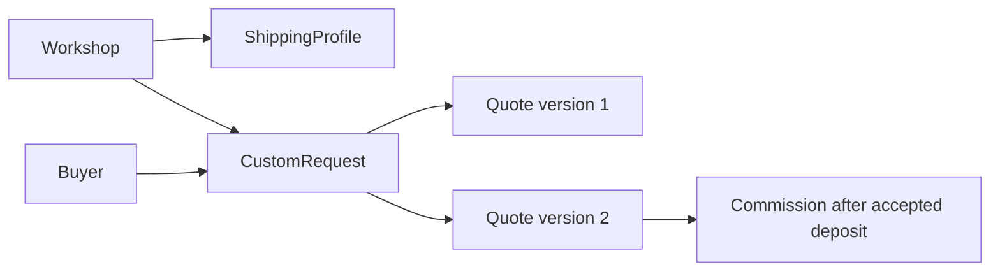

# ShippingProfile, CustomRequest, Quote and Commission

Create ShippingProfile for each workshop with served countries or regions, handling range and estimated transit range. Keep the ranges explicit and avoid converting them into a guaranteed delivery date. A buyer's destination may be excluded by one workshop while allowed by another; the checkout chapter will split decisions per workshop. Model a profile version or snapshot fields so a paid order can preserve the shipping promise that was presented at purchase.

CustomRequest contains buyer, workshop, brief, optional inspiration Piece, reference photo IDs and a limited status. It is private. Quote references a request and stores a version, scope, total price in minor units, deposit amount or rule, expiry, lead-time range and status. Commission references the accepted quote and buyer/workshop, with production status and later payment references. These are skeletons at this stage: their precise acceptance, payment and cancellation transitions belong in Modules 22 to 24. Document that boundary in the schema comments and ERD.

A quote is not a mutable note on the request. The workshop may revise the price or scope while the buyer is viewing an older screen. Versioned Quote records let the server reject an acceptance of stale version 1 after version 2 exists. A unique key on request ID and version prevents duplicate versions, but the application still needs an atomic current-version rule later. Store the accepted version on Commission. Do not let a buyer send a deposit amount; it will come from the accepted server-side quote.

Add minimum valid seed records: one open request from Buyer A to Workshop A and no paid commission. Optionally add a separate declined request to test privacy and states. A buyer from another account cannot read it. Workshop B cannot read it. A credited artisan cannot read it merely because their Piece is referenced. These tests are necessary now because reference photos and budgets are private, even before messaging routes exist.

Try to seed a Quote whose request belongs to a different workshop, and a Commission whose accepted quote does not match its buyer. A Mongoose ref alone will store these invalid combinations, so application service validation or a transaction must defend them. Record this as an invariant in `docs/erd.md`. Later modules will fill in the state machine; they should not have to guess which IDs were meant to be linked.

## Give shipping its own policy record

A Workshop may ship finished Pieces only to certain countries. It may need several days to prepare an existing bowl for dispatch, and transit time varies by destination. ShippingProfile stores served regions, handling range, transit range and a version or timestamp. A buyer's destination can be valid for one Workshop and invalid for another in the same Cart. The later checkout must present those decisions per Workshop before taking money. Do not turn a range into a guaranteed date in the schema or UI.

This diagram places ShippingProfile beside the business and Quote versions beside the request. They are different kinds of records: shipping policy can change for future sales; a Quote version is a specific offer to one buyer. An OrderLine or Commission needs a snapshot of terms accepted at the time. A later profile edit should not rewrite an existing buyer's shipping promise, and a later quote revision should not change a version the buyer already saw.

## Model a quote as an offer with history

CustomRequest stores buyer, Workshop, brief, budget range, wished date, optional inspired-by Piece and private photo references. Quote stores request ID, version number, scope, total, deposit, remaining balance rule, expiry and lead-time range. Commission stores accepted Quote ID and version, buyer, Workshop, production status and later payment references. Use finite status enums but mark transitions as unimplemented until their modules. An enum prevents a spelling mistake; it does not prevent a buyer from moving submitted straight to delivered unless the service forbids it.

Try a concrete update. The Workshop offers 12,000 minor units with a 30 percent deposit in version 1, then changes material and price in version 2. Version 1 must remain as history, but only version 2 may be accepted if it is current under the policy. Store a unique `(requestId, version)` index and a current-version pointer or conditional state rule. The detailed concurrent acceptance logic belongs in Module 23, yet this data model must give that logic a place to store its decision.

## Reject mismatched chains

A Quote for Workshop A's request must not be inserted with Workshop B's ID. A Commission must not point to a Quote for another buyer. A ShippingProfile must not be editable by a different Workshop owner. Mongoose references do not enforce these cross-document facts automatically. Write service checks and tests with valid foreign IDs. For the seed, create one open request with no Quote and perhaps one separate historical declined request. Do not seed a paid Commission and present it as evidence of a working deposit webhook.

Private photos and budget ranges stay off public Piece pages. The request inbox query is scoped by Workshop owner, and a buyer's request list is scoped by authenticated buyer ID. A credited Artisan is not automatically a party to the request. These access tests should be written before adding messages, because later conversation content will inherit the same two-party boundary. End the chapter by marking which collection each later module will deepen: request messaging in 22, quote and deposit in 23, production and balance in 24.

## Test incompatible references

Create Request R for Workshop A and Quote Q that claims Workshop B. Both IDs exist, but the relationship is invalid. The service should load R and derive Workshop A rather than trust the posted Workshop ID. If Q must include Workshop ID for query speed, verify it matches R and document which field is authoritative. A generic Mongoose ObjectId ref checks the type of the ID but not that two collections agree. This is why cross-document business rules need explicit service tests.

Create a Commission fixture that points to an unaccepted Quote. The schema might allow the reference, but a real transition must reject it. Mark the fixture as invalid and keep it in a negative test, not in the normal seed. The later deposit module must check current Quote version, expiry and payment state before starting work. A Commission row created by a direct POST with arbitrary status would make the timeline untrustworthy from its first step.

For ShippingProfile, test a buyer destination that one Workshop excludes but another serves. A multi-workshop cart should show the difference before payment. The model can represent this through separate profiles, but an Order needs the accepted shipping range snapshot to prevent future profile edits from rewriting the buyer's receipt. Add those snapshot fields now even if shipping calculation arrives in another module.

A Workshop's commission acceptance flag can change while a buyer is filling a request form. The submit route must re-read it and reject a newly paused Workshop with a clear message. Do not let the request appear in the inbox if the Workshop is not accepting work. By contrast, an already submitted request may remain visible and be answered or declined under the documented policy. The model needs both a current Workshop setting and a durable request status; one boolean cannot describe the whole conversation.

Add a quote expiry example to the seed design, but keep it out of the normal paid flow. A Quote whose expiry has passed should not be accepted even if the browser still displays its Accept button. The later route must compare server time and current version; the Quote model therefore needs an expiry instant, not a free-text date range. Test with an injectable clock so a learner can reproduce the boundary without waiting for a real week.
