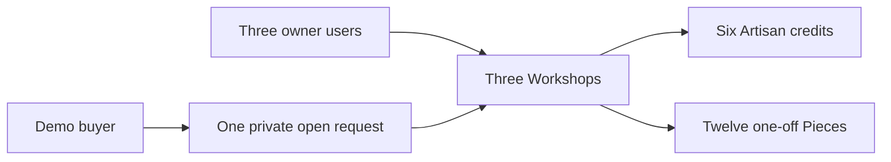

# Seed script

Write a development-only seed that refuses to run against a production database. Create three fictional workshops in different crafts, six credited Artisan records, twelve finished Pieces, exactly two sold Pieces and one open CustomRequest. Include a draft Piece that the public catalogue cannot see, a held Piece whose expiry is controlled by a test fixture, and a no-name Artisan. Use prices in minor units and realistic ranges, not zero-filled placeholders. Each record should show a deliberate relationship and test an upcoming lesson.

Do not use real artisans' names or photos without a right to do so. Describe craft techniques respectfully and accurately, but label the shops fictional. For images, use assets the team owns or small local placeholders that are clearly demos. Do not make a buyer reference photo public simply because it is convenient for the seed. If a reference is seeded, keep its storage identifier out of public Piece JSON and link it only to the private request.

Make the seed idempotent through stable fixture keys and upserts. Running it twice should leave three workshops, six artisans and twelve Pieces, not double those counts. Do not use a blanket delete in a shared database. Put an environment guard before any cleanup option, and log the chosen database name. A power interruption between writing workshops and Pieces should be recoverable by rerunning the seed without creating conflicting owner records.

Inspect one record per category in MongoDB Compass or the shell. Follow ownerId to Workshop, workshopId to Piece, artisanId back to the same Workshop, and buyerId to CustomRequest. Query public available Pieces and ensure sold, held and draft states are handled deliberately. Then query the workshop dashboard with the wrong owner ID and confirm it returns no other workshop's rows. A seed is only useful if these links reflect the actual query paths learners will later implement.

Save a tiny seed evidence file with counts and example IDs, excluding credentials. Use the fixture in tests for a sold Piece's "request similar" action, a wrong-workshop artisan assignment, a two-workshop cart, and an excluded shipping country. If any of those scenarios requires manually editing the database first, improve the seed now. The purpose of this module is to let later work focus on behavior rather than inventing data at every step.

## Treat the seed as a small proof

The seed should contain more than pretty names. It should make each future error path executable. Create three fictional Workshops: one with tatreez, one with olive wood and one with ceramics. Create two Artisan credits in each, with one pseudonym and one hidden-name preference. Create twelve distinct Pieces, not twelve units of a Product. Make two sold, one held, one draft and the rest available. Add one open CustomRequest with a buyer and intended Workshop. Keep private reference images as locally owned placeholders or omit them until private storage is configured.

Each fixture should have a purpose. A sold olive wood bowl powers "request something similar." A held bowl powers a stale-cart conflict. A draft cushion proves public browse excludes unpublished work. A ceramics Piece with unknown food-safe status tests honest display. An Artisan with hidden-name preference tests the public serializer. A ShippingProfile excluding one destination tests per-Workshop checkout later. Write those purposes in comments near stable fixture keys, not as an unrelated prose note a maintainer may overlook.

## Make a second run safe

Use stable fixture keys and upsert by those keys. Do not delete all Workshops before reseeding; a development database may contain a learner's own work. If a reset option exists, guard it by an explicit development environment and print the target database before proceeding. The seed must survive a process stop after Workshops are written but before Pieces finish. On rerun, it should find the same owner and Workshop IDs and fill the missing rows without creating duplicates or foreign Artisan links.

Run the seed twice and record counts after both runs. Expect three Workshops, six Artisans, twelve Pieces and one open request. If the count changes, inspect the upsert filter and unique index before modifying the expected value. A random generated title used as a filter will never match its prior run. Use fixed keys such as `demo-olive-workshop` only in the seed script, not as production business IDs. Once a row exists, use its database ID for relationships in this run.

## Inspect relationships, not just counts

A count of twelve Pieces can hide a Piece owned by the wrong Workshop or crediting a maker from a different one. Query one Piece from each craft and follow `workshopId` and `artisanId` to their records. Query the private request as its buyer and intended Workshop, then as another buyer and Workshop. The second pair must receive no brief or photo identifiers. Query the public catalogue as anonymous and verify it excludes draft and held purchase actions according to the product policy.

Use only fictional people and shops. Do not copy a real artisan's portrait or private story into a teaching fixture. If you need images to exercise layout, use owned placeholders with descriptive alt text. This protects the people represented and makes the data portable for every learner. Commit the script and a short evidence file with counts, sample IDs and denied-response statuses, but never credentials or storage secrets.

## Verify a repair run

Delete only one development fixture Piece in a disposable database, leaving its Workshop and Artisan intact. Rerun the seed. It should restore that Piece and leave the other eleven unchanged. Compare IDs before and after. If every Piece gets a new ID, stable keys were not used correctly; if the missing Piece stays missing, the script may skip dependent creation after finding an existing Workshop. This is a better idempotency test than simply running a successful seed twice.

Now change one fixture Piece's current price manually and rerun. Decide whether the seed resets it to canonical demo data or preserves the learner's edit. Either policy can work in a development-only fixture, but write it down. A silent mix of reset and preserve behavior makes tests unpredictable. Use distinct fixture keys so the script never touches learner-created Pieces that happen to share a title.

Keep the evidence compact: exact command, development database name, first and second counts, one repaired Piece ID, and one rejected wrong-workshop Artisan assignment. These text facts are more useful than a screenshot of a full collection. They also survive low bandwidth and let a mentor reproduce a failure without guessing which UI action created the row.

At the end, compare seed behavior with a real owner edit. If a learner modifies a fictional Piece's title to test a UI, the next seed run should follow the documented reset or preserve policy. The seed's purpose is stable teaching evidence, so unexpected overwrite is a defect even in development. Keep fixture keys and seed-only metadata out of public response fields. A buyer should see the crafted item, not the implementation key used to make a rerun idempotent.

Use one open CustomRequest addressed to Bayt al Zayt and linked to a sold bowl as inspiration. Verify the inspiration Piece belongs to that Workshop. A direct database query for the request should show buyer and Workshop IDs, but the public bowl response must not contain the request brief or its buyer ID. This paired check is stronger than checking either collection alone because the reference link is precisely where a careless populate could leak private information.
