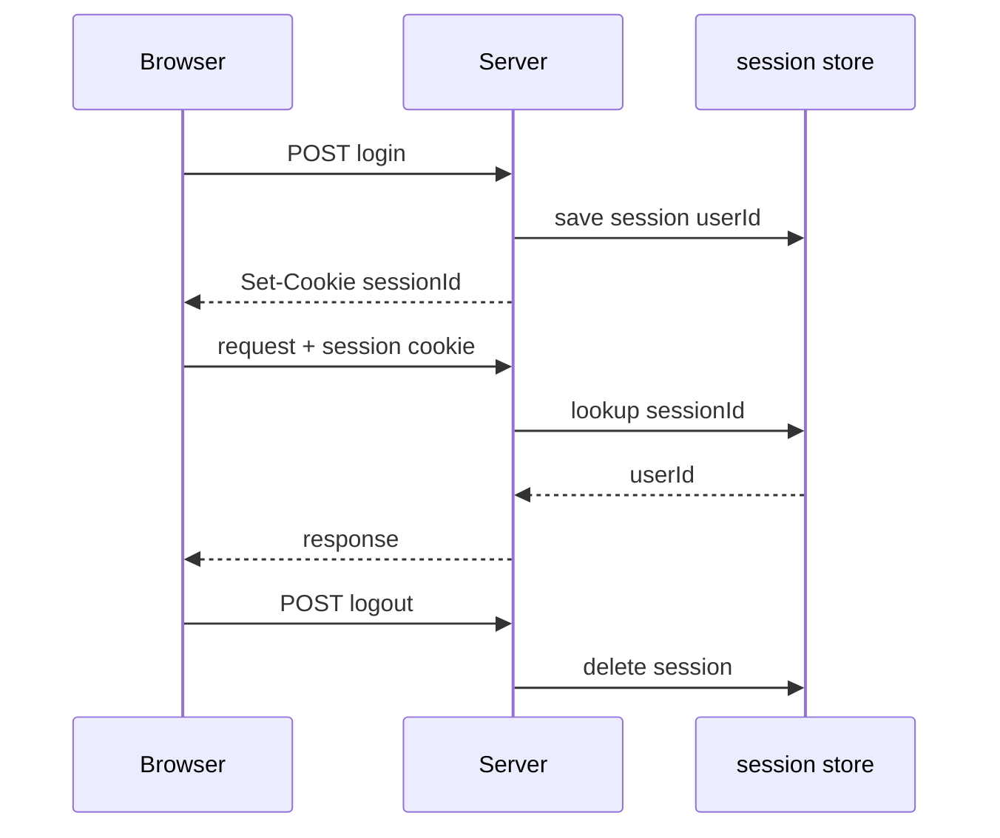
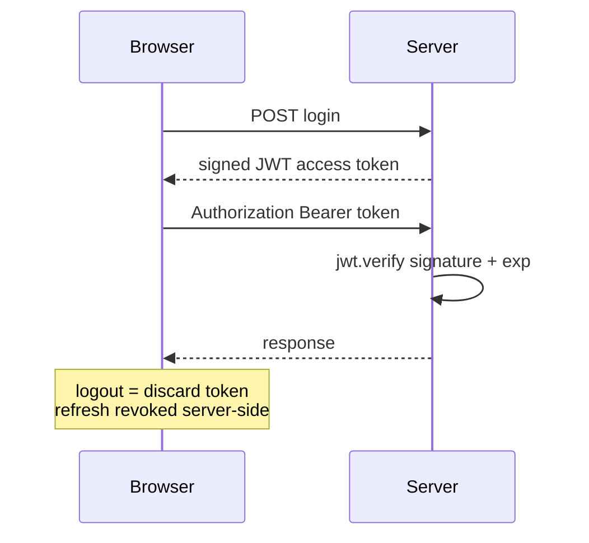

# 6.4 ,  Sessions vs JWT

> **[Learn]** · Chapter 06 ,  Authentication API · *Stateful vs stateless; pros/cons; **JWT for this course***

Every authenticated API must answer: **how does the server remember who sent this request?** Two dominant patterns ,  **server-side sessions** and **JWT (JSON Web Tokens)**. This course mandates JWT for Ghurza.

<BigWordAlert term="Stateless JWT" plainEnglish="A signed token the client sends on each request ,  server validates signature without storing session in memory." whyItMatters="Ghurza uses JWTs so the API scales without a central session store ,  good fit for a Node + React split." />

## Why this matters

The two patterns are not rival brand names for the same thing. Choosing between them moves **where state lives**, from a record the server keeps to a claim the server signs, and that move changes how logout behaves and how a React client proves who it is on every call. A learner who picks one without reading the other ends up asking why a logged out buyer still reaches a protected route. Ghurza takes JWT access plus a hashed refresh token, so the trade against a Redis session store should be a decision you can defend, not a detail you inherited.

## Think of it like…

**Hand stamp vs driver's license at a festival.** Session: venue keeps a list at the door, you show a wristband number. JWT: you carry a signed pass with expiry printed on it ,  gate staff verify signature, not a lookup list (until refresh revocation).

<ComparePanel title="Sessions vs JWT">
  <CompareColumn label="Sessions">
    The server keeps the session record in Redis or its own database. The buyer's browser holds only a session cookie. Logging out deletes the record, so the next request finds nothing to match. Running several API processes means they must share that store.
  </CompareColumn>
  <CompareColumn label="JWT (this course)">
    The server signs a token, and the client returns it in a Bearer header. Logging out clears the stored refresh hash. Verification needs no central lookup, so another API process can be added without coordinating a store.
  </CompareColumn>
</ComparePanel>

## Where the state lives on each request

Two buyers can send byte identical requests to Ghurza and receive different answers, and the reason is never in the request. It is in what the server remembers. Reduce the comparison to one question: when Lina opens her commission timeline and that request reaches the API, does the server already know who she is, or does it have to look her up?

Sessions answer with a lookup. The cookie carries an opaque identifier, and the meaning of that identifier lives in a store the server controls, which is exactly why deleting a session record revokes access on the very next request. JWTs answer with arithmetic. The token carries the identity claim and a signature computed with a secret the server already holds, so verification is a hash and a comparison and nothing has to be remembered between requests. A second API process behind the same load balancer reaches the same verdict as the first, because both processes hold the same secret.

Hold those two sentences and the rest of the chapter stops being a list of opinions. Instant revocation is a property of the store: delete the row and the next request finds nothing. Statelessness is a property of the signature: a valid signature over an unexpired claim is the whole proof. Logout behaviour, horizontal scaling and cookie handling all follow from that split, which is why this chapter keeps returning to where state lives rather than to which library is fashionable.

## Common questions

**Q: Are JWTs encrypted?**  
A: No. A JWT is *signed*, and signing is not encryption. Anyone holding a token can split it apart and read the payload as plain text, which takes one paste into jwt.io. What they cannot do is alter a claim, because the signature only verifies over untouched bytes. Treat the payload as a postcard anyone may read, sealed so nobody can edit it, which means no passwords, no secrets, and nothing you would mind a stranger seeing. The signature proves who issued the token and that it arrived intact, never that its contents are hidden.

**Q: Why short access token if refresh exists?**  
A: Because a leak should stop being useful very quickly on its own. The access token is the credential your API client keeps in memory and attaches to every call, so it is the piece most exposed to a stray script. With a fifteen minute lifetime, a stolen copy is worthless almost the moment it leaves. The refresh token sits elsewhere, in an httpOnly cookie that JavaScript cannot read, and can be revoked on the server, which is exactly what lets it live for a week without carrying the same risk.

**Q: Why not sessions with Express default memory store?**  
A: Two reasons, both specific to this course. The default store keeps sessions in the RAM of one process, so a second process knows nothing about them and a restart wipes the lot. And the SPA with Bearer tokens pattern taught here is the one the remaining chapters assume, and the one most production MERN teams run with. Sessions are a reasonable choice for a small server rendered app. They are simply not the shape Ghurza is built around, and switching halfway would rewrite the client auth work in Chapter 7.

## Server-side sessions



```
Login → server stores session in Redis/DB → returns session ID cookie
Each request → server looks up session → loads user
Logout → delete session server-side
```

| Pros | Cons |
|---|---|
| Revoking a session takes one delete | Stateful, so a store has to exist somewhere |
| The cookie carries only an opaque id | Scaling out needs that store to be shared |
| The server owns session lifetime completely | Redis adds infrastructure and a running cost |

Classic choice for monolithic apps with server-rendered pages.

## JWT (stateless access token)



```
Login → server signs JWT with secret → client stores token
Each request → client sends Bearer token → server verifies signature + expiry
Logout → client discards token; server may revoke refresh only
```

| Pros | Cons |
|---|---|
| No store lookup on every request | An unexpired token survives logout |
| Any API process can verify on its own | Payload is readable, never encrypted |
| Works well for SPA and mobile clients | Rotating the signing secret needs care |

**Hybrid used here:** Short-lived JWT access + long-lived refresh stored hashed in DB ,  revoke refresh kills renewal.

## Worked trace: one buyer, four requests

Follow Lina through a session that outlives her access token. The trace is short because only two of the four steps touch stored state at all: login writes the refresh hash, and the refresh call reads and replaces it. Everything in between is a signature check, and the server never asks the database who she is.

<TraceRequest title="Lina's session across a 15-minute access token">
  <TraceStep actor="Client" label="Lina logs in on the Ghurza login page" detail="Password compared with bcrypt, access token signed for 15 minutes, refresh hash written to the User document" />
  <TraceStep actor="API" label="GET /api/commissions" detail="Bearer token verified with JWT_SECRET, no identity lookup against the database" />
  <TraceStep actor="API" label="Minute 16 arrives" detail="verify throws TokenExpiredError and the client receives a 401" />
  <TraceStep actor="Client" label="POST /api/auth/refresh" detail="Refresh token hashed and compared, new access token returned and a rotated refresh hash stored" />
</TraceRequest>

That ratio is the reason the pattern scales: four requests, two touches of stored state. It is also the reason logout feels less absolute than a session logout, and that gap is the next section.

## The revocation gap you accept

Suppose Lina taps logout at minute 12. The server clears `refreshTokenHash` and the client forgets the access token it was holding, but any copy of that access token taken before logout still verifies until its `exp` claim passes. The gap is not a bug in your code. It is the width of the access lifetime, and it is the price of never looking anything up.

Two habits follow from that. Keep the access lifetime short enough that the gap is measured in minutes rather than days, which is why fifteen minutes appears throughout this chapter instead of an hour. Then treat refresh revocation as the real kill switch. It cannot recall a token already in flight, but it guarantees that no new access token can be minted, so exposure ends at the next expiry instead of continuing for a week.

A stricter system can close the gap completely with a `tokenVersion` number on the User document, incremented on logout or password change and compared on every request. It works, and it is worth knowing, but notice what it costs: one database read per request, which is the single thing statelessness was buying. Choose it deliberately for a buyer who needs immediate revocation, such as a suspended workshop owner, rather than adding the field by habit.

## Rotation races and how they look

Refresh rotation introduces a failure that looks like random logouts. Lina has the Ghurza collection open in two tabs, and the refresh cookie is shared by the whole browser, so both tabs hold the same refresh token. At minute 16 both tabs call `/api/auth/refresh` within a few hundred milliseconds. The first arrives, rotates the token and writes a new hash. The second arrives with the old token, its hash no longer matches the stored one, and the API answers 401. One tab continues and the other throws a logged in buyer at the login screen.

The tell is in your logs: two refresh attempts for the same user less than a second apart. That pattern means the client is racing itself, not that the server is broken. The cheap fix is a single flight refresh in the API client, one shared promise that both callers await, which Chapter 7 builds. The server side alternative is a short grace window where the previous hash is still accepted, or a token family where reuse of a rotated token invalidates the family. Decide before you write the interceptor, because retrofitting rotation into a client that refreshes on every failed request is messy.

## Debugging a rejected token

A 401 from `/api/commissions` while holding a token you believe is valid has four common causes, and they are worth checking in order because each one is cheaper than the next. Does the header actually read `Bearer ` followed by a space, and is a token present at all? Did the process that signed the token and the process that verified it read the same `JWT_SECRET`, including the same trailing whitespace and the same env file? Is the token expired rather than malformed, which you tell apart by catching `TokenExpiredError` separately from `JsonWebTokenError`? And is the machine clock sane, because `exp` is compared against the wall clock of whichever process verifies it?

Log the error name and the claim timestamps, never the token itself. An `invalid signature` line almost always means the two sides disagree about the secret, and in practice that is either a secret rotated on one side only, or a `.env` file loaded by the API and forgotten by the worker that was started in a second terminal.

## Why JWT for this course

| Factor | Ghurza choice |
|---|---|
| MERN SPA client | Bearer token in memory fits React |
| Module monolith | No separate session Redis until Ch 21 cache |
| Learning goal | Industry-standard JWT + refresh pattern |
| Pair with Ch 7 | 401 refresh loop teaches real client auth |

Redis in Chapter 21 is for **catalogue cache**, not sessions.

## What goes in JWT payload

**Include:**

- `sub` or `userId` ,  MongoDB User _id
- `role` ,  vendor | customer  
- `iat`, `exp` ,  issued/expiry  

**Never include:**

- passwordHash  
- email (optional ,  prefer /me endpoint)  
- refresh token inside access token  

Keep access payload minimal ,  reduces leakage if token stolen.

## Refresh token pattern

The two tokens do very different jobs ,  one proves you're still logged in for minutes, the other proves you're still logged in for days:

| | Access JWT | Refresh token |
|---|---|---|
| Lifetime | 15 minutes | 7 days |
| How it travels | Authorization header | httpOnly cookie in Ch 7, body for Ch 6 curl |
| Kept on the server | Nothing stored | Hash on User.refreshTokenHash |
| Ending it | Let it expire | Clear the hash on logout or rotation |

**Rotation (recommended):** New refresh on each refresh call ,  invalidate old hash.

## Comparison table

Side by side, the practical differences that matter on a real codebase:

| Concern | Sessions | JWT access + refresh |
|---|---|---|
| Revoke everything at once | Easy | Clear the refresh hashes, access runs to expiry |
| Database lookup per request | Yes | No, verification only |
| XSS reaching the credential | Cookie is httpOnly | Memory storage narrows the window |
| CSRF exposure | Cookie sessions are exposed | Bearer header on an API is far less exposed |

## Decision record

Document in learning log:

*"Ghurza uses JWT access tokens verified with JWT_SECRET and refresh tokens hashed on User. Access is stateless; refresh revocation provides logout. Session store deferred."*

## ✅ Do / ❌ Don't

**✅ Do:** Keep access lifetime short ,  15m default.

**✅ Do:** Hash refresh token before DB storage ,  like passwords.

**❌ Don't:** Put JWT_SECRET in git or client.

**❌ Don't:** Store access token in localStorage if avoidable ,  Ch 7 uses memory.

## Reflect

What happens if user clicks logout but access JWT still unexpired? How does refresh revocation help?

## Next

**Sub-chapter 6.5:** Password hashing ,  bcrypt, salt, cost factor.

Architecture chosen ,  password storage mechanics next.
