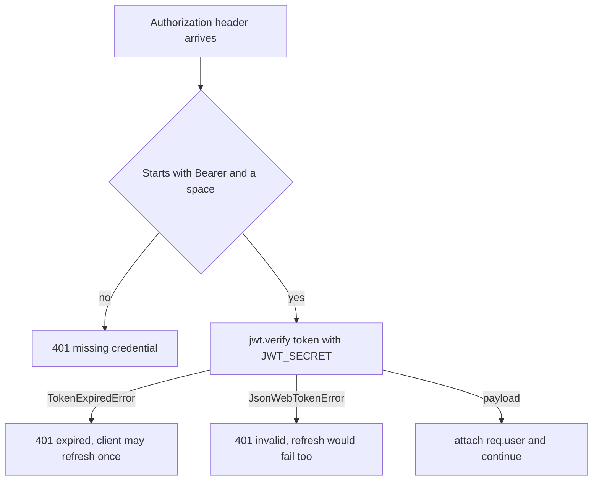

# 6.7 ,  Prime your thinking

> **[Learn]** · Chapter 06 ,  Authentication API · *Mandatory reads: bcrypt, JWT intro*

Before scaffolding auth routes, read how bcrypt and jsonwebtoken behave in Node ,  especially async APIs and error types. Thirty minutes prevents "invalid signature" loops.

<BigWordAlert term="Access vs refresh token" plainEnglish="Short-lived access token for API calls; longer refresh token to get new access tokens without re-login." whyItMatters="Ghurza access tokens expire in minutes; refresh tokens keep buyers logged in across tab sessions." />

```predict
prompt: "A buyer's access token expires while their refresh token is still valid. What should Ghurza do?"
options:
  - id: extend-expired
    label: "Keep accepting the expired access token until logout"
  - id: rotate-access
    label: "Use the refresh token to mint a new access token"
correctOptionId: rotate-access
explanation: "Short-lived access tokens limit exposure. A valid refresh token is the credential used to mint a replacement; an expired access token must not become valid again."
allowRetry: true
```

## Mandatory reads

Read these four in order. The first two are the tools you'll type into `server/src/` this chapter ,  read their official READMEs so you use the APIs the way the maintainers intend, not the way an old blog post remembers them.

| Resource | Focus |
|---|---|
| [bcrypt npm readme](https://www.npmjs.com/package/bcrypt) | hash + compare async API |
| [jsonwebtoken readme](https://www.npmjs.com/package/jsonwebtoken) | sign, verify, expiresIn |
| [JWT.io introduction](https://jwt.io/introduction) | structure recap |
| Express [Router mounting](https://expressjs.com/en/guide/routing.html) | `/api/auth` prefix |

Optional: [OWASP Authentication Cheat Sheet](https://cheatsheetseries.owasp.org/cheatsheets/Authentication_Cheat_Sheet.html) ,  password storage section.

## bcrypt API notes

```javascript
// hash ,  async preferred
const hash = await bcrypt.hash(password, 10)
// compare
const match = await bcrypt.compare(password, user.passwordHash)
```

Sync variants exist ,  use async in Express handlers to avoid blocking event loop.

## What bcrypt stores and why the cost matters

Bcrypt takes three inputs: the password, a random salt it generates on every call, and a cost factor that says how many rounds of the key schedule to run. The string it returns carries the algorithm version, the cost, the salt and the digest, which is why `bcrypt.compare(candidate, stored)` needs nothing else. It reads the salt and the cost back out of the stored string, runs the same work on the candidate, and compares the two digests.

The salt is why two buyers who pick the same password still end up with different hashes. Without it, an attacker with a stolen dump could hash one guessed password once and match every row that used it. With a per user salt, the same guess has to be run separately for every row, so the attacker pays the cost factor once per account instead of once for the whole dump. The cost factor is the second half of the same argument: each increment doubles the work, so cost 10 costs a login about a tenth of a second and costs an attacker the same for every guess.

That trade-off has a second edge that beginners meet in production. Raising the cost from 10 to 14 protects the dump better and also makes every login on a small server take noticeably longer, so measure on the host that will actually run it rather than on your laptop. The npm `bcrypt` package also cuts the input at 72 bytes, which means a long passphrase is silently truncated rather than rejected. If you accept passphrases, either validate a maximum length below that boundary or pre-hash the input, and write the decision down before a buyer discovers it.

```js
// what a stored value looks like: version, cost, salt, digest
const hash = await bcrypt.hash("a long passphrase the buyer chose", 10)
// $2b$10$Q9h1jJ7Vb3q0Jm5Kd8sOe.7zKk1Qm2s5vY9pLr4tXc6nB8wA0dF2u
const ok = await bcrypt.compare(candidate, user.passwordHash)
```

## How verification fails

Verification has exactly three useful outcomes, and the middleware has to tell them apart before it answers. A missing or malformed header is not a token problem at all. An expired token is a recoverable condition for a client that holds a refresh token. A token whose signature does not verify is not recoverable, and pretending otherwise sends the client into a refresh loop that cannot succeed.



The two error names are the whole reason the diagram branches where it does. `TokenExpiredError` carries an `expiredAt` date, so a log line can say when the token stopped being valid without printing the token. `JsonWebTokenError` covers a bad signature, a malformed string and a token signed with a different algorithm, and the safe response to all three is the same: refuse, log the name, and never tell the caller which part failed. A response that says "signature mismatch" hands an attacker a free oracle for guessing your secret.

## Trace a rejected request

<TraceRequest title="An expired access token on a protected route">
  <TraceStep actor="React" label="The commission page loads" detail="The API client attaches the access token it holds in memory" />
  <TraceStep actor="API" label="requireAuth calls jwt.verify" detail="Signature is fine, exp has passed, TokenExpiredError is thrown" />
  <TraceStep actor="API" label="The route answers 401" detail="The body carries a short message and no library detail" />
  <TraceStep actor="React" label="The client refreshes once and retries" detail="A new access token arrives, the same request succeeds, and the buyer never sees a login screen" />
</TraceRequest>

Read the last step as the reason the error must be classified rather than flattened into a generic failure. If the API answered 401 for a signature mismatch in exactly the same way, a broken secret in one process would look like an ordinary expiry, and the client would retry forever against a server that can never accept it.

## jsonwebtoken API notes

```javascript
const token = jwt.sign({ sub: userId, role }, secret, { expiresIn: '15m' })
const payload = jwt.verify(token, secret) // throws if invalid/expired
```

Error names to catch in middleware:

- `TokenExpiredError`
- `JsonWebTokenError`

Return 401 with `{ message: 'Unauthorized' }` ,  don't leak error details to client in production.

## Express middleware order preview

```
app.use(express.json())
app.use('/api/auth', authRoutes)
// later: app.use('/api/workshops', requireAuth, workshopRoutes)
```

`requireAuth` applied per-route or router ,  not globally on health.

## Where middleware order bites

`requireAuth` belongs to the routers that need identity, not to the whole application. Mounted globally with `app.use(requireAuth)`, it also guards `/health`, so the process that a load balancer uses to decide the API is alive starts answering 401 and gets marked unhealthy. The failure is confusing because the process is fine and every real route works when called by hand.

Mount the guard where the routes are declared, as `router.get("/api/commissions", requireAuth, listCommissions)`, or attach it to a router and mount that router under its prefix. Keep the health route, the login route, the register route and the refresh route outside it. Then a missing token on a public route is a validation question rather than an authentication wall, and the order of the guards in the file is the order you can read in a stack trace.

## Cost, memory and the event loop

Hashing is the slowest thing the auth API does on purpose, which makes it the first place a beginner build falls over. `bcrypt.hashSync` and `compareSync` block the event loop for the whole cost of the hash, so ten logins that arrive together queue behind each other and every other request waits too. The async functions hand the work to the thread pool, which keeps the process answering health checks and catalogue reads while passwords are hashed.

Two consequences are worth planning for. The thread pool has four threads by default, so a burst of logins is still limited by four concurrent hashes no matter how many requests arrive. And an attacker who can post to `/api/auth/login` without limits gets cheap CPU exhaustion for free, because each attempt costs you a hash and costs them nothing. Rate limit the login and register routes from the first day the API is reachable, not after the first incident.

## HTTP validation pattern

`auth.schema.js` decides what each route is allowed to receive. Every field you list here is something a real marketplace API validates ,  garbage in, garbage out is how bad APIs start.

| Route | Body fields |
|---|---|
| register | email, password, role, displayName? |
| login | email, password |
| verify-otp | email, otp |
| refresh | refreshToken (if body mode) |

Return 400 with field errors before service layer.

## Expiry arithmetic and one time codes

`expiresIn: '15m'` is a convenience, not a field in the token. The library converts it into an `exp` claim holding whole seconds since the Unix epoch, and every verifier compares that number against its own clock. That detail explains a class of bug that looks impossible: a token signed a second ago and rejected as expired, because the process doing the verifying has a clock several minutes ahead of the process that signed it. Containers on a managed host stay in sync, a laptop resuming from sleep sometimes does not, and `clockTolerance` exists for exactly that boundary rather than as a thing to set by default.

One time codes have the same shape of problem with worse consequences. A six digit code with a ten minute expiry and unlimited attempts is a brute force target, because a thousand guesses a minute finds it long before it expires. Give the code a short lifetime, burn it on the first successful comparison by clearing `otpHash`, and count failed attempts against the user so the fifth wrong guess closes the window. Store a hash rather than the digits, for the same reason you never store the password.

## OTP implementation options (pick one)

Both options store the code on the User document; they differ in how much damage a leaked database does. Plain text is fine for a dev-only demo; hashed is what you'd ship.

| Option | Storage |
|---|---|
| Plain OTP + expiry | otpCode, otpExpiresAt on User ,  dev only OK with short TTL |
| Hashed OTP | otpHash like password |

Dev delivery: `console.log('OTP:', otp)` when NODE_ENV=development.

## Note-taking template

```
Register service steps:
1. validate
2. duplicate email check
3. hash password
4. create user + profile
5. generate OTP
6. return { message, ...(dev otp) }

requireAuth:
- header parse
- verify
- attach req.user
```

Write that sketch before you open the editor, and write it as steps rather than as route names. The steps are what you will test; the names change. A register service that hashes before it checks for a duplicate email, for example, spends a hash on every retry of an address that already exists, which is a small denial of service you wrote yourself. Reading the list in order catches that, and so does one test that registers the same email twice and asserts the second answer is a 409 with no new document.

## Time box

| Activity | Minutes |
|---|---|
| bcrypt readme | 10 |
| jsonwebtoken readme | 15 |
| OWASP skim | 10 |
| Map routes to service functions | 15 |

## ✅ Do / ❌ Don't

**✅ Do:** Test jwt.verify with expired token manually.

**✅ Do:** Keep Postman/curl collection notes for 6.18.

**❌ Don't:** Implement handlers before env JWT_SECRET in config.

## Self-check before build cluster

- [ ] I can sign and verify a JWT in isolation
- [ ] I can hash and compare a password
- [ ] I know 401 vs 403 usage ,  unauthenticated vs verified/authorized

## Next

**Sub-chapter 6.8:** Authentication and token-safety knowledge check.

Reading done ,  build starts at 6.9.
