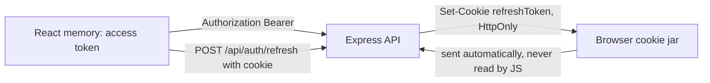

# 7.4 ,  Where tokens live

> **[Learn]** · Chapter 07 ,  Login & registration · *Access in memory; refresh in httpOnly cookie*

Concrete storage map for Ghurza client ,  implement in 7.10 and 7.14.

<BigWordAlert term="localStorage trade-off" plainEnglish="Browser storage that survives refresh but is readable by any JavaScript ,  vulnerable to XSS attacks." whyItMatters="Ghurza may use localStorage for access tokens in this course ,  understand the XSS risk you accept." />

## Why this matters

"Vague auth state" bugs dominate beginner SPAs ,  token in localStorage, refresh missing, reload logs everyone out, or refresh runs on login page causing loops. This page pins **exactly where each token lives** so implementation matches security intent from 7.2.

## Common questions

**Q: Why useRef instead of useState for the access token?**  
A: Both work. The difference shows up as re-renders. Any component reading a `useState` value repaints when that value changes, so a silent refresh, which swaps the token, could redraw a large tree with nothing visible to show for it. `useRef` keeps the value without scheduling a render. The cost is that nothing is notified when the ref changes, which is exactly right here, because the API client reads the token and the UI does not. Pass the gate with either, but pick once, stay consistent, and write the reason in your learning log.

**Q: Can React read the refresh cookie to debug?**  
A: No, and that is the entire point of the flag. `httpOnly` hides the cookie from JavaScript, so neither `document.cookie` nor `localStorage` will reveal it. Look in the Network tab instead: open the refresh request and read the `Set-Cookie` header on the response, or inspect the cookie jar under DevTools Application. You will see it being written and returned without ever needing its value inside your code. An empty cookie jar means the server never set it, which sends you back to the login handler rather than the client.

**Q: What is `credentials: 'include'`?**  
A: A fetch option, and without it the browser stays silent about cookies on a cross-origin call. Ghurza's Vite dev server runs on port 5173 while the Express API runs on port 5000, so every refresh call crosses origins. `credentials: 'include'` tells the browser to attach cookies to that call, which is how the httpOnly refresh cookie reaches `/api/auth/refresh` at all. Leave it out and the refresh route answers 401 forever, because no cookie was ever sent, and the symptom reads as broken auth rather than a missing option. One line in the API client settles it.

**Q: Why protect the refresh token more than the access token?**  
A: Because losing them costs different amounts. An access token that expires in fifteen minutes is a small loss even when stolen, since the window in which it works is nearly over. The refresh token stays valid for days and can mint fresh access tokens for that whole stretch, so a copy of it is closer to a spare key than a spare ticket. That difference decides the placement: the short-lived credential gets the convenient home in memory, and the long-lived one gets the strongest storage a browser offers, the httpOnly cookie. Match each token's home to the damage its loss would cause.

**Q: Why does page reload wipe the access token from memory?**  
A: Because memory belongs to the running page, not to the browser profile. A reload destroys the document and every variable it held, then builds a new one, so a value that only ever lived in JavaScript cannot come back. This is a feature: the access token is never left on disk for a later page, or a later script, to pick up. Recovery is the boot sequence. On mount the app calls `POST /api/auth/refresh`, the cookie supplies the proof, and a new access token is minted before any route renders. `isLoading` exists so the router can wait for that to finish.

## Access token ,  memory only

An access token is the proof your API client attaches to each call, and in Ghurza it lives in a JavaScript variable held by the AuthProvider. It is deliberately absent from localStorage, sessionStorage and any cookie that JavaScript can read. The trade is honest: memory lasts only as long as the tab is open, so a reload costs one silent refresh, which is the boot sequence described below. What the inconvenience buys is a much narrower window in which a hostile script could make use of the token.

**Location:** `useRef` or closure variable inside AuthProvider ,  **not** React state if you want to avoid re-renders on token rotation; plain state is fine if simpler.

**Set when:**

- Login success  
- Refresh success  
- App boot refresh success  

**Clear when:**

- Logout  
- Refresh failure  
- 401 after retry  

**Never:** localStorage, sessionStorage, document.cookie (JS-readable).

## Refresh token ,  httpOnly cookie

The refresh token lives for days, so it gets the strongest storage the browser offers: a cookie that JavaScript cannot read. Your server writes it through `Set-Cookie`, the browser keeps it, and React code never touches the value. When the API client calls `/api/auth/refresh` with `credentials: 'include'`, the browser adds that cookie on its own, which means no token handling exists in your components at all.

**Set by:** Server `Set-Cookie` on login and refresh responses.

**Read by:** Browser automatically on `fetch(..., { credentials: 'include' })` to `/api/auth/refresh`.

**Client JS:** Does not read refresh value ,  opaque to React.

## Server cookie spec (coordinate with Ch 6)

| Attribute | Dev | Production |
|---|---|---|
| HttpOnly | true | true |
| Secure | false (localhost) | true |
| SameSite | Lax | Lax |
| Path | /api/auth | /api/auth |
| Max-Age | 7d | 7d |

Cookie name: `refreshToken` ,  document constant on both sides.

## Boot sequence

A reload leaves nothing in memory, so the app has to rebuild the session before it renders a route. Skip that step and a signed in buyer either glimpses the login screen for a moment or gets pushed there for good. This boot time refresh is the mechanism that makes a reload feel like the session survived, even though the access token itself did not.

```
App mounts
  → AuthProvider calls refreshAccessToken()
  → POST /api/auth/refresh (cookie sent)
  → 200: set access in memory, set user from /me optional
  → 401: user stays logged out
  → set isLoading false
```

Prevents flash redirect on protected routes during boot.

## Trace the boot refresh

The boot sequence is short enough to read in one glance and easy to get wrong in one detail, so follow a single reload as four steps. The detail that matters is the order: the router must wait for `isLoading` to become false, otherwise it renders the protected route while the refresh is still in flight and the guard sees an empty token.

<TraceRequest title="Reload on a protected route">
  <TraceStep actor="React" label="The browser reloads the tab" detail="Fresh page, empty JavaScript memory, the previous access token is gone" />
  <TraceStep actor="React" label="AuthProvider mounts and calls refresh" detail="POST /api/auth/refresh with credentials include while isLoading stays true" />
  <TraceStep actor="API" label="The server rotates the pair" detail="Cookie hash matches the stored hash, a new access token is returned and the hash is replaced" />
  <TraceStep actor="React" label="The router renders the protected route" detail="Token kept in the ref, isLoading false, the timeline renders signed in" />
</TraceRequest>

Skip the second step and the fourth step renders the login screen for a session that was never lost. That is the bug that makes beginners blame the server, because the cookie is valid the whole time and the API was never asked.

## When two tabs disagree

Memory and cookies have different scopes, and that mismatch creates a logout bug worth understanding before you meet it. Suppose Amina has the workshop dashboard open in one tab and a commission timeline in another. Tapping logout in the first tab clears the cookie, which the whole browser shares, and clears that tab's in-memory token. The second tab still holds its own access token in a variable no other tab can reach, so it keeps rendering and keeps calling the API successfully until that token expires.

The lag is bounded by the access lifetime, at most fifteen minutes, and it ends in a specific way: the next call answers 401, the client tries to refresh, the cookie is gone, and the tab finally lands on login. The session did end, but not instantly, and users read the gap as a flaw. If instant logout across tabs matters for a workshop owner closing the laptop mid-conversation with a buyer, listen for a storage event on a small marker key, or poll `/api/auth/me` in the tabs that hold private work. Record the choice in your learning log, because the alternative is discovering it during a demo.

## Logout sequence

Logging out is symmetric with logging in: the client drops what it holds in memory, and the server invalidates the refresh cookie so it cannot be replayed. Do both sides ,  clearing only the client leaves a usable refresh token behind.

```
Client: clear access memory
Client: POST /api/auth/logout (credentials include) ,  if implemented
Server: clear refresh cookie + refreshTokenHash
Redirect to /login
```

## Diagram



Read the two arrow directions as the whole design. The access token travels from JavaScript because your client has to attach it, and the refresh token travels from the cookie jar because JavaScript is not allowed to see it. A drawing where both arrows leave React is the version that later grows a refresh token in localStorage.

## Dual mode during migration

While you wire the client, Chapter 6 may still be returning the refresh token inside the JSON body. That is a fair stepping stone, provided you say so out loud. Setting the cookie from client code is **less secure**, because the browser then holds the refresh value where a script could read it, even briefly, so treat it as a bridge and nothing more. The gate expects the httpOnly cookie written by the server.

- Ch 7 can set cookie from client ,  **less secure** ,  prefer server Set-Cookie  
- Gate requires httpOnly cookie pattern for final submission  

## Common beginner mistakes

Where token placement goes wrong, it usually fails in one of these ways:

1. **Access token in localStorage**: it survives a reload, and any injected script also reads it in a single line. This is the most common MERN auth mistake, and the reason this sub-chapter exists at all.  
2. **Refresh token in a JS-readable cookie or in localStorage**: the most valuable credential ends up the least protected, and an attacker walks away with the long-lived token rather than the fifteen minute one.  
3. **No boot refresh**: memory starts empty after every reload, so buyers are thrown back to login each time. `isLoading` is there so the router waits for the boot refresh instead of guessing.  
4. **Refresh loop on the login page**: the interceptor has to skip public auth routes, or a wrong password triggers a refresh that also answers 401, then a logout redirect, and the cascade confuses everyone.  

## ✅ Do / ❌ Don't

**✅ Do:** Use sameSite Lax for localhost dev.

**✅ Do:** Scope cookie Path to /api/auth minimum.

**❌ Don't:** Expose refresh to window object for debugging in committed code.

## Self-check

- [ ] I can name the token that belongs in a cookie and the one that never does
- [ ] I can explain why localStorage is the wrong home for a refresh token
- [ ] I know the two cookie flags that matter once the site is deployed (`Secure`, `httpOnly`)

## Next

**Sub-chapter 7.5:** The 401 retry loop ,  refresh once, else logout.

Placement clear ,  interceptor algorithm next.
