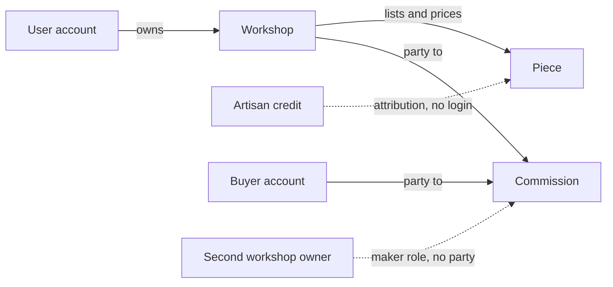

# Whose workshop, whose commission?

A maker signs in, opens a link a friend sent, and reads a buyer's private brief: the budget range, the reference photographs, the note about a wedding gift. The request belongs to a different workshop. Nothing was hacked. The route checked that the caller was a maker, loaded the request by its id, and returned it. That is the most common serious bug in a marketplace, and it is the bug this module exists to prevent.

Authentication and authorization are two different jobs. Authentication answers who you are: the session, the token, the user id. Authorization answers what this person may do to this record: read it, change it, delete it. A logged-in maker is authenticated and still not allowed to read your neighbour's workshop. Most learner projects stop after the first job, because the login screen makes the boundary look finished.

## The four people

A buyer has an account and a cart. They send custom requests, accept quotes, pay a deposit and a balance, approve finished work, and mark a delivery received. They may have bought from three workshops this year, and that history gives them no access to any workshop's dashboard.

A workshop owner has an account and owns exactly one workshop. The owner prices pieces, answers requests, sends and revises quotes, runs production, posts progress and ships. Ownership is a stored link from the user to the workshop, and every seller action resolves that link before it touches anything.

A credited artisan may have no account at all. Huda made the bowl, her name appears on the piece page with her consent, and she has no login, no inbox and no price control. If the workshop later gives her a buyer account so she can shop elsewhere, that account still grants nothing on the workshop. Credit describes the work. It never describes permission.

A second workshop owner has the same role as the first and no relationship to the other workshop's records. This person is the actor your tests must use, because a role check passes for them and only an object check stops them.

## Three signals that look like permission

The first is artisan credit. `piece.artisanId` is used to display a name and to validate that the credit belongs to the same workshop. It is tempting to let a credited maker edit the piece because the credit proves a connection. It proves authorship, not authority. The workshop decides the price, takes the money and carries the refund risk, so the workshop holds the write.

The second is a shared name. Two workshops may each credit an artisan called Mariam, and a buyer may have the same display name as a maker. Names are presentation. Never query an artisan by name to decide access, and never let a matching display name join two accounts.

The third is a past purchase. A buyer who bought a bowl last month may appear in your order documents beside a workshop id. That is a commercial history, not an invitation to read the workshop's drafts or its other buyers' briefs. Access follows the object you are touching, not the objects you once touched.

Read the solid arrows as permission and the dotted arrows as description. The only ownership edge is user to workshop. The artisan edge explains who made the piece and carries no action. The two solid arrows into the commission are the two parties, and each party sees a different set of actions on the same record.

## A commission has two parties and one timeline

A commission is unusual because both sides must read the same record for weeks. The buyer needs the accepted terms, the progress notes, the approval step and the balance. The workshop owner needs the same timeline plus the work actions. Neither should see everything. The workshop may keep an internal note about material cost or a difficult glaze batch, and that note is not part of the buyer's view of the agreement.

The actions split cleanly. The workshop owner starts production, posts progress, presents the finished work, marks the piece shipped and adds a tracking reference. The buyer approves the finished work, asks for the one included revision, pays the balance and marks delivery received. Neither side may perform the other's action, and the server must refuse even when a stale browser still shows a button. A maker who could approve their own final work would remove the buyer's only check. A buyer who could post progress could invent a timeline.

The money follows the same split. Only the server creates a deposit or balance payment intent, and only from the accepted terms. A buyer triggers it; a workshop owner can never charge a card. A second workshop cannot see that a payment exists, let alone its amount.

## Private data needs its own audience

A request carries a brief, a budget range and reference photographs. Those belong to the buyer who wrote them and the workshop that received them, and to nobody else. Not to a credited artisan, not to a buyer who is curious, not to a workshop that was declined. The reference photographs are especially easy to leak, because file identifiers often travel in URLs that look like public links. Module 22 exposes them through an authorized list and view route, and this module supplies the party check that both routes use.

A piece is different. Its public fields are meant for the world: craft, materials, care, photographs the workshop approved, price, and the credit text the maker agreed to. Its drafts, internal notes and unpublishable photos are not. One serializer cannot serve both audiences, and the moment a route returns the whole Mongoose document, the difference disappears.

## The URL is not the boundary

Object identifiers are not secrets. They appear in links, in logs, in screenshots and in a browser history that a shared phone may keep. Assume a stranger can guess or obtain any id in your database, and design every route so that knowing an id is only the first step. The route must resolve the caller's relationship to that object before it reads or writes a field.

This is why hiding a button is not security. A React component that renders no Edit link changes what an honest user sees and changes nothing about what the API will do. The test that matters sends a request with a valid token and a foreign id, and asserts on the raw JSON body, not on the screen.

Three responses mean three different things, and mixing them up confuses the client and the support person. A 401 says the caller has no valid session, so sign in. A 403 says the session is real and the object is off limits. A 404 says the object does not exist for this caller, and it is the right answer when the bare existence of a record is itself private, as it is for a buyer's request. Choose a policy per object and write it in the matrix. The course uses 403 for a piece or workshop that exists and is not yours, and 404 for a request, quote or commission that belongs to someone else, so error codes do not reveal the shape of the database.

## What this module builds

You will write the authorization matrix for Ghurza's objects: workshops, pieces, custom requests, quotes and commissions. You will write three small helpers that resolve ownership, party membership and same-workshop membership, and you will use them on every route that touches a record. You will then write cross-workshop tests with two workshops, two buyers and one credited artisan, and record the status codes plus the absence of private fields in each denial.

The next lesson takes the checks themselves, one object type at a time, and shows where each one belongs in the request path. After that you will not be able to hide a leak behind a helpful role name.
