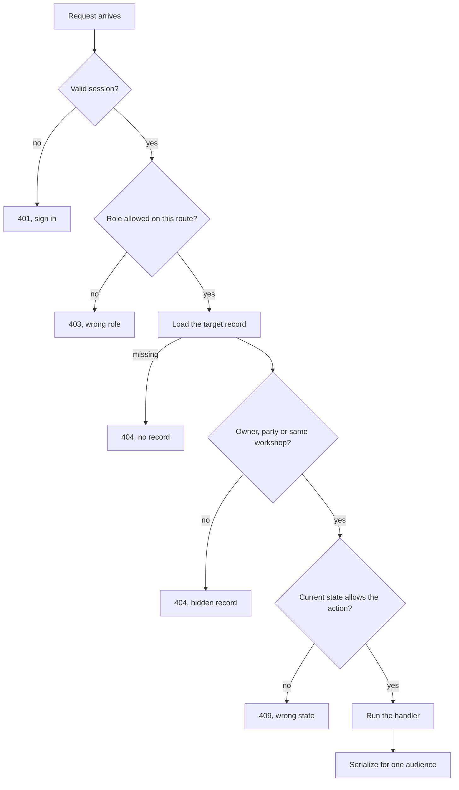

# Authorization matrix and cross-workshop tests

The matrix is the document a reviewer reads before the tests, and the tests are what make the matrix more than an intention. Write the matrix first because it forces every cell to have an answer. There are five actors and about fifteen actions on the two objects that carry private data, a custom request and a commission, so the whole thing fits on one screen and can be reviewed in a few minutes.

Put `docs/AUTHORIZATION.md` in the repository with a short paragraph before each table. Decide the status codes once: 401 for no session, 403 for a wrong role on an action the role can never perform, 404 for a record outside your relationship, 409 for a correct actor on a record in the wrong state. Every cell below uses those four numbers and nothing else.

## Requests and quotes

| Action | Buyer who wrote it | Another buyer | Workshop that received it | Another workshop | Credited artisan |
|---|---|---|---|---|---|
| Create request to Workshop A | 201, own record | 201, own record | 403, no buyer role | 403 | 403 |
| Read request and brief | 200 | 404 | 200 | 404 | 404 |
| Post a message in the thread | 201 | 404 | 201 | 404 | 404 |
| Withdraw before any quote | 200 | 404 | 404 | 404 | 404 |
| Send or revise a quote | 403 | 403 | 201 | 404 | 404 |
| Accept the latest sent quote | 200 | 404 | 403 | 404 | 404 |

Two cells deserve an explanation. Creation is allowed for any buyer, because a buyer creates their own request and the server takes the buyer id from the session, not from the body. Acceptance is buyer-only even though the workshop owns the request, because acceptance is the moment the workshop's offer becomes a commitment from the other side. A workshop that could accept its own quote could start work nobody agreed to pay for.

## Commission and production

| Action | Buyer party | Another buyer | Workshop owner party | Another workshop | Credited artisan |
|---|---|---|---|---|---|
| Read the timeline | 200 | 404 | 200 | 404 | 404 |
| Start production | 403 | 404 | 200 | 404 | 404 |
| Post a progress update | 403 | 404 | 201 | 404 | 404 |
| Present the finished work | 403 | 404 | 200 | 404 | 404 |
| Approve or request the included revision | 200 | 404 | 403 | 404 | 404 |
| Create the balance payment | 200 | 404 | 403 | 404 | 404 |
| Add carrier and tracking, mark shipped | 403 | 404 | 200 | 404 | 404 |
| Mark delivered | 200 | 404 | 403 | 404 | 404 |

The pattern is worth naming. Each row has exactly one actor who can perform the action and one actor who can read the result. The buyer can read every maker action and perform only the buyer ones. The workshop can read every buyer action and perform only the maker ones. A credited artisan appears in no row as an allowed actor, which is the correct answer and the one most likely to be broken by a later refactor.

The two tables above cover the objects that hold private data. Pieces and workshops follow the same shape with one difference: most piece reads are public by design. Add a third short table for them with rows for reading a published piece, reading a draft piece, publishing, archiving, and attaching artisan credit. The public read is the only row that needs no session, and it still needs a serializer, because a published piece must never expose the workshop's internal production note or an unpublished photo.

## Put the checks in one order

Every route runs the same sequence. Draw it once, then keep the routes in that order, because a check that runs after the handler has already written something is a check that arrives too late.



The fourth box is the object check from 8.2 and the fifth is the state check from later modules. Keeping them separate matters, because they answer different questions and return different codes. A buyer who is a party to a commission but tries to start production is a 403, not a 404, because the record is visible to them and the action is not theirs. Another workshop asking for the same record is a 404, because the record is not theirs to know about.

## Write the test before the fix

Seed two workshops, two buyers and one credited artisan. Bayt al Zayt owns a commission for a buyer called Lina. Nour Ceramics is the second workshop, and its owner has a valid maker session. The test asks for the commission with the second workshop's token and asserts on the raw response.

```js
// server/src/modules/commissions/commission.routes.test.js
test("a second workshop cannot read a commission or its private fields", async () => {
  const { workshopB, commissionId } = await seedTwoWorkshops();
  const tokenB = await signIn(workshopB.ownerEmail);

  const res = await request(app)
    .get(`/api/commissions/${commissionId}`)
    .set("Authorization", `Bearer ${tokenB}`);

  assert.equal(res.status, 404);
  assert.equal("terms" in res.body, false);
  assert.equal(JSON.stringify(res.body).includes("progress"), false);
});
```

Run it and read the failure:

```bash
$ node --test server/src/modules/commissions/commission.routes.test.js
✖ a second workshop cannot read a commission or its private fields
  AssertionError [ERR_ASSERTION]: Expected values to be strictly equal:
  + actual: 200
  - expected: 404
```

The route answered 200, and the body carried the accepted terms and the progress notes. When you open the handler, the cause is usually one of two shapes. The route compared the session user id with a field the commission does not have, or it used the workshop id from the URL and never checked that the caller owned it. Both mistakes pass a role check and both return a real record to the wrong person.

Build that fixture with stable keys and obvious names. Two workshops called Bayt al Zayt and Nour Ceramics, two buyers called Lina and Sami, and Huda for the credit. Sign in with the same fixture accounts on every run and clear the relevant collections first, so a failed test does not inherit yesterday's commission and pass for the wrong reason. When the transcript says a 404 for the Nour Ceramics owner on Bayt al Zayt's commission, a reader can see who asked and what was refused without opening a log file.

Here is the corrected handler in the shape this course uses. Read it from the session downward: no id from the body, one workshop lookup, one party decision, one serializer per role.

```js
router.get("/commissions/:commissionId", requireAuth, async (req, res) => {
  const commission = await Commission.findById(req.params.commissionId);
  if (!commission) return notFound(res, "COMMISSION_NOT_FOUND");

  const role = await assertCommissionParty(commission, req.user.id); // throws 404 when not a party
  const body = role === "buyer" ? toBuyerCommission(commission) : toMakerCommission(commission);
  res.json(body);
});
```

`assertCommissionParty` resolves both sides in one place: it returns `"buyer"` when `commission.buyerId` matches the session user, and `"maker"` after resolving the caller's workshop by owner id and comparing it with `commission.workshopId`. The route never needs a workshop id from the client, because ownership comes from the user. The serializer decision follows the role the check returned, so the fields and the permission cannot drift apart.

## Test the denial body, not only the status

A 404 with a helpful message can still leak. Write one assertion that inspects the whole body as a string and fails when a private word appears.

```js
const raw = JSON.stringify(res.body);
assert.equal(raw.includes("budget"), false);
assert.equal(raw.includes("Lina"), false);
assert.equal(raw.includes("deposit"), false);
```

The string check is crude and it works. A new field on the error object will fail this test even when the status code is correct, and a failure here is cheap to fix: move the detail into the server log and leave the response with a code. Do the same for a 403 on a piece edit, where the natural temptation is to explain that the piece belongs to another workshop. The log already knows. The caller does not need to.

Run the full set with all five actors and record a status and a body digest for each. A row that returns the expected code but a body containing the buyer's name is a failed row, not a pass with a note. Save the transcript in `docs/EVIDENCE.md` under the isolation gate, because the module 8 gate asks for exactly this evidence and the module 99 defense refers back to it.

A list route is the quiet failure that these per-record tests will not catch. A handler that loads every request and then filters in JavaScript looks correct in the browser, and it leaks the day someone adds a response field before the filter runs. Push the scope into the query instead: `CustomRequest.find({ workshopId })`, `Commission.find({ buyerId })`, and the same for the maker inbox and the order lists. Write "the filter is in the query" as a checklist item on every route that returns a collection, because a list route with no filter is the most common way a private brief reaches a stranger.

One more test earns its place: the credited artisan. Sign in as Huda's buyer account, ask for the request addressed to Bayt al Zayt, and assert a 404 with no brief. Then attempt to edit the piece she is credited on and assert a 403. Those two attempts fail for different reasons, and a future change that turns credit into access will break both at the same moment.

```quiz
type: mcq
id: handmade-m08-q3
question: A second workshop requests a buyer's commission. Which response shows the record stayed hidden?
options:
  - "404 with an error code and no record fields"
  - "403 that names the buyer in its message"
  - "200 with private fields hidden by the client"
  - "401 that asks the caller to sign in again"
correct: 0
explanations:
  - "The 404 hides existence, and the body carries nothing from the record."
  - "A message naming the buyer discloses the data the check refused."
  - "A 200 hands over the record, because the client is not the boundary."
  - "A 401 claims the session is invalid, which misleads a valid caller."
```

Commit the matrix, the helpers, the routes and the tests together. A matrix committed before the tests is a plan, and tests committed without the matrix leave the next reviewer guessing which cells are deliberate. Together they say what Ghurza allows, actor by actor, and they prove it with the same five sessions the gate will use.
