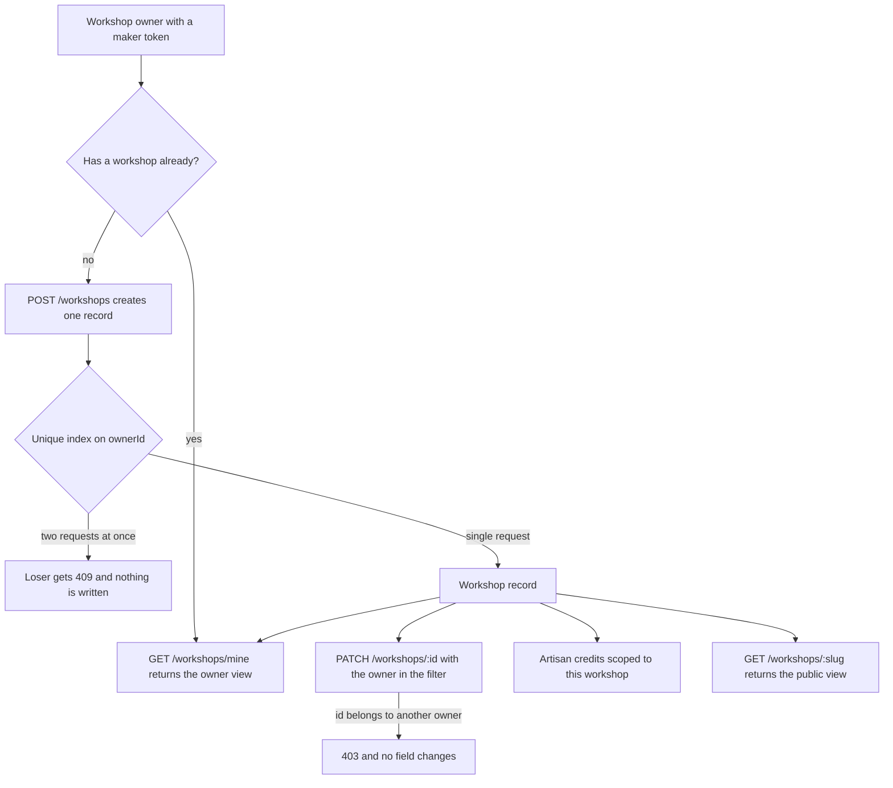

# A workshop needs a public identity

Amina has stitched tatreez for nineteen years and has run her own workshop for eleven of them. On Ghurza she has an account, a verified email address and the role `maker`. Two credited makers work with her, a shelf of finished cushion covers is ready to photograph, and a paper notebook holds the orders she handles by phone. What she does not have is a page. A buyer who opens one of her covers sees a title, a price and a photograph of stitching. Nothing on that screen says who made the cover, where the workshop is, how many weeks a new one would take, or who to ask about a repair.

That missing record is what this module adds. A Piece belongs to a Workshop, and the Workshop is the seller, not the Artisan who is credited for the stitching. Module 5 drew that model and module 8 wrote the ownership helper that protects it. This module turns both into working routes: one workshop per owner, the facts a buyer needs held in public, the settings only the owner reads, a readable page address, and a refusal for every other account that reaches for the record. Module 10 builds the screens that call these routes, which is the reason there is no interface here at all.

## Six facts a buyer needs before sending money

Buying handmade work is not a scan of a barcode. A buyer comparing two cushion covers is asking who made each one, whether the stitching is hand work or machine work, whether the workshop can repeat the piece in the size she needs, and how long she will wait for a new one. Those answers belong to the Workshop, and there are only six of them worth storing in the first version. Every field you add is a field that can go stale, and a stale field on this record sends a buyer to a workshop that has moved or stopped taking work.

| Field | Type | Who reads it | Why it is stored |
|---|---|---|---|
| `name` | string, up to 80 characters | public | The label on every piece card and every order |
| `area` | string, up to 60 characters | public | A place a buyer can picture, not a full address |
| `story` | string, up to 1,200 characters | public | Technique, materials and history in the maker's words |
| `makingDaysMin` | integer, 1 to 365 | public | The short end of the making time |
| `makingDaysMax` | integer, 1 to 365 | public | The long end of the making time |
| `shippingProfileId` | reference, nullable | public as a yes or no | The workshop's one shipping policy, built in module 14 |
| `slug` | lowercase string, unique | public | A page address that can be shared |

The list is short on purpose, and the rest of the record falls into two groups that a public page never reads. The first is identity: the owner, the account state, the creation date and the list of addresses the page used to answer to. The second is a small set of commission settings, which decide whether the workshop accepts new work at all and how it prices a deposit. Module 10 puts those settings on a page for the owner. Modules 22 to 24 read them when a request arrives and a quote is written.

## The area is a place a buyer can picture

`area` is a short piece of text, not a pair of coordinates. Ghurza has no map provider, and a buyer in another country does not need a doorstep. She needs to know whether the workshop is in the city she is visiting, because that decides whether a commission can be collected by hand instead of shipped. The maker writes the area in her own words, and the seed keeps workshop locations generic, so the course never claims that a real workshop works from a real place.

The field is also a deliberate limit on what the platform promises. Ghurza cannot tell a buyer how far the workshop is from her, cannot estimate a collection time, and cannot check that the place a maker typed is where the work is made. What it can do is show the area beside the name, which is enough for a buyer who already knows her own city, and refuse to invent the rest. A map pin and a delivery radius are real features in a real marketplace, and neither of them answers a question this page is asked.

## The story is written by the maker

`story` holds technique, materials and, when the maker chooses to share it, the history behind the work. It is the maker's statement and the server stores it without rewriting it. The cap is 1,200 characters, which is long enough for two paragraphs on a phone and short enough that the public payload stays light on a slow connection. The four rules from module 1 apply to this field more than to any other: credit the maker, state materials and technique, never invent the meaning of a motif, and never promise a date.

The honest limit is that the platform cannot verify a family history or the origin of a pattern. So the course does not ask a maker to prove one, and it does not present the field as a checked fact. It is what the workshop says about its own work. A reviewer reading the public page should be able to tell the two apart, which is why the field is called `story` and not `history`.

## Making time is a range, never a date

Two integers hold the workshop's making time: `makingDaysMin` and `makingDaysMax`. They describe how long the work itself takes, from picking up the material to a piece the maker is willing to photograph. They do not include shipping, and they do not know how many commissions are already in the queue. Module 14 combines this range with the queue and the transit range to show a buyer a ready window. The request form in module 22 and the quote form in module 23 read this field to answer the question a buyer always asks first.

A date would be easier to display and impossible to keep. A workshop cannot control a power cut, a batch of clay that cracks in the kiln, or a delivery of thread that arrives late. A range that is too narrow is worse than a range that is too wide, because the buyer plans around it and then holds the workshop to a number it wrote in a hurry. The validator refuses an upper value below the lower one, and refuses anything above 365 days, because a workshop that cannot finish a piece within a year should not appear on a page that takes money.

## One owner, one workshop

Ghurza lets one owner account run exactly one workshop. The rule costs something and is worth defending. A cooperative with two studios cannot express both under one login, and a maker who opens a second branch needs a second account. The rule earns its cost because every route in this module is single valued: `GET /workshops/mine` returns one workshop or nothing, a Piece belongs to exactly one workshop with no ambiguity, and a buyer reading the page gets one story, one making time and one shipping policy.

The rule is enforced twice, and both halves are needed. The create route first checks whether the signed-in owner already has a workshop, which answers the ordinary second attempt with a readable 409. The database holds a unique index on the owner field, which answers the race between two requests that arrive in the same millisecond. A route check alone loses that race. An index alone gives the owner a duplicate key error that reads like a server fault. When the check fails, the route must not quietly patch the existing workshop with the submitted fields, because a stale form on a second device would then move Amina's workshop to another area with no visible action.



Read the diagram as three separate levels of trust. The session decides who the caller is. The unique index decides how many workshops one owner may have. The ownership filter decides whether the id in the path belongs to this caller. None of the three can substitute for another, and the two arrows leaving the record show why the public read needs no token at all.

## Two views of one record

The workshop record has a public face and an owner face. The public view is what a stranger or a signed-out visitor reads, and every field in it could be printed on a card beside the workshop door. The owner view is the same record plus the fields that exist for the marketplace and the owner: the contact phone for a collection problem, the commission settings, the account state, and three counts that the dashboard in module 12 will show first. Two derived counts cost one indexed count each and save that dashboard from loading a table of Pieces to print two numbers.

```ts
// the shape the public workshop page consumes
type PublicWorkshop = {
  workshopId: string;
  slug: string;
  name: string;
  area: string;
  story: string;
  makingDaysMin: number;
  makingDaysMax: number;
  hasShippingProfile: boolean;
  availablePieceCount: number;
};
```

```ts
// the owner reads the same record with the marketplace settings on it
type OwnerWorkshop = PublicWorkshop & {
  ownerId: string;
  contactPhone: string | null;
  status: "active" | "paused";
  acceptingCommissions: boolean;
  maxActiveCommissions: number;
  defaultDepositPercent: number;
  quoteValidityDays: number;
  createdAt: string;
  slugHistory: string[];
  draftPieceCount: number;
  soldPieceCount: number;
};
```

The split is not cosmetic. `contactPhone` is the clearest example: a buyer sometimes needs to reach a workshop about a collection that went wrong, and every stranger on the internet does not. So the number appears on an order page after a purchase and never in the public payload. A serializer that spreads the Mongoose document into JSON will leak it on the first day, and no rendered page will show the leak. Test the raw response keys, not the screen.

## The roster is credit, not access

A Workshop may credit several makers, and those credits live in their own collection. An Artisan record holds a display name or pseudonym, a flag for whether the name may appear in public, a short bio, an optional image and a retirement date. An Artisan has no login in Ghurza and no route of her own; the workshop owner adds, edits and retires credits. Credit is a public story about who made the work, and it never becomes a way to change a price or answer a request.

The test that keeps this honest uses a valid Artisan id that belongs to another workshop. The id parses, the collection has a document behind it, and the relationship is still wrong. Mongoose references describe a relationship for population and enforce nothing, so the route must compare the stored workshop on the Artisan with the workshop it resolved from the session. Refusing only malformed ids tests the parser, not the rule that matters.

## The id in the path is the caller's word

Three of the routes take an id from the caller, and an id in a path is a value the browser chose. The update route therefore filters on the id and the owner together in one query, instead of loading the record and then asking whether the caller owns it. A refusal that has already read the record is one careless serializer away from leaking it, and the filter is the authorization. The refusal is a 403 rather than a 404, because the workshop page is public: the caller can already see that this workshop exists, so pretending otherwise only confuses the two owners involved.

The write itself is a conditional update, not a read followed by a save. Filter on the id and the owner, set only the allowed fields, and read the matched count. A handler that loads, checks and saves by id reopens the gap it just closed, and it also throws away a valid change to one field when another field fails validation. The allowed list is short and explicit, because a spread of the request body lets a caller set the owner id to somebody else or change the account state.

## What this module leaves out

There is no logo upload, no banner image, no opening hours, no map pin, no second owner and no membership record with roles. Each is a real feature in a real marketplace and none of them is needed to answer the four questions a buyer has before sending money.

Shipping is also out of reach here. `shippingProfileId` exists on the record and stays null until module 14 creates the profile. Nothing in this module prices a delivery, and the public payload says only whether a profile exists yet, because a page that shows a shipping answer it cannot compute is worse than a page that shows none.

## Bridge to the route work

The next lesson builds the routes: the schema and its validators, the slug generator with its collision suffix and its history list, the two projections, the ownership check on the update, and the two Artisan routes the roster needs. It also writes the two tests that fail against a naive implementation. The first is a second workshop accepted as a new document. The second is a cross-workshop patch that succeeds because the route trusted the id in the path.

Keep Amina and her notebook in mind while you read it. Every field and every refusal exists so that a maker can describe her workshop once, correctly, and never explain it again to a buyer who is about to send money to a stranger.
