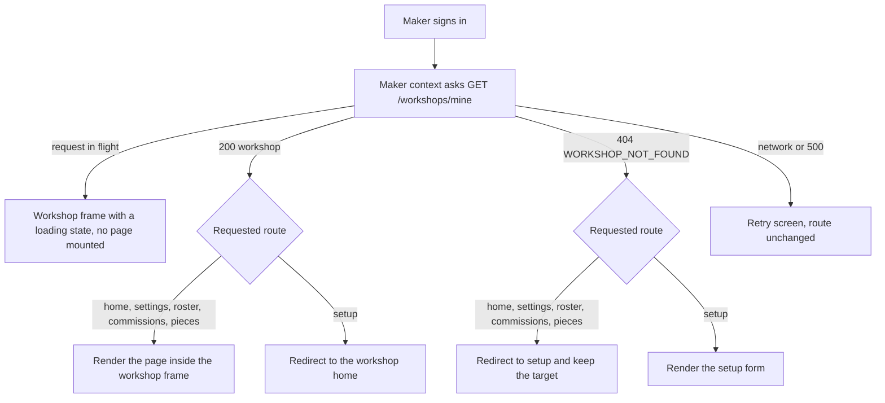

# The maker who has no workshop page

Nour is a ceramicist. She registered on Ghurza on Tuesday night, confirmed her email, and chose the maker role because she wants to sell finished bowls and take a few commissions. On Wednesday morning she signs in and lands in the workshop area of the app. For eight seconds she sees a page with a header, three empty cards and a spinner in each one. Then the cards empty out and the page shows nothing at all.

Nothing crashed, and that is the problem worth understanding. The dashboard asked for her counts, the roster asked for her Artisans, and the commissions card asked for her settings. All three answered 404 `WORKSHOP_NOT_FOUND`, because she has no workshop yet. The API from module 9 did exactly what it was built to do. The client had no plan for the first maker it will ever meet.

## Three jobs and one missing precondition

The workshop area has four jobs. Setup collects the facts module 9 requires, and creates the workshop once. Settings edits those facts afterwards. The roster adds and retires Artisan credits. The commissions page sets whether the workshop accepts new work, how many commissions may run at once, the deposit default and how long a quote stays valid. Every one of those pages except setup assumes a workshop exists, because everything they show belongs to one.

Those assumptions are correct and should stay. A roster page that quietly renders an empty list for a maker with no workshop teaches Nour that her credits were lost. The precondition is not the pages' problem. It is the routing layer's problem, and the routing layer is what this module adds.

Before any page inside the workshop area renders, the client answers one question: does the signed-in maker have a workshop? If no, setup. If yes and she asks for setup anyway, the workshop home page. This is a gate in the plainest sense. It is one decision made in one place, and every page behind it inherits the answer.

The alternative is per page tolerance. Each page checks for a workshop, each page renders its own version of "you have no workshop yet", and five pages later there are five slightly different sentences and one new page where somebody forgot. Code that drifts in five places stays invisible until a mentor opens the exact page nobody tested.

Two arrows in that diagram protect Nour from two different mistakes. The arrow out of `404` stops a page mounting without its precondition, so the roster request never fires and the console stays clean. The arrow out of `200` stops a workshop that already exists from being created twice. The API would refuse the second create with a 409, and a form that ends in a refusal has still wasted two minutes of a ceramicist's morning.

## What the client knows, and when

The client has one source of truth about the workshop: `GET /workshops/mine`, the route from module 9 that returns one workshop or a 404 with `WORKSHOP_NOT_FOUND`. That response is the only thing the routing decision may depend on. A role in the token is not enough, because a maker with a workshop and a maker without one carry identical tokens. A name cached in local storage is not enough either, because it was written by whoever used the phone last.

So the client makes that request once, as early as it can, and holds the answer in a context that the whole workshop area reads. The context has four states, and they are not the same thing:

- `loading`, when the request is in flight and the answer is unknown.
- `ready`, with the workshop, and everything ordinary.
- `none`, when the API answered 404 `WORKSHOP_NOT_FOUND`, which is a fact about this account.
- `error`, when the request failed for another reason, such as a dropped connection or a 500.

The last two are easy to merge by accident. `none` means send the maker to setup. `error` means keep her where she is, show a retry, and do not send her to a form that will create a second workshop the moment the connection returns. A client that treats every failure as "no workshop" will eventually show a setup form to a maker who has been trading for a month, or write a duplicate workshop for somebody, and both are worse than a spinner.

The `none` state also has to settle. It is a fact, not a hiccup, so it must not be retried on a timer or when the window regains focus. The maker has no workshop until she creates one, and a retry loop that asks four times a minute costs data on a phone plan that is not free.

## The guard must run before the children

Here is the failure a screenshot will not show you. A guard that renders its children and then redirects looks correct on a fast connection, because the redirect wins the race. On a phone on a weak network the render arrives first. The Pieces page mounts, its request fires, and it receives a 404. Then the redirect lands and the request is abandoned, or worse, it surfaces as an error toast above the setup form Nour is now reading.

The rule is short to state and easy to break: while the answer is unknown, render neither the page nor its children. A skeleton in the workshop frame is enough, because the frame does not need a workshop to draw a header. What must not exist is a mounted page that believes it has one.

The same rule decides where the frame sits. The workshop frame holds the workshop name, a short navigation list and the account menu, and it is the natural place for the guard, because every page that needs a workshop lives inside it and nothing outside it ever does. Setup sits outside the frame, in its own minimal shell, because it is the page for the one person who has no workshop to put in a header.

## Keep the destination, not just the redirect

A maker who taps a link to the commissions page, or an old bookmark to her roster, has already said where she was going. A guard that throws that away creates the workshop and then lands her on a page she did not ask for, and she navigates back to where she started. That is a small insult repeated on every visit, and the fix is cheap: the redirect carries the original path as a query parameter, and the setup page navigates there once the workshop exists.

The parameter has to be treated as untrusted, because it arrives from an address anybody can type. Accept only a path that starts with a single slash, reject anything that looks like a full address, and fall back to the workshop home. A guard that redirects to whatever it was given is an open redirect, which is how a domain ends up sending a maker to somebody else's sign in page with a convincing name in the address bar. The check is three lines and it belongs next to the redirect, not in a review note.

## Why not simply make the API tolerant

The tempting fix is on the server. Let the roster route return an empty list for a maker with no workshop, and let the counts return zeros. Then every page renders and the guard disappears. It is tempting because it removes a client component, and it is wrong for three reasons.

An empty roster page is a lie about the workshop's data, so Nour cannot tell an empty roster from a missing workshop. The tolerance also spreads: the next route has to be equally tolerant, and the one after that, and each is a small decision nobody signs off. And the 404 is genuinely useful information, which module 9 built on purpose. A client that hides it makes the module 9 gate unreachable in practice.

There is a real server nicety nearby, and naming it stops you confusing it with tolerance. `GET /workshops/mine` answers 404 rather than 200 with an empty body precisely so the client can tell "there is no workshop" from "the request failed". A 200 with nothing inside would be indistinguishable from a bug, and a client cannot route on a maybe.

## What this module owns at 360 pixels

The screens have to work on the device Nour actually holds while standing at a wheel. That is a phone at 360 CSS pixels wide, in one hand, in weak light, with a connection that may drop in the middle of a form. Two consequences run through the build lesson. Every control needs a tap target a thumb can hit, which means full width inputs and buttons with real height rather than small text links. And every form has to survive a lost connection without losing what she typed.

The making range is the awkward field at that width, because it is two numbers that belong together and each needs its own label. The build lesson puts them on one row with a short label above each, keeps the error message under the pair, and stacks them when the width runs out. The same pass checks that every control is reachable by keyboard, because a form that only works with a pointer is a form some makers cannot finish at all.

## The roster and the commission settings live here

Module 9 built the routes for Artisan credits and the workshop settings. This module gives them pages, and both sit inside the workshop frame behind the same guard. The roster is the page that makes the credit rule visible: a maker adds a name, chooses whether that name may appear on the public page, and retires a credit when the person stops working with her. The commissions page holds four numbers and one switch, and every one of them is read later by the request and quote modules.

Both pages are edits of records that already exist, so neither needs its own create step and neither belongs in setup. Setup collects the workshop facts and nothing else, because a form that asks for the roster and the deposit default in the same pass is a form that fails three validations at once for a maker who only wanted a page.

## What this module does not do

There is no logo, no banner image, no opening hours and no map. There is no way to change the account email from this area, and no way to close the workshop. Setup asks for the six facts module 9 requires, and settings edits the same set plus the four commission numbers. The slug is derived, so nobody types it, and a workshop that has already listed a Piece cannot change it at all.

There is also no onboarding wizard. Setup is one page with three labelled groups, saved once. The API creates a workshop in a single request, so a wizard would either write three partial workshops or hold everything in the browser until the last step, and the second option loses the whole form when the connection drops.

## Bridge to the build

The next lesson writes the workshop context, the two guards, the setup page, the settings page with its roster and commission sections, and the frame around them. It then breaks the guard on purpose to watch a Pieces request fire for a maker with no workshop, because that failure is the reason the module exists.

Keep Nour's eight seconds in mind while you read it. The measure of that lesson is not whether the roster looks good with three credits in it. It is whether the first maker to arrive after signing up ever sees a page built for a workshop she does not have yet.
