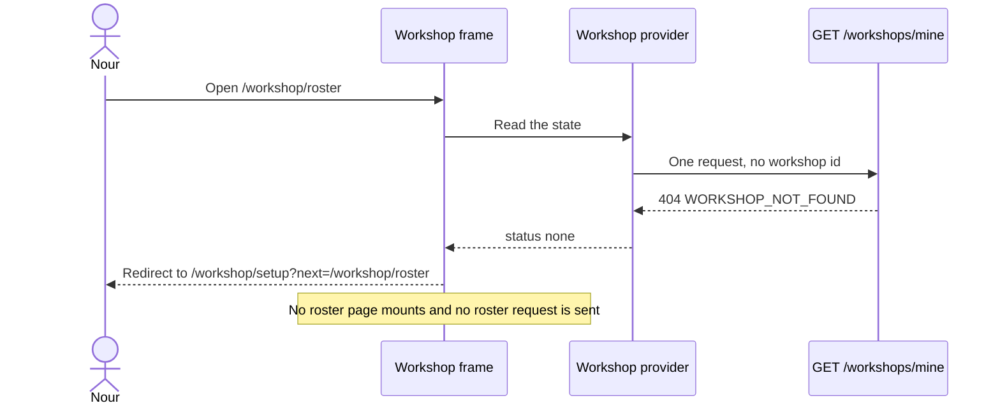

# Onboarding, settings and the routing gate

The client work splits into five pieces with one job each. A provider asks for the workshop once and holds four states. Two guards read those states and decide whether a page may render. The setup page collects the facts module 9 requires. The settings page edits them, and carries the roster and commission sections. The frame draws the header and navigation those pages sit inside, and it is the only part of the area allowed to render while the answer is unknown.

Build them in that order. Each piece is testable alone, and a mistake in an earlier piece hides in a later one. A guard built before the provider has no states to read, and a setup page tested before the guard is a page tested against a workshop that exists when it should not.

## The routes and what each one needs

| Route | Frame | Needs a workshop | Purpose |
|---|---|---|---|
| `/workshop/setup` | bare shell | no, and refuses one | Create the workshop, once |
| `/workshop` | workshop frame | yes | Home, with the draft and sold counts |
| `/workshop/settings` | workshop frame | yes | Edit the six workshop facts |
| `/workshop/roster` | workshop frame | yes | Add, edit and retire Artisan credits |
| `/workshop/commissions` | workshop frame | yes | Commission settings |
| `/workshop/pieces` | workshop frame | yes | Built in module 11 |

The table is the whole routing argument in six lines. One route is for the maker without a workshop, five need one, and the frame is shared by the five because they share a header, a navigation list and the same precondition. Write the table before the components, so the guards have an obvious shape: one guard for the five, one inverse guard for the single exception.

## The context makes one request and remembers the answer

The provider is mounted once, above the workshop branch of the router. It calls `GET /workshops/mine` on mount and maps the answer into four states. The mapping is where most of the bugs live, so it deserves to be explicit rather than clever.

```ts
// client/src/workshop/WorkshopContext.tsx (the state shape, not the whole provider)
export type WorkshopState =
  | { status: "loading" }
  | { status: "ready"; workshop: OwnerWorkshop }
  | { status: "none" }
  | { status: "error"; message: string };
```

A 200 with a workshop is `ready`. A 404 whose body carries `WORKSHOP_NOT_FOUND` is `none`, and that is a settled fact, so it must not be retried on a timer or when the window regains focus. A 401 is not the provider's business at all: the refresh interceptor from module 7 retries the request and the provider only sees the eventual answer. A 500, a timeout or an offline browser gives `error`, which keeps the current route and offers a retry.

The provider also exposes a way to set the workshop without a second request. When setup succeeds, the response body is already the owner view, so the provider moves straight to `ready`. Refetching after a 201 costs one more round trip on the worst possible connection and adds a state where the workshop exists but the screen still shows a spinner.



Read the note at the bottom. It is the point of the sequence: the roster page never mounts, so its request never fires, so there is no 404 to hide and no failed request in the console. A guard that redirects after mounting gives the same final screen and two requests the maker's data allowance paid for.

## Two guards, both boring

A guard is a component that returns either its children or a redirect. It fetches nothing of its own, and it does not decide a destination beyond the first one.

```tsx
// client/src/workshop/RequireWorkshop.tsx (outline)
export function RequireWorkshop({ children }: { children: React.ReactNode }) {
  const { state, refetch } = useWorkshop();
  const location = useLocation();

  if (state.status === "loading") return <WorkshopFrameSkeleton />;
  if (state.status === "error") return <WorkshopRetry message={state.message} onRetry={refetch} />;
  if (state.status === "none") {
    const next = encodeURIComponent(location.pathname + location.search);
    return <Navigate to={`/workshop/setup?next=${next}`} replace />;
  }
  return <>{children}</>;
}
```

Three details carry weight. The loading branch renders a skeleton rather than `null`, so the screen does not jump when the answer arrives. The redirect uses replacement navigation, so the back button does not return to a page the maker may not see and bounce again. The error branch keeps the route and offers a retry, so a dropped connection never looks like a missing workshop.

The inverse guard is shorter and exists for one reason: a maker who already has a workshop should never see the create form. It reads the same state, sends `ready` to the workshop home, and renders the setup form only in `none`. A `loading` state renders the skeleton here too, which stops the form appearing and disappearing in front of a maker who has a workshop.

## Setup: one page, three groups, one save

Setup collects the six facts from module 9 in three labelled groups: the workshop, the making time, the contact. One save button at the bottom, one request, one result. The slug is not in the form at all, because the server derives it from the name.

The form keeps the typed values in component state, submits once, and reads the error envelope from module 9: a 400 carries `fields`, and each message goes beside the input that caused it. Focus moves to the first invalid field after a refused submit, because a maker on a phone with an error three screens above the button will otherwise believe the form did nothing.

```tsx
<label htmlFor="name">Workshop name</label>
<input
  id="name"
  name="name"
  value={values.name}
  aria-invalid={Boolean(errors.name)}
  aria-describedby={errors.name ? "name-error" : undefined}
  onChange={handleChange}
/>
{errors.name ? <p id="name-error" role="alert">{errors.name}</p> : null}
```

The making range is the field that needs care at 360 pixels. Two number inputs sit on one row, each with a short label, and the pair shares one error message underneath. Mark them `inputMode="numeric"` so the phone shows a number pad, and keep the row from overflowing by letting each input shrink instead of fixing a width in pixels.

Two submit states matter more than the layout. The button is disabled and labelled with progress while the request is in flight, which stops a double tap from creating a workshop and then receiving a 409 for the second attempt. And the save does not clear the form until the server answers, so a failure leaves every typed value in place.

A 409 from the create route is not a normal failure and should not be rendered as a field error. It means this account already has a workshop, which only the server knows, so the correct handling is to refetch, move the provider to `ready`, and navigate to the workshop home with a short message. That path also covers the maker who created her workshop in another tab ten minutes ago and forgot.

## Settings: prefill, diff, save

Settings renders the same fields with the stored values and sends a patch with only the fields that changed. Sending the whole form is simpler and wrong in one specific way: a maker who opens settings on a slow connection, waits, and saves sends stale values for the fields she never touched, which silently reverts a change made on another device. The diff is a short comparison and it removes that class of bug.

The refusals from module 9 map onto the page. A 400 puts a message beside the field and focuses it. A 403 means the workshop is not this maker's, which should be impossible from this screen and is worth a plain message and a sign out. A 409 `SLUG_LOCKED` appears beside a disabled address field with the one sentence that explains why it cannot change.

The address field is also where the public page address is shown in full, with a copy button. That small feature has a real effect: a maker who can copy her page address will send it to a buyer, and the address is the only part of Ghurza she can hand to somebody who is not on the platform yet.

## The roster section

The roster lists the workshop's Artisan credits with the display preference on each row, and adds a credit through a short form: a name, a switch for whether the name may appear in public, and an optional bio. The name field is required, the bio is capped at 400 characters, and the switch defaults to showing the name, because a credit that hides by default makes the maker explain the setting to every person she adds.

The public preview line is what makes the switch legible. Beside the switch the page shows the sentence a buyer would read: the name itself, or "Made by this workshop". A maker who sees her sister's name disappear from that sentence understands the setting in one second, and a maker who only sees a toggle does not.

Retiring a credit is a button with a confirmation, and the confirmation says what survives: the Pieces already credited keep the name, and the public roster stops showing the row. The list keeps retired credits in a separate section rather than deleting them, because module 11 refuses to credit a retired Artisan on a new Piece and the owner needs to see which names are which.

## The commission settings section

Four numbers and one switch, each with a short explanation rather than a tooltip. The switch is whether the workshop accepts new work. The numbers are how many commissions may run at once, the deposit default as a percentage, and how many days a quote stays valid. Module 9 put bounds on all three numbers, so the form can show the range beside each field and the server can still be the authority.

The honest note belongs on this page, not in the schema comment. The 50 percent deposit default is a course teaching choice and not a figure from the craft trade, and the maker can change it within the bounds. Modules 23 and 24 read these values when a quote is written and when a deposit is collected, so a change here never rewrites a quote a buyer has already received.

## The frame, and what it draws while nobody knows

The workshop frame draws the workshop name, a navigation list of five entries and an account menu. It also renders a skip link that jumps past the navigation, because a keyboard user who has to tab five links before reaching a form on every visit stops using the keyboard.

While the state is `loading`, the frame draws its own shape with a grey bar where the name will sit and disabled navigation, and it draws no page. That is a deliberate compromise: the maker sees the shape of the app immediately, and the app sends no request that needs a workshop. When the answer is `none`, the frame is not rendered at all, because the redirect happens in the guard above it.

At 360 pixels the frame collapses to one column, the navigation becomes a horizontal strip of five links with the current one marked by text and not only by colour, and page content sits in a container with 16 pixel side padding. Nothing on the screen scrolls sideways. The save button on both forms sits at the end of the content rather than floating over it, because a floating button covers the error text it just caused.

## Three tests, and the one that fails first

The guard test is the important one, because it asserts the absence of a request rather than the presence of a heading.

```tsx
// client/src/workshop/RequireWorkshop.test.tsx
it("sends a maker with no workshop to setup and mounts no roster page", async () => {
  server.use(mineHandler({ status: 404, json: { error: { code: "WORKSHOP_NOT_FOUND" } } }));
  renderApp({ route: "/workshop/roster" });

  expect(await screen.findByRole("heading", { name: /set up your workshop/i })).toBeInTheDocument();
  expect(fetchCallsMatching(/\/roster/)).toHaveLength(0);
});
// currently: the roster page mounts first, fetches once, then the redirect lands
```

The second test covers the destination. Navigate to `/workshop/commissions` with no workshop, create one, and assert that the app ends on the commissions page rather than the workshop home. Then run the same flow with `?next=https://example.com` and assert that the app falls back to the home page, which is the open redirect check written as a test instead of a habit.

```tsx
it("ignores an off-site next destination", async () => {
  server.use(mineHandler({ status: 404, json: { error: { code: "WORKSHOP_NOT_FOUND" } } }));
  renderApp({ route: "/workshop/setup?next=https://example.com/workshop" });
  await createWorkshopThroughForm();
  expect(screen.getByRole("heading", { name: /your workshop/i })).toBeInTheDocument();
  expect(routerLocation()).toBe("/workshop");
});
```

The third test is the double submit. Tap save twice inside the same tick and assert one create request and one workshop. A form that sends two requests gets a 201 and a 409, and the second response can overwrite a success state with a message that reads like a failure to create.

## Acceptance criteria

- [ ] A maker with no workshop is redirected to `/workshop/setup`, and no page inside the workshop frame mounts.
- [ ] A maker with a workshop is redirected away from setup and never sees the create form.
- [ ] The `next` parameter survives the round trip, and an off-site value falls back to `/workshop`.
- [ ] A dropped connection during the workshop request shows a retry and keeps the current route.
- [ ] Setup sends one request per submit, the button is disabled while in flight, and a 400 places each message beside its field and focuses the first one.
- [ ] A 409 from create moves the provider to `ready` and navigates to the workshop home.
- [ ] Settings sends only changed fields, and a slug refusal appears beside a disabled address field with an explanation.
- [ ] The roster adds a credit, shows the public sentence beside the name switch, and keeps retired credits visible in their own section.
- [ ] The commission form refuses a deposit outside 10 to 90 percent and a validity outside 1 to 60 days, with a message from the server.
- [ ] The journey completes at 360 pixels without horizontal scrolling, and every control is reachable and operable with the keyboard.
- [ ] The three tests above run in the suite, and the guard test fails before the guard is wired in.

## Bridge to the gate

The gate is a phone at 360 pixels and a brand new account with no workshop. It walks a maker who types a URL, a maker who taps save twice, a maker who adds two credits with different display choices and a maker who uses only the keyboard through the same set of screens. It also checks that the API's 404 turned into a setup page rather than an empty roster.

Module 11 adds the Pieces routes to this frame, and it assumes the frame never renders without a workshop.
