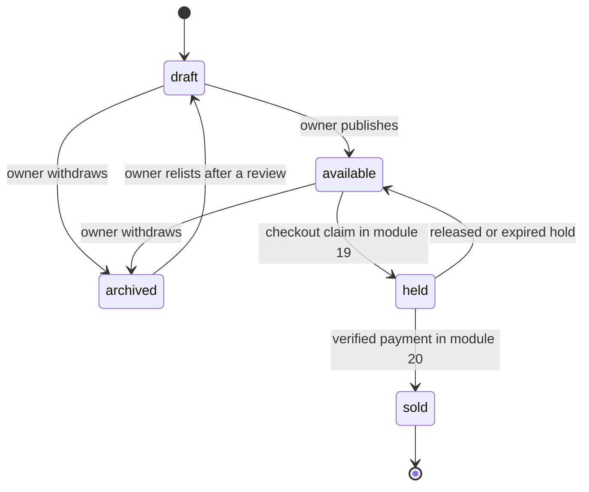

# A piece is one exact object

A buyer sends Amina a message on a Thursday night. She has seen the stitched cushion cover on the workshop page and she asks a simple question: do you have another one in blue? Amina reads it standing in her workroom with the cover on the table in front of her. There is no other one. There is this cover, with this border, these three shades of thread and a small repair near the seam that she mentions in the story. When it sells, it is gone.

The app has to be able to say that. A marketplace that models a Piece as a row with a number beside it will answer the buyer with a figure, and then discover at the worst moment that the figure was never a count of anything. Ghurza sells one exact object, so the record of that object carries its state and nothing that looks like a count.

Module 5 built the model. This module builds the routes that create, edit and archive a Piece, and the guards that stop a status moving in a direction the business does not allow. Module 12 puts a table and forms in front of those routes, and module 13 adds the photographs. Everything in this module is proved with curl and with tests.

## The fields a Piece carries

A Piece record answers two different questions at once. What is this object, and may somebody buy it right now? The first question is answered by descriptive fields that a buyer reads on the page. The second is answered by `status` and the optional hold.

| Field | Type | Who writes it | Why it is stored |
|---|---|---|---|
| `workshopId` | reference | server, from the session | The workshop that owns the Piece |
| `artisanId` | reference, nullable | owner, validated | The Artisan credited for this exact object |
| `title` | string, up to 120 | owner | What the buyer reads first |
| `craft` | enum | owner | tatreez, olive wood, ceramics and the rest of the course list |
| `materials` | string, up to 300 | owner | Thread, wood, clay, glaze, finish |
| `dimensions` | object, in centimetres | owner | Height, width and depth, so a buyer can picture the size |
| `description` | string, up to 2,000 | owner | Technique and detail in the maker's words |
| `careNotes` | string, up to 500 | owner | How to wash, store or handle the object |
| `priceMinor` | integer | owner | The price in the smallest currency unit |
| `photos` | list of up to six URLs | owner, from module 13 | Ordered images, the first one is the cover |
| `status` | enum | routes only | draft, available, held, sold, archived |
| `hold` | subdocument, nullable | checkout route | The checkout that claimed it and when the claim ends |

Two absences in that table are deliberate. There is no count, because one Piece is one object, and a field that always holds the value 1 invites every later feature to decrement it. There is also no buyer field, because a sale is recorded in the Order and its line snapshot, not by writing a buyer id onto the object that was sold.

The dimensions are an object with three numbers and a unit, not a sentence. A sentence cannot be compared or filtered, and a buyer looking for something that fits a shelf is doing a comparison whether the app helps her or not. Store centimetres, render the unit the maker chose, and keep the conversion in one place when module 16 builds the piece page.

## Status is the whole of availability

`status` carries every question about whether a Piece can be bought. `draft` means the owner is still writing it and nobody else can see it. `available` means it is on offer. `held` means one checkout has a temporary claim with an expiry. `sold` means the object has an owner. `archived` means the maker withdrew it.

Five values, one field, and no arithmetic anywhere. That is the point. A count invites a partial state: two of three left, one reserved, and a discount for the last one. A status forces the honest question instead, which is who holds this object and until when. Module 19 builds the claim that moves a Piece from available to held, and module 20 builds the verified payment that moves it from held to sold. This module builds the two moves an owner makes by hand, and refuses the rest.

Read the diagram for the arrows that do not exist. There is no path from `sold` to anywhere, and no path from `archived` straight to `available`. A sold Piece is finished as an object for sale, and an archived Piece has to come back as a draft that gets reviewed before it is offered again. Those two absences are the rules this module has to enforce in code, because a state diagram in a document enforces nothing.

## Sold pieces stay, because they are portfolio

The instinct when a Piece sells is to remove it from the page so buyers stop clicking it. That instinct is wrong here, and the reason is craft specific. A sold piece is the best evidence a workshop has. It shows the stitch count, the finish on a bowl, the way a glaze breaks over a rim. It is also the entry point to the second half of the product: a buyer who opens a sold bowl and taps "Request something similar" starts a conversation with the maker that may become a commission.

So a sold Piece keeps its page, its photographs and its credit, and it loses its purchase action. A button that reads "Sold" is honest, and a button that has been removed leaves the buyer wondering whether the page is broken. The catalogue work in module 15 reads the sold state and shows portfolio pieces only when a buyer asks for them, which keeps the default browse view calm.

Archiving is the opposite move and it is not a delete either. A maker archives a Piece when the work is damaged, when the photographs were wrong, or when she has decided not to sell it. The record stays, the page stops appearing, and the history stays readable. Deleting the document would break any order line that references it, and would also destroy the only evidence of what the workshop used to offer.

## Held is not sold, and a draft is not a page

A held Piece has a temporary claim and an expiry, and it may return to available if the claim fails or the checkout is abandoned. That is the one transition in the diagram that moves backwards, and module 19 owns it. Nothing an owner does by hand may move a Piece out of held, because a maker who could release a claim could sell the same object twice within one afternoon.

A draft Piece is invisible to buyers, which is what makes it useful. A maker photographs a bowl before she has decided the price, and saves it as a draft. She writes the story for a cover and runs out of time, and the draft waits for her. A draft may be incomplete in the ways module 9 allowed for a workshop: title and price are required, and the publish step is what demands a photograph and a finished description. Splitting authoring from the offer is what stops a form from holding a maker's work hostage to one missing field.

## Credit belongs to the workshop

`artisanId` is optional and, when present, it must point at an Artisan belonging to the same workshop that owns the Piece. This is the invariant module 5 described and module 9 made possible, and it is the check that a naive implementation misses. A reference field accepts any valid id from the Artisan collection, including one that belongs to the olive wood workshop two streets away. Only a service that reads the Artisan and compares its `workshopId` with the Piece's workshop catches it.

The failure is not abstract. A ceramics studio that credits another workshop's embroiderer is publishing a claim about who made the object, and the other workshop has no way to correct it. It also puts a name on a page that the Artisan's own display preference may forbid. The check is three lines and it belongs in the create and edit paths, with a test that uses a real id from another workshop rather than a malformed string.

A retired Artisan is the second half of the same rule. Module 9 retirement keeps the record, so the id still parses and still resolves. A new Piece may not credit a retired Artisan, because the workshop has said the person no longer works with it. Existing Pieces keep their credit, which is why retirement is a date and not a delete.

## Photographs arrive later, and the field arrives now

`photos` is a list of up to six URLs with an order, and the first one is the cover. Module 13 builds the uploader, the storage account and the delete rules. This module builds the field, the cap and the publish requirement, so that the rest of the API is written as if photographs exist.

That order matters for the publish rule. A Piece without a photograph is a Piece nobody can evaluate, and a handmade object is judged on its surface more than most things sold online. So publishing refuses a Piece with no photo, and the refusal names the missing field rather than saying "incomplete". To work through this module before module 13 exists, use one publicly readable image URL from the seed assets. State in your log that this is a stand in, and do not store image bytes in MongoDB.

## Money is an integer, and the price belongs to the workshop

`priceMinor` is an integer in the smallest currency unit, and the currency comes from configuration rather than from the request body. A cover priced at 24,000 minor units is 240.00 in the platform currency, and no floating point value appears anywhere in the path from the form to the order snapshot.

The price on a Piece is the current asking price, not the price anyone paid. Module 19 freezes the amount into the order line when a checkout starts, and a later edit to the Piece does not move that number. That distinction is why an owner may lower a price on an available Piece without worrying about orders already in progress, and why a price edit on a held or sold Piece is refused: the money has already been promised to somebody.

## Touching a Piece that is not yours

Every route in this module takes either a workshop id or a Piece id from the caller, and both are values the browser chose. The owner is resolved from the session, and the query filters on the Piece id and the resolved `workshopId` together. Another workshop that knows a valid Piece id gets a 403 and no fields, because the catalogue is public and the id was never a secret.

A hidden Edit button is not a control. The test that matters sends a patch from the second workshop's token and then reads the stored document, because a route that writes and then refuses would pass a check based on the response alone. Write that test before the route, watch it fail, and then add the filter.

## What this module leaves out

No image upload, no video, no size guide, no shipping estimate on the Piece, no discounts and no drafts shared with a specific buyer. There is also no route that moves a Piece from held to sold, because only a verified payment may do that, and there is no route that releases a hold, because only the checkout and its expiry rules own that decision. Those absences are the module's boundary, and stating them keeps a later reviewer from reading a status enum as a finished workflow.

## Bridge to the route work

The next lesson builds the schema and the four routes: create inside your own workshop, edit with a status aware field list, publish, and archive. It also writes the two tests that fail on a naive build, which are a cross-workshop edit that succeeds and a sold Piece that returns to available through a status patch.

Keep Amina and the buyer's Thursday night message in mind while you read it. The correct answer to "do you have another one in blue" is a conversation, not a number, and the record has to be shaped so that no screen can invent one.
