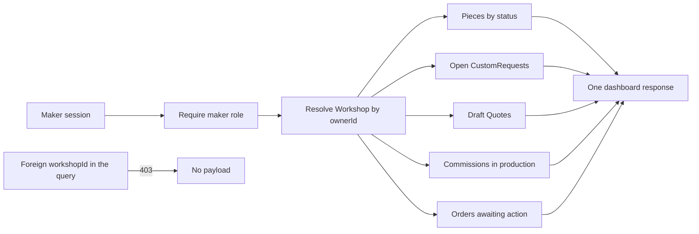

# The maker's back office

It is nine at night and Amina opens Ghurza on her phone. She has worked on embroidery all day and has twenty minutes before the power goes. Three things need her. A buyer has asked whether she can make a larger version of a sold cushion cover. A draft piece has sat without a price for six days. An order needs packing before the courier comes. She does not want to browse her own collection. She wants one screen that says what is unfinished, what is unanswered and what is waiting on money.

That screen is the maker's back office. It shows the same records buyers see, arranged for a different question. A buyer asks what can I buy. A maker asks what needs me now. The public collection answers the first question with available pieces and nothing else. The back office answers the second with counts across every status of a piece, plus the requests, quotes, commissions and orders that belong to one workshop. Building it is mostly a design problem, because the routes are small and the scoping is the part that can go wrong.

The maker arrives on this screen more often than anywhere else in Ghurza. It is the first page after sign in, the page she reloads between tasks and the page that tells her whether a week went well. That makes it the most valuable page for a reviewer to attack. A dashboard that fetches too much once leaks the workshop next door. A dashboard that fetches too little makes a maker open six tabs on a phone with a weak connection.

## One question per panel

The back office has five regions, and each answers one question. Pieces by status answers what is drafted, available, held, sold or archived. Open custom requests answer who is waiting for a reply. Quote drafts answer which price is half written and not yet sent. Commissions in production answer which piece is being made, and at which stage of it: pattern drafted, carving done, bisque fired. Orders answer what has been paid and not packed. Five questions, five panels, one workshop.

Two of those regions cannot be filled yet, and that is normal for week two. Orders arrive with the checkout module, requests with the custom request module, quotes with the quotes module and commissions with the production module. The dashboard is built now so the shape exists, and each later module fills its own panel with real records. Until then a panel shows zero, and zero is a valid answer. The mistake is to hide an empty panel with a note that says coming soon, because a maker reads that as a missing feature rather than a missing record.

The panels that work today are the ones with records in the seed: twelve pieces across three workshops, two of them sold, and one open request addressed to one workshop. That is enough to prove the dashboard reads the right workshop and the right statuses. A reviewer can sign in as two makers and see different counts on the same page, which is the test this module cares about most.

## The scope comes from the session

The single rule for the whole module is that the workshop is derived from the signed in account, never from the address bar. A route like `GET /maker/dashboard?workshopId=...` is an invitation. Someone who owns a workshop will guess a neighbouring identifier within a minute, because workshop identifiers appear in public pages, in order receipts and in shared links. The handler resolves the workshop from the owner field of the authenticated user, and a client supplied workshop identifier is either ignored or rejected.

That rule has a second half, which is easier to forget. A credited artisan is not the owner. Huda may be named on twenty pieces from Bayt al Zayt and still hold no account that can read the workshop's draft prices, private briefs or orders. Credit is attribution, and the authorization module already tested the difference. The dashboard inherits it: a maker account with no workshop of its own gets a clear message about opening a workshop first, not a screen full of another workshop's work.

A buyer who calls the route gets a denial with no partial payload. Not an empty dashboard, which reads like a workshop with nothing to do, and not a redirect that the client is expected to interpret. The status code and the message matter because the interface shows one of them to a person. Return forbidden for a buyer, return not found for a workshop identifier that does not exist, and return the dashboard only for the owner.

Read the diagram as a fan out from one resolved workshop, not from one request parameter. Every panel shares the same resolved workshop identifier, so the panels cannot disagree about whose records they count. The rejected branch on the right is the reason the fan out is safe: the only input that decides ownership is the session, and a workshop identifier typed by a client never reaches a query filter.

## Counts before lists

The first version of this page returns counts, not full rows, for four of the five panels. The piece panel is the exception, because a maker needs to act on a piece and a count cannot be edited. The reason is the phone. Every extra list is bytes over a connection the learner is paying for, and a dashboard that loads slowly on a good day is unusable on a bad one.

A count is also easier to get right. Counting pieces by status for one workshop is a single grouped query, and the workshop filter is the first stage of it. Returning five lists instead invites five separate queries, five chances to forget the filter and five places where a later change can widen the scope. Start with the version that has fewer opportunities to leak.

There is a real cost to this choice. A count does not tell a maker which piece is stale, so the dashboard cannot say "this draft has been untouched for six days" without another query. When that need appears, the piece panel already has the rows and the index to sort them. Other panels can grow a short list of three items later, ordered by what is oldest, and stay useful. Decide that per panel later, and keep the response shape wide enough to add a list beside a count without breaking the page.

## What the maker is allowed to do from here

The dashboard is a starting point, not a second editor. From the piece panel a maker opens a piece, edits the descriptive fields, publishes a draft or archives an available piece. From the request panel a maker opens a brief and replies, once the request module exists. From the commission panel a maker posts a production step, once that module exists. The dashboard links to those actions and does not reimplement them.

The reason to keep the actions on their own pages is that each one has rules the dashboard would have to repeat. Publishing needs a complete title, a price, materials, care notes and at least one photo of the actual piece. Editing a held piece must fail with a conflict, because a buyer is holding an offer that a price change would rewrite. A dashboard that sends a quick price edit from a table row would need the same rules in a smaller space, and the second copy of a rule is the one that drifts.

So the table shows the state and the link, and the detail page owns the decision. That split also gives the maker a clear place to read the server's answer. A conflict of the kind this course calls 409 lands on the edit page beside the field, with a message that says the piece changed and asks for a reload. On a dashboard row, the same answer would be a toast that vanishes before a maker on a slow connection reads it.

## What this module does not do

This module does not build a statistics page. There are no charts of revenue and no month by month comparisons, because a workshop with twelve pieces has nothing to plot and the numbers would teach the learner to trust a graph over a record. It also does not build a platform admin view. Every panel is scoped to one workshop, and there is no account that can see all of them.

It does not send notifications either. A maker learns what needs attention by opening the page. Reminders, quiet commission nudges and quote expiry arrive with the queue module near the end of the course. Until then, a dashboard that is honest about what it shows is better than a badge that was computed somewhere the learner cannot inspect.

Write three sentences before you build. What does Amina see first, which panel tells her that a buyer is waiting, and which single value proves the page is scoped to her workshop rather than to the marketplace. The next lesson turns those sentences into a route, a query and a table.
