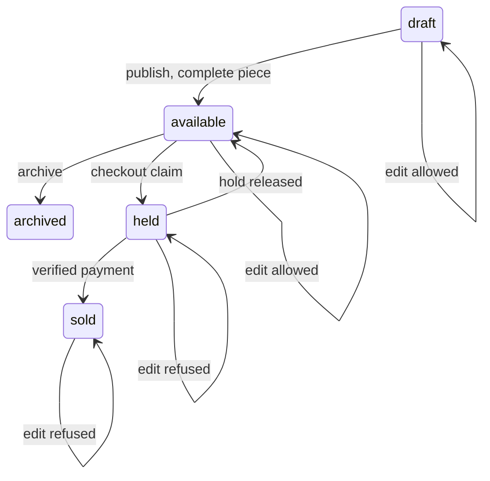

# Pieces, commissions and the maker dashboard

The pieces module already has routes for creating, listing and changing the status of a piece for the signed in workshop. The dashboard is the page that uses them. It adds one new route for the counts, a filtered table, a create and edit form, and two actions that move a piece between states. Everything else it shows waits on a record that a later module will fill.

Work in this order: the scoped count route, the table that reads it, the form that writes a piece, the publish and archive actions, then the error mapping that keeps the screen honest when the server refuses. Doing it in that order means every visible number on the page has a query behind it that you can run by hand.

## One route, five scoped counts

Start with the contract. The dashboard route takes no identifiers, because the only identifier it needs comes from the session. It answers with one object, and each key in that object is a panel on the page.

```js
// server/src/modules/dashboard/dashboard.routes.js (shape only)
router.get("/maker/dashboard", requireAuth, requireRole("maker"), getDashboard);
```

```js
// the response, with teaching values from the seed
{
  workshop: { id: "665f0a...", name: "Bayt al Zayt" },
  pieces: { draft: 2, available: 7, held: 1, sold: 2, archived: 0 },
  requests: { open: 1 },
  quotes: { draft: 0 },
  commissions: { inProduction: 0, awaitingApproval: 0 },
  orders: { awaitingPayment: 0, toPack: 0 }
}
```

Every value in that object is counted for one workshop. The handler does not accept a workshop identifier, a status filter or a date range from the query string. If your client code passes one, delete it before the client calls the route, because a parameter that exists is a parameter that will be trusted by someone later.

The piece counts come from one aggregation. A `$match` on the workshop runs first, then a `$group` that counts by status, then a small projection that turns the result into a fixed shape. Fixed shape matters more than it looks: the page renders five tabs with numbers beside them, and a missing key would render as blank rather than zero.

```js
// server/src/modules/dashboard/dashboard.service.js (the piece counts)
const rows = await Piece.aggregate([
  { $match: { workshopId } },
  { $group: { _id: "$status", count: { $sum: 1 } } },
]);
const pieces = { draft: 0, available: 0, held: 0, sold: 0, archived: 0 };
for (const row of rows) pieces[row._id] = row.count;
```

The `$match` is the security boundary, so it goes first and it uses the workshop resolved from the session. A version that groups first and filters afterwards would count every workshop in the database and then throw most of the result away, which is both slower and one refactor away from returning the wrong total. Read the aggregation pipeline documentation for `$group` before you extend it; the field names you choose now are the ones later panels will join against.

The other four panels count records that the seed barely contains. Count them with the same rule: workshop scope first, then the condition that makes the record interesting to a maker. An open request is one that still expects an answer. A draft quote is one that exists and was never sent. A commission in production is one whose recorded stage is in production or awaiting a step from the maker. An order awaiting action is one that is paid and not yet packed.

## The piece table and its filters

The table is the panel a maker uses every day. It lists the workshop's pieces with an image slot, title, craft, price, credited artisan and status, and it filters by status through tabs for draft, available, held, sold and archived. The image slot stays empty until the next module adds photographs, which is why the row reserves space for it now. The default tab is available, because that is the state a maker manages most often.

```js
// GET /maker/pieces?status=available
const ALLOWED = ["draft", "available", "held", "sold", "archived"];

export async function listMakerPieces(req, res) {
  const workshop = await workshopForOwner(req.user.id);          // 404 if none
  const { status } = req.query;
  if (status && !ALLOWED.includes(status)) {
    return res.status(400).json({ error: { code: "BAD_STATUS", fields: { status: "Unknown status" } } });
  }
  const filter = { workshopId: workshop._id };
  if (status) filter.status = status;
  const pieces = await Piece.find(filter).sort({ updatedAt: -1 }).limit(100);
  res.json({ pieces: pieces.map(toMakerSummary) });
}
```

An unknown status is a 400, not an empty list. The distinction is not pedantry: an empty list tells the maker that no piece is in that state, while a 400 tells the developer that the client sent a value the server never offered. The tab that sent the value came from a fixed list in your own interface, so a wrong value is a typo in your code and should be loud.

The sort uses `updatedAt` and the filter uses `workshopId` and `status`, which is why the pieces module added a compound index on those three fields. Without it, a workshop with a few hundred pieces still reads fine and a workshop with a few thousand does not. Open the compound index documentation and check the field order against the queries you actually run: workshop first, status second, updated time last, which matches the filter and the sort in that order.

`toMakerSummary` deserves its own function. The maker view needs a cover image address when one exists, a title and a price. It does not need the full document with every photo, the internal notes, the shipping profile or the hold details of another buyer. A serializer that returns everything means the browser holds data the page never shows, and a curious buyer with a stale tab can read it in the network panel.

## The create and edit form

The form writes the fields the piece model already defines. Title, craft, technique, materials, dimensions, care notes, price in minor units, currency, an optional credited artisan from this workshop, and a small `craftDetails` object for the attributes that only one craft has. Do not invent a new field for every craft. A ceramic piece records glaze in `craftDetails`, an embroidery piece records stitch count there, and the shared fields stay shared.

Two checks belong in the form and again on the server. The credited artisan must belong to the workshop that owns the piece, which is a cross document check the schema cannot do alone. The price must be a positive integer in minor units, which the schema can do and the form should also say before the request leaves the phone.

The form saves drafts. A draft may have an empty description, no photos and no price, because a maker starts a listing when the piece is finished and fills it in over an evening. Publication is a separate action with its own rules, and it is the only point where the listing makes a promise to a buyer. Keeping those two moments apart is what lets a maker work on a listing across a power cut without losing the draft.

## Publish, archive, and the conflict

Publishing moves a draft to available. Archiving moves an available piece out of the catalogue. Both are conditional updates, not a general patch that accepts any status from the browser.

The diagram below places the two dashboard actions on the piece lifecycle and marks the states where an ordinary edit is refused. It shows why the edit route and the status route need different filters: one changes descriptive text, the other moves the piece, and both have to read the current state before they write.



Notice the four self transitions. The top two are writing states and the bottom two are refusals, so the same piece document both allows and blocks an edit depending on where it sits. A dashboard that sends `PATCH /maker/pieces/:id` with a title and lets the schema decide would write in all four, which is the defect the gate looks for.

```js
// publish, with the completeness rule in the filter
const updated = await Piece.findOneAndUpdate(
  {
    _id: pieceId,
    workshopId,
    status: "draft",
    title: { $ne: "" },
    priceCents: { $gt: 0 },
    materials: { $ne: "" },
    careNotes: { $ne: "" },
  },
  { $set: { status: "available" } },
  { new: true }
);
if (!updated) return res.status(409).json({ error: { code: "PIECE_CHANGED", message: "This piece changed. Reload it." } });
```

The filter does two jobs. It makes the transition correct under a double tap, because only one update can match `status: "draft"`, and it refuses an incomplete piece even if a stale form said it was ready. A null result then needs a second read to tell the maker which of the two problems occurred: a missing price, material or care note is a 400 with a field, while a piece that already left draft is a 409 with a reload. Re-read by identifier only, decide, then answer.

The same pattern covers editing a piece that is held or sold. The update filter includes `status: { $in: ["draft", "available"] }`, so a title change submitted from a tab left open before checkout matches nothing and the route answers with a conflict. The maker sees a message that the piece is held and cannot be edited, which is the truth: a buyer is holding an offer built from that title and price.

## The panels that wait

Four panels show records that later modules create. Build them now with a real query and an honest empty state, because a panel built early is a panel whose scoping is tested early. The requests panel counts the seeded open request for the workshop it was addressed to and zero for the other two. That single difference is the test for the whole page.

```js
// each count is scoped the same way, with its own condition
const [openRequests, draftQuotes, commissions, orders] = await Promise.all([
  CustomRequest.countDocuments({ workshopId, status: { $in: ["submitted", "answered"] } }),
  Quote.countDocuments({ workshopId, status: "draft" }),
  Commission.countDocuments({ workshopId, status: { $in: ["in_production", "awaiting_approval"] } }),
  Order.countDocuments({ workshopId, status: { $in: ["paid", "packed"] } }),
]);
```

Every one of those filters contains `workshopId`. A count without it returns a number that looks plausible and is wrong, which is the worst kind of defect on a dashboard because nothing on the screen invites a second look. When the request, quote, commission and order modules arrive, they will reuse this scope rather than invent a new one.

The empty state needs a sentence, not a spinner that never ends and not a zero with no explanation. An empty orders panel says there are no orders yet. A failed request says the panel could not be loaded and offers a retry. Those are different sentences because they mean different things, and a maker who cannot tell them apart will assume the worst on a bad connection.

## Failing tests to write first

Three tests fail against the code as module eleven left it, and each one fails for a different reason worth reading.

```js
// server/tests/dashboard.test.js
test("workshop B sees zero pieces for workshop A", async () => {
  const res = await request(app).get("/maker/dashboard").set("Authorization", `Bearer ${tokenB}`);
  expect(res.status).toBe(200);
  expect(res.body.pieces.available).toBe(0);
  expect(res.body.requests.open).toBe(0);   // currently counts every workshop
});

test("an unknown status filter is a 400, not an empty list", async () => {
  const res = await request(app).get("/maker/pieces?status=reserved").set("Authorization", `Bearer ${tokenA}`);
  expect(res.status).toBe(400);
  expect(res.body.error.code).toBe("BAD_STATUS");   // currently 200 with []
});

test("editing a held piece is refused and changes nothing", async () => {
  const res = await request(app).patch(`/maker/pieces/${heldPiece.id}`)
    .set("Authorization", `Bearer ${tokenA}`).send({ title: "New title" });
  expect(res.status).toBe(409);
  const after = await Piece.findById(heldPiece.id).lean();
  expect(after.title).toBe(heldPiece.title);   // currently 200 and the title moved
});
```

Run them before you fix anything and keep the failing output. The first test is the ownership one, and it can pass for the wrong reason if workshop B simply has no pieces. Seed both workshops with at least one available piece so a zero can only come from the filter.

## Acceptance criteria before the gate

The dashboard route answers 200 for an owner, 403 for a buyer and 404 for a maker with no workshop. Every count in the response changes when a record in that workshop changes and stays the same when a record in another workshop changes. The table lists only the signed in workshop's pieces, filters by five statuses, sorts by most recently changed and refuses an unknown status with a 400. A draft with no price, materials or care note cannot publish, and the message names the missing field. The next module adds one more publish rule, a photograph of the actual piece, and it belongs in the same place. A held piece cannot be edited and the row is unchanged after the attempt.

Finally, load the page with the network panel open and count the requests. One call for the dashboard, one for the table, and no call that returns another workshop's data. If the table refetches on every tab press, keep it: the filter changes the query, and the query is what keeps the scope honest. The next lesson is the gate, and it asks you to bring the two makers, the conflict and the four empty panels with you.
