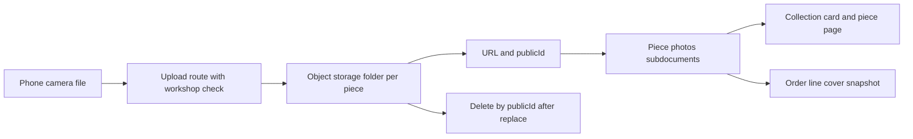

# A buyer cannot touch the stitch

Lina is four thousand kilometres from the workshop. She cannot turn the cushion cover over, feel the weight of the olive wood, or tilt the bowl until the glaze catches the light. Everything she knows about the object arrives through a small screen on a phone on a mobile connection. The photographs are not decoration on a listing. They are the whole inspection, and the buyer is being asked to pay for an object she has never held.

That changes what a photograph has to do. A catalogue image that says "handmade style" tells Lina nothing about the piece that will arrive. A photograph of the actual cover, taken in daylight, with the back seam and the embroidery close enough to see the thread, tells her what she is buying. The difference is not the camera. It is whether the picture is evidence of this object or a mood.

This module builds the upload path and the rules around it. Before writing a route, decide what the photographs have to prove, because a storage bucket will happily hold any picture you send it and a buyer will pay for the wrong promise.

## Three jobs for four photographs

A piece carries at most four photographs, so each one has a job. The first is the cover, the whole object, filling most of the frame with nothing distracting behind it. The buyer sees it in the collection and it is the picture that decides whether she opens the page at all. A cover that hides the shape of the piece is a cover that makes the next click harder.

The second is craft evidence, close enough to show technique. On an embroidered cover that means the stitch pattern and the density of the thread. On carved olive wood it means the grain and the tool marks. On a glazed bowl it means the surface where the glaze pools and thins. This is the photograph that separates a workshop from a reseller, and it is also the one a buyer zooms into when she is deciding whether the price is fair.

The third is scale. A bowl photographed alone could be a cup or a basin, and dimensions in prose do not fix that on a phone. Put a hand, a common object or a ruler in the frame, or photograph the piece on a table with something the buyer recognises. Say in the caption what the reference object is, since a hand in the frame means one thing in a workshop and another in a studio.

The fourth is honesty: the flaw, the underside, the repair, the place where the glaze ran. A one-off piece has one buyer, and she will receive exactly the object in the photographs. Showing a small crack with a sentence that explains it is better than hiding it in a corner of a wide shot, because the buyer who discovers it on arrival asks for a refund and writes a review that costs more than the piece.

## The photograph must be of this piece

The hardest rule is also the simplest to state. Every photograph on a listing is of the physical piece the buyer will receive. Not a photograph of a similar piece the workshop made last year, not a borrowed picture of embroidery from another catalogue, not a photograph taken from another workshop's page. A one-off object is exactly the case where a borrowed image is a lie rather than a convenience.

This matters more in handmade work than the rule suggests, because a workshop often makes the same design twice. The second cover may use the same pattern and a different dye lot. Its photograph must be of the second cover, or the buyer receives a colour she never saw. Keep the old photographs on the sold piece, where they belong, and take new ones for the new piece.

There is a second reason, which is legal rather than ethical. A photograph is someone's work. Copying a picture from a search engine or from a maker's social feed into your storage bucket, then serving it from your own domain, creates a claim you cannot answer. The course runs on fictional workshops with the learner's own photographs, openly licensed images, or images used with written permission. Say which one applies in your README, per piece, so a reviewer can check.

## A photograph is a pointer, not a file

The course keeps image files out of the database. MongoDB stores a record of where the picture lives: a public URL, a public identifier, a short description, and which of the four jobs the photo does. The bytes live in object storage, which is built for large files, caching and resizing. A database row with a two megabyte image inside it makes every query slower, including the ones that have nothing to do with photos.

The chain below is the argument. Follow one photograph from the maker's phone to the buyer's order receipt and notice that each step stores something small and derived, never the file itself.

Two things in that diagram are worth holding onto. The stored pair of URL and public identifier is what makes deletion possible, because a delete needs the storage key and not the address a browser used. And the order line keeps its own copy of the cover address, which is why a later photo change cannot silently rewrite a receipt the buyer already paid for.

## Say what the light was

Phone cameras make decisions on the buyer's behalf. They warm a colour, sharpen an edge and brighten a shadow, and the result is a cover that looks more saturated than the cloth. The buyer then opens a parcel in ordinary daylight and sees something else. The gap is small, but a buyer who feels misled by a colour will not be reasoned with by a paragraph of explanation.

Take photographs in daylight, near a window, without a filter. If the cloth is dyed with a natural dye, say that the colour varies and photograph it beside something white so the buyer can judge the cast. If the glaze is photographed under a lamp, say so. Two sentences in the description prevent most of the conversations that start with the picture looked different.

Do not edit a photograph to remove a defect, and do not crop so tightly that a repair leaves the frame. A straightened edge and a corrected horizon are harmless. A clone tool that removes a stain is a misrepresentation of an object that exists once, and the buyer will see the difference in her hands.

## The frame is somebody's home

A workshop is often a room in a house. Photographs taken there can show a street number, a child, a neighbour at a window, a stack of letters or a wall of family pictures. None of that belongs on a public page, and the person in the frame has not agreed to appear on a marketplace.

Check the background before upload, not after. Move the piece to a plain wall, or crop the frame before saving. Ask permission for any person who appears, including a hand that is identifiable by a bracelet. The same rule covers the metadata inside the file, which can carry the coordinates where the photograph was taken. Strip that data on the server rather than trusting the phone's settings, because a maker who is rushing will forget.

## What a photograph cannot claim

A photograph shows appearance, and appearance is not provenance. It cannot prove who made the piece, how long it took, or that the material is what the description says. Those claims live in the text fields and in the artisan credit, and the writing rules from the introduction apply to the description beside the image. Never invent a motif's history or a family's tradition to make a photograph feel older than it is.

Nor does a photograph promise a delivery date. A beautiful cover with a two week production range is honest; the same cover beside "arrives Friday" is a promise the maker cannot keep. Shipping and lead times have their own module later in this week, and the piece page will show ranges there. This module only decides what the buyer can see.

Before the next lesson, choose one finished piece from the seed and plan its four photographs in a note. Name the job of each one, the light you would use, and the sentence that would sit beside it. The upload route you build next exists to put exactly that set on the page, and to keep the set frozen once somebody has paid for the object it shows.
