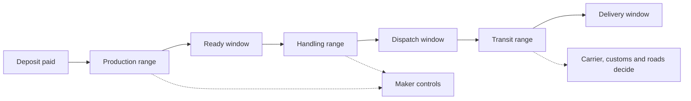

# Honest lead times and shipping

Sami is in another country and wants a cushion cover for a room he is painting. He asks one question that sounds simple: can it arrive by the twentieth. Amina has eight days of embroidery ahead of her, a queue of two commissions, a courier who collects twice a week and a parcel that has to clear a border. She can answer the question in one of two ways, and only one of them is honest.

The first answer is a date. I will post it on Thursday and it will arrive on the nineteenth. It is easy to type, it converts well, and it is a promise about events Amina does not control. The second answer is a pair of ranges. Your deposit starts eight to eleven days of work, I pack and hand the parcel to the courier within two to three days of finishing, and transit to your country has taken seven to fourteen days in my experience. The second answer is longer, less satisfying and the only one she can stand behind.

Ghurza needs the second answer, stored as numbers rather than a sentence, because three separate people will read it: the buyer who is planning, the maker who is making the work, and later the commission timeline that has to decide whether a step is late.

## Three clocks, not one

The mistake that produces a false date is treating delivery as one duration. It is three. Production is the time the maker needs to make a piece that does not exist yet, and for a hand embroidered cover that is measured in weeks. Handling is the time between a piece being finished and a carrier accepting it: packing, a second photograph, the courier's collection day. Transit is the time from the carrier's hands to the buyer's door, and it is the clock the maker influences least.

Each clock belongs to a different person. The maker owns production and handling, and can shorten either by working longer or by keeping a queue that matches capacity. Nobody in the workshop owns transit past the handover. A postal service, a customs office and a road decide most of it, and the maker's experience gives an estimate rather than a commitment.

On a made-to-order piece the clocks run in order. A deposit starts production, production ends in a ready window, handling turns the ready window into a dispatch window, and transit turns dispatch into a delivery window. On a finished piece there is no production clock at all, which is why the same workshop can quote three to five days for a bowl that exists and eight to eleven days of work plus transit for a cover that does not.

Notice that the diagram never lands on a point in time. Every arrow adds a range and the end is wider than the start, which is not sloppiness. It is the shape of the information a maker actually has. The two dotted labels matter as much as the boxes: the maker controls the first two clocks and only estimates the third, so the interface must not present the delivery window with the same confidence as the ready window.

## Why the range is wider at the end

Adding two ranges gives a wider range, and that is the arithmetic that makes honest estimates look unhelpful. Production of eight to eleven days plus handling of two to three days is a ready window of ten to fourteen days from the deposit. Add transit of seven to fourteen days and the delivery window is seventeen to twenty-eight days. The maker who says seventeen to twenty-eight days sounds less organised than the one who says three weeks, and is the only one whose estimate is likely to hold.

The queue is the part that changes most between two commissions. A workshop with a maximum of two active commissions and one already in progress starts a new piece later than a workshop that is empty. That is not a reason to hide the queue. A buyer who understands that the second slot starts after the first piece ships will wait, while a buyer who was told a date and then watches it pass will ask for a refund.

Say what the range assumes. The maker's queue is worked in order at a steady pace, materials are in hand, nothing breaks and the courier collects on schedule. When one of those fails, the maker posts an update and proposes a new range rather than quietly letting a promise expire. The commission module records both the original range on the accepted quote and the later change, so the buyer can see what moved and decide.

## A zone is a decision, not a filter

Shipping cost and availability are per destination, and a workshop cannot serve every country equally. A zone groups destinations that behave the same way for this maker: a list of country codes, a flat rate in minor units, and a transit range for that group. A small workshop may have three zones: neighbouring destinations, a wider region, and a rest of world zone it does not serve at all.

Two answers other than a price are legitimate and should be visible before checkout. Quote required means the maker will not commit to a flat rate for that destination, perhaps because the parcel is heavy or the route is unusual, and the buyer needs a conversation. Not shipped here means the workshop has decided not to send pieces there, which is a real decision for a maker working alone and is better stated early than discovered at payment. Treat both as first class answers in the data, not as errors.

This is also where a paused zone belongs. A maker who cannot post anything for two weeks, because of a family matter or a materials shortage, needs a way to pause shipping with a short note rather than archiving the work. The note is shown to the buyer and checkout refuses the destination while it is paused. A pause that silently removes pieces from the catalogue teaches the buyer nothing and costs the maker the sale anyway.

The ship-from country is part of the profile for the same reason. A parcel that stays inside one country crosses no border, and a parcel that leaves crosses one, which changes both the transit range and the paperwork. Do not encode a claim about which routes are available from any particular place. The maker enters the country the parcel leaves from, and the course treats it as a fact the maker supplies.

## Customs in plain English

A cross border parcel carries a declaration: what the item is, what it is made of, and what it is worth. A cushion cover described as a textile article with a cotton cover, or a bowl described as a glazed ceramic object, is what a customs officer needs. A description that says gift tells them nothing and can delay the parcel.

The buyer may owe import charges when the parcel arrives, and those charges are set by the destination, not by the maker. The course does not calculate duties and does not pretend to. What it does is state the possibility on the piece page and in the confirmation, so a buyer is not surprised by a payment request before delivery. A maker who says nothing about it has not made the parcel cheaper; the buyer still pays, and now blames the shop.

Some destinations restrict or inspect certain materials, and rules change without notice. Wooden objects, items with plant fibres, and animal derived materials can all attract attention at a border. The honest instruction to a maker is to confirm the current rule for a destination before accepting an order, and to write that confirmation in the order notes. The course cannot give legal advice, and a paragraph that pretends otherwise would be worse than saying nothing.

## The trade-off

The choice is between a single promised date and a pair of labelled ranges. The date is easier to show, converts better in a demo and is the one thing that will be quoted back in a complaint. The ranges are harder to design, need two numbers per stage, and require the maker to admit that a hand-made object takes as long as it takes.

Choose the ranges, and choose to show the inputs beside them: work starts after the deposit, packing takes a few days, transit is an estimate. The buyer can then plan for the far end instead of the near end. Switch only if a workshop gains a process it truly controls end to end, with its own courier and a fixed route, and even then show a range with a narrower span rather than a minute on a clock.

Keep one sentence in front of you while you build the next lesson: a date is a promise about other people's work, and a range is a description of your own. The model you write will decide which of those the interface can say.
