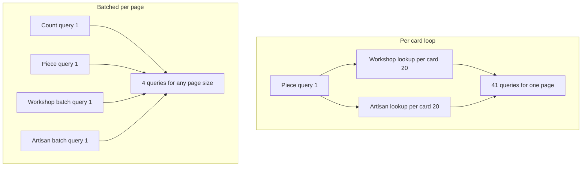

# Browsing a collection of one-off pieces

A buyer opens Ghurza on a phone and sees a grid of work. Before she taps a card she wants four answers: is this piece still there, what does it cost, how long before it can leave the workshop, and will the workshop send it to her country. The collection page has to answer all four on the card itself. Every card is one object, and it can disappear from the list while she is still reading it.

This module builds that page as an API. The route returns a page of cards with the workshop name, the credited maker, the craft, the price, a ready range and the availability status. It also returns sold work when the buyer asks for it, because a sold piece is the best evidence a workshop has. By the end of the module one page runs a fixed number of database queries whether it shows five cards or twenty. The next lesson makes that number grow, shows the failing test, and then fixes it.

## What the collection is allowed to show

Every Piece carries one of five statuses: draft, available, held, sold or archived. Draft means the maker is still writing the description and choosing photos. Archived means the workshop has withdrawn the listing, perhaps because a bowl was damaged in the studio. Held means one checkout has claimed the piece for a short payment window. Sold means a verified payment completed, and the page stays as a record of the work.

The default collection shows available pieces only. That default is a product decision, not a database detail, so write it where the route can be read against it. A held piece is not available to the next buyer, and showing it as though it were invites a 409 at checkout that the buyer could have avoided on the card.

Sold work needs its own switch. A request with `include=sold` returns available and sold cards together, and each sold card carries the word "Sold" in text as well as a muted treatment. Colour alone would fail in sunlight and for a buyer who cannot separate the two shades. Keeping sold pieces in the collection is what lets a buyer find a workshop whose style she likes, even when the exact bowl she liked is gone.

Draft and archived pieces never appear in a public list. Do not fetch every piece and hide the private ones in React. That pattern leaks unpublished titles, prices and workshop notes to anyone who opens the network panel, and it sends a large payload to a phone for no reason. The filter belongs in the query, where a reviewer can read it.

Sort newest first, with `createdAt` descending and `_id` descending. The second key matters when a seed writes twelve pieces inside the same millisecond. Without it, two pages can return the same card twice and skip another.

## Every filter needs a field behind it

A filter is only honest if a stored field can answer it. Before adding a control to the page, point at the field. The craft filter reads `piece.craft`, the same small list the maker form writes: tatreez, olive wood or ceramics. A request for a craft outside that list returns 400 rather than an empty list. An empty list says "this workshop has none of those right now", and a 400 says "that is not a craft we know", which are different facts.

Price filters read `priceCents`, an integer in the smallest currency unit, with `minPriceCents` and `maxPriceCents` as optional bounds. Reject decimal input, reject a negative bound, and reject a minimum above the maximum. These bounds only narrow a list. They never travel into checkout as an agreed amount, because the server will compute the payable total from stored records when the time comes.

The lead time filter is the one that needs thought. A piece has three clocks: production time before it is finished, handling time before the workshop can post it, and transit time in the hands of a carrier. Module 14 stores handling and transit as ranges on the ShippingProfile. On a browse card the useful number is production plus handling, because transit depends on a destination the buyer has not chosen yet. The filter is `maxReadyDays`, and a piece whose range ends at 14 days disappears when the buyer asks for pieces ready within 7.

The destination filter is different in kind. "Ships to my country" is stored per workshop, in the zones of its ShippingProfile, not on the piece. Resolve the set of workshop IDs that serve the country in one query, then filter pieces by workshop inside that set. If you write the lookup inside the card loop instead, a page of twenty pieces costs twenty extra queries for a single country question. The same set can be reused by every card on the page.

Keep the query names boring and stable: `craft`, `minPriceCents`, `maxPriceCents`, `maxReadyDays`, `shipsTo`, `include`, `page` and `limit`. A public route is a contract with your own client, and a contract that renames its fields by mood creates silent empty screens that nobody can debug on a phone.

## Pagination on a list that moves

Use `page` and `limit` with a default of 20 and a maximum of 60. Return `total` and `hasMore` so the client can render "showing 20 of 34" and a next button without guessing. Clamp or reject a limit above the maximum, and never accept an unbounded request. A collection route that can return five thousand documents will eventually be asked to do exactly that from a metered phone connection.

Offset pagination has a known weakness on a moving list. Between page 1 and page 2 a piece sells and leaves the result set, so every row shifts up by one and a card is skipped. A newly published piece pushes a row down, so one card appears on both pages. For browsing, that is a small cost: the buyer can scroll back, and the next refresh corrects it. For a cart summary or an order list it would be unacceptable, because the reader is counting items rather than skimming them.

Cursor pagination removes the shift by reading "after this row" instead of "after this many rows". It costs more to build, and it makes a total count harder to show. This build takes offset pagination because the collection is small and the buyer benefits from seeing how much work exists. The reading in 15.6 covers the cursor version, so you can defend the choice instead of inheriting it.

## Two names on every card

A card shows the workshop's public name and the credit of the maker who made the piece. Artisans choose how their name appears: full name, first name only, or the workshop name only. The serializer applies that choice, and the API never returns an Artisan document whole because a card needed one string.

This is where a working page usually becomes a slow one. The obvious code loads the page of pieces, then asks the database for the workshop of each piece, then for the artisan of each piece.

```js
// server/src/modules/pieces/piece.routes.js, naive version, do not keep it
const pieces = await Piece.find(filter).sort({ createdAt: -1, _id: -1 }).limit(limit);
const cards = [];

for (const piece of pieces) {
  const workshop = await Workshop.findById(piece.workshopId); // one query per card
  const artisan = await Artisan.findById(piece.artisanId); // another query per card
  cards.push(toPublicCard(piece, workshop, artisan));
}
```

With twelve seeded pieces in a local database, that loop finishes before you notice. Each query takes a millisecond or two when the data sits on the same machine and nothing else is running. The page looks correct, a test that checks only the JSON passes, and the defect ships.

The same code with twenty cards and a remote database is a different experience. Suppose each round trip costs 60 milliseconds, which is optimistic on a mobile connection. The loop runs one query for the page, then forty more one after another, and the buyer waits about two and a half seconds for something three queries could have answered. The pattern has a name you should use in review. An **N+1 query** is one query for the page plus one more query for each row in it.

The fix is to stop asking per row. Collect the distinct workshop IDs and artisan IDs from the page, load both sets with a single `in` query each, and build a small lookup object. Three queries for any page size is the budget for this route, plus one count query for the total.



Notice what the diagram does not claim. It does not say the batched shape is faster for every single request. On a tiny local database both finish quickly, and the loop version is shorter to read. It claims that only one shape keeps the cost fixed as the page grows, and a public page that grows is the normal case rather than the exception.

The cache module will make this distinction sharper. A cache hides the query count until it misses, and it misses exactly when a workshop publishes or a piece sells. If the code behind the cache is N+1, every refresh wave hits the database with forty queries per buyer.

## What you will build

The build has six parts. Each part has a check you can watch fail before it passes, which is the habit this module is trying to install.

- A public `GET /api/v1/pieces` route with the filters above and no login requirement.
- `page`, `limit`, `total` and `hasMore` in the response envelope.
- An `include=sold` switch that adds portfolio cards without adding a purchase action.
- One route for a single piece, with the shipping answer when a country is supplied.
- Batched workshop and artisan lookups, plus a test that counts queries at two page sizes.
- A compound index that serves the default sort and the common filters.

The acceptance is concrete. With the module 5 seed, the default request returns the available pieces and no draft. Adding `include=sold` adds exactly the two sold pieces, each marked in text. A ceramics filter returns only ceramics. `maxReadyDays=7` drops the workshop with a two-week handling range. `shipsTo` for the country that one workshop excludes returns no piece from that workshop. The query counter prints the same number for five cards and for twenty.

## Where this leaves you

A buyer should be able to reach a piece she wants, understand what it costs and how long it takes, and know that the workshop will ship to her. Nothing on this page promises a date. A range is the only honest promise when work, handling and a carrier are all in the path.

The next lesson starts with the failing test rather than the route. Counting queries before fixing them turns a vague instinct about performance into a number you can put in a review.
