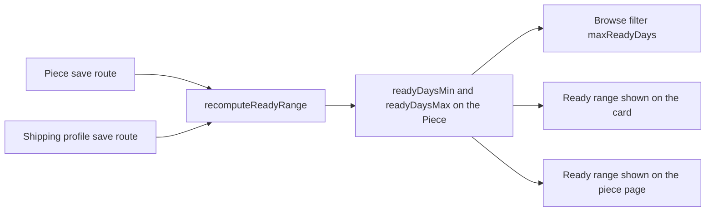

# Collection query, filters and the N+1 trap

The route is already outlined after the last lesson. This lesson writes it, and the first file you write is a test that counts queries. A test that checks only the JSON shape cannot tell a four-query page from a forty-one-query page, and the difference is what a buyer on a slow connection feels in her hand.

The counter is small: a search hook on every model pushes each operation into an array, and the test asserts on the array length. Keep it in `server/src/test/query-counter.js` so later modules can reuse it for the cart and order routes. Register it before the models are compiled, because a plugin added afterwards does not reach schemas that already exist.

```js
// server/src/test/query-counter.js
export function startQueryCounter(mongoose) {
  const queries = [];

  mongoose.plugin((schema) => {
    schema.pre(/^(find|count)/, function () {
      queries.push(this.model.modelName);
    });
  });

  return {
    get operations() {
      return [...queries];
    },
    get count() {
      return queries.length;
    },
    reset() {
      queries.length = 0;
    },
  };
}
```

## Start with the failing test

Seed twenty available pieces across three workshops and request one page. Assert that four operations is the ceiling. Run it before the batched lookups exist and it fails, which is the point: the failure message names the number of queries rather than a vague promise about performance.

Then run the same assertion at `limit=5`. If the count falls from 42 to a handful, the route is doing work per row, and the difference between the two numbers tells you how much. That single observation is a better diagnosis than reading the handler and guessing.

```js
// server/src/modules/pieces/piece.routes.test.js
test("a page of cards costs a fixed number of queries", async () => {
  const counter = startQueryCounter(mongoose);

  await request(app).get("/api/v1/pieces?limit=20").expect(200);
  const atTwenty = counter.count;

  counter.reset();
  await request(app).get("/api/v1/pieces?limit=5").expect(200);
  const atFive = counter.count;

  expect(atTwenty).toBeLessThanOrEqual(4); // 42 before the fix: count, page and 40 lookups
  expect(atTwenty).toBe(atFive);
});
```

Before you read on, commit to a number. The handler loads twenty cards, and each card needs a workshop name and a maker credit.

```predict
prompt: "A page shows 20 cards. The handler runs one query for the pieces, then looks up the workshop and the artisan for each card inside the loop. How many lookups run for that request?"
options:
  - id: twenty-one
    label: "21"
  - id: forty-one
    label: "41"
correctOptionId: forty-one
explanation: "One piece query, then a workshop lookup and an artisan lookup for each of the twenty cards: 1 + 20 + 20 is 41. The pagination total is a separate query, so the measured counter reads one higher. The shape is the point: sixty cards would cost 121 lookups, and a cache would hide that only until it misses."
allowRetry: true
```

The failing test is not a formality. It fixes the budget in the repository, so a later feature that adds a name to the card cannot quietly add a query per row without turning the suite red.

## Define the contract in one file

Put the query shape and the card shape in `server/src/modules/pieces/piece.public.js`, beside the serializer that builds them. The project is JavaScript, so the types are JSDoc comments that the editor and the reader both understand.

```js
// server/src/modules/pieces/piece.public.js
/**
 * @typedef {Object} CollectionQuery
 * @property {string} [craft]          one of tatreez, olive-wood, ceramics
 * @property {number} [minPriceCents]  integer, smallest currency unit
 * @property {number} [maxPriceCents]  integer, smallest currency unit
 * @property {number} [maxReadyDays]   production plus handling, transit excluded
 * @property {string} [shipsTo]        ISO 3166-1 alpha-2 country code
 * @property {"available"|"sold"} [include]  default available
 * @property {number} [page]           starts at 1
 * @property {number} [limit]          default 20, maximum 60
 */

/**
 * @typedef {Object} PublicPieceCard
 * @property {string} id
 * @property {string} title
 * @property {string} craft
 * @property {number} priceCents
 * @property {string} currency
 * @property {"available"|"sold"|"reserved"} status
 * @property {number} readyDaysMin
 * @property {number} readyDaysMax
 * @property {string|null} coverPhotoUrl
 * @property {{ id: string, name: string }} workshop
 * @property {{ displayName: string } | null} makerCredit
 * @property {boolean} canAddToCart
 */
```

`canAddToCart` is on the card because the client should not reimplement the status rules. It is true only when the piece is available and the card came from a list that permits buying. It is false for sold and reserved cards, and the checkout route still revalidates the piece before it claims anything. A flag that saves a wasted tap is not a permission.

## Parse the query without trusting it

Validation happens once, in `server/src/modules/pieces/piece.query.js`. The route calls it and passes the result onward. Two things are easy to get wrong here. The first is spreading `req.query` straight into the database filter, which lets a caller send `status: draft` or a query operator you never intended to accept. The second is treating a failed conversion as a server error. A buyer who types a letter into a price box deserves a 400 with a field message, not a 500.

```js
// server/src/modules/pieces/piece.query.js
const CRAFTS = ["tatreez", "olive-wood", "ceramics"];
const STATUS_BY_INCLUDE = { available: ["available"], sold: ["available", "sold"] };

export function parseCollectionQuery(raw) {
  const include = raw.include === "sold" ? "sold" : "available";
  const craft = raw.craft ? String(raw.craft) : null;
  if (craft && !CRAFTS.includes(craft)) {
    throw new BadRequest("craft", `craft must be one of ${CRAFTS.join(", ")}`);
  }

  const page = Math.max(1, Number.parseInt(raw.page ?? "1", 10) || 1);
  const limit = Math.min(60, Math.max(1, Number.parseInt(raw.limit ?? "20", 10) || 20));
  const minPriceCents = toOptionalInt(raw.minPriceCents, "minPriceCents");
  const maxPriceCents = toOptionalInt(raw.maxPriceCents, "maxPriceCents");
  if (minPriceCents != null && maxPriceCents != null && minPriceCents > maxPriceCents) {
    throw new BadRequest("minPriceCents", "minimum is above the maximum");
  }

  return {
    include,
    craft,
    minPriceCents,
    maxPriceCents,
    maxReadyDays: toOptionalInt(raw.maxReadyDays, "maxReadyDays"),
    shipsTo: raw.shipsTo ? String(raw.shipsTo).toUpperCase() : null,
    page,
    limit,
  };
}
```

Build the filter object from the parsed values and nothing else. The status clause always comes from `STATUS_BY_INCLUDE`, so no caller can ask for a draft. When `shipsTo` is present, add the workshop set that serves that country, resolved in a separate query against the ShippingProfile collection before the piece query runs.

## Store the ready range on the piece

The `maxReadyDays` filter raises a design question. Production days belong to the piece. Handling days belong to the workshop's ShippingProfile. If the filter has to read two collections, it stops being a single indexed query.

This build stores `readyDaysMin` and `readyDaysMax` on the Piece. A small service, `recomputeReadyRange(pieceId)`, adds the piece production range to the workshop handling range and writes the result. The piece save route calls it, and the shipping profile save route calls it for every piece in that workshop.

The trade-off is honest. What it buys is one indexed query for the hottest read in the product, and a card that can render a range without a second lookup. What it costs is a copy that can go stale if a write path forgets to call the service. The alternative is an aggregation that joins the profile on every browse request, which removes the copy and makes the filter slower and harder to index. When to switch: if range changes become frequent, or if the range must include a queue of commissions ahead of the work, move the calculation into a nightly job plus a short cache.



The diagram is a warning about writers. Two routes can change the number, and both must call the same service, or the collection and the detail page will disagree about the same piece. That disagreement is worse than a slow query, because a buyer plans around a range she was shown.

Guard the copy with a test. Shorten a workshop's handling range, reload the collection, and expect the card to show the new number. If it shows the old one, a write path is missing its call.

## Populate or aggregate

There are two realistic ways to put names on the cards. The first is `populate` with an explicit `select`. Mongoose issues one extra query per populated path, which fits the budget of four and keeps the serializer simple. The second is an aggregation with a join, which returns everything in one cursor.

This module uses `populate`, because four queries is already a fixed cost and the serializer is easier to test when it receives ordinary objects. The aggregation becomes worth its complexity when the response needs a computed field from three collections, or when search scoring arrives in module 26.

```js
// server/src/modules/pieces/piece.service.js
export async function listCollection(query) {
  const filter = buildPieceFilter(query, await workshopIdsForCountry(query.shipsTo));

  const [total, rows] = await Promise.all([
    Piece.countDocuments(filter),
    Piece.find(filter)
      .sort({ createdAt: -1, _id: -1 })
      .skip((query.page - 1) * query.limit)
      .limit(query.limit)
      .populate({ path: "workshopId", select: "name slug" })
      .populate({ path: "artisanId", select: "name displayName nameDisplay" })
      .lean(),
  ]);

  return {
    items: rows.map(toPublicCard),
    page: query.page,
    limit: query.limit,
    total,
    hasMore: query.page * query.limit < total,
  };
}
```

`lean()` returns plain objects instead of Mongoose documents. That halves the memory per card and removes getters you do not want in a public response. The count and the page run in parallel, which keeps the wall clock shorter than running them one after another while the query count stays at four.

## Index for the default request

The default request has no craft and no price bound. It filters on status, sorts by `createdAt` descending, and takes twenty rows. That is the query to index first, because it runs on every visit.

```js
// server/src/modules/pieces/piece.schema.js
pieceSchema.index({ status: 1, createdAt: -1, _id: -1 });
pieceSchema.index({ status: 1, craft: 1, priceCents: 1 });
pieceSchema.index({ status: 1, readyDaysMax: 1 });
```

Read the compound index from left to right. Equality fields come first, then the sort, then a range. An index that starts with `craft` cannot serve the request that has no craft filter, because the leading field is missing. That is the most common indexing mistake in a catalogue, and it is invisible until the collection is large.

Verify with `explain("executionStats")` on the default request. Look for an index scan plan and for `totalDocsExamined` close to the number of documents returned. Record your own two numbers in the learning log rather than repeating a figure from this page. If the plan says collection scan, the sort or the status clause is not covered by the index you made.

## The single piece route

`GET /api/v1/pieces/:id` returns what the detail page needs: ordered photos, dimensions, materials, technique, care notes, the maker credit with the artisan's display choice, the ready range, and the shipping answer for a supplied country.

```js
// server/src/modules/pieces/piece.service.js
/**
 * @typedef {Object} PieceShippingAnswer
 * @property {"rate"|"not_shipped"|"quote_required"|"paused"|"unknown"} state
 * @property {number} [rateCents]
 * @property {number} [transitDaysMin]
 * @property {number} [transitDaysMax]
 */
```

The route is public, so it authorises nothing, but it must still keep unpublished work invisible. A draft piece returns 404 even when the caller guesses the ID, and the body contains no title. An archived piece also returns 404, because the workshop withdrew it. A held piece returns 200 with `status: "reserved"` and one sentence about a short reservation. It must not return the checkout ID, the expiry timestamp, or the buyer who holds it. Those fields describe another person's pending payment, and the card only needs to say that the piece is not free right now.

## Pick the fix that scales

Before you run the tests, decide which change actually removes the growth. The question below is the one a reviewer will ask when a page slows down after a release.

```quiz
type: mcq
id: handmade-browse-q1
question: "A page of twenty cards runs one page query plus a workshop lookup and an artisan lookup for every card. Which change keeps the cost fixed when the page grows to sixty?"
options:
  - "Put a cache in front of the route and keep the loop"
  - "Collect the distinct workshop and artisan IDs and load each set in one query"
  - "Raise the maximum page size and read the pieces in two batches"
  - "Move the workshop lookup into a Mongoose virtual on the Piece schema and await it for every card"
correct: 1
explanations:
  - "A cache hides the count until it misses, and it misses whenever a piece sells or is published."
  - "Two batched lookups serve any page size, so the count stops depending on the number of cards."
  - "Batching the pieces still leaves one workshop and one artisan lookup per card."
  - "A virtual that awaits a model call still runs inside the card loop."
```

The answer matters beyond this route. Every list that shows a name from another collection has the same choice, and the cart and order pages in the next modules will meet it again.

## Verify the route with six tests

The query count test is the first. The other five cover the promises the page makes. A draft piece requested by ID returns 404. The default list returns no sold piece, while `include=sold` returns both sold pieces with a false `canAddToCart`. A request for `craft=glass` returns 400, because glass is not one of the three seeded crafts. A `limit=1000` request returns at most 60 cards. A page of ceramics never contains a tatreez piece, and `maxReadyDays=7` never contains a piece whose stored range ends above 7.

Then run the route in the browser and look at the network panel. The response should be under 100 kilobytes for twenty cards, which is what a buyer on a metered connection needs. If it is larger, a photo URL or a description is being sent at full detail on a list that only needs a cover.

The next lesson converts these checks into the module gate. You will need the query log more than the screenshots, so keep the counter output in a file as you go.
