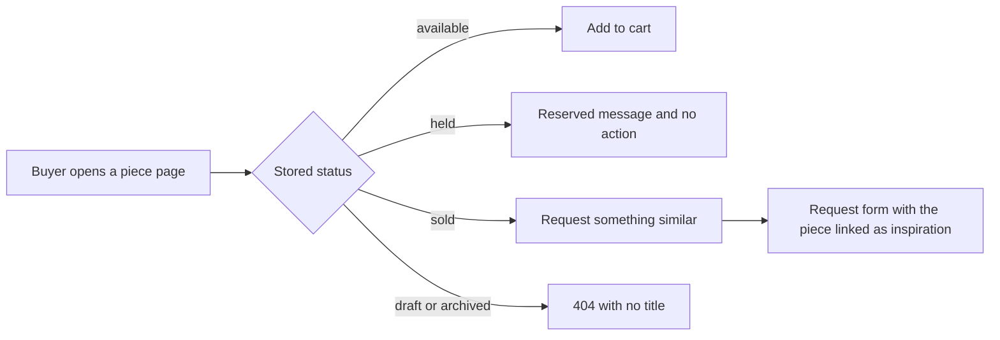

# A storefront for work that may be one of one

The collection API answers questions. The storefront has to convince a buyer that a stranger in a workshop made this object well enough to send money for it. Those are different jobs, and a page that treats a hand-stitched cushion like a pair of shoes in a size run will fail at the second one. A card has to show the work, name the maker, and tell the truth about time and distance.

This module builds two screens on top of the module 15 API: a collection page that a buyer can browse on a phone, and a piece page that carries enough detail to decide. It also settles the hardest interface question in the variant. A sold piece has no purchase action, and it must not pretend that waiting will bring it back. It offers one thing instead: a way to ask the maker for something similar.

## A gallery, not a shelf

A shelf shows interchangeable units. A gallery shows objects, and the interesting part of an object is who made it and how. That changes what belongs on the card. The photo is the argument, the title is the label, the maker credit is the attribution, and the price and ready range are the practical facts that let a buyer decide whether to read further. Nothing on the card should look like a quantity control, because there is no second one behind it.

The temptation is to copy a general shop layout and hide the parts that do not fit. Keep a quantity box and set it to one, and you have taught every future client that one is an accident of data rather than the nature of the object. Add a variant selector for size, and a buyer will ask for a smaller version of a bowl that exists once. Both controls create work for the maker that the workshop never agreed to do.

The card carries five facts and one label: a cover photo, the title, the maker credit, the workshop name, the price in the buyer's currency, and a status label when the piece is sold. The ready range goes on the card as well, in words, because "ready in 10 to 14 days" is the fact that decides a gift purchase. The label is a word inside the card, not a shade, so the page still works in sunlight and for a buyer who cannot distinguish two muted colours.

## Photos are the heaviest thing on the page

A piece can have up to six photos: the whole object, a close-up of the stitching, the grain or the glaze, the base, the size next to a hand, and the packing. That is right for the piece page and wrong for a grid. Six full-size photos at roughly 3 megabytes each would cost a buyer more data than the rest of the session combined, and most of that detail is invisible at card size.

Use the transformation URL from the photo service rather than the stored original. A card asks for roughly 600 pixels wide with automatic quality and format, and the piece page asks for 1200. The original stays untouched in storage as the source. This is the same principle as the rest of the course: MongoDB keeps the reference, the media service keeps the bytes, and each screen asks for the size it needs.

Two attributes earn their place on every image. `loading="lazy"` keeps photos below the fold from competing with the first screen, which is the difference between a page that appears and a page that hangs on a weak connection. Explicit `width` and `height` reserve the space before the image arrives, so the grid does not jump under the buyer's thumb while she is trying to tap a card. A layout shift on a phone is not a cosmetic problem, because the tap lands on the wrong piece.

Alt text is part of the content, not a decoration. The maker writes a short description of each photo when uploading: "green tatreez cushion cover, close-up of the cross stitch border". The card uses that text. A page full of images with empty alt attributes is unusable with a screen reader and loses the craft detail for anyone who cannot see the photo.

## The piece page in reading order

The piece page has one job: let a buyer decide without opening another tab. The order of the sections follows the questions a buyer asks. First the photos, because the work is visual. Then the title, the price and the maker credit. Then the action area, which depends on status. Then the details: materials, technique, dimensions, care. Then the honest logistics: the ready range and the shipping answer for her country. Last, the workshop's own note about how the piece was made.

Materials and technique come before care because they explain the object rather than protect it. "Olive wood, hand carved, oiled finish" tells a buyer what she is holding. "Wipe with a dry cloth, keep out of direct sun" tells her how to keep it. Dimensions belong next to the photos, in both centimetres and inches, because a buyer judging scale from a photograph will guess wrong. A piece described as a small bowl can arrive as a serving dish.

The shipping answer is not a policy paragraph. Module 14 already returns a state per workshop and country: a rate and a transit range, "does not ship here", "ask the maker for a quote", or "shipping is paused". The piece page renders that state in one sentence. A buyer in a country the workshop does not serve should learn it before she reads the care notes, not after she has paid.

## Three states, three action areas

The piece page is where the status enum becomes something a person sees. An available piece offers one primary action: add to cart. A held piece offers no action, and says the piece is reserved for a short time. A sold piece offers the request path. A draft or archived piece has no page at all, and the route answers 404 rather than explaining what the workshop withdrew.

The diagram is deliberately about what the buyer may do, not about what the database allows. Two of its four branches end without a transaction, and that is correct. A held piece is someone else's pending payment, and offering a waitlist would be a promise the workshop cannot keep. An archived piece was withdrawn, and a page that explains why invites a support conversation the course does not staff.

The held branch deserves one more sentence of care. Say that the piece is reserved while another buyer finishes payment, and stop there. Do not count down the seconds. A hold that expires in four minutes looks like pressure, and the exact expiry can change if the payment retries. The honest sentence is that it is not available right now and the buyer can look at other work from the same workshop.

## What a sold piece offers instead of an alert

A one-off piece never comes back. The bowl was one bowl. A "tell me when it is available" button would collect an address for an event that cannot happen, and every later email would be a broken promise. This product builds no availability alerts, no notification list and no saved search. Those belong to a shop that sells many copies of the same thing, and this shop does not.

The useful action is a message to the person who made the object. "Request something similar" opens the custom request path with the sold piece attached as inspiration. The buyer can see the photos, the materials and the dimensions of the original while she describes what she wants different: a larger tray, a different glaze, the same border on a runner. The workshop receives a brief with a reference rather than a vague request, which is the difference between a quote in two days and a week of questions.

The link carries the piece ID and nothing else. The workshop is fixed by that piece, so the buyer cannot accidentally send the request to a different studio. No price is prefilled, no delivery date is promised, and the sold piece is never cloned into a new available listing. The request creates a private record with status submitted, and the workshop may decline it. Module 22 builds the form and the thread, and this module builds the button, the URL and the explanation around it.

Be precise in the interface copy. "Request something similar" is honest, because the maker may say no or propose something different. "Order a custom version" is not, because it implies a price and a commitment that do not exist yet. The same rule applies on the card: a sold card says "Sold", not "Almost gone" or "Back soon".

## The buyer who is on a phone

Most of the fellowship browses on a phone, often on a connection that drops. Three decisions follow from that. The grid is one column on a narrow screen, so a card is big enough to judge. The filter bar collapses into a single row of buttons that open a panel, because a form with eight fields at the top of a small screen pushes the work out of sight. Page changes keep the scroll position near the top of the grid, so the buyer does not land in the middle of a new page of cards.

Loading states matter more than they look. A grid that shows nothing while a request runs reads as broken on a slow connection. Render skeleton cards with the right dimensions so the page has a shape immediately, then replace them when the data arrives. If a request fails, say so in one sentence and offer a retry, rather than leaving a blank page that the buyer reads as an empty collection.

## What you will build and how you will know

The build has five parts. A collection page that reads the module 15 API and renders cards. A filter bar that writes to the URL, so a shared link and the back button both work. Pagination that shows how many pieces exist. A piece page with the detail sections and the three action states. A request handoff that carries the sold piece ID to the request form without inventing a price.

You will know it works when a buyer on a 360 pixel wide screen can browse, filter, open a piece and read the materials. She should see the shipping answer for her country, add an available piece to the cart, and reach the request path from a sold piece. Nowhere on that path should she meet a quantity control or an availability alert. The next lesson builds it and starts with the test that fails when a sold card offers a purchase action.

## Where this leads

The screens in this module are how the workshop's work reaches a buyer. Everything the maker entered in modules 11 to 14 arrives here as either a fact, a range or a credit. If a field is missing from the maker form, this page is where the buyer notices, which makes the page a good test of the earlier modules rather than only of the API.
