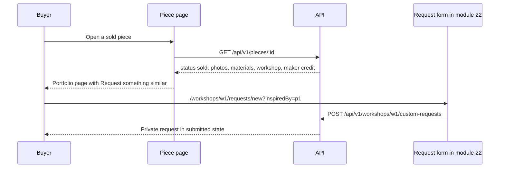

# Piece page, maker credit and the request path

Start with the component test that decides the hardest behaviour: a piece that cannot be bought must not offer a purchase. Write it against the action area rather than the whole page, because the action area is the part with the rules.

The first version of that component checks `piece.status !== "archived"` and renders the add button for everything else. That looks reasonable and it is wrong for a held piece, which is someone else's pending payment. Run the test and read the failure: a button named "Add to cart" is present on a reserved piece.

```jsx
// client/src/components/PieceActions.test.jsx, written before the fix
import { render, screen } from "@testing-library/react";
import { PieceActions } from "./PieceActions.jsx";

const soldPiece = {
  id: "p1",
  title: "Olive wood bowl",
  status: "sold",
  canAddToCart: false,
  priceCents: 45000,
  currency: "ILS",
  workshop: { id: "w1", name: "Bayt al Zayt" },
};

const heldPiece = { ...soldPiece, status: "reserved", canAddToCart: false };

test("a sold piece offers a request, not a purchase", () => {
  render(<PieceActions piece={soldPiece} country="PS" />);
  expect(screen.getByRole("link", { name: /request something similar/i })).toBeTruthy();
  expect(screen.queryByRole("button", { name: /add to cart/i })).toBeNull();
});

test("a reserved piece offers no action at all", () => {
  render(<PieceActions piece={heldPiece} country="PS" />);
  expect(screen.queryByRole("button", { name: /add to cart/i })).toBeNull();
  expect(screen.queryByRole("link", { name: /request something similar/i })).toBeNull();
});
```

## The card is presentational

The card carries no action. It is a link to the piece page, wrapped around a photo, a title, a maker credit, a price and a status label. That keeps one decision, "can I buy this here", in one place, and it keeps the grid cheap to render on a phone.

```jsx
/**
 * @typedef {Object} CardPiece
 * @property {string} id
 * @property {string} title
 * @property {string} craft
 * @property {number} priceCents
 * @property {string} currency
 * @property {"available"|"sold"|"reserved"} status
 * @property {number} readyDaysMin
 * @property {number} readyDaysMax
 * @property {string|null} coverPhotoUrl
 * @property {string|null} coverPhotoAlt
 * @property {{ id: string, name: string }} workshop
 * @property {{ displayName: string } | null} makerCredit
 */
```

Four details decide whether the card feels right. The photo keeps a fixed aspect ratio so the grid never shifts. The title is two lines at most, with the rest available on the page rather than in a tooltip a phone cannot show. The credit line reads "Made by Huda" and falls back to the workshop name when the artisan chose the workshop-only display. The status label is a real word in the flow of the card, so a sold piece is obvious without a colour cue.

Do not render the ready range in a coloured pill. It is a sentence: "Ready in 10 to 14 days". On a card of 300 pixels it fits on one line at body size, and it answers a question the buyer is already asking. A pill with an icon and a shade of amber answers nothing and adds a second thing to decode.

## Money, ranges and names need one formatter each

Three small helpers prevent most of the display bugs in this module, and each one gets a unit test with a value you can check by hand.

```js
// client/src/lib/format.js
export function formatPrice(cents, currency) {
  return new Intl.NumberFormat("en", {
    style: "currency",
    currency,
    minimumFractionDigits: 2,
  }).format(cents / 100);
}

export function readyRangeText(min, max) {
  if (min === max) return `Ready in ${min} days`;
  return `Ready in ${min} to ${max} days`;
}

export function makerLine(piece) {
  return piece.makerCredit?.displayName
    ? `Made by ${piece.makerCredit.displayName}`
    : `Made at ${piece.workshop.name}`;
}
```

The price helper takes minor units, because that is what the API stores and what checkout will charge. Divide by 100 once, in this function, and never anywhere else. A card that prints 45,000 for a 450 unit bowl has made an error of a hundred times, and the buyer reads it as an expensive shop rather than a bug. Test one value per currency in the project, including a value below one unit to see how decimals render.

The range helper handles the equal case, because a maker with a fixed three day handling time should not read "Ready in 3 to 3 days". The maker line never invents a name. When the artisan chose the workshop-only display, the credit is the workshop, which is exactly what that artisan asked for.

## Images ask for the size they need

Module 13 stores a photo URL from the media service. The card needs roughly 600 pixels and the piece page needs 1200, and the stored original is often both larger and heavier.

```js
// client/src/lib/images.js
export function pieceImage(url, width) {
  if (!url) return null;
  if (!url.includes("/upload/")) return url; // not a transformed asset, use as stored
  return url.replace("/upload/", `/upload/f_auto,q_auto,w_${width}/`);
}
```

Automatic format and quality let the service choose a smaller encoding for the device, which matters on a metered connection. Explicit width and height on the `` reserve the box before the bytes arrive. Lazy loading holds back the photos below the fold. Alt text comes from the description the maker wrote for that photo, and a photo without one gets no alt attribute rather than the piece title repeated six times.

## The filter bar writes to the URL

Filters live in the URL, not in React state. That one decision gives you a working back button, a shareable link to "ceramics ready within a week", and a page that survives a reload on a flaky connection. Use `useSearchParams` and write each change as a new search string.

Two rules keep the bar usable. Reset `page` to 1 whenever a filter changes, because a buyer on page 3 who narrows the filter otherwise sees an empty page and concludes the filter is broken. Debounce only the fields a person types into, such as a price bound; a select or a toggle can update immediately.

On a narrow screen, show three controls and put the rest behind a "Filters" button that opens a panel. The three are craft, ready time and "show sold work", because they are the choices a buyer makes most often. The country selector belongs in the panel and should default to the country stored on the buyer profile when there is one.

## The collection page

A CSS grid does the work: one column below 480 pixels, two up to 900, three above. Do not measure the window in JavaScript to choose a column count. The media query runs before paint, and a resize handler running after paint is how grids end up with cards that jump.

Render four skeleton cards while the request is in flight, at the same aspect ratio as the real card. A phone on a weak connection will show them for a second or two, and a page with a shape reads as loading while a blank page reads as broken. Keep the skeletons out of the accessibility tree so a screen reader does not announce four empty articles.

The pagination bar shows two things: previous and next, and "20 of 34". On a change, scroll to the top of the grid rather than the top of the document, so the buyer keeps the filter bar in view. When a request fails, keep the current filters and offer a retry that repeats the same request. When a filter returns nothing, say that no piece matches and offer a reset, rather than the word "empty".

## The piece page

The page fetches one piece by ID and renders three states: loading, not found, loaded. The not-found state is a real page with a link back to the collection. Do not retry a 404, and do not show a draft or archived piece as "unavailable", because those pieces were never public and a specific message would confirm that they exist.

The gallery shows the first photo large and the rest as thumbnails in a row, in the maker's chosen order. Each thumbnail is a button with an accessible name, and arrow keys move between images. Alt text is per photo. The buyer can look at the stitching or the glaze without leaving the page, which is the whole point of allowing six photos.

Below the gallery, the page reads: title, price, maker line with a link to the workshop, the action area, then a definition list for materials, technique, dimensions and care. Dimensions appear in centimetres and inches on the same line. The ready range and the shipping answer follow as sentences, then the workshop note in the maker's own words.

The shipping answer uses the state the API returned. A rate and a transit range become "Ships to PS for 45.00, usually 5 to 9 days in transit". A missing route becomes "This workshop does not ship to PS" with a link to other work from the same workshop. A paused profile becomes a sentence about the workshop having paused shipping, without a date it cannot keep.

## The action area

`PieceActions` takes the piece, the buyer's country and an `onAdd` callback. It branches on the piece status first and on `canAddToCart` second, and both checks agree because the server built the flag from the same status.

```jsx
/**
 * @typedef {Object} PieceActionsProps
 * @property {{ id: string, status: "available"|"sold"|"reserved", canAddToCart: boolean, workshop: { id: string, name: string } }} piece
 * @property {string} [country]
 * @property {(pieceId: string) => Promise<void>} [onAdd]
 * @property {boolean} [adding]
 */
```

For an available piece the area shows one primary button, "Add to cart". The handler posts to `POST /api/v1/cart/items`, and that route arrives in module 17. Until then the call answers 404, which is a legitimate state during the build. Do not keep a cart in React state to fill the gap. A cart that lives only in the browser cannot survive a reload, and it would teach you the wrong model one module before the correct one.

For a reserved piece the area shows a sentence and no control. For a sold piece it shows the request link. For anything else it renders nothing, because the route should have returned 404 before the page got this far. Put the whole decision in one function, `actionFor(piece)`, and test all four cases, so a later status added to the schema cannot silently inherit the purchase branch.

## The request handoff

The request link is the only path a sold piece keeps. Its shape matters, because module 22 will read it.



The URL names the workshop and the inspiration piece, and nothing else. No price, no dimensions copied into query strings, no buyer ID. The buyer fills in or edits the brief on the form. If the form does not exist yet in your build, the link can land on a short page that names the workshop, keeps `inspiredBy` in the URL and explains that the maker reviews the brief before quoting. What it must not land on is a notification signup, an email link, or a copy of the sold piece turned back into an available listing.

Test the contract without the form: click the link on a sold piece, confirm the URL carries `inspiredBy` equal to the piece ID and the workshop ID from the piece, and confirm a reload keeps both. That is the whole interface between this module and module 22, and it is small enough to keep stable.

## Choose the right action for a reserved piece

The reserved branch is where most first versions go wrong, because the piece looks available in the data and only the hold says otherwise. Answer this before you finish the component.

```quiz
type: mcq
id: handmade-shop-q1
question: "A piece is held by another buyer's checkout. What should the action area show?"
options:
  - "Add to cart, with a warning that another buyer is paying"
  - "No action, and a sentence that the piece is reserved for a short time"
  - "Request something similar, because the piece is not available"
  - "An availability alert that emails the buyer if the hold expires"
correct: 1
explanations:
  - "A purchase control on a held piece sets up a 409 the buyer could have avoided."
  - "The hold belongs to another checkout, and the honest interface offers no action."
  - "A held piece is not sold, so the request path would misdescribe it."
  - "A hold that expires changes nothing about whether this piece will exist for sale."
```

The rest of the page is easier than this branch. Photos, a definition list and two sentences about time and distance carry the detail. Verify them on a real phone, because the layout is where the remaining problems live.

## Verify on a phone and with a keyboard

Open the collection at 360 pixels wide. The grid should show one card per row, the filter panel should open without covering the whole screen, and the page should never scroll sideways. Tap a card, read the piece, and check that the action area shows exactly one primary action. Open the sold piece and confirm the request link. Tab through the page: the skip link, the filter panel button, every card, every thumbnail and the action area should all take focus in a sensible order, with a visible focus ring.

Then break it. Add a filter that matches nothing and read the empty state. Turn off the network, reload, and read the failure state. Request a draft piece by URL and read the not-found page. These three states take an afternoon and are the ones a buyer on a weak connection will actually meet.

The next lesson turns these checks into the module gate, including the accessibility pass and the sold-piece request path.
