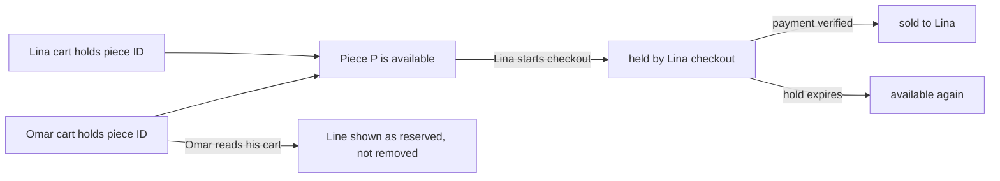

# A cart of exact pieces

Lina finds the olive wood bowl on her phone and taps add. The request is slow, so she taps again. On a shop that sells copies, that second tap is a request for two bowls, and a quantity field on the cart page lets her fix it. Here it is a mistake with only one correct answer: she wants one bowl, because there is one bowl.

This module builds the cart API. A cart line is a piece ID, not a piece ID plus a number. The cart belongs to one buyer, is stored on the server, and survives a lost connection. A piece in a cart is not taken, not promised and not held. It becomes unavailable to anyone else only at checkout, in module 19, and only for a short payment window.

## One line, one piece

The cart model from module 5 stores distinct piece IDs for one buyer. Adding the same piece twice keeps one line, and the API answers with a clear duplicate result rather than a second line or a silent success. The UI has no stepper, no plus button and no number field, because each of those invites a buyer to ask for a second copy of something that cannot exist twice.

This is more than a nicety about craft. A quantity field forces every later stage to answer questions with no honest answer. What does it mean to hold two of one piece? What does a refund of one look like? What is the shipping cost for two cushions that are the same cushion? Removing the field removes a whole family of bugs, and it makes the interface match the thing being sold.

Duplicate adds still happen, so handle them at the right layer. The client can disable the button while a request is in flight, which is good manners, but it is not the guarantee. The guarantee is the database write, which refuses to add an ID that the same cart already contains. Two taps in two tabs then leave one line and one duplicate message.

## A cart is not a reservation

It is tempting to hold a piece the moment it enters a cart. The piece would never be taken from under the buyer, and the cart page would always be accurate. The cost is that carts are abandoned constantly. A buyer adds a piece at midnight, sleeps, and comes back after a day of work. A hold that lasts that long takes a unique object out of the workshop's shop for a sale that may never happen.

Ghurza puts holds at checkout instead. A cart records interest. Two buyers can have the same bowl in their carts at the same time, and that is fine and expected. The first one to begin checkout claims it, and the other one sees the line change state rather than disappear.

The diagram makes the important asymmetry visible. A piece can sit in many carts, and it can be held by exactly one checkout. Any design that puts the hold on the cart collapses those two facts into one and either locks the shop or oversells the bowl.

The buyer's experience follows from the same picture. When Omar opens his cart and sees that the bowl is reserved, the line stays with a clear message and a link to other work from the same workshop. Removing it silently would leave him wondering whether he had imagined adding it.

## One cart per buyer

A buyer has one cart, and it belongs to the account rather than the device. Sign in on a phone and on a laptop, add a piece on the phone, and the cart on the laptop is the same cart. That behaviour is a consequence of storing the cart in MongoDB under the buyer ID, and it is the reason the API needs no cart ID in any URL.

The route reads the buyer from the session and nothing else. There is no `GET /carts/:id`, because a cart ID in a URL is an invitation to try someone else's. If a handler ever accepts a buyer ID or a cart ID from the body or the query string, the authorization rule becomes "trust the client", which is not a rule.

A unique index on `buyerId` makes the one-cart rule a database constraint rather than a code convention. The first add creates the cart. A second concurrent add that tries to create another document fails on the duplicate key, and the handler retries against the existing cart. Without the index, a double tap under load can create two carts for one buyer and a cart page that shows only one of them.

## Status is worked out when the cart is read

A cart line has no status field. Its state is derived from the current Piece document at the moment the cart is read. Storing a status on the line would create a second truth that goes stale the moment another buyer checks out, and there is no job that could keep it correct without locking the piece.

The read states are small and each one has a different sentence. Available means the piece can go to checkout. Reserved means another checkout holds it for a short time. Sold means it is gone, and the cart offers the request path from module 16. Withdrawn means the maker archived it. A piece the workshop does not ship to the buyer's country is still in the cart, with a warning rather than a rejection, because a warning can explain itself and a rejection at add time cannot.

Shipping is the one line state that depends on where the buyer is. Module 14 returns a state per workshop and country, so the cart asks that question once per workshop in the cart rather than once per line. A cart with pieces from two workshops needs two shipping answers, and each answer includes a rate and a transit range, a not-shipped state, a quote-required state or a paused state.

## What the cart shows

The cart groups its lines by workshop, because that is how the sale will split. Each group shows the workshop name, its lines with photo, title and current price, a subtotal, and the shipping answer for the buyer's country. The page then shows one total. Money is computed on the server in integer minor units and returned as integers, and the client formats it without doing arithmetic of its own.

The price on a cart line is the current price, not a price from the moment of adding. If a maker edits a piece from 450 to 490 while it sits in a cart, the cart shows 490 and the buyer sees the change. Storing the price at add time would create a small, quiet promise that the checkout could not honour, and the buyer would discover the difference on a payment screen.

The total in the cart response is for display. Module 19 recomputes the payable amount from the current Piece documents and the workshop shipping answers when checkout begins, and the provider amount comes from that calculation. A cart response that the client can edit is not a total, it is a suggestion.

## The two failure modes to expect

The first is a piece sold between the cart read and the checkout tap. The buyer saw a price and an available label, then the checkout answers with a conflict naming the piece. That is a normal outcome, and the wording should make it clear that nothing was charged and the rest of the cart is intact. The cart page must offer to continue without the lost piece rather than losing the whole cart.

The second is a duplicate line after a fast double tap. If the cart page shows the same bowl twice, the add route is not enforcing uniqueness and the cart document may already be inconsistent. Fix the write, then write a test that adds the same piece twice in parallel and expects one line and one duplicate answer. Cleaning the data by hand is not a fix, because the next buyer will reproduce it.

## What you will build and how you will know

The build has five parts. `POST /api/v1/cart/items` adds an exact piece or explains why it cannot be added. `DELETE /api/v1/cart/items/:pieceId` removes one line and is safe to repeat. `GET /api/v1/cart` returns the buyer's cart grouped by workshop, with derived line states, shipping answers and totals in minor units. The Cart schema carries a unique index on the buyer and a bounded array of piece IDs. A set of tests proves that two buyers never see each other's cart and that sold, held, archived and duplicate pieces are refused.

You will know it works when two browser profiles, signed in as different buyers, hold different carts. A piece sold in one profile should show as unavailable in the other. The same piece added twice in one profile should leave one line.

## Where this leads

The cart page in module 18 renders this response, and checkout in module 19 turns it into holds. Both depend on the two decisions in this lesson: a line is an exact piece, and a cart is not a hold. Change either one later and the race tests in module 19 would have to be rewritten, which is a good sign that the decision belongs here.

The next lesson builds the routes, the schema and the failing tests, starting with the refusals rather than the happy path.
