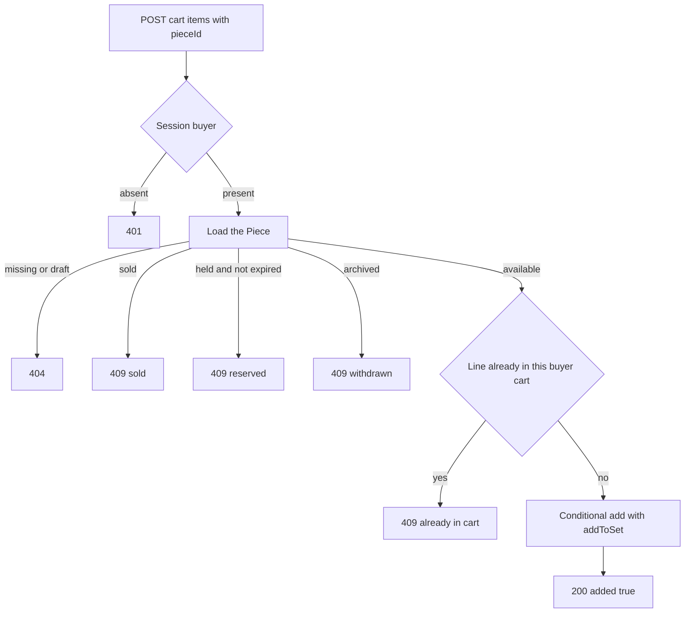

# Add, remove and reject sold or held pieces

The refusals come first. A cart that adds anything it is given is worse than no cart, because every refusal would then happen later, at checkout, after the buyer has spent time choosing. Write the tests for the four refusals and for the two-buyer boundary before the routes exist, run them, and read six failures rather than one.

The tests need two buyer accounts, one piece in each interesting state, and one piece that is available. Use the module 5 seed plus a fixture that sets a piece to held with a future expiry.

```js
// server/src/modules/cart/cart.routes.test.js, written first
test("a sold piece cannot be added", async () => {
  const res = await request(app)
    .post("/api/v1/cart/items")
    .set("Authorization", `Bearer ${linaToken}`)
    .send({ pieceId: soldPiece.id });
  expect(res.status).toBe(409);
  expect(res.body.reason).toBe("sold");
});

test("a held piece cannot be added", async () => {
  const res = await request(app)
    .post("/api/v1/cart/items")
    .set("Authorization", `Bearer ${linaToken}`)
    .send({ pieceId: heldPiece.id });
  expect(res.status).toBe(409);
  expect(res.body.reason).toBe("reserved");
});

test("an archived piece cannot be added", async () => {
  const res = await request(app)
    .post("/api/v1/cart/items")
    .set("Authorization", `Bearer ${linaToken}`)
    .send({ pieceId: archivedPiece.id });
  expect(res.status).toBe(409);
  expect(res.body.reason).toBe("withdrawn");
});

test("the same piece twice leaves one line", async () => {
  await request(app)
    .post("/api/v1/cart/items")
    .set("Authorization", `Bearer ${linaToken}`)
    .send({ pieceId: availablePiece.id })
    .expect(200);

  const second = await request(app)
    .post("/api/v1/cart/items")
    .set("Authorization", `Bearer ${linaToken}`)
    .send({ pieceId: availablePiece.id });

  expect(second.status).toBe(409);
  expect(second.body.reason).toBe("already_in_cart");
});

test("a cart request without a token is refused", async () => {
  await request(app).get("/api/v1/cart").expect(401);
});

test("two buyers never see the same cart", async () => {
  const lina = await request(app)
    .get("/api/v1/cart")
    .set("Authorization", `Bearer ${linaToken}`)
    .expect(200);
  const omar = await request(app)
    .get("/api/v1/cart")
    .set("Authorization", `Bearer ${omarToken}`)
    .expect(200);

  expect(lina.body.itemCount).toBe(1);
  expect(omar.body.itemCount).toBe(0);
});
```

## The schema and the index that enforces the rule

The Cart document is deliberately small: a buyer, an array of piece IDs, and timestamps. The unique index on `buyerId` is the rule that makes one cart per buyer true even when two requests arrive in the same millisecond.

```js
// server/src/modules/cart/cart.schema.js
const MAX_LINES = 20;

const cartSchema = new mongoose.Schema(
  {
    buyerId: {
      type: mongoose.Schema.Types.ObjectId,
      ref: "User",
      required: true,
      unique: true,
    },
    lines: [{ type: mongoose.Schema.Types.ObjectId, ref: "Piece" }],
  },
  { timestamps: true }
);
```

`lines` is an array of plain IDs, not an array of subdocuments. That choice is load bearing. `$addToSet` compares whole array elements, so an element shaped `{ pieceId, addedAt }` never matches an existing element whose `addedAt` differs by a millisecond, and the duplicate slips through. An array of IDs compares cleanly and deduplicates. The cost is that you cannot store a per-line note or a price snapshot in the cart, which is exactly what you want: both of those would be a second truth.

Bound the array. Twenty lines is generous for a cart of unique objects, and the limit protects the document size and the read cost. Put the bound in the write filter rather than in a separate read, so a full cart refuses the next piece instead of growing past a limit nobody chose.

## Interfaces for the three routes

The cart view is built on read, so its types describe the response rather than a stored document.

```js
// server/src/modules/cart/cart.types.js
/**
 * @typedef {Object} CartLineView
 * @property {string} pieceId
 * @property {string} title
 * @property {number} priceCents
 * @property {string} currency
 * @property {string|null} coverPhotoUrl
 * @property {"available"|"reserved"|"sold"|"withdrawn"|"missing"} state
 * @property {string|null} message
 */

/**
 * @typedef {Object} CartGroup
 * @property {string} workshopId
 * @property {string} workshopName
 * @property {CartLineView[]} lines
 * @property {number} subtotalCents
 * @property {"rate"|"not_shipped"|"quote_required"|"paused"|"unknown"} shippingState
 * @property {number|null} rateCents
 * @property {number|null} transitDaysMin
 * @property {number|null} transitDaysMax
 */

/**
 * @typedef {Object} CartView
 * @property {CartGroup[]} groups
 * @property {number} itemCount
 * @property {number} totalCents
 * @property {string[]} warnings
 */
```

The routes are `POST /api/v1/cart/items` with `{ pieceId }`, `DELETE /api/v1/cart/items/:pieceId`, and `GET /api/v1/cart?country=PS`. None of them takes a buyer ID or a cart ID. The session supplies the buyer, and a request that carries one anyway is ignored rather than trusted.

## Adding a piece

The add route has one write and a short list of refusals. Load the piece by the submitted ID. A missing piece and a draft piece both answer 404, because a draft is not public and telling a caller that it exists is a small leak. A sold piece answers 409 with reason `sold`. An archived piece answers 409 with reason `withdrawn`. A held piece answers 409 with reason `reserved`, unless its hold has already expired, in which case the line is treated as available and the claim at checkout will decide.

The expired hold deserves a sentence. The cart is not the place that decides who owns a piece. Reporting an expired hold as available is a display decision, and module 19's conditional update is what actually grants the piece. A cart that refused an expired hold would send the buyer away from a piece nobody holds.



The duplicate check cannot be a read followed by a write. Two taps that arrive together both read "not present" and both write. Use one conditional update whose filter includes the buyer and excludes the piece, so the database decides.

```js
// server/src/modules/cart/cart.service.js
export async function addPiece(buyerId, pieceId) {
  const added = await Cart.findOneAndUpdate(
    {
      buyerId,
      lines: { $ne: pieceId },
      $expr: { $lt: [{ $size: "$lines" }, MAX_LINES] },
    },
    { $addToSet: { lines: pieceId } },
    { new: true }
  );
  if (added) return added;

  // The write matched nothing: no cart yet, a full cart, or the line already exists.
  const existing = await Cart.findOne({ buyerId }).lean();
  if (existing) {
    if (existing.lines.some((id) => id.equals(pieceId))) throw new Conflict("already_in_cart");
    throw new Conflict("cart_full");
  }

  try {
    return await Cart.create({ buyerId, lines: [pieceId] });
  } catch (error) {
    if (error.code === 11000) return addPiece(buyerId, pieceId); // another request created it
    throw error;
  }
}
```

The `null` result is ambiguous, so the second read resolves it. A cart that exists and already contains the ID is a duplicate. A cart at the limit is full. No cart at all means the first add is still the only writer. That read is scoped to one buyer and one small document, and it happens only on the failure path, which is why it is cheaper than making the happy path do more work. The recursive retry after a duplicate key runs at most twice in practice, because the second attempt finds the cart that the racing request created.

## Reading the cart

The read is four queries for any cart size. Load the cart by buyer. Load every piece ID in it with one `in` query. Load the workshops for those pieces with one `in` query. Load the shipping profiles for those workshops with one `in` query. Then group in memory by `workshopId`.

The piece query must not filter by status. A tempting version loads only `status: "available"` pieces, which silently drops the sold and held lines and makes the cart look smaller than it is. Load every ID, then map the status to a line state and a sentence. A piece ID in the cart with no matching document becomes state `missing`, and the line is removed on the next read with a note.

Subtotals come from the current price on each piece, summed as integers. The shipping amount for a group comes from the profile answer for the buyer's country, and it is added once per workshop, not once per line. The total is the sum of the groups, and the response also includes a warning list so the page can put one sentence at the top of a long cart.

Treat a cart with no shipping answer carefully. A missing profile, a not-shipped country and a paused profile are three different facts, and each needs its own `shippingState` so the page can say the right thing. Do not collapse them into a null amount, because a zero would look like free shipping.

The array also gives you line order for free. `$addToSet` appends a new ID at the end, so the stored order is the order the buyer added things in, and the newest line is last. The page can show the newest first by reversing the group, or keep the workshop order and let the buyer scan. Either way, the order survives a reload because it is in the document, which is more than a client sorted list can promise. If a buyer removes a line and adds it again, it moves to the end, which matches what she just did.

## Removing a piece

`DELETE /api/v1/cart/items/:pieceId` uses `$pull` on the buyer's cart. It answers 200 with `{ removed: true }` or `{ removed: false }`, and both are success. A buyer who removes a line twice, or whose second tab removed it first, should not see an error for reaching the state they wanted.

Do not delete the cart document when the last line goes. An empty cart is cheap, and keeping it avoids a create race on the next add. The cart page renders the empty state from `itemCount: 0`.

## Choose the write that survives two taps

The duplicate rule is the one place in this module where a read followed by a write looks correct and is not. Answer before you run the parallel test.

```quiz
type: mcq
id: handmade-cart-q1
question: "Two add requests for the same piece arrive in the same millisecond. Which design leaves exactly one line?"
options:
  - "Read the cart, then push the piece ID if it is absent"
  - "A conditional update that excludes the ID, then adds it"
  - "A unique index on the whole array of piece IDs"
  - "Disable the button on the client while a request runs"
correct: 1
explanations:
  - "Both requests can read the same absent ID before either one writes."
  - "The database checks the exclusion and writes in one operation, so the second add matches nothing."
  - "A unique index applies to documents, not to elements inside an array field."
  - "A disabled button is good manners and no guarantee against a second tab or a retry."
```

The same shape applies to removal, where a repeated request should be safe rather than refused. Both rules come from one idea: the server decides from the current document, not from what the client last saw.

## Prove it with two buyers and a stale piece

Run the six tests from the start of the lesson. Then run three more that the first six cannot catch. Add a piece, then sell it through a direct fixture update, then read the cart and confirm the line is still present with state `sold` and a message. Count the lines in the response against the lines in the document, so a silent drop fails the test.

Add the same piece twice in parallel with `Promise.all` and assert one line and one 409. Delete a line twice and assert both answers are 200 with `removed` false and then true, or the reverse order. Finally, send `GET /api/v1/cart?buyerId=<omar>` with Lina's token and confirm the query parameter changes nothing, because the session is the only source of the buyer.

Check the index itself in the database. `db.carts.getIndexes()` should show a unique index on `buyerId`. Then try to insert a second cart for the same buyer directly in the shell and read the duplicate key error. If the insert succeeds, the index was created on a development copy and not on the database your tests use.

## A failure worth keeping

The most instructive bug in this module is the filtered read. Change the piece query to include only available pieces and run the stale-piece test. The line vanishes from the response, the buyer thinks she never added it, and the cart looks fine. Nothing throws. That is why the test asserts line count against document count rather than checking a field on one line.

The next lesson turns these checks into the gate, with the two-buyer evidence and the running total in minor units.
