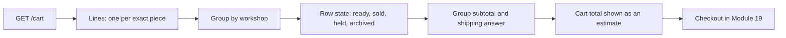

# One cart, several workshops, exact pieces

Lina has three pieces in her cart. One is a stitched cushion cover from Bayt al Zayt, one is a glazed bowl from the same workshop, and one is a carved olive wood tray from a second workshop across the city. One cart, two workshops, three exact objects. Before she pays, the page has to answer three questions: which workshop ships which piece, what each workshop charges to send it, and whether anything in the cart has changed since she added it. The cart API from Module 17 already holds those facts. This module turns them into a page she can act on.

A cart page is not a smaller version of the collection page. A collection card invites browsing. A cart row records a decision Lina already made about one physical thing. That difference shapes every element on the screen. There is no quantity to raise, because there is no second cushion cover. There is no colour choice, because the cover is the cover. There is no "similar item" suggestion inside the cart, because a substitution would change what she agreed to buy.

The page also has to teach the split before checkout asks her to accept it. Ghurza turns one cart into one Order per Workshop. A buyer who first learns that rule on a payment screen feels tricked, even when the split is correct. A buyer who sees two workshop headings, two subtotals and two shipping answers on the cart page has already met the shape of the purchase. By the time she pays, nothing about the order structure is new.



Follow the arrows from the left. The database read returns lines, the browser groups them, each row gets a state from the server, and each group gets a shipping answer that belongs to that workshop alone. The last box is outside this module on purpose: the cart page never holds a piece. It reports what the server currently says and sends the buyer to checkout, where Module 19 claims each piece for a short time.

## What the cart endpoint already gives you

Module 17 left you with a scoped cart: `GET /cart` for the logged in buyer, `POST /cart` to add one piece, and `DELETE /cart/:lineId` to remove one. Each line points at exactly one Piece. The response carries enough context for a page, if you shape it well. A workable contract looks like this.

```ts
type RowState = "ready" | "sold" | "held" | "archived";

interface CartLine {
  lineId: string;
  pieceId: string;
  title: string;
  craft: string;
  makerCredit: string;
  coverPhotoUrl: string | null;
  priceCents: number;
  state: RowState;
  workshopId: string;
  workshopName: string;
}

interface WorkshopGroup {
  workshopId: string;
  workshopName: string;
  subtotalCents: number;
  lineIds: string[];
  shipping:
    | { outcome: "flat"; amountCents: number; handlingDays: [number, number]; transitDays: [number, number] }
    | { outcome: "quote_required" | "not_shipped" | "paused"; note: string };
}

interface CartPage {
  groups: WorkshopGroup[];
  totalCents: number | null;
  currency: string;
}
```

Two decisions are baked into that shape. The state of a piece travels with the line, so the page does not have to guess from a missing field. And the shipping answer belongs to the group, not to the line, because one workshop packs one parcel for Lina and quotes one price for it. A cart of four pieces from one workshop is one shipping answer. A cart of one piece from each of two workshops is two answers, and they can disagree.

Everything in that response comes from the server. The browser may display a subtotal, but it must not be the authority for the amount Lina will pay. Module 19 recalculates the whole purchase from stored pieces and stored shipping profiles, and any difference between the page and the payment screen has to be explained to Lina rather than hidden.

## Four row states, four sentences

A one-off catalogue makes unavailable lines normal. Between the moment Lina adds a bowl and the moment she opens the cart, another buyer may have paid for it. The workshop may have archived it. A third buyer may hold it for the next twelve minutes. None of those events should make a row vanish, because a line that disappears without a word looks like a bug and leaves Lina unsure whether she removed it herself.

So the page names the state in one short sentence per row. A ready row shows a price and a remove control, and nothing else. A sold row says the piece has been sold, keeps the photo and title, and offers one action: remove it, or request something similar. A held row says another buyer is paying right now, without naming that buyer or quoting their deadline. An archived row says the workshop has withdrawn the piece. A row with no sentence is a row Lina has to interpret, and she will interpret it as the shop being broken.

The same rule applies at group level. Bayt al Zayt may pause shipping while Lina has the page open. A group with a paused shipping profile says so above its lines, keeps the pieces visible, and blocks the path to checkout for that group. The page does not silently remove the workshop, and it does not pretend the shipping answer is a number when the answer is a sentence.

## Subtotal, shipping and total

Money on this page lives at three levels, and mixing them is the most common mistake in a cart build. Each workshop group shows its own subtotal, computed from the prices on its own lines, plus the shipping sentence or amount for that group. The page total is the sum of those group subtotals and group shipping amounts. If one group cannot ship to Lina's country, the page total becomes unavailable rather than partial. A total that quietly excludes an unshippable group is worse than no total: it tells Lina a number that checkout will refuse.

Keep the arithmetic in integer minor units, the same convention the order snapshots use. Format for display at the edge, not in the middle of a sum. When a piece is not ready, exclude it from the subtotal and say why. A subtotal that includes a sold piece is a promise the workshop cannot keep.

Show the handling and transit ranges inside the group, not as one combined delivery date. The workshop needs two days to pack an embroidered cover and the parcel may take seven to fourteen days in transit. Those are two ranges with two owners. Printing "arrives 14 May" converts an honest range into a promise the maker cannot control, and the road from a workshop in Gaza to a buyer in another country has more uncertainty than any single date can carry.

## The header badge

Three pieces across two workshops is one number in the site header, and it is the number a buyer glances at most often. Count pieces, not workshops and not cart lines that might later merge. Lina with three pieces across two workshops sees three. That number must come from the same server read as the page, and it must update after an add or a removal without a full reload. A badge that counts differently from the page is the kind of small inconsistency that makes a buyer distrust every other number on the screen.

Decide what the badge does for a piece that has since sold. The honest choice is to keep counting it until Lina removes the line, because the line still exists and she still has to deal with it. Hiding the sold piece from the count leaves a cart badge that says two while the page shows three rows, and the difference is invisible until she opens the page.

## The page at 360 pixels

Most fellows will open this page on a phone, often on a slow connection. Design the narrow layout first. One column of workshop groups. A group heading that stays readable while the rows scroll. A row with a thumbnail, a title, one line of craft and maker credit, the price, and a remove control that is reachable with a thumb and does not sit under a scrolling gesture.

Remove is a destructive action on a small screen, so it needs one confirmation step or an undo. A tap that deletes a line during a scroll is a real defect, not a minor annoyance. Keep the button label in words, not an icon alone, and keep it focusable when the buyer uses a keyboard. After a removal, the page reloads the cart from the server and shows the new subtotal and total.

The empty state matters as much as the full one. A buyer who has never added a piece, and a buyer who has just removed the last one, both arrive at the same page. Say which one it is, offer a way back to the collection, and do not render a zero total with an empty table underneath.

## What this module does not decide

The cart page does not reserve anything. Two buyers can hold the same available piece in two carts at the same time, and that is correct. A cart is an expression of interest that may sit for days. Holds begin at checkout and last fifteen minutes. If the page suggested otherwise, a buyer would leave a cart open for a week and expect the piece to wait.

The page also does not decide what happens when checkout loses a piece. Module 19 owns the claim, the conflict and the release. What this module owes that one is an accurate starting view: current state per row, current price per row, current shipping answer per group, and a total that will not surprise the payment screen.

Write your page decisions down before you build. Which four row states exist, what each one says, what the group shows when shipping is paused, how the badge counts, and what the narrow layout does with the remove control. The next lesson builds the page against those decisions, and the gate asks you to prove them at 360 pixels with a cart that changes underneath you.
