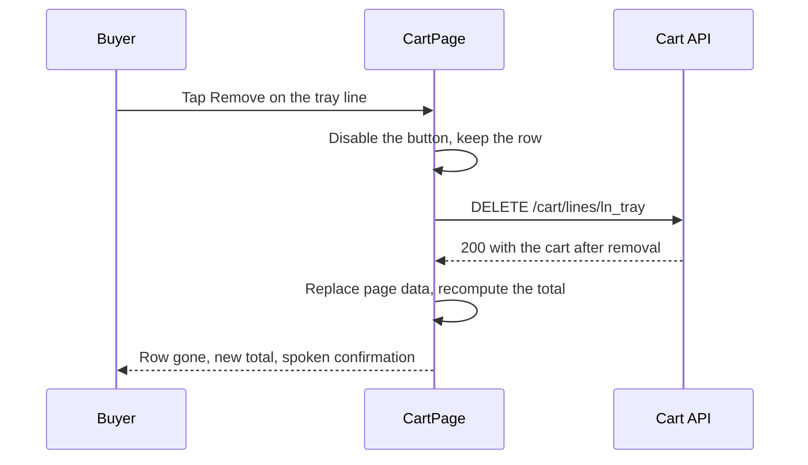

# Cart rows, workshop groups and removal

Start with the smallest page that tells the truth. It reads the cart once, renders one section per workshop, lists one row per piece and shows a group subtotal and shipping line. Then add removal, the header count and the narrow layout. Building it in that order keeps you honest about which facts come from the server and which are only paint.

The screen lives in three components under `client/src/`: `pages/CartPage.jsx` for the data and the states, `components/CartGroup.jsx` for a workshop section, and `components/CartRow.jsx` for one piece. A small `hooks/useCart.js` owns the fetch and the remove call so the badge in the header can use the same source. Keep the pieces small. A page that renders groups, rows, totals, warnings and the badge in one file becomes impossible to test at 360 pixels.



The diagram shows the path you are building, including the part most learners skip: the row stays visible and the button is disabled while the request is in flight. The server returns the cart, not an empty body, so the page replaces its data with an authoritative answer instead of editing an array in memory and hoping the two agree.

## Make the endpoint carry the state

The cart route from Module 17 returns lines with a piece reference and a workshop reference. It needs three additions before the page can be honest: a `state` per line, the workshop group summary, and a page total that is `null` when any group cannot ship to the buyer.

The stored cart document keeps `buyerId` and a list of `{ lineId, pieceId, workshopId, addedAt }`. Everything else is derived on read. Derive `state` by comparing the current Piece document with the cart line: `available` becomes `ready`, `sold` becomes `sold`, `held` becomes `held`, and `archived` becomes `archived`. A draft piece that a cart still points at is a data defect, so treat it as `archived` and log it rather than rendering a draft title to a buyer.

Write the failing API test first. The route today returns a flat total and no state, so this test fails for a reason you can point at.

```js
// server/src/modules/cart/cart.routes.test.js
test("a sold piece keeps its line and the total becomes unavailable", async () => {
  const res = await request(app).get("/api/cart").set("Authorization", `Bearer ${linaToken}`);

  const soldLine = res.body.lines.find((line) => line.pieceId === bowlId);
  expect(soldLine.state).toBe("sold");

  const bayt = res.body.groups.find((group) => group.workshopId === baytAlZaytId);
  expect(bayt.lineIds).toContain(soldLine.lineId);
  expect(bayt.subtotalCents).toBe(2400);
});
```

Two numbers in that fixture are worth reading against the seed. The cover is 2400 minor units and the bowl is 1800, so the group subtotal is 4200 while both are ready. Once the bowl is sold it leaves the subtotal, and the assertion above expects 2400. Decide that rule once and assert it. A group subtotal that includes a sold piece will disagree with the order total in Module 19, and the buyer will read the smaller number at checkout as a hidden charge.

## Render the groups in server order

Sort groups by workshop name on the server so the page order is stable between reloads. Within a group, sort ready rows before unavailable rows, then by the time the buyer added each piece. Do not sort by price, because a cart reordered by price makes a buyer lose their place when one piece sells.

Each group is a `<section>` with an accessible name taken from the workshop name, so a screen reader can jump between workshops. The heading holds the workshop name and the subtotal. Under it, a shipping line reads either "Shipping 5.00, handling 2 to 3 days, transit 7 to 14 days" or one sentence for a workshop that cannot ship to this address. Keep the ranges in the group, not repeated on every row.

Each row holds the cover photo with a fixed aspect ratio, the title, the craft, the maker credit, the price and the remove control. The maker credit comes from the server and is the display form the artisan chose, not the artisan's account name. For a sold piece, the row keeps the photo and title and replaces the price line with the sentence from the previous lesson. It offers two actions: remove the line, and request something similar. That second link opens a custom request later, so wire it to the request form and pass the piece ID.

Write the second failing test against the page itself, with the cart helper stubbed.

```jsx
// client/src/pages/CartPage.test.jsx
test("groups pieces by workshop and offers no way to change a quantity", async () => {
  render(<CartPage />);

  const groups = await screen.findAllByRole("region", { name: /workshop/i });
  expect(groups).toHaveLength(2);
  expect(within(groups[0]).getByText("42.00")).toBeInTheDocument();
  expect(screen.queryByRole("spinbutton")).toBeNull();
  expect(screen.queryByRole("button", { name: /increase|decrease/i })).toBeNull();
});
```

That second assertion is not decoration. A quantity control is the first thing many learners add from habit, and one stray `type="number"` input reopens a question this domain closed in Module 17. A one-off piece has no count.

## Remove a line without lying to the buyer

Removal is a `DELETE /cart/lines/:lineId` scoped to the buyer. The route deletes only a line whose `buyerId` matches the session and returns the cart in its new state. If the line is already gone, return the current cart with 200 rather than a 404. A buyer who taps remove twice, or whose first response was lost, is not making a mistake.

In the browser, keep the button disabled until the response arrives, and keep the row visible. Removing the row immediately and then restoring it on failure is the optimistic version, and it teaches the buyer that the page cannot be trusted. On success, replace the page data with the returned cart, move the keyboard focus to the group heading when the removed row was the last in its group, and announce the change in a polite live region.

Map the failures deliberately. A 401 sends the buyer to login and keeps the return path. A 409, if your route uses one for a cart that changed in another tab, means the page should reload the cart and show a short banner. A 5xx keeps the rows on screen with a retry control, because an unreachable server and an empty cart must never look the same.

Test the double tap on a throttled connection. With the network at 3G and two quick taps, the API must receive one delete. If you rely only on a disabled attribute, check that it is set before the request starts and cleared in a `finally` block. A button re-enabled by an error path that never ran is how duplicate requests appear in production.

## Keep the header count in one place

One number with two consumers is easy to keep true, and two numbers that look alike are not. The badge reads from the same cart state as the page. Put the cart in a context provider mounted above the router, or fetch it in a hook that both the header and the page consume. The count is `lines.length` from the server response. After an add or a remove, the provider updates from the response, and the header number changes without a reload.

Do not compute the badge from a separate request that runs on every route change. On a slow connection that is one more round trip per navigation, and when the two requests disagree, the header becomes wrong in a way the buyer notices first. One read, one number.

Sold lines stay in the count until the buyer removes them. The line exists, the buyer has to act on it, and a badge that hides it makes the cart look empty while it still needs attention. Say this in your README so the Week 3 demo does not argue with itself.

## Build the narrow layout first

Work at 360 by 740 before you look at a desktop window. One column, no horizontal scroll, a 44 pixel minimum target for the remove button, and a group heading that stays visible while the rows of that group scroll. Test it with a long piece title, a long workshop name, and a maker credit that carries three words. Real Ghurza data will be longer than your fixture.

Keep the remove control as a labelled button, not an icon alone, and place it away from the scroll gesture zone at the row edge. If you add a confirmation, make it a small dialog with the piece title in it, so the buyer confirms a specific object and not a generic "this item". Cancelling the dialog must send no request at all.

Then walk the page with the keyboard only. Tab to the first remove, open the confirmation, cancel it, tab to the next group, remove a line, and check that focus lands somewhere sensible afterwards. Check both themes for contrast on the price and the state sentence. A muted grey that passes on a bright screen fails in sunlight on a cheap phone.

## Verify against a cart that changes

Load a cart with two workshops and one piece that sells in another browser while the page is open. Remove a ready line and confirm the totals on screen match `GET /cart` after a reload. Then remove the sold line and confirm the group subtotal returns to the value the API reports.

Reload the page with the network off and read what it says. It must say it could not reach the server, not that the cart is empty. Then switch the network back on, refresh, and check the badge against the row count.

The last test is the one that matters for the next module: leave the page open, buy the tray in a second browser with a second buyer, and return to Lina's tab. The row must not vanish. It should change to the sold sentence on the next read, and the total must become the honest number for what remains. Module 19 will claim pieces under a hold and return conflicts for exactly this kind of change. A cart page that already reports change calmly makes that conflict readable instead of alarming.
