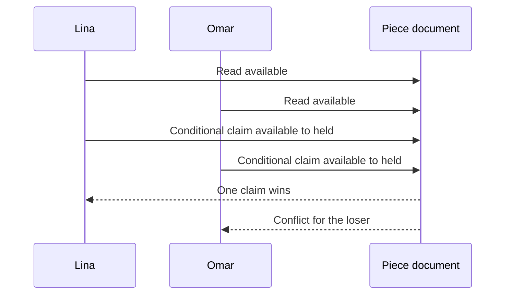

# Set the scene

Lina and Omar both open the page for one stitched cushion cover. Each browser shows available because both page reads happen before either buyer starts checkout. That is normal. The question is what the server does when both try to reserve the same Piece. A one-off object cannot be sold twice, and a friendly "only one left" label does not decide which request wins. This module makes the Piece document the authority for one exact physical item and records one Checkout identity in a temporary hold.

The diagram does not promise Lina always wins. The database may process Omar's conditional write first. The invariant is one winner, one loser, and one hold that names the winning Checkout. The loser should receive a 409-style conflict with the lost Piece identified and a useful next action. The UI can show other available work or a "Request something similar" path; it must not create a second paid order for the same cover.

## One Piece, several promises

The Piece has a Workshop owner, a current price, approved maker credit, photos, craft, dimensions and availability state. A Cart line only records that a buyer wants this ID; it is not a reservation. A Checkout attempts the hold. A pending OrderLine snapshots the title, price, maker credit and shipping terms the buyer accepted. Module 20 later uses a verified provider event to turn the held Piece into sold. These stages are separate so that an abandoned Cart does not block the maker's work and a browser redirect does not count as payment.

A multi-Workshop Cart raises a second problem. Lina might choose the cushion cover from Workshop A and a ceramic cup from Workshop B. If the cover is no longer available, the app must not leave the cup held while telling Lina the whole Checkout failed. The route will claim every Piece or release the holds it acquired itself. Only then can it create the split pending Orders. A partial failure must be visible and repairable, especially if the server stops during release. The later lessons will choose a transaction or compensating recovery path and test it.

## What the buyer sees

The Cart should warn that one-off availability can change. At checkout, the server rechecks Piece status and shipping eligibility for each Workshop and destination. A Workshop may pause shipping to a country while the buyer has an old Cart tab open. A Piece price may change. In either case, the app asks for a new decision before payment rather than silently dropping a line or charging a new total. If all claims succeed, the buyer sees one Checkout with a pending payment state and one Order per Workshop. No Piece is sold yet.

A held Piece may temporarily show unavailable to other buyers. The page need not reveal the winning buyer's name or Checkout ID. If the hold expires without successful payment, the Piece can become available again under a careful rule. A late provider success is possible and must be handled in Module 20; this module records the Checkout identity and expiry so the payment path can decide whether to honor or refund it. Do not mark a Piece sold merely because the hold timer reached zero or because a success page loaded.

## What the maker sees

A Workshop owner may see a pending Order for its own Piece, but it should not start fulfillment until payment is verified. A credited Artisan may appear in the OrderLine snapshot but does not gain access to the Workshop's seller dashboard through credit alone. Another Workshop owner cannot read the order or change the Piece's held state. The ownership chain established in Module 5 still applies during checkout, when mistakes would be more costly.

Write two questions in your learning log before coding. Which single document determines whether Lina or Omar got the cushion, and which ID lets a release job know whether a hold still belongs to its Checkout? Then ask which record preserves the maker credit and price Lina saw even if the Workshop edits the public page tomorrow. The next chapter shows why a read followed by a write cannot answer the first question safely.

## Follow one Checkout across two Workshops

Add a ceramic cup from Workshop B to Lina's Cart. The Checkout must now answer three questions before payment: is each exact Piece claimable, does each Workshop serve Lina's destination, and what current price and shipping range is each Workshop offering? The server loads stored Piece and ShippingProfile records. It does not trust a client-sent Workshop ID, price or country eligibility flag. Only after both Pieces are safely held does it create a pending Order for each Workshop and a combined Checkout total. A failure on the second Piece must not leave the first one blocked without a recovery path.

Run the story twice. First, both Pieces are available and both Workshops serve the country. Lina sees one Checkout and two pending Orders, each seller scoped to its own Piece. Second, Omar claims the ceramic cup just before Lina's second hold attempt. Lina receives a conflict for the cup; her earlier cushion hold is released if it still belongs to her Checkout. The buyer is asked to revise the Cart. Do not silently charge her for only the cushion, because that is a different purchase choice.

## Draw the status transition with ownership

Before checkout, Piece.status is available. A successful claim changes it to held with Checkout identity and expiry. The Piece still belongs to its Workshop; the buyer has only a temporary claim, not ownership of the listing record. After a verified payment, Module 20 changes the correctly held Piece to sold and marks the corresponding Orders paid. If payment fails or a safe expiry rule runs, the hold may be released. A public page can show "temporarily held" without naming Lina or exposing her Checkout ID.

This separation helps support. If Omar says he saw available but got a conflict, the database can show which Checkout won the claim and when. If Lina says she paid but a Piece is not sold to her, the payment handler can compare the provider event with the hold identity. Do not tell either buyer a different person's private details. Store enough server-side correlation to investigate while returning only a safe status to the client.

## Use the maker credit correctly

The OrderLine snapshot should preserve the approved maker credit shown when Lina confirmed the sale. It should not give the Artisan access to pending Order routes or a payout field. The Workshop seller account handles fulfillment. If the maker's display preference changes later, a privacy policy determines how current public pages and historical receipts respond; the checkout code should not silently copy a full private Artisan document into a buyer response. Add a serializer test that looks for only the approved credit text.

A Piece may also have several ordered photos. Snapshot a safe cover photo reference for the OrderLine, because the Workshop may reorder or archive the public gallery later. Do not store buyer reference photos from a separate commission request in this ready-made Order. The distinction between public Piece image and private request image remains important even when both are uploaded to one media provider.

## State the module's limit

This module can prove one hold, all-or-nothing local Checkout preparation, split pending Orders and immutable sale facts. It does not prove a successful card charge or refund. A manually seeded sold Piece can help render a page, but it is not payment evidence. The next module must verify the provider event, transition only matching holds to sold, and refund a late success after takeover. Put that boundary on the demo plan so an instructor can tell what was built and what remains.
