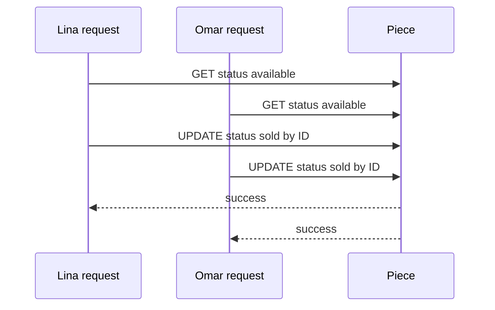

# The last-piece trap

A tempting checkout handler reads `Piece.status`, sees available, then updates it to sold after payment. Lina and Omar can both read available before either update runs. Both may be told to pay. The final database row can still say sold once, but it cannot tell which buyer had a valid claim when both Order records were created. A serial test with one buyer will never reveal this error. The problem is the gap between the read and the write.

Both updates can succeed if their filters include only `_id`. The second may overwrite hold identity or timestamp from the first. A frontend disabled button does not solve this; both clients loaded before either change. A queue in one server process is also fragile if the app runs multiple instances. The database document is the shared boundary that both processes must compete for, so the expected current state belongs in the update predicate.

## Move the decision into one conditional write

For one Piece, use a conditional update that matches `_id` and available status, then sets held status, Checkout ID and expiry together. MongoDB applies a single-document write atomically and checks the predicate against the current document. One caller matches; the other does not. Inspect `matchedCount` or the returned document. A no-match is a conflict, not a reason to retry with a looser filter. If the route retries by updating on `_id` alone, it destroys the safety the conditional claim established.

An expired hold can be treated as available in the same atomic claim if the filter permits the exact held state with `hold.expiresAt <= now` under the course's payment-expiry policy. Do not run a separate "release expired" step and then a new claim without checking that the old payment cannot still succeed. The hold identity and expiry must be recorded so the payment module can reconcile a late event. Use an injectable server clock in tests; a buyer's browser clock cannot decide whether a hold is expired.

## Distinguish Cart from hold

Lina may have added the cushion to her Cart yesterday. Omar may have added it today. Neither action owns it. The Cart stores one Piece ID, not a quantity of one. It can show the last known price and status for display, but checkout loads current Piece and Workshop shipping policy. If a Piece is sold or held, the Cart should explain why that line cannot proceed. A stale Cart is expected in a one-off marketplace; it is not an excuse to take payment and repair the inventory later.

A sold Piece can remain on a public portfolio page. Its continued visibility does not make it available again. A direct Checkout request for its ID must return a conflict regardless of what the page button shows. This test is important because old tabs and scripted clients can send requests after the UI changes. Availability is a server state, not a styling class.

## Write the failing race test first

Create one available Piece and two Buyer sessions in a disposable database. Send two claim requests concurrently and wait for both responses. Assert exactly one success, exactly one conflict, and one held Piece whose Checkout ID matches the winner. Repeat the test with the request order reversed and with a short artificial delay before each write. Do not assume the same buyer wins every run. The invariant is about counts and IDs, not a particular person.

Then run a bad implementation with a read and broad update in an isolated exercise to see both success responses. Restore the conditional route and keep the failing case as a regression test. Save the two raw responses and final Piece document. The next chapter names the full set of records this module will build around that single-document claim.

## Compare a broad and conditional update

In a disposable test, start with `{status: 'available'}`. A broad `updateOne({_id: pieceId}, {$set: {status: 'held'}})` can return a matched row for both buyers, because the second call still finds the same ID after the first changed status. A conditional `updateOne({_id: pieceId, status: 'available'}, ...)` returns one match and then zero. The difference is one predicate, but it changes the business outcome. Save both raw results and the final document so a learner can see why a later read is insufficient.

A `findOneAndUpdate` with a return-after option can give the winning caller the held document. The loser receives null. Do not interpret null as a database outage by default; it can be the expected conflict. Log Piece ID, Checkout ID and decision status on the server with private buyer data redacted. A useful 409 response tells the client which Cart line changed without revealing the winner's identity.

## Include expiry in the same decision

An expired hold does not have to be cleared by a sweeper before a new buyer claims it. A filter can match a held Piece whose `hold.expiresAt` is at or before the server's `now`, then atomically replace the hold identity and expiry. Write the predicate as two explicit eligible branches, available and expired-held, both requiring the same Piece ID. Do not use a broad `$or` that accidentally matches a sold Piece with an old expiry field still present. The update should clear or replace all old hold fields in the same write.

At the exact boundary, decide whether equality counts as expired. Then use that rule in claim route, countdown copy and fake-clock tests. The browser can display a countdown but cannot decide eligibility. A user who changes their device clock must not make a hold last longer. The payment handler also needs the Checkout identity because an old provider event can arrive after a new buyer has taken over.

## Watch the worker, too

A release job created for Checkout A may run late, after B claimed the Piece. If it updates by Piece ID alone, it can make B's Piece available to C. The release filter must include `status: held` and `hold.checkoutId: A`. A zero-match release is safe and should be logged as stale or already handled, not retried with weaker conditions. Test this with A expiry, B takeover and A release in that order. Then race B and C against the expired A hold; one still wins.

A worker can also stop after releasing some holds from a failed multi-Piece Checkout. The Checkout needs a rollback-pending state or transaction semantics so a retry knows what remains. This is not a reason to mark all involved Pieces available. Each release must prove ownership of the hold it changes. The last-piece trap affects cleanup as much as acquisition.

## Describe the visible failure honestly

Omar may feel surprised by a conflict after seeing an available page. The UI can explain that another buyer reserved the one-off Piece just before checkout and show a safe alternative. It should not say "your payment failed" when no payment was attempted. If the Piece is sold, show the sold portfolio page and an optional custom request path. If it is merely held, show temporary unavailability under the product policy. Distinct messages help the buyer decide what to do without exposing someone else's purchase.

## Audit the false success

Write the two response bodies that the naive route would return. Lina sees a successful Checkout with the cushion cover, and Omar sees another successful Checkout with the same Piece ID. The final database document can display only one buyer if the code overwrites a `buyerId` field, so inspecting that document alone can hide the duplicate promise. Count Orders by Piece ID and inspect both HTTP histories. The invariant is stronger than a final `status: sold`: at most one active Checkout may claim the one-off object, and at most one paid OrderLine may ever represent its sale. Keep the second caller's 409 in the test report.

Ask which line of the naive code made the promise too early. It was not the initial read by itself; reading a page is normal. The fault is treating an old observation as permission to write without checking the state again atomically. The next chapter puts that condition into the write filter, where the database can decide against the current Piece state.
