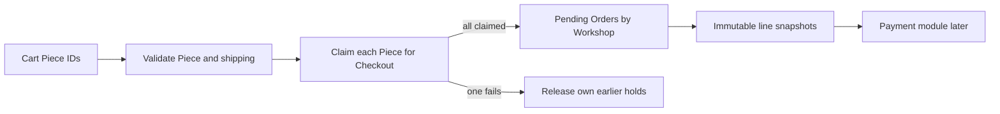

# What you will build

This module begins with a Piece hold and ends with a Checkout that can safely wait for verified payment. The main records already exist from Module 5: Piece, Cart, Checkout, Order and OrderLine. You will add transition services and routes around them. A buyer sends Cart intent; the server checks current Pieces and Workshop shipping profiles, claims every Piece for a Checkout, snapshots sale facts, and creates one pending Order per Workshop. A failure releases only holds belonging to this Checkout and returns a conflict naming the lost Piece. Module 20 then handles payment and late-success cases.

The order of operations matters. A pending Order created before holds are secured may promise a Piece another buyer won. A hold acquired without a Checkout identity cannot be released safely after a partial failure. A provider payment started before all Pieces are held may take money for an unavailable item. Write this sequence as a small state diagram and keep it beside the route while building. A code path that skips a step should have an explicit test or be removed.

## Hold one Piece with its owner and deadline

The Piece document has a finite status and a hold subdocument. The hold records Checkout ID and expiry. The claim query must include `_id` and an eligible current state; the update writes held status and the new identity together. A Workshop owner cannot casually set a held Piece back to available from a stale editor. A release operation checks both Piece ID and Checkout ID, so an old cleanup task cannot release a newer hold. These are server-side rules. The Cart UI can explain them but cannot enforce them alone.

For the core, use a fifteen-minute hold window unless the cohort's agreed policy changes it. The server clock determines expiry. Tests inject a clock rather than sleeping fifteen minutes. If an old hold is expired, a new claim may win under one conditional update. The payment module must later cancel or refund an old attempt that succeeds after takeover. This module does not call the provider; it preserves enough identity and state for that decision.

## Split Orders without splitting the buyer's payment

If Lina's Cart has a cushion from Workshop A and a cup from Workshop B, create one Checkout total and one pending Order per Workshop. Each seller sees only its own Order. The buyer sees both. Compute Piece prices and shipping by Workshop on the server in integer minor units. Do not trust a client-sent shipping amount or Workshop ID. A paused Workshop or excluded destination blocks its lines before holds begin, so the buyer can choose an alternative rather than reach a provider page with an impossible delivery promise.

Each OrderLine embeds title, price, currency, craft, approved maker credit, a safe cover photo reference, and shipping amount and handling/transit ranges shown at confirmation. The Piece ID remains for navigation and state reconciliation. A Workshop can later reprice or archive the Piece, but the OrderLine explains what Lina agreed to. The snapshot is not a second mutable listing. The next payment module will compare Checkout total to the provider amount and mark pending Orders paid only after a verified event.

## Decide the local consistency method

One Checkout can touch several Piece documents and Order documents. A MongoDB transaction can make local writes atomic when using a replica set, but the route still needs a clear response for a conflict and a provider call remains outside the transaction. The roadmap also teaches compensating release: acquire holds, and if one fails, release the earlier holds that still belong to this Checkout. Choose and test one core implementation in the build chapters. If using compensation, record a recovery state for a crash before every release completes. If using a transaction, explain why the local database must support it and how to retry a transient conflict.

The gate will ask for a two-buyer race, a multi-Workshop partial failure, scoped Order reads and snapshot immutability. A green Checkout page is not enough. Save the exact input Pieces and the final state of each document. The next chapter starts with the atomic update that gives one buyer the first Piece.

## Plan the Checkout identifiers

A buyer retry after a network drop should locate the same Checkout attempt, not create a fresh fifteen-minute hold every time. Use a stable buyer-scoped request key and Checkout ID. Each Piece.hold names that Checkout ID. Each pending Order names the Checkout and one Workshop. The buyer can read all Orders under the Checkout, while each Workshop reads only its own. These links let a support worker trace a partial failure without relying on the browser tab that started it.

A second deliberate attempt after the first expires needs a new request key. It must reprice Pieces and recheck shipping under current data. An idempotency key should prevent duplicate effects for one attempt, not freeze yesterday's offer forever. Write separate tests for same-key retry and new-key Checkout. In the first, IDs and total remain the same. In the second, a changed Piece price or ShippingProfile may produce a new offer that requires buyer confirmation.

## Decide what to freeze before payment

The server loads current Piece prices and each Workshop's shipping rules. It computes one total in integer minor units under a single currency. After the buyer accepts, OrderLines capture Piece title, craft, dimensions summary, approved maker credit, safe photo reference, price and shipping amount/range. The Checkout stores total and currency. A later Workshop price edit changes only a new offer. A later shipping-profile edit does not rewrite a paid buyer's receipt. The payment module will compare provider amount against the frozen Checkout, not current Piece data.

A Workshop may stop serving Lina's country between Cart addition and Checkout. The route should return a conflict before holds begin. If policy changes after a confirmed pending Checkout, the product needs a rule for honoring or cancelling the frozen offer. Do not silently remove one Workshop's Order and keep the same payment total. The snapshot exists so the team can see what the buyer accepted and handle the change deliberately.

## Sequence local and external work

Hold claims and Order creation happen in MongoDB. Stripe is external. A transaction can make local claims and pending records atomic on a replica set, but it cannot include the provider. If the core implementation uses compensating release, it must record rollback progress and retry after a crash. Either way, do not create a PaymentIntent until the server has a durable Checkout plan for every claimed Piece. A provider request can time out ambiguously; a stable provider idempotency key based on Checkout identity will be needed in Module 20.

The route's response should expose a pending state, not a sold state. A Workshop can see an incoming pending Order but should not ship it. A buyer can see what was confirmed and wait for payment resolution. A success-page refresh is a read; it cannot turn a held Piece sold. These state names should appear in schema and UI copy so the later webhook transition has one clear job.

## Turn the plan into a gate checklist

Before code, write the cases the gate will run: two Buyers race for one Piece, one Cart has two Workshops and the second Piece fails, a stale release runs after another Checkout takes over, a Workshop edits a Piece after an Order snapshot, and an unrelated Workshop tries to read the Order. For each case, list expected HTTP result and final database rows. The build chapters will fill in implementation, but the expected evidence should be written first.
