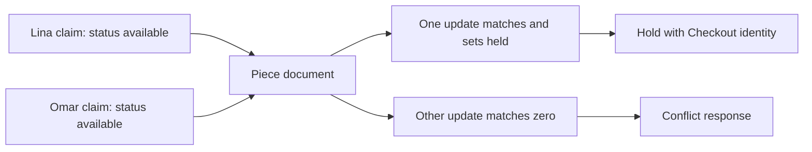

# One document, one atomic update

The single Piece is the concurrency boundary. Use `findOneAndUpdate` or an equivalent conditional update with a filter on Piece ID and eligible status, setting held state, Checkout ID and expiry in one database operation. MongoDB's single-document atomicity means the filter is checked when the write executes. Two callers can both have read available earlier, but only one can change the currently available document to held. The other receives no matching document and should return a conflict with that Piece ID.

The diagram says nothing about which buyer arrives first at the database. It says the result has one winner. A check in JavaScript before the update is useful for a friendly early message but cannot be the final guard. A unique index on Piece ID already exists, yet it does not prevent two broad updates to the same row from both succeeding. The state predicate is what makes the claim exclusive. Ask a peer to point at the exact clause that fails for the second caller.

<TraceRequest title="One cushion, two conditional claims">
  <TraceStep actor="Lina" label="Try status available" detail="Matched document becomes held for Checkout L" />
  <TraceStep actor="Omar" label="Try status available" detail="No available row remains" status={409} />
  <TraceStep actor="API" label="Report the losing Piece ID" detail="Do not start payment for Omar" />
</TraceRequest>

## Write the predicate carefully

The filter should include `_id` and either status available or a specifically expired held state allowed by the policy. The update must set `status: held`, `hold.checkoutId` and `hold.expiresAt` together. Request the post-update document if the API needs to know which claim won. Avoid a pattern that writes the hold first and status second; a crash could leave contradictory fields. Avoid a filter that checks only `_id` or only `hold.expiresAt` without state, because a sold Piece could be reopened accidentally.

The Piece's Workshop ID is also needed for later split Orders and shipping checks. Load it from the stored document, not the request body. A buyer might send a valid Piece ID with a forged Workshop ID to reduce shipping or see another seller's rates. The server decides ownership and shipping from current Piece and Workshop data. If a Piece is draft, archived or sold, the claim returns no match even if the public page or old Cart still has its ID.

## Handle a no-match as a normal product outcome

A no-match can mean the Piece is held, sold, archived, or the ID does not exist. The API may choose 409 for a known unavailable Piece and 404 for unknown or hidden ones, under the course's disclosure policy. It must not return a generic 500 or retry with a looser filter. The client should remove or mark the stale Cart line and offer a path to other available Pieces or a custom request. It should not automatically swap in a different Piece at a new price.

A no-match also must not create a pending Order or provider attempt. If the Checkout has already claimed earlier Pieces in a multi-item Cart, the route releases those own holds before returning. The losing Piece is never held under this Checkout. Store a result object that lists claimed and failed IDs so the caller and test can verify cleanup rather than relying on an exception that loses context.

## Test the exact boundary

Create one available Piece, two Checkout IDs and two concurrent update calls. Assert one update returned a document and the other returned null or matchedCount zero. Inspect the final Piece: status held, one Checkout ID and a future expiry. Reverse request order and run again in a fresh disposable fixture. The winner may change, but count remains one. Add a sold Piece and verify the same claim never changes it. Add a draft Piece and verify it remains draft.

Then test a stale release with a different Checkout ID. It should match zero and leave the winner's hold intact. This is a related single-document rule: cleanup must be as scoped as acquisition. The next lesson adds expiry and shows why a new claim can be allowed without a separate unsafe release step.

## Separate the cart read from the claim

A Cart is an expression of interest, so Lina can add the cushion cover while Omar still sees it on a public page. Neither action should set `held`. When Lina presses checkout, the route authenticates her, loads the Cart, derives Piece and Workshop facts, and attempts the conditional write. That update is the first operation that can exclude Omar. Place a log marker before and after the write in a disposable test to show the difference between a stale read and the actual claim point. Do not present the marker as a production lock: the database predicate is the lock.

In the successful result, record the exact Checkout ID that owns the hold. A later release needs that ID, and a pending OrderLine must point back to the same Checkout. If the update API returns the pre-update version by default, request the post-update document or inspect matched count and load the updated row under an appropriate consistency plan. A truthy return from an unrelated read is not proof that the claim was made.

For a failed claim, decide whether the Piece is visible to this buyer before returning details. A public Piece that just became held can receive a friendly unavailable message. A hidden draft should not reveal its owner or title. Both cases must leave the loser without an Order. This distinction belongs in route-level tests, while the concurrency test can focus on the simpler matched-count invariant.

Try an update filter that includes `status: available` but sets only the `hold` subdocument. The database will still serialize writes, yet the resulting state says available with a hold attached. Another caller can then match `status: available`. The test should fail. Restore the update that changes status and owner together. This is why atomicity applies to the whole business transition, not merely to one field.

Finally, identify the eligibility predicate for sold and archived objects. Neither should enter the expired-hold branch because they are not held. Write a table of four starting states and expected match counts: available one, active held zero, expired held one if takeover is allowed, sold zero. This table becomes the fixture matrix for the next chapter.

## Inspect an accidental broad filter

In a scratch branch, remove the status clause from the claim filter and rerun the two-buyer test. Both updates can now report a match: the second overwrites the first hold owner. The final Piece names only Omar, yet Lina may already have a pending Order. Restore the status clause and compare the results. This exercise makes the failure observable without relying on a vague warning about race conditions. It also shows why checking `matchedCount` is necessary but only meaningful when the filter encodes the business rule.

Check the return mode of the exact database API used in the project. Some wrappers return the document before the update unless configured otherwise; some return a result object with counts. Write an assertion for the expected shape. If the code assumes a post-update document and reads an old `status: available` value, it can misreport success or calculate a snapshot from stale data. The test should compare the returned Checkout ID with the stored Piece owner and fail if they differ.

Finally, separate this atomic claim from the later Order insert. One document's atomicity proves only that one Piece has one current holder. It does not make a two-Piece Cart or split Orders atomic. The lesson's output is the safe claim primitive, and the later compensation chapter supplies the group guarantee. Mark that boundary in the service interface so a route cannot treat one successful primitive call as a complete checkout.
