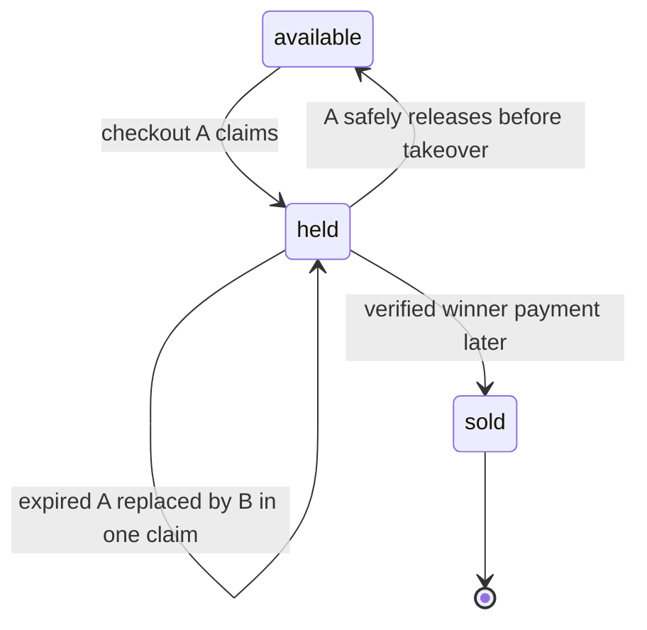

# Holds with an expiry

A buyer can close a tab after claiming a Piece. The Piece cannot remain held forever, so the hold has an expiry determined by the server clock. At a later checkout, the claim filter can match either an available Piece or a held Piece whose recorded expiry is at or before the current server time, if the payment policy allows takeover. The update writes the new Checkout identity and expiry in the same single-document operation. This avoids a gap between a separate release and claim in which another request can interleave.

The held-to-held arrow is easy to overlook. It represents a takeover after expiry, not an extension by the old buyer. The filter checks old expiry and state, then atomically replaces Checkout ID. A late cleanup job for A must compare Checkout ID and must not clear B's new hold. If a timer fires at exactly the expiry instant, define whether `expiresAt <= now` is expired and use the same rule in code and tests. Browser clocks are irrelevant.

<TraceRequest title="Old expiry job meets a new hold">
  <TraceStep actor="Checkout A" label="Hold expires at 14:15" detail="Piece remains held until a safe transition" />
  <TraceStep actor="Checkout B" label="Claim at 14:16" detail="Atomic filter sees expired A and writes B" />
  <TraceStep actor="A cleanup job" label="Try to release A" detail="Checkout ID no longer matches; B stays held" />
</TraceRequest>

## Choose the clock and duration

Use an injectable server clock in the claim service, not `Date.now()` scattered across route, worker and tests. The course family suggests a fifteen-minute default hold. Save an absolute expiry instant in the Piece document and Checkout record so both can be compared and support can explain the state. A buyer's displayed countdown is advisory; the server decides whether a claim or payment is still eligible. A client that changes its local time must not extend a hold.

The hold should include the stable Checkout ID. If a buyer refreshes the payment page, a read can show that their Checkout still holds the Piece without making a second claim. A retry with the same Checkout ID can be idempotent under a defined rule. A different Checkout ID after expiry is a new attempt, possibly by another buyer. Write separate tests for same-attempt retry and different-attempt takeover so the service does not confuse them.

## Payment may arrive at a boundary

A provider success for A can arrive after B has taken over the Piece. The payment module must not mark A's Order paid and the Piece sold to A when the Piece now names B. It should inspect hold identity and its policy, then refund the late success in test mode if it cannot fulfill A. This is why this module stores Checkout ID rather than only a boolean held flag. The course does not assume expiry means a provider payment is impossible; it plans the late-event path explicitly.

A successful payment for B also needs a conditional transition from held by B to sold. A broad update on Piece ID would let an event for A steal B's Piece. The future webhook should filter Piece ID, held status and B's Checkout identity. Keep this expectation in a test note even though the provider integration is outside Module 19.

## Test three times without waiting

Use a fake clock at 14:14, 14:15 and 14:16 for a hold expiring at 14:15. At 14:14, a different Checkout cannot claim it. At the chosen boundary 14:15, the rule determines whether takeover succeeds. At 14:16, it should succeed under the expired-hold policy. After B claims, replay A's release and verify zero rows matched. Then race B and C at 14:16: only one may take over the expired A hold. The test verifies atomic expiry behavior, not the speed of a JavaScript timer.

The next lesson asks you to predict several arrival orders before seeing code. The goal is to understand which predicate decides each outcome, not to memorize that "transactions solve races."

## Choose one clock for the decision

Store expiry as a UTC instant, not a display string. The client can show a countdown for Lina, but the server and database decide whether a hold is still eligible. If two application instances have clocks that differ, one may try an expired-hold takeover too early. The training build should compute the `now` used in the query on the server and test around the boundary with an injected clock. For a production design, document the clock-skew assumption and avoid treating the browser countdown as authority.

When a hold expires, the original Checkout can still exist in a pending state. Do not silently rewrite its Checkout ID to the new holder; record that its Piece claim is lost and make its payment path stop or reconcile. A late payment event is an important later-module problem. In this chapter, prevent stale release: the old Checkout must not clear the new holder's state. Condition release on both `status: held` and the current `hold.checkoutId`; a release that matches zero is evidence that ownership changed.

Run a three-actor fixture. Lina holds the cover until 10:00. At 10:01 Omar claims it with one conditional update. At 10:02 Lina's cleanup worker tries to release its old hold. The final Piece must remain held for Omar. Repeat with the cleanup running at 09:59; it may release Lina's own active hold if Lina canceled, after which Omar can claim. These are different histories and should not be flattened into a single sleep-based test. Use a fake clock to make each branch reproducible.

Expiry is a safety valve, not a way to promise stock forever. Choose a hold duration long enough for the buyer to complete the payment flow but short enough to return an abandoned Piece to circulation. The course does not prescribe a universal number of minutes. Make the value a named configuration with a test that verifies `expiresAt = now + duration`, and show the deadline in the buyer UI. A support team should be able to explain why a checkout failed after that deadline.

A background sweeper can tidy expired held rows, yet correctness must not depend on it running on time. The eligible-state update itself recognizes an expired hold. If the sweeper runs after Omar's takeover, it must also use the old Checkout ID in its filter so it cannot clear Omar's new hold. Add this as a regression test before moving to multi-Piece cleanup.

## Model the boundary in a table

At exactly 10:00, decide whether `expiresAt <= now` counts as expired; use that same comparison in code and tests. A mismatch between `<` in the claim query and `<=` in the UI can create a one-tick discrepancy. The buyer's countdown is approximate, but the server rule must be deterministic. Write fixtures at 09:59:59, exactly 10:00:00 and 10:00:01 with an injected clock. Expect no takeover before the boundary and one possible takeover at or after it. A sold Piece remains ineligible at every time.

Keep the Checkout deadline and Piece expiry aligned. If the Checkout says Lina has five minutes but the Piece hold expires after three, the UI promises time the server cannot honor. If the Checkout extends a deadline, it must extend only its own currently held Pieces using owner-scoped conditional writes, and it must handle an extension that fails because ownership changed. For this core lesson, avoid extension entirely: one configured duration and one displayed deadline are easier to verify. Document that choice before adding a payment timer.

A claim may match an expired hold even if a sweeper has not cleared it, but the old attempt's Order must no longer be treated as payable. Add a recovery check before a payment module is allowed to act on an expired attempt. This chapter does not implement payment, yet it must leave enough state for M20 to tell whether a provider success corresponds to a current hold or to a lost one.
