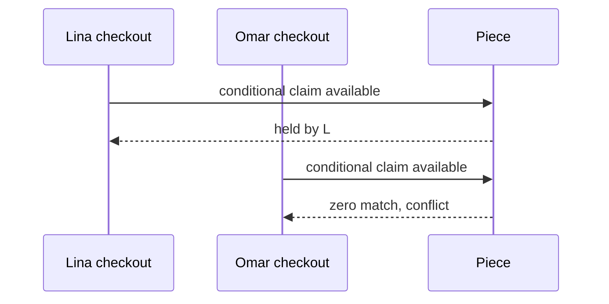

# Predict the race

Before implementing the multi-item route, predict the result of two Checkout requests against one Piece. Both buyers may have read available in their browsers. Draw events at the database boundary, not the page-load boundary. For each timeline, name the status and Checkout ID immediately before each conditional update, and say whether its filter matches. If the answer depends on which HTTP request arrived at the load balancer first, you have chosen the wrong moment: the database writes decide.

This first timeline is simple. Reverse the two claim writes and Omar wins. Then add an expired hold from an earlier Checkout A: Lina and Omar both attempt takeover at the same server time. One update changes held-by-A to held-by-L or held-by-O; the other sees a fresh expiry and fails. The original Cart timestamps do not matter. Write the final Piece document after each timeline. It should have one holder and one expiry, never a list of two buyers.

<TraceRequest title="Three possible claim orders">
  <TraceStep actor="Case 1" label="Lina write, then Omar" detail="Lina holds; Omar conflicts" />
  <TraceStep actor="Case 2" label="Omar write, then Lina" detail="Omar holds; Lina conflicts" />
  <TraceStep actor="Case 3" label="Both replace expired A" detail="One atomic write wins; the other sees a fresh hold" />
</TraceRequest>

## Predict a stale cleanup job

A's hold expires, Lina takes over, and A's delayed cleanup runs. If the cleanup filter includes Piece ID, held state and `hold.checkoutId: A`, it matches zero. If it filters only Piece ID and expired time from the old job payload, it may clear Lina's new hold. Predict both outcomes and mark the safe predicate. Cleanup code is a competing writer too; a race test that checks only two buyer requests can miss a worker that opens the Piece afterward.

Now add a payment event for A after Lina's takeover. It cannot sell the Piece to A because A no longer owns the hold. The future payment handler should detect the mismatch and follow a late-success refund policy. A payment event for Lina may sell it only while the Piece is held by Lina's Checkout. This prediction connects the hold race to money without making a browser success page authoritative.

## Predict a two-Piece Cart

Lina tries to claim Piece P from Workshop A and Piece Q from Workshop B. She claims P, then Omar claims Q first. Lina's claim of Q fails. Her route must release P only if P is still held by Lina's Checkout, return a conflict naming Q, and create no ready pending Orders or provider attempt. If a cleanup failure leaves P held, record a rollback-pending state and retry. Do not silently tell Lina the whole attempt failed while P blocks other buyers for fifteen minutes. This case tests all-or-nothing at the Checkout level, not one-document atomicity alone.

Reverse the order: Omar claims Q before Lina begins. A validation pass may notice Q unavailable and avoid claiming P, but it cannot rely on that read for safety because Q could change after validation. The claim and cleanup path still needs to work. Sort Piece IDs before acquisition to make behavior predictable and reduce contention, while accepting that the database decides each contested Piece.

## Check your prediction against code later

Save your three one-Piece timelines and the two-Piece failure in the learning log. When the build chapters implement claims, run them as concurrent tests and compare actual winner IDs and final states. If a test passes only when request A always starts first, rewrite it to assert the invariant rather than a particular buyer. The next chapter widens the scope to several Workshops and asks when to use a transaction versus compensating release.

## Make three timelines, not one story

First, Lina and Omar both read the available cushion cover before either starts checkout. Lina's claim reaches MongoDB first. Write the two outcomes next to the database operations: Lina gets a held Piece and Omar gets no match. Their earlier page reads have no bearing on the outcome. Second, reverse claim arrival while keeping the same page-read order. Omar wins. A test that always asserts Lina wins would be testing scheduler luck, not the invariant.

Third, let Lina hold the Piece until 10:00. At 10:01 Omar and a cleanup worker race. Omar's takeover and the worker's release must both include ownership conditions. If Omar wins first, the worker's old-owner release matches zero. If the worker wins first, it clears Lina's expired hold, and Omar can subsequently claim available. In both histories Omar may become the sole holder; no path should leave two active claims. Draw the order of actual database writes under each outcome rather than assuming the background job runs first.

For each timeline, include the HTTP response to the losing buyer. A 409 with the lost Piece ID is useful because the Cart can mark the exact line. A generic success followed by an eventual refund does not satisfy the checkout invariant. Also record whether any pending Order was created; it must correspond only to a successful set of holds. This catches a route that creates Orders before checking the Piece claim.

Use a barrier in the test harness so both calls begin from the same setup, then call the real route concurrently with distinct sessions and Checkout IDs. Do not use a fixed timeout as proof of simultaneity. Run the test many times if the environment allows, but make its assertion independent of which buyer wins. Restore a fresh Piece between iterations, or prior results will bias later runs. Count held owners and Orders by Piece ID after each round.

The exercise exposes one limit of a single Piece's atomic write: if a Cart contains a cover from Amina's Workshop and a tray from Kareem's Workshop, the first claim can succeed while the second fails. That is not a double sale, but it is still a broken checkout if the first hold lingers. The next chapter coordinates those separate documents without pretending they form one atomic write.

## Explain the observation gap

A trace log may show that Lina's request entered the API first, but Omar's database write can still be evaluated first. Threads may pause for validation, network reads or scheduling. Compare three timestamps: request received, claim operation started, and claim result returned. Only the database result determines the holder. Do not turn timestamps into a lock or assume they totally order operations across machines. Their value is diagnostic: they help explain a losing request without changing the invariant.

Try a fourth timeline with the same buyer double-clicking Pay using the same request key. This is different from Lina versus Omar competing for stock. Both calls should resolve to one Checkout attempt and one hold owner, rather than one successful Checkout and one confusing self-conflict. Use the unique buyer/request-key constraint to identify the same attempt, then return its existing state. If the second request uses a new key, it is a new attempt and should see the active hold as unavailable unless the route deliberately supports replacing its own attempt. State which policy the build uses.

Write the invariant in a sentence that a test can count: for any Piece, no more than one current active hold owner, and no more than one pending payable OrderLine tied to that active hold. The first clause concerns the Piece document; the second concerns the route's sequencing and recovery. Both are necessary because a route can avoid double holds yet still insert two Orders from stale preflight results.

The learning log should include one table row per timeline with the initial Piece state, write arrival order, matching claim, losing response and final hold owner. The table can reveal when a learner has accidentally treated an earlier page read as a reservation. Use the same Piece ID in each narrative but a fresh fixture per test run, so the explanation stays comparable without state leaking between cases.
