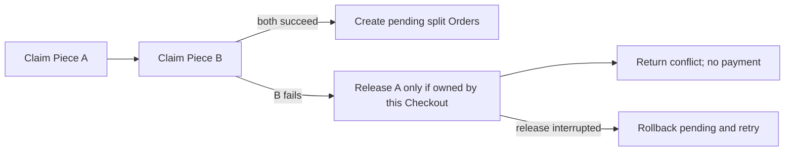

# All or nothing across workshops

A one-document conditional update protects one Piece. A Cart can contain Pieces from several Workshops, so one Checkout may need several claims and several pending Orders. MongoDB does not make separate writes to different documents atomic as a group without a transaction. If the second claim fails, the first claim must be released or the whole transaction aborted. If the server stops during cleanup, a recovery job must finish the release. The system should never charge for a combined Cart while only one of its Pieces is actually held.

The release must be scoped by Checkout identity. A broad `status: available` update on Piece A can undo another buyer's newer hold if A's original hold expired and someone took over before cleanup ran. Check `_id`, `status: held` and `hold.checkoutId` equal to the failing Checkout. If no row matches, do not force it; inspect whether the Piece was already released, sold or taken over. Record enough state on Checkout for a worker to reconcile interrupted cleanup.

<TraceRequest title="Second workshop Piece disappears">
  <TraceStep actor="Checkout L" label="Claim Workshop A Piece" detail="A now held by L" />
  <TraceStep actor="Checkout L" label="Claim Workshop B Piece" detail="Another buyer already holds B" status={409} />
  <TraceStep actor="Checkout L" label="Release own hold on A" detail="Filter on Checkout L, then return conflict" />
</TraceRequest>

## Choose a core method honestly

A MongoDB transaction can make claims and pending Order inserts all-or-nothing if the local database is a replica set or sharded cluster. A transaction still uses conditional predicates on each Piece to prevent two buyers from both claiming it. It also has retry behavior for transient conflicts. External Stripe calls cannot be rolled into the database transaction. The course family recommends a local single-node replica set for teaching transactions; verify that setup before making the transaction the core path.

The roadmap also teaches compensating release. Claim Pieces in a deterministic order, and if any claim fails, release the ones this Checkout acquired. If a release fails or the process stops, mark Checkout rollback-pending and let a worker retry with the same identity. This approach works across separate writes but requires more recovery logic. Explain why a simplistic `finally { set all pieces available }` block is unsafe: it can release Pieces that this Checkout never owned or that have been taken over since.

Pick one implementation for the learner build and test the alternative as a design discussion. Do not claim transaction atomicity while running standalone MongoDB, and do not claim compensating release is instantly all-or-nothing if cleanup can fail. The gate will inspect the final records after forced failure and retry. If the implementation uses transactions for local writes, still preserve Checkout IDs and expiry for payment integration and worker cleanup after a committed hold.

## Calculate shipping before claiming

A Workshop may not ship to Lina's country. Check each Workshop's current ShippingProfile and paused state before acquiring holds, so an impossible destination does not temporarily block Pieces. This precheck is not a concurrency guarantee; shipping policy could change, so the route should freeze accepted shipping terms when it creates Orders and follow a documented rule if the Workshop later changes its profile. Use server-calculated shipping in minor units per Workshop, then sum into one Checkout total. A client-sent shipping amount is not authority.

If one Workshop is excluded, return a clear line-level conflict without payment. The buyer may remove that Piece and retry. Do not quietly drop it and charge for the rest, because the buyer may have chosen the Cart as one purchase. A later UI can offer a revised Cart, but the buyer confirms it. This is the same principle as a stale Piece price: the server owns facts, and the buyer accepts a new offer.

The next chapter checks your understanding with concrete timelines. Then the build chapters implement the chosen method, split Orders and a race test. Keep the local consistency boundary distinct from the later provider event; a database transaction cannot make Stripe and MongoDB commit as one operation.

## Draw the partial failure

Lina's Cart contains a cushion cover from Amina and a tray from Kareem. The route claims the cover, then finds the tray has already been held by Omar. If the route returns 409 immediately, Amina's cover remains hidden from other buyers for the full hold duration even though Lina could not purchase the Cart. Put this trace in a test fixture and inspect both Piece documents after the response. A clean failure releases the cover using Lina's Checkout ID and reports the tray ID as lost. It must leave no pending split Orders.

A release can also fail because the process stops. Persist a Checkout state such as `rollback_pending` with the list of holds claimed so a retry or worker can finish releasing them. Each release remains conditional on that Checkout ID. If expiry has already let another Checkout take a Piece, the old rollback must match zero and move on; it must never force status to available. The recovery worker is safe to rerun because a second release also matches zero. Record cleanup progress and expose it in logs so a stuck hold is diagnosable.

A MongoDB transaction can bundle the Piece updates and pending Checkout/Order writes, but it requires a deployment that supports transactions, including replica-set configuration for a local MongoDB training environment. The session must be passed to every participating operation. An external payment provider cannot join that transaction. If the local course build uses compensation instead, say so in its architecture note and exercise crash recovery; several independent writes are not the same as a database transaction. This module uses explicit claim-and-compensate in the main lesson, with transactions as a justified alternative if the project setup is changed.

Do not let the payment step start while `rollback_pending` or partial claims remain. A buyer whose Cart failed must not be charged for the cover that was released. For a successful multi-Workshop Cart, create one pending Order per Workshop only after every Piece is held by the same Checkout and the snapshot totals match. Keep those Orders pending through this module. The next module will decide what happens after the payment provider reports success, timeout or late success.

There is a second failure shape: all holds succeed and then inserting one Workshop Order fails. The route still needs to unwind its own holds and any partial pending records or make a recovery record that can do so. Force this exception in the test adapter after the first Order insert. Assert the final Checkout is not payable, and rerun recovery twice to prove it is idempotent. The gate will make this scenario part of the evidence, rather than accepting only the easy case where the second Piece was unavailable.

## Name the decision after cleanup

If the Cart fails on Kareem's tray, Lina's response can say the checkout did not proceed only after Amina's cover has been released or a durable recovery state makes the remaining hold non-payable. A response that promises full rollback while the process has lost database connectivity is misleading. Store the failure reason, expose a retryable attempt status and let the cleanup worker complete its owner-scoped releases. The buyer can be told to wait or start a new attempt after recovery; the UI should not send the old attempt to payment.

Transactions can reduce this recovery surface, but their scope must include every relevant Piece and pending Order write. A transaction that wraps Order inserts while Piece claims occur outside it leaves a partial-hold gap. Review the operation list and the session passed to each one. If a duplicate-key error aborts the transaction, the route should surface a conflict rather than retrying forever. In the compensation route, a duplicate Order key should lead to a lookup of the existing same-Checkout Order and a consistency check, never a second Order for that Workshop.
