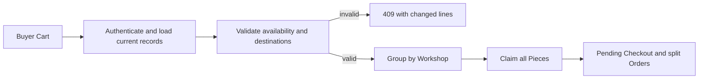

# Checkout route

Build `POST /checkouts` for an authenticated buyer. Lina's Cart contains one cushion cover from Amina's Workshop and one tray from Kareem's. The browser sends Piece IDs, selected shipping destinations and a stable request key. It may display totals for confirmation, but the server loads current Piece, Workshop and shipping facts. The response is either a complete pending Checkout with one pending Order per Workshop, or a conflict with no payable attempt. This route does not call a payment provider; that belongs in the next module.

## Define the request boundary

Start from the session's buyer ID. Load the Cart owned by that buyer, or parse a submitted list of Piece IDs against an authenticated Cart if the existing app uses that shape. Never accept `buyerId`, `workshopOwnerId`, Piece price, artisan credit or a final shipping amount from the client as authority. Each Piece ID must be unique in the request, because one-off objects do not have a quantity greater than one. Reject duplicate IDs explicitly; silently coalescing them can hide a broken UI or a crafted request. A custom request or quote is a different purchase path and should not be interpreted as a ready-made Piece ID.

Require a stable request key for retrying the same buyer decision. Store it with buyer ID under a unique database constraint so a double click or lost response returns the same Checkout. If the existing Checkout is complete, return its current pending summary. If it is `rollback_pending`, run or schedule recovery before allowing a new attempt with that key. A new key signals a new decision, so re-read and revalidate every current Piece. Do not use an in-memory cache to enforce request identity across server processes.

## Build a normalized plan

Load all Pieces and their Workshops. For each line, record Piece ID, Workshop ID, current price in integer minor units, currency, craft and maker credit. Require `status: available` or an eligible expired hold according to the chosen policy; the later atomic claim repeats this check. Verify the Workshop is active and its shipping settings allow the buyer's country or region. If the Workshop has paused shipping, report that line before claiming anything. A UI warning is helpful, but only the server's present settings decide whether checkout proceeds.

Group the plan by Workshop ID. Shipping belongs to a Workshop shipment, not to each Piece independently unless the Workshop's rule explicitly says so. Derive a shipping amount and the advertised range for each group from server-side policy. If Amina can ship to Lina's region but Kareem cannot, reject the entire Cart. Do not charge only the Amina group without renewed buyer approval. The response should identify Kareem's group and the reason, without exposing private Workshop configuration or another buyer's details.

## Separate preflight from the guarantee

The normalized plan is a useful preflight snapshot, but it is not a reservation. Amina could archive the cushion cover or Omar could claim it after this read. Pass the Piece IDs and expected offer terms into the hold procedure in the next chapter. Each conditional claim must verify current eligibility and, where prices or listing versions can change, either check the expected version in the write predicate or revalidate inside an appropriate transaction. If terms change while claims are being made, unwind the claims and send a conflict asking Lina to confirm a new offer. Never quietly write an OrderLine using a price the buyer never saw.

Choose an amount calculation that does not use floating-point currency arithmetic. For two Workshops, sum each group's Piece amounts and shipping amount in integer minor units, then sum group totals into the Checkout total. Demand one currency for this core build. If the project later supports conversion, that requires an explicit rate, time and disclosure policy, not a hidden addition in this route. Assert the sum of pending Order totals equals Checkout total before the response is considered ready.

## Return the pending plan

A successful response includes Checkout ID, status `pending_payment`, deadline, total and currency, and buyer-visible Order summaries grouped by Workshop. Each Order has its own shipping amount and range. A maker later sees only the Order for their Workshop; the buyer sees all their own Orders. The route should not mark a Piece sold or expose payment success. `held` means a time-limited exclusive claim, not a completed purchase. A paid state requires the later webhook and reconciliation work.

Use a 409 response for a known stale or unavailable Piece and include its ID and a safe reason, such as `already_held`, `sold`, `shipping_paused` or `destination_unavailable`. Use the course's disclosure policy for hidden or deleted records; a public route should not reveal a private draft's title. If an internal store fails, return a retryable server error and keep a durable recovery state for any holds already taken. Do not return a success body while one group's status is uncertain.

## Exercise and inspection

Seed Lina, Amina and Kareem, one available Piece per Workshop and two shipping policies that allow Lina's destination. Submit a valid Cart and inspect one Checkout and two pending Orders after the hold procedure is connected. Verify both Pieces have the same Checkout ID and a future hold expiry. Change Kareem's shipping policy to paused, submit a fresh request key, and assert no new holds or Orders appear. Then change a Piece price between Cart display and request. The route should explain the changed offer and wait for Lina to confirm it before creating a payable Checkout.

Send a forged request body with a low `total`, a Workshop ID for a cheaper shipping zone and another buyer's ID. None of those fields should change the server plan. Confirm the response uses Lina's session, actual Workshop ownership and current allowed shipping rule. Finally, run two concurrent requests with the same request key. Both should resolve to the same Checkout ID, with no second set of Orders. The next chapter implements the claim-and-compensate operation that turns this plan into a reliable all-or-nothing reservation.

## Contract notes for the implementation

Write the route's shape in a short API contract beside the code. State the request key scope, expected offer version or confirmation field, response statuses and the precise meaning of `pending_payment`. If the existing application names statuses differently, map to those names consistently in models, route and tests. A mismatch such as `pending` in the database and `reserved` in the UI can make the buyer believe a sale is final. The contract is a tool for review: a teammate should be able to point from each state transition in the route to an assertion in a test.

Keep the provider adapter absent from this module's unit test. A fake payment success would mask the real open question of late events after a hold expires. The checkout route is complete for this module when it creates a durable, scoped, internally consistent pending plan and refuses invalid alternatives. The next module will own one provider attempt, its webhook and the sale transition.

## Review a concrete split

For a cover priced at 2,400 and a tray priced at 3,100 minor units, with 500 shipping for Amina and 700 for Kareem, the expected pending Orders are 2,900 and 3,800. The Checkout total is 6,700. Put these numbers in a route test. Then forge a browser total of 6,000; the server should still calculate 6,700 or return a changed-offer conflict, according to the acknowledgment contract. This small arithmetic fixture makes grouping errors visible: if shipping is added per Piece or a Workshop group is omitted, the exact sum fails.
