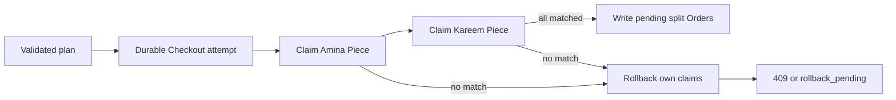

# Hold every Piece or none

Implement the reservation procedure behind `POST /checkouts`. Lina wants a cushion cover from Amina and a tray from Kareem. The route must never show a payable Checkout for only one of those Pieces. It can return a complete pending plan when both claims succeed, or a conflict that unwinds claims this Checkout already made. The winner of a one-off Piece is decided by the current database state, not by the Cart page or the order in which the API received requests.

## Choose the attempt identity

Create a Checkout ID before the first claim. It is the owner token for all Piece holds in this attempt and the stable key used by cleanup. Pair it with the authenticated buyer ID and the idempotency request key under a unique index. An HTTP retry with the same key must find the existing attempt and resume or report it, rather than taking a second set of holds. A different buyer cannot reuse Lina's key to inspect or cancel her Checkout; always scope lookup to the session buyer. The attempt starts in a state that means it is assembling, not payable.

Choose a deterministic Piece ID order before claiming. Sorting does not make the sequence atomic, but it makes logs and tests reproducible and reduces avoidable contention if another request uses the same ordering. For each Piece, perform a conditional `findOneAndUpdate` that matches `_id` and either `available` or an expired `held` state according to the module's policy. Set status, Checkout ID and expiry in one write. Ask for the updated document to capture the actual Workshop and offer terms. If price or version differs from the buyer-approved plan, treat it as a conflict and release this Checkout's own claims.

## Record enough for recovery

After each successful claim, persist its Piece ID in the Checkout attempt or make it recoverable by querying Piece holds for that Checkout ID. A process can stop between claiming Amina's cover and trying Kareem's tray. If no durable record connects the hold to Lina's attempt, the system can wait only for expiry and cannot tell the buyer what happened. Persisting progress brings its own ordering problem: the process might stop after the Piece update but before adding the ID to an array. Querying by `hold.checkoutId` during recovery closes that gap, provided the hold field is indexed or the operational scale is understood. A transaction is another way to close it, but this build chooses an explicit compensation path and tests the gaps.

The success branch is reached only after every Piece reports a successful claim and the current offer terms remain accepted. The total number of claimed unique Piece IDs must equal the number of planned IDs. Create the pending Order snapshots in the next chapter, then transition the Checkout to `pending_payment`. If the process stops during Order creation, it must not leave the Checkout marked payable. Its recovery state must either finish the exact same pending plan or unwind the holds and partial Orders. Do not infer completion merely because one Order exists.

## Release only what this attempt owns

When a claim fails, set the attempt to `rollback_pending` before returning a terminal failure. For every Piece currently held by this Checkout ID, issue a conditional release that matches `_id`, `status: held` and `hold.checkoutId` equal to this Checkout. Clear the hold fields and return status to available. If the match count is zero, inspect whether the Piece expired and another Checkout took it, or whether it was already released. Neither case authorizes a broad update. Repeating the rollback should have the same safe result, which lets a worker retry after a crash.

Report all lost Piece IDs that can be safely identified. A 409 body can distinguish one `already_held` Piece from an `offer_changed` Piece, while keeping another buyer's Checkout ID private. If cleanup is still pending because the store was unavailable, do not claim that the Cart is ready to retry immediately. Return a retryable state or error tied to the attempt and let the recovery worker finish. The buyer should not start payment for a partially reserved Cart.

## Exercise the three failure windows

First, make Kareem's tray held by Omar before Lina begins. Lina claims Amina's cover, fails on Kareem's tray, then releases the cover. Inspect final Piece documents: Amina's is available, Kareem's remains held for Omar. There are no payable Orders for Lina. The response names the lost tray and uses a conflict status. If the route instead leaves Amina's cover held, the test has caught an all-or-nothing failure even though there is no double sale.

Second, force a process error immediately after Amina's claim. Restart the recovery function using Lina's Checkout ID. It should discover and release Amina's hold without clearing Omar's or any later holder's claim. Call recovery twice to prove the second pass is harmless. Inspect the attempt state after each pass; a terminal `failed` state should be reached only when there are no holds owned by that attempt and no partial pending Orders. A log line alone is not evidence of completion.

Third, let Lina's hold expire, allow Omar to take over, then run Lina's delayed rollback. Omar's Checkout ID must remain on the Piece. This scenario catches a tempting implementation that releases by Piece ID alone. Use a fake clock rather than sleeping through a real hold duration. Also test a sold Piece in the same code path: neither a new claim nor a rollback may reopen it. The tests should assert statuses and owners, not just HTTP codes.

## Decide the transaction alternative explicitly

MongoDB transactions can provide an atomic local boundary for claims and pending Orders if the deployment supports them and every operation uses the session. A transaction can abort the whole multi-document attempt rather than using compensation, but it does not make an external payment provider part of that commit. This course build uses claim-and-compensate because it makes the recovery obligations visible. If the project adopts transactions later, change the architecture note, fixtures and local MongoDB setup together. Do not add a session argument to one write and call the whole sequence transactional.

Use one test that injects a failure after the first pending Order insert, once those Orders are implemented. The recovery path must identify and remove or cancel the partial record as well as release holds. Do not mark a split Order paid, shipped or sold in this module. A later payment webhook may arrive after a hold expires, and M20 must reconcile and possibly refund it. This lesson's claim is narrower: a pending attempt is either fully reserved for its payment window or safely unwound.

## Review the code as a state machine

Draw the Checkout states next to the actual route functions: `assembling`, `pending_payment`, `rollback_pending`, `failed`, and later payment states. For each arrow, name the actor and the database condition that permits it. In particular, a generic retry cannot move `rollback_pending` to `pending_payment` merely because a Cart still contains the same IDs. It must verify it owns every current hold and that the agreed snapshot terms are unchanged. Reviewers should be able to find one function responsible for transition validation; scattered status assignments make races hard to reason about.

Commit the conditional claim, scoped release, retry lookup, durable recovery and the three failure-window tests. Include a short trace of the two-Workshop failed attempt in the pull request or learning log. The following chapter freezes the successful attempt's OrderLine details so later listing edits cannot rewrite Lina's agreement.
